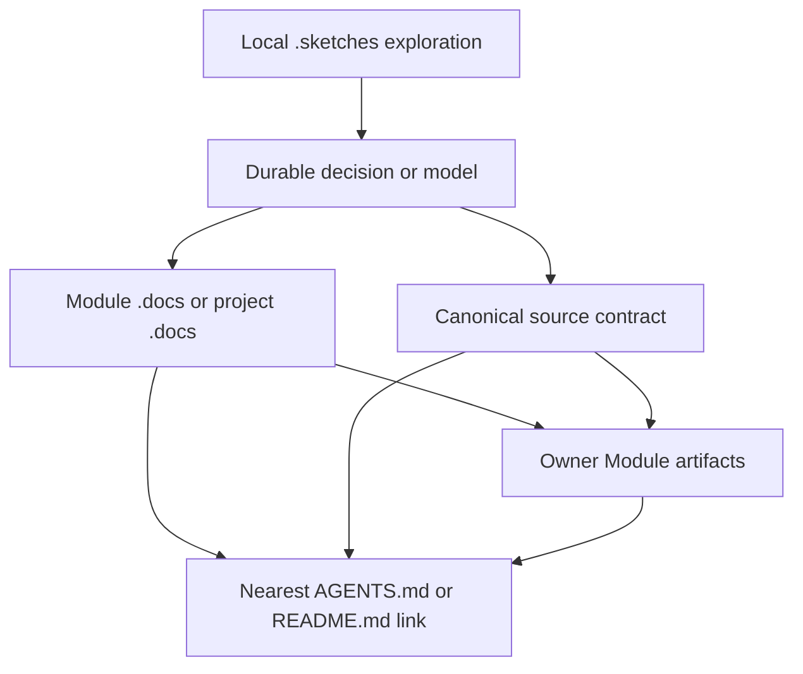

# Documentation Guide

Read the sections matching the artifact you are writing or changing. These conventions apply to independent and delegated work; a small edit needs only the relevant section.

## Structured and model-based expression

Prefer structured, semi-structured, or model-based expression when it makes documentation more precise and information-dense. This applies to design documents, requirements, explanations, decisions, task records, and agent guidance. Identify the concepts and their relationships first, then choose the simplest form that exposes them clearly. Combine a model with short prose for its purpose, rationale, and interpretation.

| Content to express | Suitable form | Make explicit |
| --- | --- | --- |
| Quantities, constraints, invariants, or optimization goals | Mathematical model: equations, inequalities, sets, or predicates; e.g. `0 <= used <= capacity` | Symbol definitions, units, domain, assumptions, and boundary conditions |
| Transformations, behavior, or callable contracts | Function model: `f: (Input, Context) -> Result`, with preconditions and postconditions | Inputs, outputs, failure cases, side effects, and guarantees; distinguish conceptual notation from executable code |
| Collaboration, user flows, protocols, or lifecycle behavior | Interaction model: actor/action/response tables or `state + event + guard -> next state + effects` | Participants, ordering, conditions, state changes, and relevant failure or cancellation paths |
| Dependencies, topology, sequences, or state transitions best understood visually | Mermaid flowcharts, sequence diagrams, or state diagrams | Node and edge meaning, direction, boundaries, and branch conditions; choose the diagram type to match the relationship |
| Entities, configuration, examples, mappings, or decision rules | Data expressions: typed records, schemas, JSON/YAML, or decision tables | Field meaning, types, required/optional status, allowed values, and whether the expression is an example or a normative contract |

Choose only the forms that help the reader; a document does not need every model type. Define notation near its first use and retain assumptions, exceptions, uncertainty, and decision rationale rather than compressing them away. Mermaid is a rendering format for a model, not a substitute for deciding what the model means. Use plain prose for simple facts or reasoning that would become harder to read as notation. Link canonical schemas, contracts, and models instead of maintaining parallel copies in prose, diagrams, and code.

When these expressions are used to carry out a method, retain their actual conclusions and open questions through [method working records](./scenarios/project-context.md#make-method-execution-explicit). The model describes the subject; the working notes show what has been established and what remains to do, without imposing another template or copying the model.

Express simple content directly. For new models, complex relationships, interacting states or multiple dimensions, apply [visual model communication](scenarios/interactive-design-communication.md): derive a polished, componentized panoramic HTML file from the domain model, composing professional visual forms such as Mermaid, SVG, Canvas, chart libraries or 3D renderers, and use interaction to explore it while retaining context. Keep source ownership and update the shared view when discussed meaning changes.

### Architecture and interface diagrams

For module, interface or dependency design and review, create or update a focused model diagram as a working artifact. Prefer Mermaid embedded in the owning Markdown design, review or task-linked document. Reuse an accurate existing diagram and record the scope confirmed against it; do not redraw unchanged models or turn an unrelated bounded edit into a new architecture exercise.

Choose the view by the relationship being examined:

| Question | Preferred view | Make explicit |
| --- | --- | --- |
| What interfaces, Services, Entities and types exist, and how are they related? | Mermaid `classDiagram` | Relevant attributes/state, operations/events, type relationships and public boundaries; boxes can represent module/interface roles without requiring class implementations |
| Which modules depend on, use or compose which capabilities? | Mermaid `flowchart` as a module/dependency graph | Scope, directed edges and labels distinguishing imports, calls, implementation and wiring |
| In what order do participants call, respond or emit events? | Mermaid `sequenceDiagram` | Participants, public operations, relevant results/failures and ordering |
| Which states and events permit which behavior? | Mermaid `stateDiagram-v2` | States, triggers, guards and relevant outcomes; connect detailed transition rules through canonical links |

A static interface/type view does not establish runtime ordering, and an import graph does not establish all interactions. Use complementary views only when they resolve different questions; do not require every diagram type. Represent database relationships separately when their storage meaning differs from domain relationships.

Keep diagrams small and semantic. Identify whether a view describes current, proposed or partially verified structure; explain edge meanings and mark unresolved relationships. Link authoritative contracts/types and record the examined scope, conclusion and next unresolved question beside the diagram or through the existing task. Update affected views when the model changes; a rendered diagram alone does not establish correctness.

Use syntax supported by the project's renderer and check rendering with existing tooling when available. If only source/syntax was inspected, record that limit. Official syntax references: [class diagrams](https://mermaid.js.org/syntax/classDiagram.html), [flowcharts](https://mermaid.js.org/syntax/flowchart.html), [sequence diagrams](https://mermaid.js.org/syntax/sequenceDiagram.html), and [state diagrams](https://mermaid.js.org/syntax/stateDiagram.html).

## Agent entry points and context

- Apply the [expression guidance](#structured-and-model-based-expression) to agent instructions. Make conditions and routing explicit with decision tables, routing rules, diagrams, or linked file trees. Readers must be able to tell what always applies, what is conditional, and where deeper context lives.
- Apply progressive disclosure. Keep automatically loaded guidance focused on common behavior and discovery, project entry points focused on local navigation, and detailed methods in scenario or role guides. Keep each rule in one authoritative location.
- Keep artifact catalogs in the owning [Module's artifacts](#module-artifacts); link its carrier with a reading condition instead of embedding its entries in automatically loaded guidance. Retain actionable rules and scenario routes in the entry point.
- Verify routing coverage when adding or changing guidance: relevant scenarios must have a discoverable route; overlaps must mean intentional composition rather than contradictory instructions. Check entry paths and conditions, not only whether links resolve.
- Distinguish scenario from role. An independent agent may need design guidance, and a delegated agent may need only a narrow implementation section. Reading a guide does not authorize delegation or require unrelated guides.
- Prefer a shallow, well-linked tree. Each guide must state its scope and be understandable without requiring the reader to load every parent document. Do not create circular reading requirements or repeatedly reload an already-read entry point.

## Professional Agent profiles

A professional profile is a reusable guidance entry, not a running Agent, a Skill installation or a Task. Use the existing domain AGENTS.md to aggregate cohesive responsibilities, selected methodology, Skill/tool routes, professional decisions, workflow and structural outputs. If several distinct roles need separate contracts, use the domain's existing roles area; a simple profession does not require another directory or file.

Keep shared methodology in the reusable guidance source. Put project-specific environment, tools and access bindings in the project's .agent-guides/local/domains or the owning module's existing local guidance. Link its concrete location through the nearest AGENTS.md or .xmeta artifact map, with applicability and explicit composition/replacement scope. Directory proximity alone does not override another profile.

Use [professional-Agent construction](scenarios/professional-agents.md) for selection and usability. Keep evidence and selection rationale in the owning design/task; keep live instance identities, assignments and runtime state in the Controller/backend records. Do not maintain a second global skill catalog or permanent worker status in the profile.

## Layered module context and local artifacts

Apply [structure as architectural expression](./code-structure.md#directory-hierarchy-as-a-module-map) to the documentation system itself. A path such as `billing/.docs/designs/pricing.md` communicates an owner, artifact kind and topic; `.sketches/` signals exploratory work. Choose names and nesting that make reading and writing destinations evident before adding explanatory rules. Keep prose for meanings, rationale and constraints that the layout leaves unclear.

Treat context as a hierarchy. The project entry explains global conventions and destinations; the nearest module or directory `AGENTS.md` adds rules and routing for its subtree; a `README.md` explains what the local code or artifacts are for and how to use them; focused documents and source contracts carry the detail. A child entry point inherits parent rules unless it explicitly narrows or replaces a rule within its scope, and it should link upward rather than copy project-wide guidance.

Use local context files when a directory has a meaningful responsibility, public contract, workflow, or vocabulary that a fresh agent needs to understand. A small directory can rely on its parent; do not create empty `AGENTS.md` or `README.md` files everywhere. `AGENTS.md` is for actionable behavior, boundaries, and routing. `README.md` is for orientation, setup, examples, and usage. A [Module carrier](#module-artifacts) describes the directory and may own its artifact catalog. Neither entry point should silently become a duplicate task tracker or a second source of truth.

Choose ownership and artifact lifecycle separately: first identify the narrowest meaningful scope responsible for the decision, then choose exploration, durable documentation, or an executable contract. When a decision spans children of one owner, record their shared decision at that owner and retain child-specific detail locally. Prefer [subject colocation](./code-structure.md#ownership-and-colocation) for new subject-specific documentation; a sibling `Subject.spec.md` may suffice. Preserve existing authoritative central documents through clear ownership and links rather than relocating them for a routine change. A directory example does not determine ownership.

Any module or directory, including a page, feature, pattern, or component boundary, may add these optional artifact areas when its scale and workflow justify them:

| Area | Role | Lifecycle and constraints |
| --- | --- | --- |
| `.xmeta.yaml` or `.xmeta.md` | One Package carrier for directory identity and optional artifact navigation | Use artifacts for destinations and reading or writing conditions; keep content and live status in their owning artifacts. See [Module artifacts](#module-artifacts). |
| `.sketches/` | Local exploration, discussion notes, research, experiments, and draft task ideas | Working material; subdirectories such as `discuss/`, `research/`, `experiments/`, and `tasks/` are optional cues, not a required schema. Promote durable conclusions to `.docs/`, source contracts, or the owning task record. |
| `.docs/` | Durable documentation owned by the local module or directory | Use meaningful topic/type groupings such as `designs/` or `specs/` only when they improve retrieval. Use the owning Module's artifacts for the catalog; retain direct task-specific routes where useful. The project Module locates project-wide decisions. |
| `uiux/` or its established equivalent | Scoped UI/UX presentation rules, token/theme data and visual/motion resources | Use the product home for shared resources and subject-local collections when useful. Follow [design-resource ownership](./domains/webdevelopment/design-system.md#design-system-artifacts-and-structure); functional/interface/state documents keep their own authority and link to the presentation resources. |
| `.tools/` | Small scripts or utilities scoped to the local module | Keep usage and side effects discoverable in the nearest `README.md` or `AGENTS.md`; follow project tooling and permission rules. Do not hide required application behavior or canonical state in an ad hoc tool. |

Add only the local areas that reduce discovery cost. Organize them by useful topic or purpose and keep exploratory notes, normative contracts, live task state, generated output, and executable tools distinguishable. For example, if `pages/` owns a page composition model, `pages/.docs/` may hold it; a nested page may independently use `.sketches/` while exploring a flow. These are separate placement examples, not a scaffold to create at every level. Promotion from a sketch to a durable design changes its lifecycle; it does not automatically broaden its ownership.

Use the artifact's semantic form to match its information: Mermaid for topology, flows, and state transitions; mathematical or function notation for constraints and behavior; class or relationship diagrams for ownership; YAML, JSON, or schemas for structured state and data; and prose for rationale and interpretation. A file name such as `thing.design.md`, `thing.spec.md`, `thing.interface.md`, or `thing.state.yaml` may provide a useful cue when it matches local conventions, but naming alone does not establish authority or validity.

Read the nearest entry point first, then follow only the Module catalogs and artifact links relevant to the current task. Do not scan every `.sketches`, `.docs`, `.tools` or Module catalog by default, and do not treat a sketch, generated file, or example schema as normative until its owning entry point identifies it as such.

## Artifact placement rules

These are Agent-facing conventions for choosing where new information belongs across the project. They describe possible layouts, not resources that every directory contains. Choose the narrowest meaningful owner first, then consult that Module's concrete artifacts and reuse an existing destination before creating another.

| Information | Placement convention | Apply when |
| --- | --- | --- |
| Directory identity and local catalog | `<owner>/.xmeta.yaml` or `<owner>/.xmeta.md` | A directory has independently useful context or a catalog; use one carrier and list only its concrete resources in artifacts. |
| Durable designs and specifications | A subject-adjacent file such as `<owner>/<subject>.spec.md`, or `<owner>/.docs/` for a useful document collection | Keep local decisions with the subject and shared decisions with their common owner. Group further only when retrieval benefits; link canonical executable contracts. |
| Design-system documents and resources | The existing presentation-system home, otherwise `<owner>/uiux/` | The product or subject needs a coherent presentation-resource collection; use [shared/local homes](./domains/webdevelopment/design-system.md#shared-and-local-homes) and avoid duplicating canonical design documents in `.docs/`. |
| Exploration | `<owner>/.sketches/` | Keep discussion, research, experiments and draft task ideas here; promote durable results and keep live task state in its owning record. |
| Local tooling | `<owner>/.tools/` | A repeatable local operation needs a helper; document its usage and side effects in the nearest entry point. |
| Roadmap | The existing authoritative home, otherwise `<owner>/.docs/roadmap.md` | Maintain one current capability-planning entry per responsibility by default. Use the native [Roadmap contract](./refs/xschema/schema-contract.md#roadmap) and [feature planning](./scenarios/feature-planning.md); items lead to Proposals without copying their decisions or execution states. |
| Proposal | The existing authoritative home, otherwise `<owner>/.docs/proposals/<change>.md` | Give a planned capability change a separately addressable design decision. Use the native [Proposal contract](./refs/xschema/schema-contract.md#proposal); its body owns internal decisions and scope, and it links detailed designs and aggregates Deliveries. Early ideas can remain sketches. |
| Domain model entry | The existing authoritative entry, otherwise `<owner>/.docs/model/README.md` | Explain scope, language, relationships, current support and explicit targets; connect topic/module designs, native contracts and technology decisions through [design management](./domains/design-management/AGENTS.md). A small model can fit on this page. |
| Model topic | Its existing module/contract home, or `<owner>/.docs/model/<topic>.md` for a topic owned at this scope | Expand only meaning that needs its own treatment. Keep module detail with its module and exact contracts in native declarations; the model entry links them. |
| Continuing feature design | The existing feature/scenario/specification section; when several features need independent homes, `<owner>/.docs/model/features/<feature>.md` | Explain purpose, scope, representative scenarios and current support, linking professional sources through [feature design maintenance](./domains/design-management/workflow.md#maintain-a-features-current-design). Keep shared rules, native contracts, prototypes and evidence with their owners; do not require a separate file for a small capability. |
| Delivery | The existing owning plan, otherwise `<owner>/.controller/<outcome>/<outcome>.delivery.md` | Coordinate a bounded, verifiable outcome with meaningful stages and Tasks. Use `.delivery.md` for new records and the [Delivery contract](./refs/xschema/schema-contract.md#delivery). |
| Task | The owner's existing task area, otherwise `<owner>/.controller/<outcome>/tasks/<responsibility>.task.md` for a Delivery | Record local scope, execution facts, evidence and handoffs. An independent Task can use `<owner>/.controller/<responsibility>.task.md` without creating a Delivery or other parent documents. Follow [task record guidance](./scenarios/task-records.md). |
| Task Meta | `<task-directory>/.<task-stem>.meta.md` | Analysis before dispatch is useful; keep it adjacent to its Task and follow the [Task Meta contract](./refs/xschema/schema-contract.md#task-meta). |
| Coordination | The existing coordination document, otherwise `<owner>/.controller/<outcome>/controller.md` for the selected Delivery | Coordinate authorized local work when its scale needs a Controller; preserve existing carriers and do not create one solely to match this example. |

`<owner>` is the responsible project, product, module, feature, page, pattern or component directory. `<subject>`, `<topic>` and `<feature>` name local subjects; `<change>`, `<outcome>` and `<responsibility>` name the actual design change, delivered result and assigned work. `<task-directory>` and `<task-stem>` come from an existing Task's directory and filename without its extension. Keep lifecycle state in metadata rather than repeatedly renaming files. Omit a directory placeholder and its following slash when that directory is the project root. These are explanatory conventions, not a matching language, creation instructions or execution authority.

Create new Task and Delivery Markdown records under the owning `.controller/` with names ending in `.task.md` and `.delivery.md`, including nested task areas. Keep `schema: task` or `schema: delivery` and required fields in YAML front matter; the suffix selects candidates and does not replace content validation. The supplied xschema defaults do not discover plain `task.md`, `delivery.md`, YAML records or arbitrary Markdown as Tasks/Deliveries. See the [canonical filename contract](./refs/xschema/schema-contract.md#canonical-task-and-delivery-standard). Reuse existing records when continuing work; changing this guidance does not authorize renaming historical records or fixed fixtures. If an existing live record needs current query discovery, migrate its filename and incoming references within that migration's authorized scope.

For planned capability work, use the default [Roadmap → Proposal → Delivery → Task decomposition](./scenarios/feature-planning.md#planning-levels), with the model serving as design basis and update destination throughout. Create each artifact only when it has real content and responsibility; small fixes need no full chain or empty directory skeleton. Preserve valid existing locations, including established `docs/` models and `.controller/tasks/` records. Map their roles through actual [artifacts](#module-artifacts) instead of making copies or moving historical identities to fit the defaults.

Filename cues such as `-xx-topic-design.md` and `-xx-topic-controller.md` are [structural placeholders](#structural-placeholders), not required records. No directory needs every area in this table. Reusable operating rules belong in the relevant existing Agent guide; project feedback belongs in the project’s `.controller/lessons.yaml` or existing lesson record, with a link to its owning rule.

## Module artifacts

Use `schema: package` in a directory's unique `.xmeta.yaml` or `.xmeta.md` for its identity and optional `artifacts` catalog. Artifacts describe the concrete resources owned by this directory and how to read or maintain them. A small directory with only a useful direct link can rely on its parent. Do not create a separate inventory for the same scope.

Prefer carrier-relative paths starting with `./` or `../`, following the [Package contract](./refs/xschema/schema-contract.md#package). Describe each resource’s actual purpose; read/write conditions may be local extensions, not standard schema fields. Locate the consuming project’s actual catalog through its own entry, following [context discovery](./scenarios/project-context.md#keep-context-discoverable). Keep path templates, naming recipes and conventions applying across directories in [placement rules](#artifact-placement-rules), not in artifacts or Module content. A resource may link its applicable guide through guidance. Reference authoritative artifacts without copying their content, progress or decisions.

Use the open `kind` values `model`, `roadmap`, `proposal` and `delivery` to make those discovery roles explicit where useful. Register only real resources at their actual paths, including existing nondefault homes. A model entry can remain `schema: document`; its artifact role identifies a distributed design entry, not a new entity schema or a requirement to centralize all designs. Catalog entries locate resources; formal planning aggregation stays in the Roadmap, Proposal and Delivery contracts. Do not copy their states into the catalog.

Link the carrier from the nearest `AGENTS.md`, `README.md` or relevant document when readers need local resources. When migrating a mixed catalog, move concrete local entries into artifacts and general conventions into the relevant guide; repair incoming links and remove the old catalog. Keep the entry point's behavior and scenario routes without repeating either source.

The carrier's directory is the Module's scope; the location of an old catalog does not redefine its owner. A parent may reference a child Module without enumerating the child's artifacts. Use the nearest relevant Module for local destinations and the project Module for shared destinations. Reading a parent does not require reading every child or target, so discovery stays available without adding every catalog to default context.

## Documentation and code comments

- Give documentation clear background, links to authoritative sources, and a structure that resolves existing knowledge gaps. For managed documents and directory descriptions, use [xschema shared structures](./refs/xschema/common-schema.md). Metadata describes the carried subject; detailed content stays in the body. Empty placeholders do not need metadata.
- Explain the purpose, intended uses, and related resources of complex functions, methods, and files in comments. Keep public contracts canonical in their declarations instead of copying them into multiple documents.
- For exported TypeScript/React usage contracts, use the [TypeScript rules](./domains/webdevelopment/implementation.md#typescript-and-react-contracts).

## Structural placeholders

Empty directories and empty example filenames are optional naming and location cues. They carry no entity metadata, active assignment or required document form; populate them only when a real artifact is needed.

## Markdown and plain text

Do not insert manual line breaks within a sentence or paragraph. Keep each paragraph as a single unbroken block of text and separate logical blocks with blank lines; let the editor wrap the display.

## YAML

For both `.yaml` and `.yml`, apply the shared [compact expression preference](./code-structure.md#compact-formatting). Prefer flow style for scalar lists and lists of objects: `["a", "b"]`, `[{key: val}, {key: val}]`, or `- {key: val, key2: val2}`. Use block style when an individual entry is long enough to harm readability, for example beyond roughly 300 characters, or when nesting or comments benefit from separate lines. Preserve indentation and scalar semantics.
