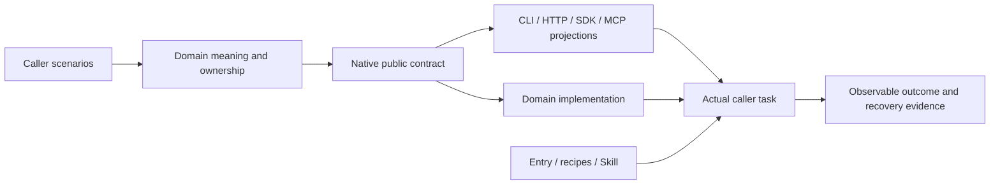

# Model and ownership

Use this model to decide what a system exposes before selecting a protocol or documentation format. An agent is a consumer of a product capability. Its interface needs explicit meaning and recoverable outcomes, just as a human or script interface does.

## Concepts and dependency direction

| Concept | Meaning | Owner |
| --- | --- | --- |
| Domain object | A thing with meaningful identity, facts and lifecycle | Domain model |
| Observation | A measured or inferred current fact, with freshness/uncertainty | Observing domain capability |
| Operation | A consumer intent with inputs, preconditions, results, failures and effects | Public service contract |
| Schema | Executable representation constraints, validation and supported defaults | Native contract declarations |
| Metadata | Descriptions, ownership, effect declarations and presentation choices | Native operation or a referenced owned declaration |
| Projection | A CLI command, HTTP route, SDK method or MCP tool derived/mapped from an operation | Delivery adapter |
| Recipe | A task path with prerequisites, exact inputs, expected results and recovery | Caller documentation |
| Discovery entry | A short route to the right recipe or machine contract | Documentation/Skill/client integration |
| Evidence | A bounded observation of generated consistency or consumer behavior | Existing delivery/test record |

Arrows show derivation or use, not source imports. A source dependency must keep core policy independent of transport and provider mechanisms; use the shared [service and dependency-inversion guidance](../../scenarios/engineering-design.md#service-contracts-and-dependency-inversion).

Do not promote every process, connection, handle or metadata group into a managed resource. Give a concept independent identity and lifecycle only when a current scenario requires callers to manage it separately. Distinguish these two uses of “resource” explicitly:

- **Domain resource ownership** classifies which capability owns an operation. A metadata value such as `resource: "environment"` can group CLI help, API tags or MCP tools.
- **MCP Resource** is a protocol-exposed, URI-addressable context item read through MCP resource methods. Domain grouping does not register one. Expose an MCP Resource only when a client needs that read model; use a tool for an operation.

## One authoritative chain

Adapt this matrix to the project's actual homes. Each fact has one editable owner; views link or derive from it.

| Fact | Authoritative owner | Derived or consuming views |
| --- | --- | --- |
| Vocabulary, object boundaries, invariants and lifecycle | Domain model/design and implementing domain | Contract semantics, recipes, state tests |
| Public fields, units, variants, requiredness, absence and validation | Native schemas/types | Typed service, HTTP/OpenAPI, CLI validation, MCP JSON Schema |
| Operation signature and stable public failures | Native service/operation declarations | Provider binding, SDK, error projections |
| Ownership, effect declarations and surface names | Native operation metadata, or one referenced mapping owned by the surface | Capability manifest, CLI registration, OpenAPI identifiers, MCP descriptors |
| CLI streams/exit codes, protocol envelopes and serialization policy | Authored adapter contract | Help, recipes and real-consumer cases |
| Installation, supported versions and client configuration | Runtime/package declarations and maintained setup guide | Skill prerequisites and caller recipes |
| Exact generation and compatibility checks | Project scripts/configuration | Delivery automation and maintenance instructions |
| Executed behavior and remaining limits | Existing evidence/task record | Support claims and completion report |

A schema cannot by itself enforce permissions, process ownership, concurrency, external reachability or lifecycle invariants. Metadata describes behavior; the owning implementation enforces it. A generated client is a binding, and a Skill is guidance. Neither supplies missing business behavior or authorization.

“Shared schema” means one maintained chain for public values and operation meaning. It does not mean identical CLI syntax, HTTP and RPC wire formats, error envelopes or UI structure. Name a mapping's lost distinctions and recovery policy before relying on it; [contracts](contracts.md) supplies the boundary questions.

## Choose a proportionate surface

Start with the shortest path that satisfies a real consumer and its operating constraints.

| Current need | Adequate starting point | Add more when |
| --- | --- | --- |
| Private, same-process capability | Native exported function/type with nearby semantics | A real process, package or protocol boundary appears |
| Agents can already invoke a working CLI | Reliable machine output, help and a task recipe | A client needs typed composition or cannot use a shell |
| Other programs need typed calls | Existing native client or supported SDK | Another runtime or deployment requires HTTP/RPC portability |
| HTTP consumers need interoperability | Maintained OpenAPI projection and a real consumer | A supported language binding reduces repeated integration work |
| MCP clients need callable operations | Standards-compliant adapter and explicit setup | The product's scenarios justify additional protocol capabilities |
| Agents struggle to select existing operations | Short entry, caller recipes and a discoverable Skill | Packaging/discovery evidence shows another supported host is needed |

Do not expose all internal methods, generate business logic or invent a contract DSL to create symmetry. Follow shared [public-contract design](../../scenarios/engineering-design.md#public-contracts-and-domain-meaning) and [API/SDK guidance](../../scenarios/api-contracts-and-sdks.md) for their underlying methods.
