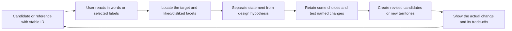

# Conversation and guidance

Use throughout a collaborative logo project, especially when the user is uncertain, cannot name a style, dislikes candidates or gives mixed feedback. Conversation is part of the design method, not a final approval step. Its purpose is to understand the user's intent, show useful alternatives, and carry the right constraints into the next iteration.

The user should not need to learn professional terminology before expressing a preference. Use accurate domain terms with a short observable description. “Contour tension — a more stretched, energetic outline” can help; a paragraph on curve mathematics usually does not. Do not replace professional meaning with vague praise such as “higher-end.”

## Keep two layers of language

The user-facing layer uses concise names, visible properties and ordinary choices. The design layer records the relevant facet, hypothesis, target version, retained qualities and proposed operation. Translate between them explicitly when it matters, without exposing the full record structure in every reply.

| User expression | Professional interpretation to test | Accessible choice |
| --- | --- | --- |
| Too bulky | Excess optical mass, tight counters or unsuitable proportions | Lighter visual weight — reduce thickness and open the internal space |
| Too plain | Weak concept, generic silhouette or insufficient character | More distinctive structure — change the organizing shape, not just the color |
| Looks cheap | Could be type spacing, rough contours, arbitrary effects or incoherent detail | More precise craft — refine joins, spacing and material consistency |
| Too busy | Competing detail and hierarchy | Clearer hierarchy — keep a focal subject and reduce competing detail |
| Not lively | Gesture, rhythm or expression may be static | More gesture — introduce movement through pose, contour or composition |
| I cannot describe it | The desired contrast is not yet visible or verbalized | Show the same idea in contrasting treatments and let the user choose what to retain |

Interpretations are hypotheses. Preserve the actual statement and do not silently turn it into a final design instruction.

## Guide the current phase

| Phase and common situation | What to discuss | Useful assistance | Useful result |
| --- | --- | --- | --- |
| Starting with little direction | Name, use, audience/context, desired associations and unwanted associations | Short contrasting examples or a few concrete expressions; infer from known context before asking | A working intent, with facts and assumptions separated |
| User has adjectives but no imagery | What “warm,” “inventive” or “crafted” could mean visually | Abstract intent into subject, relationship, shape, type and material; compare plausible interpretations | Several concept territories, not a forced style label |
| User has references | Which exact properties are liked or disliked | Let them select contour, subject, type, color, material or composition independently | Attributed reference traits and intentional exclusions |
| Exploring broad directions | Which propositions and personalities fit the brand | Diverse labeled candidates, quick reactions and optional descriptor tags | Shortlist plus what to retain, reject or keep open |
| User likes parts of different candidates | Which parts are compatible and why | Explain one or two meaningful hybrids; show what would be lost | A deliberate combination or a clear trade-off |
| Narrowing a direction | Which idea should survive and what feels weak | Controlled comparisons and more specific form/type/material tags | A refinement plan tied to the chosen cue |
| Material or application review | Does the chosen identity fit this surface and use? | Source beside expression, relevant size/context views and actual limitations | Appropriate variants and remaining craft questions |
| Near completion | Are the agreed requirements met, and what files/uses are needed? | A concise delta from prior feedback and a clear deliverable preview | Acceptance for specified assets/uses or an explicit remaining issue |
| Repeated dissatisfaction | Is the wrong concept, wrong expression, poor craft or poor presentation being changed? | Summarize retained likes, unhelpful attempts and plausible root causes | Reframe the brief or test a discriminating alternative |

Do not conduct every discussion at every phase. Work with the current uncertainty. The assistant may propose a concrete working assumption and continue reversible work when clarification is optional; silence is not a submitted preference or approval.

## The multi-round loop

Each round should answer a question. Do not treat “generate another batch” as the default response to every dissatisfaction. The next round may be a reference comparison, a lettering study, an anatomy correction, an application view or a brief revision.

The design loop and execution loop have different outcomes. When the user adds feedback during an activity, retain it and distinguish it from the inputs already dispatched. Show which statements informed the new result and what remains open; “generation finished” does not mean the user selected a design. Use [collaboration and workbench design](workbench.md) when translating this dialogue into product interactions, and [records](records.md) for the round and activity relationships.

## Offer selectable language without overwhelming the user

The [feedback vocabulary](../resources/feedback-vocabulary.yaml) provides short user-facing change options, professional mappings, ambiguities and likely next operations. Descriptive style/subject/material tags remain in the [style vocabulary](../resources/style-vocabulary.yaml); do not copy them into a second catalogue.

Use three complementary annotation modes:

1. **Reaction:** interested, not for this brand, uncertain, or compare further. This scopes attention; it is not a final approval state.
2. **Description and facet:** what the user notices or likes, such as rounded contours, engraved metal, an animal subject or generous spacing. Link the relevant style facet or a local descriptor.
3. **Change or retention:** keep this quality, reduce it, increase it, change only this facet or explore another concept. A descriptive tag alone does not say which action the user wants.

A user can like the subject and reject the material. Retain both, without averaging them into a single score. Let users skip a candidate or add their own words. An agent's pre-applied labels must be visibly suggestions, never submitted feedback.

Offer the most relevant groups first based on the phase and prior statement. A compact initial palette can expose a useful subset with search or “more descriptors” for the full set. The underlying vocabulary should be rich; the visible choice surface should remain manageable. Do not force a universal fixed tag count or show dozens of unrelated options at once.

In chat, users can reply “B: keep the animal, less detail; D: like the metal only.” In a workbench, use the same semantics as per-candidate facet chips, region annotations and optional short notes. Selection, annotation and next-round planning should work without writing a paragraph or operating a complicated form.

## Example prompts by situation

These are adaptable patterns, not scripts to repeat verbatim or mandatory extra questions.

| Situation | Example selectable prompt |
| --- | --- |
| Initial uncertainty | “Which qualities are closer: quiet and precise, warm and handmade, vivid and playful, or bold and mechanical?” Keep them as open starting points, with text input available. |
| Too similar | “Should the next round change the subject, the core shape, the drawing language, or the type treatment?” |
| Too rough | “Which part is bothering you most: rough contour joins, awkward proportions, type spacing, too much detail, or an artificial material effect?” |
| Likes a reference | “What should carry over: the contour, subject, composition, lettering, palette or surface?” |
| Likes only part | “Keep the animal and its expression; should we test an engraved version and a clean geometric version?” |
| Wants a different mood | “Should it feel more restrained, more gestural, more crafted or more playful?” Connect options to actual visible changes. |
| Near selection | “This version keeps the chosen silhouette and adjusts the spacing and metal finish. Is the remaining issue the form, the wordmark or its use on the site?” |

Use actual current candidates and words the user has already used. Avoid suggesting a preferred answer through loaded labels such as “professional version” versus “basic version.” If the target is unclear, resolve the specific ambiguity rather than requiring the user to repeat the entire brief.

## Turn feedback into a next-round brief

Keep a compact internal record and communicate the meaningful delta:

- **Retain:** the selected subject, silhouette, expression, material or type relationship.
- **Change:** the target facet and proposed operation, with the interpretation's uncertainty where material.
- **Explore:** the alternatives that can distinguish competing hypotheses.
- **Control:** what remains constant so the comparison answers its question.
- **Check:** how the next round could confirm or disprove the interpretation.

For example: “Retain candidate B's alert animal and broad head. Test simpler interior detail and two type weights; keep the palette and pose constant. The question is whether the current roughness comes from density or the lockup.” If the user instead requests unrestricted new directions, do not preserve the old skeleton by default.

This record is a design plan, not a confirmation request. Proceed within the already authorized work. Summarize feedback back to the user when it prevents a likely misunderstanding; do not require ritual approval before every refinement.

## Handle ambiguity, contradictions and stalled loops

If reactions conflict, distinguish context, target version and facet. “More detail” for an engraved hero and “simpler” for navigation may be compatible. “Keep the animal” and “make it less childish” can call for anatomy/type changes rather than removal of the animal.

If “more premium” could mean several things, show a controlled contrast or offer a small choice set with visible implications. Do not translate every such request into thinner strokes, gold color or more empty space.

If repeated rounds miss the mark, stop automatic variation. Recover the user's actual likes, dislikes and retained intent. Check whether the failure is concept, reference interpretation, source craft, application or presentation. Suggest a targeted reframing and continue the useful work it enables.

When the user requests no image reading, preserve that policy across the whole loop. User annotations remain valid input. Do not claim the agent visually diagnosed a flaw it learned only from the user's description.

## Completion and handoff

A round is sufficient when it yields the comparison or refinement promised and a clear next decision or resolved issue. The overall project is sufficient at the user's requested stage, with accepted uses and unfinished dependencies stated. Endless exploration is not the only sign of collaboration; accepted choices should narrow future work unless reopened by new evidence or user intent.

Carry the scoped feedback, source versions, next-round brief and actual evidence into [records](records.md). A new agent should be able to resume from the user's decisions without relaunching an intake interview or silently discarding previous preferences.
