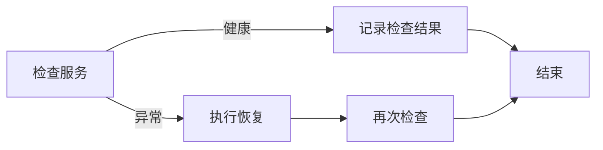

# 示例：把演练目录变成可工作的管理产品

这是一个虚构的服务演练工作台，用来演示设计判断。对象、数量、接口能力和结果均为说明材料，不是已实现产品或用户研究。本例借鉴实际工作台改版中的经验，但不要求其他产品采用这些主体、存储或执行方式。

## 起点：有目录和记录，仍然无法管理

现有界面左边列演练名称，右边依次摆放说明、参数、JSON 和历史记录卡片。用户要求：“我要维护演练，选好条件执行，失败后知道是哪一步、当时用了什么，并能交给同事查看。”

这个请求至少包含三种工作：作者维护规则；操作人员准备并控制一次尝试；负责人排查和交接结果。最先做的完整切片选为“从已有演练选择条件，执行一次，定位失败并查看原资料”。编辑和其他管理工作仍进入规划，但不会冒充已交付能力。

## 先辨认对象及其关系

| 主体 | 用户如何理解 | 关系与能力 |
| --- | --- | --- |
| 演练定义 | 有版本的目标与步骤规则 | 作者可编辑；包含节点，被配置和执行引用 |
| 运行配置 | 这次要用的条件、输入和执行方式 | 指向明确版本的定义及已有执行适配器 |
| 执行 | 某个时间实际发生的一次尝试 | 固定使用的定义/配置，拥有步骤、当前状态和结果 |
| 步骤记录 | 这次尝试中某一步的实际情况 | 属于执行，关联当时输入、结果和采集资料 |
| 留存资料 | 当时保存的截图、状态或日志 | 属于具体执行/步骤和采集记录；可读取与交接 |

外部服务已有执行 SDK 和讨论能力，工作台通过它们提供的合同接入；工作台不重新创建业务执行器或评论体系。步骤只在执行里有意义，暂不设全局步骤中心。用户暂时没有跨执行搜索资料的任务，也不急着建立全局资源中心。

由此得到三个稳定入口：演练、运行配置、执行记录。若将来用户频繁跨运行复用或检索资料，再评估集合入口；不能因为模型有五个名词就产生五个菜单。

## 用任务决定页面怎样连接

```text
演练集合 → 演练详情 → 关联的运行配置 → 输入与能力检查
                                              ↓ 明确开始
                                         单次执行工作区
                                              ↓ 选择失败步骤
                                       当时输入 / 结果 / 资料
                                              ↓ 选择一份资料
                                       预览、下载或上下文链接
```

这张图表达用户导航与动作，不是业务步骤的执行图。每一步都能返回原对象；直接打开资料链接时，也能辨认其执行和步骤上下文。

| 页面 | 它回答什么 | 主区与操作 |
| --- | --- | --- |
| 演练集合 | 哪个演练适合当前任务？ | 搜索、分类/状态筛选，按行比较名称、用途与更新时间；选择后进入详情 |
| 演练详情 | 目标与规则是什么？怎样执行？ | 关系图或合适步骤表达、选中节点检查器、关联配置；编辑能力存在时提供编辑入口 |
| 运行配置 | 本次条件是否正确、能力是否可用？ | 目标版本、输入、预期与执行适配器状态；满足前提后明确开始 |
| 执行工作区 | 现在发生了什么，哪里需要关注？ | 当前目标与进展、步骤选择、上下文控制、选中步骤详情 |
| 留存资料视图 | 有什么依据，来自哪里？ | 一项资料的实际内容、采集时间和所属上下文；按能力预览或下载 |

集合和详情可以共享一个分栏工作区，也可以是独立页面，取决于比较和连续操作的需要。布局数量不由上表直接决定。

## 页面表达必须守住真实语义

假定演练规则包含健康与恢复两条路径。作者顺序为“检查、直接结束、恢复、再检查、结束”，把它编号为 1–5 会误导为每项都必须执行。下面的图根据实际关系表达互斥分支与汇合：



这张图展示定义中的规则，不代表某次执行已经走过这些节点。查看具体执行时标明实际路径、未执行路径与未知事实；不能用当前选中的节点冒充执行进度。图中“再次检查”之后的处理仍由演练定义决定，此简化示例不说明真实业务的成功准则。

执行列表使用对齐行呈现开始时间、演练、过程状态、业务结果和资料情况。12 条已加载记录显示“已加载 12 条”；只有已知全量才显示总数。“执行结束、检查失败、资料尚在保存”可以同时成立，不压缩成一个绿色“完成”。

## 为每个动作确定真实后果

以“开始”为例，假设执行 SDK 支持带身份的启动请求和按原请求查询结果。页面选择的配置与版本进入请求，按钮提交后显示处理中；拿到执行身份后打开该次工作区。回复丢失时保留原请求，查原结果，不能重新开始另一场演练。

如果 SDK 没有这项查询能力，设计不能凭空承诺恢复：应显示无法确认，沿实际可用的核查方式处理，将缺口交给合同 owner。是否能安全重发只能由原合同决定。

同样，草稿、运行和页面分别处理：用户切到演练详情，不隐式结束正在执行的实例；返回时看到同一次执行及其待定操作。编辑定义后，旧执行继续显示当时版本；查看当前定义是另一条明确链接。

假定每次采集都可产生名为 `state` 的资料。资料链接使用所属执行、步骤和采集项的精确身份；找不到原项时显示缺失，不能随便打开另一份同名 `state`。

## 从原型走到实施

先用一条演练、两个运行配置和几种代表状态验证导航、分支理解与操作反馈；增加较大集合、长标题和重复名称检验定位与密度。受控夹具只支持结构验证。随后选择已授权的真实执行适配器跑通开始、步骤、结果和留存读取，才说明真实集成成立。

明确页面读取/动作合同和共享视觉规则后，可将定义编辑、集合导航、执行工作区划为独立责任，安排必要顺序。各部分都收到同一任务背景、关系模型与验收路径。整体负责人从默认入口操作，不让三个分别可用的模块掩盖整体断点。

## 按使用结果检查

| 场景 | 预期判断/行为 | 需要的证据 |
| --- | --- | --- |
| 初次进入，尚无执行记录 | 能找到已有演练和可用配置，理解如何开始 | 默认入口实际画面与路径；空记录不等于连接错误 |
| 执行失败，进入其中一步 | 能区分执行结束与检查失败，找到当时输入和资料 | 具体步骤及原数据的实际读取 |
| 提交后离开再返回，回复尚未确认 | 仍是原请求与原执行，没有隐式重复启动 | 跨页交互和原合同结果查询 |
| 打开历史资料，当前定义已改变 | 仍能确定当时版本及资料身份 | 旧记录读取与当前版本明确区分 |
| 对象增加、名称重复 | 能通过范围、筛选与身份找到目标 | 代表规模下实际操作，清楚说明查询覆盖范围 |
| 窄屏或键盘操作 | 能选步骤、读详情、操作并返回 | 实际渲染和焦点路径，不能只测横向溢出 |

这组设计推导只说明怎样构造与检验候选。真正交付时记录实际观察和未完成部分；不能因为例子中的路径写得完整，就宣布产品已可用或用户已接受。
