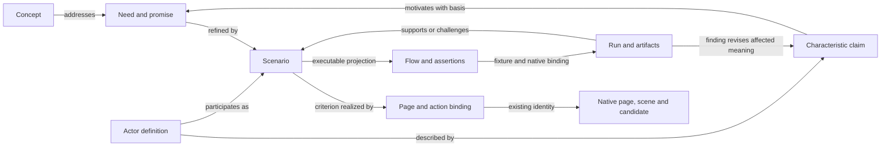

# Experience data model

Use this semantic agreement before choosing storage or a viewer. It specifies meanings and relationships, not a new universal schema/runtime. Inspect and reuse the consumer's canonical models first. Exact fields/types belong to native declarations when implemented. Product-experience owns experience meaning with the relevant product owner; domain/contract owners own executable contracts and enforcement.

## Identity before precision

A text description can already have a stable identity, owner, source and explicit relationships. Add structured distinctions to that same subject as understanding improves; preserve narrative rationale and uncertain alternatives. Do not require every description to become a type or make each refinement a new disconnected document. Refinement is local to a subject and revision, not a mandatory global stage.

| Subject | Meaning and key references |
| --- | --- |
| Product concept | Proposed value, scope, vocabulary and alternatives; references actor definitions and intended outcomes |
| Actor definition / role | Context, goals, abilities and authority; may represent a group or situational role, not automatically an identified person or permission class |
| Characteristic claim | A description/analysis of an actor in a stated context; references its actor, evidence or assumption, and implications for needs/design. Confidence is not research proof |
| Need / requirement | Outcome or selected promise, retained at the existing product source; relationships distinguish contribution, refinement, dependency and constraint |
| Scenario / criterion | Actor, trigger, conditions, alternatives, outcome and observable promise, retained at the complete-outcome owner |
| Experience binding | Scenario/criterion ↔ page purpose / navigation / meaningful action / state / domain fact or operation; references original owners |
| Candidate / prototype reference | A chosen/alternative realization of a semantic subject; exact page/composition/scene/candidate version and fixture references |
| Flow / branch / step / assertion | Executable projection of the scenario, conditional paths, actions and observable checks; manual judgments remain separate |
| Fixture / run / artifact / finding | Deterministic supplied data, actual execution/observation, retained evidence and interpretation/disposition; never substitutes for requirements or domain state |

Relations are first-class when they carry meaning: subject and target references, relation kind, reason/source, applicable context and revision. Distinguish `participates-as`, `described-by`, `motivates`, `refines`, `depends-on`, `constrains`, `realized-by`, `bound-to`, `verified-by`, `supports/challenges` and `supersedes`. Reuse equivalent native relationships rather than creating another registry. Needs and scenarios, scenarios and pages, and criteria and assertions can be many-to-many; hierarchy, navigation, semantic dependency and execution order are different relations.

## Minimum data agreements

For a maintained subject, retain its namespaced stable reference, revision, owner/source location, human description, relevant structured detail and precision/uncertainty. For a reference, retain project/source identity, subject kind/ID and exact revision (or mark explicitly current/unpinned). Display labels and URLs can change without changing identity. A historical claim requires pinned sources; current navigation may resolve latest while disclosing drift. Unresolved/stale/retired references stay visible.

For an actor characteristic, retain context, statement, basis kind (`observed`, `reported`, `user-direction`, `inferred`, or `hypothesis`), source references, supporting/challenging evidence and open question. Avoid unnecessary personal data; an invented persona biography is not evidence. A trait such as “remembers partial titles” should influence a scenario through an explicit reason, not silently become a product guarantee.

Keep four dimensions separate: precision/maturity of a subject; selected versus alternative product direction; source/evidence support; actual run outcome. For example a precisely defined criterion may be selected but unexecuted, and a successful run may exercise an assumption whose user value is still unknown. Do not collapse these into a single green status.

When splitting or merging subjects, retain supersession links and remap affected consumers with reasons; historical runs remain attached to their original subjects/revisions. Let the same platform project these identities as concept narrative, actor analysis, scenario map, prototype view and evidence report. A common platform is an optional realization of these relationships, not a prerequisite or an installed capability. When UIUX or another workbench is adopted, inspect its native page, scene, candidate and contract identities and reference them instead of creating parallel records.
