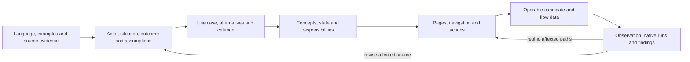

# Models and two workflows

## Progressive models

Begin at the current uncertainty. A rough actor is a hypothesis about a situation, not a demographic biography. A product user role describes goals and authority; it is not automatically an Agent role, permission group or staff position. Ground distinctions in examples and evidence before formalizing them.

| Precision needed now | Minimum useful model | What permits refinement |
| --- | --- | --- |
| Vague need | Actor/situation, desired progress, obstacle, source and consequential open question | Concrete example distinguishes competing interpretations |
| Outcome slice | Trigger, preconditions, actor authority, normal and deciding alternative, observable end state | User direction or evidence selects a promise; unresolved assumptions stay labeled |
| Concept/behavior | Stable object identity, relationships, meaningful state and rule owner | Domain owner confirms meaning; use native declarations if already available |
| Experience | Page responsibility and entry/return links, visible resource scope, action/control/result, draft and recovery behavior | A navigable candidate can expose gaps, including hidden/disclosed states |
| Executable path | Deterministic fixture/reset, supported action binding, observable assertion and effect boundary | Ready host and native runner under task authorization; no guessed service guarantees |

These are local precision descriptions, not native lifecycle enums or a waterfall. One scenario can have stable criteria while another still explores actor needs. Keep maturity of a model, selection of a promise and state of a run separate. Do not convert an unconfirmed assumption into a passed criterion.

## Source and identity agreement

The canonical consumer source owns needs, requirements, scenarios and criteria. A flow references exact nodes; it does not duplicate their editable wording. Use persistent IDs within that owner, preserving them across renames/reordering. Retire IDs with replacement links on real splits/merges; never recycle them for different meaning. IDs establish stable traceability, not one click per test or a forced bijection: one criterion may require several branches/assertions, and one step may support several criteria.

| Record at the owning artifact | Meaning |
| --- | --- |
| Source identity + revision | Existing path/URI and node/anchor/ID, commit/content hash or retained source bytes; date alone cannot freeze mutable content |
| Basis and assumption | Research observation, user-selected direction, expert inference or hypothesis; supporting/refuting evidence and next decision, with owner |
| Model and binding revision | Affected page/action/criterion and fixture versions; candidate/build identity and changed/retained semantics |
| Evidence identity | Exact run/attempt, environment, actor/scope, timestamp, check boundary, actual result and immutable artifact reference when available |

Keep quotations/observations separate from interpretation and recommendation. Preserve old sources or retrievable revisions beside historical runs. Changed criterion, locator meaning, fixture, host or service guarantee triggers impact review of the linked checks; old evidence stays valid only for its original version and scope. Resolve broken/stale bindings explicitly, never relabel old results as the new candidate.

## Design workflow

1. Recover original intent and existing sources. Select the uncertainty that changes the design; distinguish observed need, user direction and assumption. Use [discovery](../product-design/discovery.md) and [requirements](../product-design/requirements.md) as needed.
2. Establish one complete user outcome and its deciding failure/return branch. Derive concept, relationship, state and authority distinctions with the contract owner; keep open design questions separate from runtime unknown-effect states.
3. Map each selected criterion to a page's purpose, entry/return, meaningful action/control, required fact/operation, feedback and next state. Retain many-to-many relationships. Page lists do not prove outcomes; service inventories do not prove UI supply. Use [three-axis interaction modeling](../interaction-modeling/method.md) for the joins.
4. Give the prototyper the complete slice, page/action intent, data and criteria. Let them author the declared whole before detailed review; receive candidate version, full disclosed states, fixture/reset and simulation limits. Coordinate shared components with the design-system owner and native data/Mock with the contract owner.
5. Once the prototype is operable, maintain [flow data and native bindings](execution-and-reporting.md). If the assignment stops at design, hand over an explicit unexecuted projection and prerequisites. If execution is authorized, assess the actual promised boundary and return findings to the source owner.

Completion means the selected question has a consumable design, supported decisions and concrete remaining dependencies. It does not require solving every adjacent product capability.

## Evaluation workflow

1. Recover the original criterion, exact candidate, target actor/task and environment. State whether this is self-review or an independent assigned instance. Follow [evaluation](../product-design/evaluation.md) and use [tool experience review](../product-design/scenarios/tool-experience-review.md) for workbenches where appropriate.
2. Choose evidence to match the claim: expert walkthrough predicts risks; native replay checks observed behavior; participant task observation can reveal comprehension; production metrics need their own population/window. Freeze sources and capture assistance. Without participants, make no user-research claim.
3. Review entry → action → result → adverse/return path. Check scope/identity, discoverability, useful feedback and continuity. Use scoped existing tests for automatable guarantees; retain manual observations for comprehension, visual hierarchy and contextual judgment. An image alone cannot establish an operation's durable effect.
4. Record finding ID, original criterion, observed versus expected result, exact evidence, interpretation/confidence, consequence, owner and disposition (correct, clarify, investigate, defer with reason, or supported). A missing prerequisite is an evidence gap unless evidence also establishes a defect.
5. Return goal changes to the requirement owner, binding/behavior defects to Coder or contract owner, shared presentation issues to the design-system owner, and prototype changes to the prototyper. Recheck affected claims under the new version, preserving original failures and attempts. Reuse unaffected evidence.

Stop at the assigned question with readable findings and evidence limits. Recommend a decision; final user acceptance remains separate from automated results and expert judgment. This workflow adds no standing approval gate or mandatory review agent.
