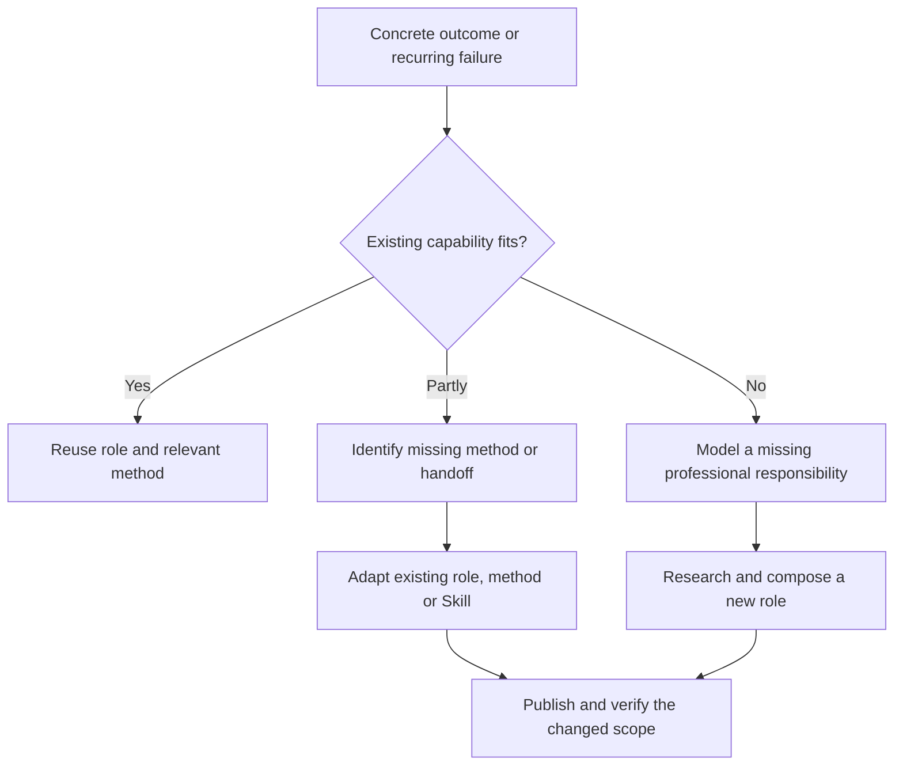
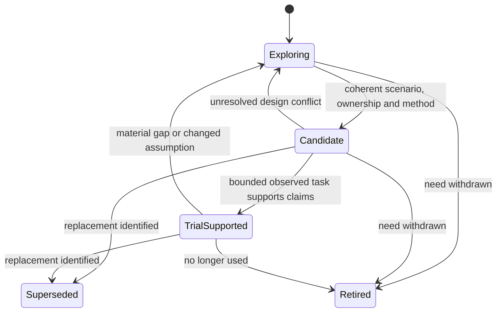

# Construct and maintain roles and methods

Use for substantive professional-role design, collaboration adaptation, method/Skill research and maintenance. This method composes existing shared guidance; it does not replace its authority or create native runtime states. Begin from the requested outcome rather than a profession label. Professional roles must apply [context, not control](../../principles.md#context-not-control): critically assess external problem definitions and suggested methods, own the domain model and current Task state, and route actual authority/commitment changes without treating Controller wording as professional truth.

## Select the useful change

If missing information changes the responsibility or chosen method, record the question and seek the necessary input. Continue independent authorized work. A research task may finish with a supported comparison; it need not publish a new role.

| Situation | Read/apply | Result |
| --- | --- | --- |
| Capability matching or missing profession | [Professional Agents](../../scenarios/professional-agents.md) | Scope, method prerequisites and scoped usability |
| Discovering or comparing Skills | [Skill research](../../scenarios/skill-research.md) | Source-based reuse/adaptation decision |
| Writing or adapting guidance | [Harness authoring](../harness-authoring/AGENTS.md), select matching routes | Scenario basis, compatible content and validation |
| Installing an already selected Skill | Available installation Skill or the selected installer's current help | Actual target location, source/version and host discovery checked within authorization |
| Publishing a reusable role | `guidance/roles/<name>.md`, plus its installed `.agent-guides/roles/<name>.md` destination and nearest route | One Markdown role definition; consuming integrations own runtime compatibility and default profile resolution |

## Establish the topic before substantive publication

Find the affected module's existing design/Task and artifact map. For a new topic, use its `.sketches/<topic>/` for exploration; a durable design follows the owner's actual design home. Adapt the [workspace template](workspace-template.md); create only files that the work needs. Shared collaboration design may cover several roles. Each topic stays with its actual owner; the steward does not own a global workspace for every role.

| Artifact | Owns | Split or create when |
| --- | --- | --- |
| Topic entry (`AGENTS.md`) | Scope and reading/writing routes, design and Task links | A new directory needs an entry for a fresh Agent |
| Design | Scenario, models, decisions, trade-offs, maturity and adoption evidence | New or materially changed responsibility/method needs a recoverable basis |
| Research section or `research.md` | Sources/revisions, mechanism, assumptions and adoption analysis | Research becomes independently useful or too large for the design |
| Native `.task.md` | Work status, blocker, current result and next action | Substantial implementation needs work tracking; reuse an existing Task first |
| Evidence | Actual inputs, artifact/version, environment, result and limits | A real trial or adoption produces useful retained evidence |

Do not create empty directory trees, independent status files or duplicated source archives. Link the topic through the nearest existing entry. When exploration stabilizes, promote the selected design to its proper owner and repair incoming routes; retain useful decision provenance.

## Model the work and research its basis

| Step | Working result | Decision to resolve |
| --- | --- | --- |
| Frame | Actor, representative task, expected outcome and capability gap | Why reuse, extend or create? |
| Align | Collaboration map and directional input/output agreement | Who owns each judgment and deliverable? |
| Bind | Actual stack, native contracts, artifact homes and tool/access prerequisites | What constrains the solution here? |
| Research | Professional sources and relevant Skill mechanisms | What improves a needed judgment, under which assumptions? |
| Select | Alternatives/decision table with source links and concerns | Why this path; what is rejected or deferred? |
| Compose | Focused role plus referenced methods and project adapter | Can a fresh Agent find and apply the needed basis? |
| Verify | Relevant structural checks and bounded task evidence | Which claims are actually supported? |

Before assigning an unfamiliar profession, distinguish researched professional basis from unsupported assumptions. Prefer maintained primary sources and native tool documentation. For Skills, use existing collections or the skills.sh CLI discovery route described in the research guide; read the actual entry and necessary resources. Record inspected revision, useful method, dependencies, attribution/license when carrying material, local differences and rejected alternatives. Catalog popularity and successful installation are not evidence of professional effectiveness.

Research-only work does not execute upstream scripts or authorize installation. For selected adoption, inspect compatibility, actual destination and host discoverability. Retain a recoverable prior version using existing mechanisms; update upstream content only when relevant to the consumer, not by blindly refreshing a whole collection.

## Express the model before adding prose

| Question | Preferred form | Meaning to preserve |
| --- | --- | --- |
| Which roles/resources depend on each other? | Mermaid flowchart or relationship model | Named responsibility and directed dependency |
| Who hands what to whom, and when? | Mermaid sequence diagram plus artifact table | Required input/output, ownership and missing-input behavior |
| Which transitions are allowed? | Mermaid state diagram plus transition table | Trigger, guard, evidence, effect and unresolved branch |
| Which approach should be selected? | Decision table or meaningful decision tree | Alternatives, reasons, constraints and unknowns |
| What supports a conclusion? | Source/evidence table | Source revision, observation versus inference and limits |
| Why accept a trade-off? | Concise prose beside the deciding model/table | Rationale that cannot be inferred from arrows |

Use a focused model when relationships matter. Do not force every short edit into every diagram type. Label current, selected, illustrative and observed scopes; use domain-specific nodes and meaningful edge labels. Keep diagrams near their owning decision and update them when semantics change. Native schemas/code remain authoritative for exact executable contracts; a drawing is not another operation registry. Inspect changed diagrams with an available renderer/parser when practical; state when only source and static interpretation were checked.

## Maintain three separate kinds of state

Work progress uses the [existing Task contract](../../refs/xschema/common-schema.md#task). Keep its status only in the canonical Task; record blockers and next actions there. Design maturity is local descriptive vocabulary, not a native Task enum:

| Event | Update at the owner |
| --- | --- |
| Research changes an assumption or a decision | Design/source table, affected model, rationale and open questions |
| Work starts, blocks, finishes or changes hands | Canonical Task status, result, blocker and next action |
| A bounded trial completes | Exact candidate, input, environment, actual result and limits; maturity changes only to the supported scope |
| Guidance/configuration is published | Published paths and version/reference; this alone is not trial support |
| A runtime instance adopts the role | Exact instance/scope and adopted instruction evidence, when observed |
| A prior design is replaced or retired | Reason, replacement if any and affected consumers; retain useful provenance |

Adoption is an evidence record, not a single ready flag: published files, installed resources, actual runtime use and task effectiveness are independent facts. Material revisions require reassessing affected evidence; preserve previous supported observations with their version and scope. A candidate needs no ceremonial approval step. Unresolved user choices remain unresolved until answered.

## Validate and hand off at the promised scope

Follow the actual role/project entry with a representative request and the boundary that challenges the method: ownership conflict, absent prerequisite, incompatible stack or a narrow maintenance edit. Verify links/anchors and that the published Markdown role is included in the guidance delivery. Check that downstream consumers can use the declared artifacts. Static walkthroughs support routing and interpretation; observed effectiveness requires an actual task with retained inputs/results.

Deliver topic/design links, selected method and source basis, changed published paths, prerequisites, evidence and remaining gaps. Make the next action recoverable without the original chat. Reopen on demonstrated failure, changed workflow/stack or relevant upstream changes. Reuse passed checks until affected inputs change; do not add mandatory reviewers or rerun the whole construction process for a small correction.
