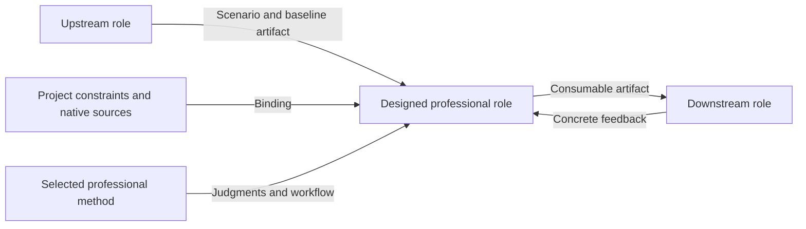
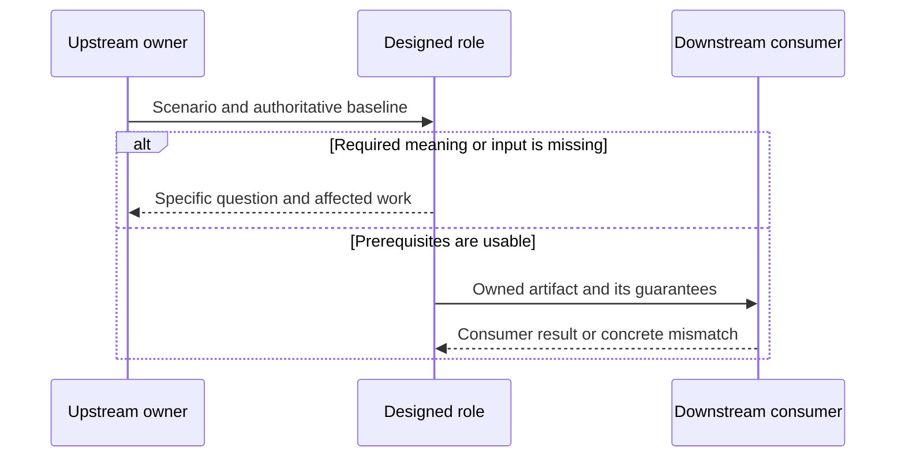

# Role or collaboration topic template

Copy the useful sections into the affected owner's design workspace. Replace illustrative nodes and rows with actual project facts; delete unused models. This template is not a completed role design or evidence of execution. Link the design and canonical Task from the topic's actual entry; do not copy Task status here.

## Outcome and basis

| Question | Record |
| --- | --- |
| Why this work? | User/consumer, scenario, capability gap and expected result |
| What already exists? | Role/method sources and why reuse or extension is/is not adequate |
| What constrains it? | Actual stack, contracts, workspace, tools/access and explicit exclusions |
| Where is work tracked? | Canonical Task link; owner and next action remain there |
| What is its maturity? | Exploring / candidate / trial-supported / superseded / retired, with reason and scoped evidence |

## Responsibility model

Illustrative structure: replace with the actual actors, responsibilities and inputs/outputs. Mark current facts and selected changes distinctly.

| Participant | Owns | Receives | Produces / consumer | Does not own |
| --- | --- | --- | --- | --- |
| Actual role | Decisions and guarantees | Named source artifacts | Named artifacts and receiver | Adjacent responsibilities |

## Collaboration sequence

Illustrative sequence: replace it with the real handoff. Independent work may proceed when its prerequisites are ready.

| Handoff | Required input / owner | Output / consumer | Completion evidence | Missing or changed input |
| --- | --- | --- | --- | --- |
| Actual step | Artifact, identity and source | Artifact and guarantees | Appropriate check or observed use | Affected work, question and resolution owner |

## Research and alternatives

| Source / revision | Inspected material | Useful mechanism | Assumptions / tools | Adopt / adapt / reject and reason | Limits |
| --- | --- | --- | --- | --- | --- |
| Actual source link | Entry and necessary resources | Improved professional judgment | Actual prerequisites | Decision | Unread or unobserved parts |

| Decision | Options | Chosen path and basis | Trade-off / concern | Revisit trigger |
| --- | --- | --- | --- | --- |
| Material choice | Reuse, adapt or create; domain alternatives | Source-linked rationale | Known cost or uncertainty | Changed constraint or evidence |

## State and change model

Use the construction method's design-maturity model by reference. Add a domain-specific state diagram here only if the designed workflow has its own meaningful states. Do not invent new Task enums or duplicate the canonical Task's progress. For consequential transitions, record trigger, guard, effect and required evidence together.

| Trigger | Affected artifact / owner | Required change | Evidence or unresolved question |
| --- | --- | --- | --- |
| Contract, workflow or tool changes | Actual source and consumer | Update selected model/method and dependent route | What invalidates or preserves prior conclusions |

## Publication, adoption and evaluation

| Claim | Artifact/version or instance/scope | Evidence | Limits |
| --- | --- | --- | --- |
| Guide/configuration published | Actual paths and version reference | File/configuration checks | Not runtime adoption |
| Tools/Skills usable | Actual installation and host | Discovery/prerequisite observation | Not task effectiveness |
| Runtime adopted | Exact instance and instruction basis | Actual observation, if performed | Existing instances may retain prior snapshots |
| Task supported | Candidate, input and environment | Observed result and consumer evidence | Bounded to this task/context |

| Evaluation case | Expected decision / consumer result | Evidence type and actual result | Gap / owner |
| --- | --- | --- | --- |
| Representative complete task | Consumable outcome | Static, check or observed task: state which | Remaining limitation |
| Decisive boundary or failure | Correct scope, missing prerequisite or conflict handling | Actual result or explicitly untested | Required next input |

## Questions and superseded decisions

| Question / prior decision | Impact | Resolution owner or replacement | Supporting source |
| --- | --- | --- | --- |
| Actual unresolved issue | Which judgment or work depends on it | Who supplies what; or successor design | Evidence link |

Before handoff, put the current next action and blocker, if any, in the canonical Task. Ensure the topic entry reaches this design, research/evidence when separate, published guidance and the Task.
