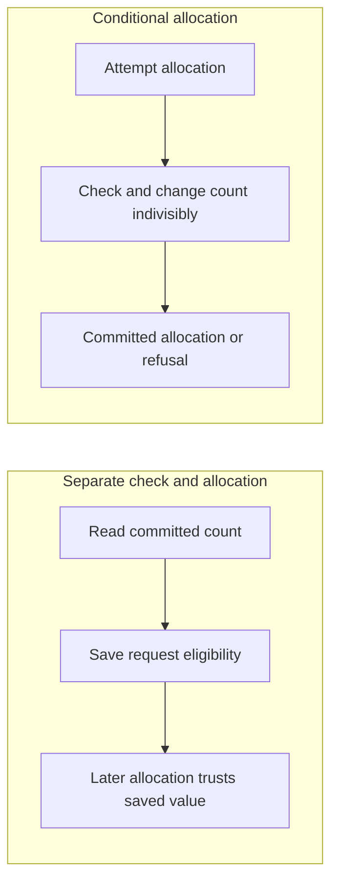

# Two requests and the last slot

This is an authored planning example, not a report of an implemented product, database experiment or reader study. It illustrates the [editorial](../planning/editorial-method.md), [evidence](../planning/research-and-evidence.md) and [experiment](../production/interactive-experiments.md) methods together.

## Reader decision and claim

Reader: a service maintainer whose independent requests can allocate a limited shared resource. Trigger: one slot remains and two requests arrive. Decision: where must the capacity condition be enforced?

Teaching claim: a condition read before a separate allocation can become stale. A single indivisible conditional allocation preserves this model's capacity invariant. This is a statement about the specified rules; applying it to a storage platform requires the actual operation and documented/integration-tested semantics.

Define capacity `C`, committed allocation count `U`, requests `A` and `B`, and each request's saved eligibility. Initial values are `C = 1`, `U = 0`. Invariant: `0 <= U <= C`. Pending reservations, cancellation, expiration, retries and external notifications are excluded until explicitly modeled.

The two responsibility placements are:

Arrows show teaching operation order, not network timing or a particular database's isolation guarantee. The placement of the condition relative to the write is the relationship being compared.

## Decisive counterexample

| Event | A's saved observation | B's saved observation | Committed U | Interpretation |
| --- | --- | --- | --- | --- |
| Initial | None | None | 0 | One slot remains |
| A reads | Eligible at U=0 | None | 0 | A has made no durable allocation |
| B reads | Eligible at U=0 | Eligible at U=0 | 0 | Both hold an observation of the same slot |
| A allocates | Eligible at U=0 | Eligible at U=0 | 1 | B's observation is now stale |
| B allocates | Eligible at U=0 | Eligible at U=0 | 2 | Trusting that saved value breaks U<=C |

The conditional alternative has one event per attempt. Its guard and result are:

| State/guard before attempt | Operation | Result |
| --- | --- | --- |
| `U < C` | Check and increment U indivisibly | Allocation committed; U grows by one |
| `U >= C` | Check without increment | Refusal; U unchanged |

Starting at zero, either request can take the first event and reach one. The other refuses. A browser simulation would encode indivisibility as a model rule; it would not establish that a real storage API supplies it.

## Evidence plan and allowed conclusions

| Question | Basis or proposed check | Allowed conclusion |
| --- | --- | --- |
| Can the separate model exceed capacity? | The enumerated teaching trace | This legal schedule violates the stated invariant |
| Does the conditional model preserve the invariant? | Guard/transition derivation plus boundary cases | Preservation within these rules and valid initial state |
| Does an actual service use the needed operation? | Inspect native service/repository operation and application composition | Meaning of the inspected implementation |
| Does storage supply the required semantics? | Relevant primary contract and a real contention/failure procedure | Only the guarantee and environment actually supported |
| Does the explanation help readers? | Proposed task: predict a new event order and explain the result | No observed benefit until readers actually attempt it |

An integration procedure, if authorized, would create an isolated capacity-one resource, run competing allocations, then inspect durable counts, accepted identities and refusals. It would also examine relevant failure/retry behavior. This example has not executed that procedure. A mock returning “allocated” twice cannot test durable isolation.

## Primary form and observation sequence

Obstacle: readers must otherwise retain each request's old observation while tracking committed state. Compare an aligned trace with a steppable explorer. The static trace exposes the fixed counterexample and is easy to revisit. The explorer earns its extra work if readers need to vary the ordering and inspect boundary conditions. Neither animation nor a race driven by real browser timing is necessary.

Sequence: orient on `C`, `U` and the two request lanes; consider whether both can succeed; step through the unsafe schedule while saved values remain visible; compare the conditional design under equivalent initial conditions; change B's read timing or capacity and predict the result. Supporting text explains the boundary and production unknowns after those observations.

Controls: design selection, preset, step eligible event and reset. Observations: per-request saved eligibility, committed count, ordered events and invariant result. Disable illegal events with the rule that prevents them. A “try to exceed capacity” challenge can expose the mechanism without scoring speed. The static table above is the unavailable-medium route to the central conclusion, with less exploration.

## Acceptance and delivery boundary

Authored semantic cases: unsafe schedule ends at two; a sequential separate schedule refuses the second read; conditional attempts end at one with one refusal; capacity zero refuses; reset restores state and trace. A repeated action must follow an explicit model rule. This model does not promise request deduplication; add identity/retry semantics before teaching that claim.

Authored experience cases: keyboard stepping, ordered text trace, non-color distinction, reduced motion, narrow-screen readability and recoverable reset. An implemented widget additionally needs its real production/hydration/browser checks. No runtime or reader check is reported here.

If the publication supports trusted components, implement the local model through its actual contract. If it supports only static content, ship the trace and a verified figure export, or link a separately versioned work when that route serves the goal. If neither visual rendering nor export has been checked, describe the artifact as planned and name that gap. Use the consumer's existing source, metadata and discovery contracts; no CMS, MDX, database or hosting capability is assumed.

Transferable rule: put a shared invariant's decisive condition at a boundary that can atomically enforce it with the protected change, and verify that the real boundary has the required semantics. Capacity correctness alone establishes neither request idempotency nor delivery of an external notification.
