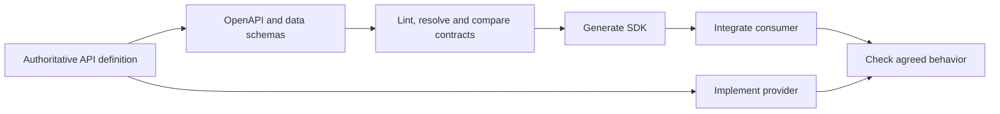

# API Contracts and SDKs

Use this guide when designing, reviewing or changing an HTTP/RPC API, its data schemas or a derived SDK. First choose the [actual boundary](./engineering-design.md#contract-boundaries-and-integration): same-process modules can use typed interfaces and package exports; private module internals need no automatic protocol file or generator. Deployment separation permits HTTP or RPC according to the integration need.

## Locate the contract before judging it

| Question | Locate or establish |
| --- | --- |
| What is authoritative? | Maintained OpenAPI/IDL source, or the provider declarations and repeatable command that emit it; identify its owner and consumers |
| Where are the data definitions? | Request/response/event schemas and referenced files or inline definitions; distinguish transport types from domain and storage models |
| Does the contract cover actual behavior? | Relevant operations, parameters, payloads, responses/errors, authentication and state/effect semantics; compare with real provider routes and consumers |
| How does it reach consumers? | Generator/configuration, public SDK/package entry, handwritten adapters and consumer imports |
| Is the result current? | Source revision, declared schema dialect, relevant tool versions and reproducible checks; identify stale output or undocumented deviations |

An API implementation, generated client or documentation page alone does not establish the maintained source contract. Record missing definitions, unresolved references or coverage gaps explicitly. In review-only work, propose the concrete correction; within authorized implementation, establish or repair the source rather than patching a second handwritten client contract.

## Maintain one OpenAPI source chain

Choose the ownership model already supported by the project: schema-first definitions drive implementation/bindings, or authoritative code declarations emit the OpenAPI description. Make that choice explicit and avoid independently maintaining both versions. Keep definitions with the owning service/capability; shared definitions follow real shared ownership.

OpenAPI describes HTTP operations and their request/response contracts; a collection of data schemas alone is not the complete API description. Maintain operation coverage, deliberate operation identifiers for stable client naming, required/optional fields, relevant formats/variants, errors and security declarations. Definitions may be inline or referenced; do not create a separate data file per type by habit. Use the [OpenAPI specification](https://spec.openapis.org/oas/latest.html) and confirm that the selected dialect is supported by the project's generator and checks.

The workflow below is a method model, not a prescribed file layout:

Keep domain behavior and authorization with their owner. Generated types and clients do not establish runtime validation, permission enforcement or successful effects.

## Choose tools by the missing capability

Reuse existing project tooling. When a capability is missing, these are candidates to verify against supported dialects, target language/runtime, licensing and maintenance; they are not a stack to install together.

| Need | Candidate and ordinary entry points | Selection boundary |
| --- | --- | --- |
| Lint an OpenAPI description and bundle references | [Redocly CLI](https://redocly.com/docs/cli): `redocly lint`, `redocly bundle` | Static contract quality and reference handling; does not verify live server behavior |
| Generate a TypeScript client and related types | [Hey API](https://heyapi.dev/openapi-ts/get-started): `openapi-ts` with project configuration | A candidate for a basic typed SDK; choose supported plugins/output deliberately |
| Generate frontend clients with query-library integration | [Orval](https://orval.dev/): `orval` with project configuration | Useful when the application wants that integration; do not add it beside another generator for the same surface |
| Generate clients for multiple target languages | [OpenAPI Generator](https://openapi-generator.tech/docs/usage/): `validate`, `generate` | Select the actual generator and its supported features; avoid unnecessary cross-language machinery |
| Compare a changed API with an accepted baseline | [oasdiff](https://www.oasdiff.com/docs): `oasdiff breaking` | Use actual baseline/candidate inputs and the documented CI failure policy; supplements semantic review |
| Maintain an existing Protobuf/RPC boundary | [Buf](https://buf.build/docs/cli/): `buf lint`, `buf breaking`, `buf generate` | Applies to Protobuf schemas; does not justify introducing RPC between local modules |

For a TypeScript HTTP client without an existing equivalent, start by evaluating Redocly plus one client generator: Hey API for a general SDK, or Orval when generated query integration is wanted. Add baseline compatibility checks where consumers depend on stable evolution. Use the established native generator for another protocol; do not convert every boundary to OpenAPI.

## Make generation repeatable

Put the selected commands and configuration in the owning project's normal scripts/build system, with reproducible dependency/plugin versions. Discover the real input path, output policy and public package entry before running them; use current tool help instead of copying unverified flags.

1. **Check the definition:** lint/validate the description, resolve references and inspect relevant operation/data coverage. Bundle when the consuming tool or distribution needs it.
2. **Assess compatibility:** compare against the actual accepted/released contract when present. Classify affected consumers and plan required adaptation; a clean structural diff does not prove semantic equivalence.
3. **Generate from the source:** regenerate the selected SDK/types, inspect the change and detect stale output. Keep handwritten domain/authentication/error adapters outside generated files. Never edit generated files as the sole fix.
4. **Check integration:** typecheck/build the actual consumer and verify the affected provider/client scenario plus relevant rejected/error behavior using existing checks. Fixtures must follow the contract; mock-only success is not real integration evidence.

Use a narrow regeneration-diff check when outputs are committed, or reproducible build/package generation when they are not. Include the relevant steps in existing CI when maintaining a shared API. Run only authorized target-environment checks; do not install a second framework or call a live service merely to complete a generic checklist.

## Retain the working result

Update the boundary diagram with the actual definition, provider, SDK/package and consumer relationship. In the existing [working record](./project-context.md#make-method-execution-explicit), retain their paths, the selected toolchain/configuration, examined coverage, actual command/check outcome, unresolved compatibility questions and next action. Link existing output instead of copying declarations or logs.

If a definition, generator or target environment is absent, record that specific gap and the next authorized action. Keep static validation, generation, consumer compatibility and observed runtime behavior distinguishable; passing one does not establish the others. These are method checkpoints, not required report fields or new user-approval gates.
