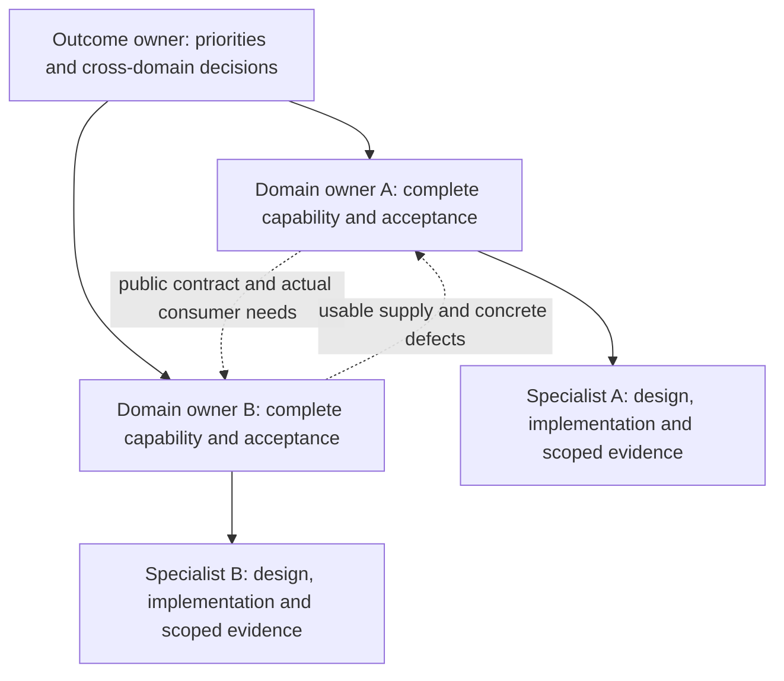

# Review collaboration and delivery effectiveness

Use when planning or revising delegated work, at a sustained delivery checkpoint, or when activity no longer explains progress toward the original result. Controllers review their own coordination as well as their children's work. Workers use the same questions to challenge an assignment or report a structural problem; they do not need to wait for a parent to notice it.

This scenario supplements [workflow management](workflow-management.md). That source owns decomposition, verification ownership and execution rules. This method owns the retrospective judgment and correction. It grants no new delegation, resource or external-effect authority. A routine bounded fix under a sound assignment needs no separate review exercise.

## Governing judgments

- Optimize time to a usable result under the original functional, architectural and engineering requirements. Include coordination, waiting, repeated verification and recovery in the cost. Activity counts cannot establish value.
- Count useful learning when it resolves a named uncertainty that could invalidate the selected design. Infrastructure and native contracts can be valuable before a visible demo; identify their consumer and the condition they actually remove.
- Give specialists complete responsibility, the whole-system path and enough local decision authority to author related domain files and definitions together. Controllers notice fragmented execution through existing work; workers challenge fragmented dispatch and propose a coherent responsibility. Neither side treats the other's default habits as an adequate workflow. Keep the original goal visible while preserving domain ownership and shared contracts.
- Apply the same burden of justification to process as to code: a review, message, gate or intermediate artifact should change a decision, prevent a concrete failure or enable a consumer. Remove process that has ceased to do so.

## When to review

| Trigger | Proportionate action |
| --- | --- |
| Initial decomposition, material reassignment or a change in the selected outcome | Check the proposed result, responsibility boundaries, critical dependencies and real runtime before dispatch. Reuse established answers. |
| A usable batch completes or a major integration boundary is reached | Compare the capability before and after it; select the next complete result. Consume existing evidence. |
| Long-running coordination has no natural checkpoint | Agree a review interval at the start, such as about an hour of active work, and review at the next safe point. Adapt it to the work; do not interrupt a bounded live run. |
| Contributions accumulate without consumption; similar fixes recur; shared assembly queues grow; instructions or reviews dominate work | Review the affected structure now. Do not keep dispatching smaller patches while the cause remains unexplained. |
| A worker or user questions direction, restrictions, requirements or efficiency | Examine the concrete concern against the original outcome. A challenge is useful input, not failure to follow the assignment. |

Use the controller's existing work checkpoints and completion events. A review interval is a reminder to assess the work, not a reason to poll Agents, create timer Agents, request periodic status messages or require a report from every tier. Reuse a review already made at the same boundary.

## Run a bounded review

1. **Recover the intended result.** Read the original scenario and selected design, the current capability/gap and the next promised consumer result. State what a user or real consumer can do now and what changed since the previous checkpoint. Keep essential unfulfilled promises visible. Do not reconstruct the programme from chronological messages.
2. **Trace the path that matters next.** Follow one representative end-to-end path, its blocking dependency chain and its riskiest unresolved assumption. Identify the actual suppliers, consumers, integration owner and scarce resources. Compare actual calls/data/effects with the intended architecture; passing local checks alone cannot establish that fit.
3. **Sample the work and coordination.** Start with original Task summaries, a representative assignment/handoff and the relevant shared queue. Ask the responsible owner only for facts that are missing and could change the decision. Read raw evidence when a claim is contradictory, unsupported or materially affected; do not audit every receipt or obtain nine parallel self-assessments.
4. **Judge causes with the criteria below.** Separate observation, inference and unknown. Check explanations that could disprove the concern: necessary foundational work, an authorized guarantee, a genuine resource constraint or an already planned consumer may explain an apparent delay. Record the cause that best fits the facts, not a verdict based on document volume.
5. **Change the work where needed.** Choose continuation, a local correction, structural diagnosis/reassignment or an exact decision needed from another owner. Name what changes, who acts and which next result or observation will show whether it helped. Preserve valid contributions and independent work.

An ordinary review should take a few minutes using existing context. If the answer needs deeper investigation, state the causal question, affected scope and a bounded investigation before continuing with [system diagnosis](systematic-troubleshooting.md). Do not turn a quick checkpoint into an unbounded programme audit.

## Evaluation criteria and corrective actions

| Dimension | Evidence of a sound arrangement | Warning and useful correction |
| --- | --- | --- |
| Goal and priority | The next work makes a selected user result possible or resolves an uncertainty blocking it; the consumer and next integration step are clear. | Local APIs, fixtures or stories grow while the same user path remains missing. Reorder around the missing path and test its riskiest assumption early; preserve other selected commitments. |
| Architecture and functional fit | Responsibilities, public contracts, state and effects agree with the governing design and actual consumer. Shared assembly stays thin. | A host absorbs several domains, duplicated models appear, or local passing results cannot compose. Have the relevant owners correct the boundary/dataflow, including consumers, rather than add another adapter by default. |
| Requirement validity | A gate protects an original promise, required engineering property or concrete failure mechanism, with a sufficient observation and stopping condition. | A preferred proof, exhaustive combination, stylistic preference or temporary precaution becomes a universal prerequisite. Apply the requirement test below. |
| Granularity and autonomy | A worker can deliver a cohesive capability, perform ordinary repairs and explain its consumer. It can refine internal design within its authority. | Every file, selector or internal repair requires another dispatch; no one owns the usable whole. Merge the fragments into a complete responsibility and clarify decision authority. Task reuse alone does not prove cohesion. |
| Professional and runtime capability | The assignee has the needed method, domain context, tools, access and executable next action. Uncertain runtime assumptions get an early bounded probe. | A title, model, Skill, required port or fixture is treated as actual capability. Supply the missing method/access/runtime or establish the exact gap before building dependent layers. |
| Team topology and capacity | Independent responsibilities can progress; one owner handles each actual conflict; a named existing owner integrates. | Many domains wait for the same person to wire their features, or more Agents only enlarge the queue. Return separable domain assembly to domain owners, keep a thin shared composition point and match concurrency to real capacity. |
| Communication and state | A message supplies a usable result, concrete decision, defect or completion to an actual consumer. Status has one authoritative home. | Relay-only controllers, acknowledgements and copied status dominate. Remove redundant hops/copies and let assigned owners resolve their contract relationship directly. |
| Verification and evidence | A designated executor verifies the changed guarantee; the receiving owner judges fit and tests missing composition. | Each tier reruns checks, recalculates hashes or issues a second receipt. Reuse valid evidence; reopen only affected guarantees for a real change, contradiction or explicit independent requirement. |
| Process and context cost | Current context is sufficient to recover the goal, decision authority, usable inputs and next action. Control work resolves real choices. | Agents must parse long histories, repeat source inventories or wait for routine permission within an existing grant. Keep a short current view with links, batch necessary work and remove obsolete gates. |

Use these as diagnostic lenses, not a mandatory form for every Task. Available elapsed time, repeated checks, unconsumed contributions or waiting chains can substantiate a finding. Do not invent utilization, cost or completion percentages; online/idle status and message, file or test counts are not individual performance measures.

## Test an added requirement

For a disputed gate, establish:

1. Which original user promise, canonical invariant, operational requirement or concrete failure does it protect? Who owns that meaning?
2. Does the current consumer actually need it now? Distinguish a start prerequisite from final acceptance and a later selected capability.
3. What is the least sufficient design and observation that preserves the guarantee? Can a snapshot, isolated process, public contract or one executor replace repeated manual proof?
4. When is the guarantee established, when does the temporary restriction end, and what relevant change would reopen it?

Keep required authorization, confidentiality, state integrity, provenance, idempotency, recovery and real-output correctness. A slow implementation does not make an essential guarantee optional. Resolve an unclear guarantee with its semantic owner. Remove an unjustified process gate within existing authority; return a change to a user promise to its decision owner. Do not silently weaken acceptance to fit the available tests.

For example, function-call purity may be the required boundary while module loading already reads its own release metadata. Eliminating that existing load-time read is separate work unless a real consumer requires it. Likewise, source identity at a real execution boundary does not require every message recipient to hash the same tree.

## Choose a team structure that can deliver

There is no universally best number of Agents or tiers. Begin with complete responsibilities, dependencies and real capacity. Use a single qualified implementer when it can own the cohesive result; use parallel specialists for independent decisions or capabilities; add coordination only where it owns substantive product, domain or integration decisions. Honor any team structure explicitly selected by the user for the current programme. Its tier count and dispatch rules remain project bindings; this review does not make them universal defaults.

For each coordinating responsibility, ask which consequential decision or integration would otherwise be missing. If the role only forwards messages, change its work within the authorized structure. Before adding parallelism, identify which waiting dependency it removes and whether the new handoff/shared queue costs more than the overlap saves. Do not expand the team merely because capacity is available.

This diagram separates the reporting structure from direct dependency communication. The roles can be fulfilled by existing people/Agents; the diagram is not an instruction to create instances.

- Keep one dispatch owner per assignment. Direct peer collaboration does not grant another controller permission to retask its worker or change a sibling's contract.
- Give one existing owner the complete integration result; this is responsibility, not an automatic new reviewer or Agent. Domain owners retain their semantics and ordinary feature assembly.
- Reserve the central writer for actual shared roots, generators or scarce resources. Domain factories/assembly leaves can be owned by their domains. Coordinate the actual collision set and finite consumption window, not whole packages merely because several workers read them.
- Commission an assignment around the original scenario, real inputs/consumer, complete contribution, local decision space, necessary evidence and finish boundary. Reuse [task handoff](task-handoff.md). Paths make ownership findable; they do not replace the capability being assigned.
- Let workers propose a different decomposition, challenge a premise and repair necessary internals within their responsibility. Escalate changes to public semantics, shared ownership, selected scope or external effects to their owners. A blocked runtime can justify bounded feasibility work, not endless substitute scaffolding.

Assess a proposed split by its handoff: can the receiving owner use the result without reconstructing the provider's design or completing most of its implementation? If not, keep design/implementation/integration together where possible or repair the public boundary. Do not split simply to keep every Agent busy.

## Communicate for decisions and consumption

| Situation | Message and route | Stop condition |
| --- | --- | --- |
| Usable supply releases a consumer | Provider to named consumer: public entry, usable behavior, limits and required next action; link original evidence. | Consumer can act. No routine parent relay or acknowledgement. |
| A decision is required | Requester to actual decision owner: incompatible assumptions/options, impact, recommendation and action waiting on it. | Decision and affected assignment are recoverable in the original context. A queued message is not a decision. |
| Worker finds a structural problem | Worker to its owner and affected contract owner: observed mismatch, original goal, causal hypothesis and proposed coherent correction. | A responsible owner resolves or explicitly dispositions it; repeated small patches do not stand in for that decision. |
| Assigned result completes | Use the existing completion route once, with result, limits, integration receiver and settled or uncertain resources. | The receiver judges contribution and remaining integration. Do not pair automatic callbacks with duplicate completion pings. |
| Routine progress | Update the original Task only when the fact materially changes. | No broadcast, copied status table or progress-only child task. |

Parents need outcome changes, cross-domain choices and actual blockers. They do not need every leaf receipt. Workers need enough original goal and design context to see system problems; reducing messages must not hide that context or genuine risks.

## Decide, correct and finish

| Judgment | Action |
| --- | --- |
| Sound structure and meaningful progress | Continue the existing assignment; record no finding if none is useful. An incomplete but necessary foundation can satisfy this judgment. |
| Bounded drift or redundant process | Adjust priority, assignment scope, evidence consumption or a message route in the original work. Preserve valid checks and results. |
| Structural mismatch, repeated unexplained failure or no owner for the usable whole | Pause the affected patching, diagnose the model/ownership, and revise the coherent provider-consumer responsibility before more local dispatch. Independent work continues. |
| Unknown capability or genuine external constraint | Obtain the smallest observation that changes the decision; identify the resource/authority owner and release unaffected work. Do not present uncertainty as either completion or personal inefficiency. |

Do not average away a critical failure with a score across the other dimensions. State the most consequential cause and its supporting facts, including counterevidence. If it is only a hypothesis, say what would distinguish it.

Keep the useful conclusion in the original Controller/Task: current result and gap; principal concern and basis; concrete decision/owner; next user result or observation. Existing entries may already carry most of this. No new review ledger, per-tier report, independent reviewer or approval round is implied.

A correction must alter actual work: for example, transfer a complete domain assembly responsibility, merge fragments, remove a redundant check, bring forward a feasibility probe or resolve the real dependency. “Be more efficient” and another checklist are insufficient. Judge the correction at the next meaningful event: did its consumer become usable, the blocking wait end, or the questioned assumption become known? Do not claim improved efficiency merely because this guide was read or a revised prompt was queued.

End the review once the next action, responsible owner, retained guarantees and follow-up observation are clear. If the review itself duplicates evidence, requires many status reports or delays ready implementation, reduce it to the unresolved decision. Reopen only for a new meaningful checkpoint or relevant change.
