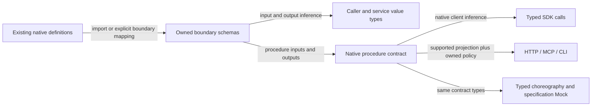

# Model and native contracts

Use this method for a new or changed domain boundary. Reuse an established model for a bounded change. Shared [object modeling](../data-state-modeling.md#object-models-as-the-design-basis) owns the general concepts; this method connects them to a declarations-first contract design.

## Derive responsibilities from the scenario

Start with the canonical scenario's actor, desired outcome and decisive branches. Read the existing native declarations and their consumers before extracting concepts from a prototype. Distinguish observed current behavior, selected target behavior and unresolved assumptions. Keep the original scenario as the requirement source.

For each consequential concept, retain its meaning, owner and source, then answer the relevant questions:

| Decision | Derive from the scenario | Check against a deciding example |
| --- | --- | --- |
| Entity or value | Stable identity/history versus value equality; attributes, units and absence meanings | Could two equal-looking values refer to different resources or revisions? |
| Relationship | Ownership, cardinality, allowed references and independent lifetimes | What remains valid if a related resource changes or disappears? |
| Aggregate boundary | Facts that must stay consistent under one owning operation | Which competing command could break the invariant? Leave the future atomicity mechanism unresolved when not selected |
| Domain operation | Valid construction, queries, commands, guards and resulting facts | What may change, what must remain unchanged, and why can the request be rejected? |
| Application/service capability | A coherent caller use case and the capabilities it coordinates | Does it coordinate several owners, or belong to one existing object/value operation? |
| State or observation | Resource lifecycle versus caller knowledge, transient view state and pending local input | Does losing an observation prove the resource failed, or only that its result is unknown? |

Try merging or deleting a disputed concept and replay the deciding branch. Retain distinctions required by identity, version, scope, authority, lifecycle or consistency. A UI panel, selected tab, loading flag or demo array does not establish a domain entity. UI drafts and return context can have their own interaction owner without becoming authoritative resource state.

Use records/functions, classes or service signatures according to responsibility. Entities need meaningful operations and protected invariants; they do not all need classes. Values and pure transformations can remain local. An aggregate is a consistency decision, not a demand for a database transaction or a service per entity. Publish only capabilities needed by actual consumers; do not make every object method an RPC procedure.

## Separate declaration and enforcement responsibilities

| Concern | Contract responsibility | Enforcement or mapping owner when implementation is authorized |
| --- | --- | --- |
| Values and fields | Identity, units, bounds, variants, optional/null meanings, reference target and version | Boundary validation and the owning domain operation |
| Queries and commands | Actor/context, required facts, guards, outputs, stable errors and effects | Domain/application service; authentication context is established by a trusted boundary |
| Lifecycle | Allowed transitions, state-specific facts, rejected/duplicate/stale inputs, intended effects | Owning operation and the actual coordination boundary |
| Storage | Facts that must survive and required consistency/retention semantics | Persistence adapter when authorized; an in-memory Mock does not require or establish production persistence |
| Transport | Wire values, serialization, safe error mapping and loss policy | SDK/HTTP/MCP/CLI adapter |
| View | Selection, draft, comparison, presentation and observation freshness | UI/caller projection; it must not rewrite authoritative resource state |

For each substantive method, keep semantic notes beside the native declaration: input preconditions; result and error meanings; changed and unchanged facts; acceptance versus completion; partial or unknown outcomes; idempotency scope; continuation and recovery; and owned/borrowed resource lifetime where relevant. Use the shared [public contract questions](../engineering-design.md#public-contracts-and-domain-meaning) instead of maintaining a second signature list. Declarations name the promise; a specification Mock, runnable frontend Mock and production service establish different enforcement evidence under their actual boundaries.

Put validation failures, expected domain refusals, transport failures and unexpected internal failures in distinct documented categories. Choose the native contract's declared errors or result variants consistently; a valid refusal must not be shaped as a successful completed effect. Keep public messages safe. A `forbidden` schema variant does not implement authorization, and a revision field does not implement compare-and-set.

## Keep one native source chain

A selected runtime-schema and procedure stack follows [native declarations and owned projections](../../domains/agent-facing-systems/contracts.md#native-declarations-before-projections). Keep a single editable owner per fact and derive consumer types and bindings from it.

This is the selected design chain, not a claim that generators, adapters or a server exist. Use the selected stack's supported client inference for the SDK/port shape. For example, oRPC offers `ContractRouterClient<typeof contract>`; that example does not require choosing oRPC or imply that an adapter is installed. Exact operation declarations remain in the native contract. Keep schema/operation metadata there, or reference one surface-owned mapping for presentation choices. Do not add a second handwritten operation registry, independent SDK method list or parallel DTO interfaces. When runnable Mock consumers are authorized, apply [provisioning](../mock-provisioning.md#separate-derived-mechanisms-from-domain-behavior) to implement the same chain with explicit handler coverage and owned behavior.

| Existing authority | Reuse rule |
| --- | --- |
| Compatible native schema and type | Import or compose the schema; infer its derived types. Do not restate its fields under a new platform name |
| Native TS type without a runtime schema | Import the type. Reuse any supported schema source/generation first; otherwise own the smallest necessary validation or wire schema with an explicit correspondence check and documented unsupported semantics |
| Native value cannot cross JSON unchanged | Define a deliberately named wire representation and declared encode/decode mapping tied to the original type. Infer wire types from its schema; do not redefine the original entity |
| Missing proposed platform concept | Declare only the new ownership and facts; reference native identities/values rather than copying their whole model |

For the TS-only case, a handwritten boundary validator can be necessary; it is not permission to maintain a second handwritten TS definition of the native model. Distinguish that adapter schema from a schema claiming to redefine the native authority. A type correspondence check catches some shape drift, not all native invariants or runtime validation errors.

Inspect both the native parser's input and its normalized output before reusing a configuration or document type. A parser can turn keyed file entries into arrays carrying their keys as identity fields; serializing that normalized object does not recreate a valid file. Keep the file encoder/decoder with the adapter, preserve omission and defaults, and exercise read → local edit → save → reread. Label a limited view projection separately from native validation. Use the native validator when available at the actual boundary; a projection must not claim its authority.

### Schema direction and JSON boundaries

For a selected Zod schema, use `z.input<typeof Schema>` for values accepted before parsing and `z.output<typeof Schema>` for parsed values; `z.infer` denotes the output type. Defaults, coercion and transforms can make those types differ. Identify where validation runs and whether a service receives raw wire input or parsed domain input. An SDK's public argument type comes from its actual contract/client inference; do not force it to accept a different shape with a cast.

“Derive in both directions” requires an explicit source and supported mechanism for each direction. Schema-to-TS inference is native. TS-to-runtime-schema generation needs a real supported tool or owned boundary validator; TypeScript type erasure provides no runtime reflection. A conversion round trip is a separate semantic property. Do not claim arbitrary bidirectional generation, lossless conversion or schema equivalence from structural assignability. Never use `as`, `any`, an empty schema or an unchecked custom predicate to disguise a missing validator.

Check JSON boundaries for unsupported native values and semantics: `undefined` versus omitted/null, dates, bigint, bytes, maps/sets, class instances, callbacks, resource handles, non-finite numbers and opaque references. State the accepted encoding, precision, units, ownership and decode failures. Do not assume native RPC serialization also works for generic HTTP or MCP JSON. Credentials and local handles remain behind their owner; expose safe references only where the public contract requires them.

### Preserve meaning in each projection

Follow the shared [projection policies](../../domains/agent-facing-systems/contracts.md#give-every-projection-an-explicit-policy). The native contract supplies operations and schemas; each actual surface owns its additional rules and records unsupported mappings.

| Surface | Own explicitly |
| --- | --- |
| SDK / native RPC | Client type derivation, endpoint/auth setup, protocol serialization, typed domain errors versus connection failures, cancellation and observation lifetime |
| HTTP / OpenAPI | Routes and operation IDs, status and error mappings, security declarations, JSON/absence policy and supported schema dialect; native RPC is not generic JSON HTTP |
| MCP | Tool names, object envelopes, supported JSON Schema, structured results/tool errors, connection lifetime and conservative effect hints |
| CLI | Grammar and parsing, omitted/clear/false distinctions, machine stdout, diagnostics/exit codes, interruption and input-source precedence |

Record losses such as schema refinements, transformations or units not expressible in a projection, and how native validation or caller documentation preserves the promise. A transport can compose several operations; it need not mirror each method one-for-one. Names and matching types alone establish neither authority nor effect parity. Use only the selected versions' actual supported projection paths; design-only bindings remain labeled proposed.

## Evolve the promise with its consumers

Compare old and proposed observable behavior using [changed promises](../collaborative-modeling.md#compare-changed-promises). Inspect both structural and semantic compatibility: units/defaults, absence, enum/result/error variants, revision rules, permissions, idempotency, lifetime and recovery/retention. An added union branch can break an exhaustive caller even when old data still parses.

Name the affected native consumers, stored or issued facts, in-flight operations and surface mappings. Declare whether existing work retains its old policy or needs explicit adaptation; keep execution identity stable across recovery. Update the native source first, then actual derivations and affected caller cases. Do not hand-patch generated output or add speculative compatibility machinery for unpublished internal drafts. Leave unexamined consumers and unsupported runtime guarantees visible for the next owner.
