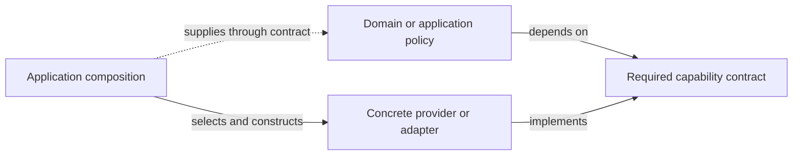

# Engineering Design Guide

Use this guide for the design situations below, in either independent or delegated work. Read only the sections relevant to the current decision. Design before implementation, using top-down decomposition and separation of concerns. Apply the proportionality check before committing to a design: introduce abstractions, protocols, migration systems, or multi-phase strategies only when the current problem demands them. Routine fixes within existing contracts do not require reading this guide.

For simple content, express it directly. For new models, complex relationships, interacting states or multiple dimensions, apply [visual model communication](interactive-design-communication.md): derive a polished panoramic HTML view from the domain model, compose professional visual forms such as Mermaid, SVG, Canvas, chart libraries or 3D renderers, deliver the portable componentized HTML file early; when shared access is needed, serve that same file through LAN HTTP and update it with the canonical model. This also applies to systems without a frontend.

## Routing

| Situation | Apply |
| --- | --- |
| Assessing existing architecture, interfaces, classes, dependencies or overall engineering quality | Start with [architecture and engineering quality review](./architecture-quality-review.md); this file owns design principles, while that guide owns review scope, evidence and proposal delivery |
| Choosing a technical approach, toolchain, library, framework or infrastructure solution, or preparing to implement a general-purpose capability | [Technology selection design](#technology-selection-design) |
| Designing or changing a command-line tool's public interface | [Command-line tool design](./command-line-design.md): model the whole command surface, configuration and caller experience before choosing parsing and dispatch mechanisms |
| Designing an end-to-end product, service, or cross-layer architecture | [Domain, module, and product composition](#domain-module-and-product-composition), then [Service contracts and dependency inversion](#service-contracts-and-dependency-inversion); use [Contract boundaries and integration](#contract-boundaries-and-integration) for the relevant integration boundary |
| Designing or materially changing project structure, domain boundaries, contracts, or a non-trivial feature | [Types and contracts before implementation](#types-and-contracts-before-implementation), [Domain-oriented structure](#domain-oriented-structure), and [Directory hierarchy](../code-structure.md#directory-hierarchy-as-a-module-map) |
| Defining interaction between domains, modules, frontend/backend, services, APIs, RPC, or events | [Service contracts and dependency inversion](#service-contracts-and-dependency-inversion), then [Contract boundaries and integration](#contract-boundaries-and-integration) for the relevant integration boundary |
| Choosing module hierarchy, public interfaces and implementation organization | [Module contracts and implementation patterns](#module-contracts-and-implementation-patterns) and [directory hierarchy](../code-structure.md#directory-hierarchy-as-a-module-map) |
| Defining a module's public responsibility, Service operations or their domain types | [Public contracts and domain meaning](#public-contracts-and-domain-meaning), with a focused [architecture/interface diagram](../documentation.md#architecture-and-interface-diagrams) |
| Defining a bounded function, value type or small module interface | [Small module and value contracts](#small-module-and-value-contracts): native declarations and nearby behavioral meaning; deepen the model only for an unresolved boundary |
| Deriving or revising a scenario's module responsibilities, collaboration or contract against a baseline | [Collaborative modeling](collaborative-modeling.md): choose a starting model, expose unresolved semantics, trace required facts and check the selected guarantee before handoff |
| Publishing or consuming a protocol-derived SDK, generated client or typed module package | [Protocol-derived packages and SDKs](#protocol-derived-packages-and-sdks) |
| Modeling domain data or behavior that depends on lifecycle or history | [Data and state modeling](./data-state-modeling.md), including its state-machine selection and progressive modeling workflow |
| Designing a web page, screen, layout or component hierarchy | [Web development scenarios](../domains/webdevelopment/AGENTS.md): select experience, interface structure, design-system and component-contract guidance according to the decision, together with the applicable general contract and state sections |
| Implementing a complex feature | Relevant design sections above; model the problem and maintain task state using [project context guidance](./project-context.md) |
| Making a bounded change within an existing design | Follow existing contracts; revise only the affected types or boundaries when necessary |

## Technology selection design

Once architecture identifies domain responsibilities, boundaries and required capabilities, resolve consequential technology choices before substantial implementation. Select the toolchains, frameworks and infrastructure that will realize those capabilities; research may reveal constraints that require revisiting the architecture. Reuse accepted choices while their requirements remain valid, and investigate the affected capability when a new requirement or concrete limitation appears.

Derive selection criteria from the affected scenario, invariant or contract. Separate required guarantees from preferences: for example, recovery may require preserving an original operation identity across process restart, while concurrent admission may require an atomic decision. Name the relevant environment, supported runtime/version, scale and resource constraints. A preferred library or a generic quality score is not the requirement.

When inheriting an earlier proposal, separate necessary facts and guarantees from its suggested technical carrier. Check the mechanism against the current scale, process model and constraints before treating it as an accepted requirement. For recovery, first identify the facts that must survive, effect ordering, concurrency and atomicity needs; then assess whether existing platform/file capabilities suffice or a database is justified. Do not equate recovery with a database, or single-machine use with sufficient file guarantees. This is a focused decision in the current design, not a mandatory new research or approval phase.

### Reuse before building

- **Own domain policy; reuse technical mechanisms.** Keep project-specific domain meaning, invariants and business decisions in project-owned code. Standard capabilities such as parsing, transport, persistence, serialization and build tooling should normally come from suitable existing solutions. DDD ownership does not require implementing their low-level machinery.
- **Research before rebuilding.** Inspect platform capabilities and existing project dependencies first. Where they are insufficient, investigate suitable, mature and maintained open-source solutions in the relevant ecosystem before writing custom infrastructure. Consider complete tools or integrations as well as libraries; composing established capabilities often removes more work than wrapping individual primitives.
- **Compare total complexity.** Evaluate functional and semantic fit, maintenance, ecosystem compatibility, license constraints, security, performance, integration and operating cost. Include adapter code and future upgrades in the comparison. Popularity alone is insufficient, and a dependency that introduces disproportionate complexity may be a poor fit.
- **Build the demonstrated gap.** Custom infrastructure needs a concrete unmet requirement or a supported cost advantage over available solutions. Prefer a narrow adaptation to recreating an entire mechanism. Use [capability contracts and adapters](#service-contracts-and-dependency-inversion) where external APIs would otherwise couple domain policy to a framework or provider; ordinary utility use needs no automatic wrapper.

### Research and decision evidence

Research candidates through current official documentation and upstream repositories. Verify the required behavior, supported versions, maintenance and license against the project's constraints; distinguish a promising candidate from a verified fit. Use a focused prototype when a consequential uncertainty cannot be resolved from the available evidence. Scale research to the decision; an established choice with unchanged requirements does not need a new survey.

Record consequential choices in the owning design: the capability to satisfy, selected solution, relevant alternatives, evidence, integration boundary and any remaining custom work or uncertainty. Link authoritative sources and applicable versions instead of copying documentation. A short comparison may suffice; use the [Module artifact destinations](./project-context.md#keep-context-discoverable) rather than requiring a separate selection document for every dependency. For custom work, retain the specific reason existing solutions were unsuitable.

Make the tradeoff inspectable: connect each decisive requirement to the candidate's mechanism or limit, explain why the selected option fits better than the relevant alternatives, and retain the conditions that would require reconsidering it. For a consequential unknown, state what a bounded probe must establish or leave that guarantee unresolved. Choosing a solution, integrating it and exercising its promised behavior are different facts. Keep the current choice and its remaining limits in the owning topic; retain the decision's rationale by reference, without a separate dependency registry.

For example, a document-processing service may own its interpretation and acceptance rules while using a mature parser for syntax and an existing storage client for persistence. Select those mechanisms against the service's contracts, and keep its domain decisions in the service.

## Types and contracts before implementation

For scenario-to-declaration work, [consumable contract modeling](contract-modeling.md) connects these decisions to native schema reuse, representation boundaries and complete caller flows. Use [Mock provisioning](mock-provisioning.md) when a real frontend needs runnable simulated supply; declarations and fixtures alone do not provide that capability.

For a system composition, use C4 context/container/component views at the levels needed to establish responsibilities and module boundaries; connect the selected boundaries to their owned contracts. Do not produce every level when the existing model already answers the question.

Let responsibilities and consumer needs determine contracts, and let contracts guide implementation. **Design → Skeleton → Implement** is a useful progression when establishing new boundaries, not a mandatory set of artifacts for every change. If the domain or boundary is unclear, use [progressive derivation](./project-context.md#progressive-derivation-and-externalized-reasoning) to resolve the uncertainty with a small model or sketch.

For a scenario that still needs concept, responsibility or behavioral derivation, use [collaborative modeling](collaborative-modeling.md). Clear existing contracts may be changed directly; the modeling route does not require converting all prose to types or adding an implementation to a design-only task.

- **Model responsibilities and dependencies.** Identify domain concepts, use cases, ownership and permitted dependency directions, then resolve relevant [technology choices](#technology-selection-design) before committing to concrete mechanisms. Record consequential decisions in existing context using a suitable [expression model](../documentation.md#structured-and-model-based-expression).
- **Make contracts canonical.** Define meaningful types, public operations, failure semantics and relevant effects or lifecycle guarantees using [data and state modeling](./data-state-modeling.md). Keep declarations with their owner and link them from designs so consumers and providers share one source of truth.
- **Expose structure where it helps.** A skeleton can make a new responsibility map, public signatures and composition points reviewable before behavior is complete. Reuse existing declarations for established boundaries; design-only work may remain a model or signature sketch. Use stubs or mocks only where they help validate a collaboration.
- **Implement the whole declared batch.** Apply [whole-domain authoring](../principles.md#whole-domain-authoring): create the related contracts, modules and consumer bindings together, fill behavior within the common structure, then concentrate consistency and behavioral verification. Design → Skeleton → Implement describes the capability as a whole, not a repeated file-by-file cycle. Use early probes for consequential unknowns; revise a mistaken boundary and affected consumers coherently.

Use the language's natural abstraction mechanisms: typed functions, data types, modules, interfaces, or protocols. Contract-first design does not require inheritance, a class for every concept, a separate interface for every implementation, or abstractions for hypothetical future variants. For a bounded change, apply these principles only to the affected contract and behavior.

### Small module and value contracts

For a small module, its real exported function, interface or value type can be the complete declaration. Put semantics that the type cannot express in nearby documentation: input constraints and absence/units, result guarantees, relevant errors or effects, and resource lifetime if it owns resources. Reference an existing domain rule instead of copying it. For example, a duration parser needs to define accepted syntax, units, range and invalid-input behavior; it does not need a Service, protocol generator or model catalog.

Consumers and implementations use the same native declaration. A new declaration may precede implementation; label sketches, stubs and unsupported result branches honestly, and remove a design-only signature copy once the real declaration owns it. Verify the affected public behavior through an actual caller or focused contract check; compilation alone establishes neither runtime validation nor the promised effect. Keep module-local details local and link only meaningful boundaries from the broader model.

## Domain, module, and product composition

Design a complex product from the outside in. The product is a composition of capabilities; each capability is owned by a domain module; each domain module separates its public contract from its internal model, use cases, and concrete adapters. The same model applies whether a boundary is implemented as an in-process service, an HTTP API, an RPC method, or an asynchronous event.

```text
Product = Compose(Domain₁, Domain₂, ..., Contracts)
Domain = PublicContract + DomainModel + UseCases + Adapters
Boundary = Contract + Mapping + FailureSemantics + CompatibilityRules
```

At the product level, map capabilities, domain relationships, composition points, and cross-domain flows. At the domain level, define vocabulary, owned facts and state, invariants, use cases, ports, persistence representation, and the distinction between exported and private members. At the module level, make the public operations and dependency direction visible before choosing concrete classes, storage clients, transport handlers, or framework details. A domain may remain a module in one deployment; DDD does not imply microservices or separate repositories.

Use that capability map to drive [technology selection](#technology-selection-design): distinguish domain policy to implement from technical capabilities to obtain through existing solutions before building the concrete providers.

Keep each domain's state and rules behind its owner. Other domains request capabilities through the declared contract and receive results, errors, or events; they do not import private implementation files or mutate another domain's storage. Apply [service contracts and dependency inversion](#service-contracts-and-dependency-inversion) to those collaborations and their composition points.

## Domain-oriented structure

- Keep the project's public organization and composition focused on responsibilities and relationships. Apply [structure and detail](../code-structure.md#structure-and-detail) when choosing file, module, and function boundaries.
- Organize engineering code around cohesive business capabilities or domain responsibilities, following domain-driven design principles. Define each domain's vocabulary, owned data, rules, public capabilities, and boundary with neighboring domains. Use explicit bounded contexts when the same concept has different meanings or rules in different domains.
- Let the project structure expose those responsibilities. Prefer domain modules with explicit public entry points over grouping all business code only into global `services`, `models`, or `utils` directories. Choose concrete folders and layers to fit the project's scale and conventions; avoid unrelated structural rewrites.
- Separate domain rules, application orchestration, and delivery or infrastructure concerns. Domain code owns business meaning and invariants; application code coordinates use cases; adapters handle UI, transport, persistence, and external services. These responsibilities need not each become a package or directory in a small project.
- Apply [dependency inversion](#service-contracts-and-dependency-inversion) to keep core domain rules independent of UI frameworks, database clients and vendor SDKs. DDD determines domain meaning and ownership; dependency inversion governs how those responsibilities depend on mechanisms.
- Cross domain boundaries through declared public contracts. Do not import another domain's internal implementation or mutate its owned state directly. Keep shared concepts small and stable; do not create a common model merely because two domains currently have similar fields.
- Apply DDD patterns only when they solve a present modeling problem. Domain boundaries do not imply microservices, separate deployments, repositories for every entity, CQRS, event sourcing, or a message bus. A small system can preserve clear ownership and dependency direction with a few modules.

## Public contracts and domain meaning

A module's public contract should let a consumer understand its responsibility and interactions in domain terms without reconstructing its private implementation. Establish meaning before choosing transport or generating code. Completeness means supporting the declared scenarios and outcomes, not exposing every internal method or anticipating every possible use.

| Design question | Make explicit |
| --- | --- |
| What does the module own? | Its cohesive capability, authoritative facts, responsibility limits and intended consumers |
| What can a consumer do? | Domain-named commands, queries or events; required inputs, results, failures and relevant state/effect guarantees |
| Under what conditions can it rely on the result? | Preconditions, scope/revision and authority supplied by the caller; distinguish acceptance, completion and observation, including partial or unknown outcomes where relevant |
| What do its types mean? | Entity identities, values/units, relationships, valid variants and absence semantics; link [data/type definitions](./data-state-modeling.md#data-and-types) |
| How do Services relate to the model? | Which use case or capability each Service operation supplies, which entities/value types it uses, and where the rules are enforced |
| What must remain private? | Implementation mechanisms and representations that callers do not need to depend on |

A Service groups coherent capabilities; it is not automatically a database table wrapper or one Service per Entity. An Entity owns identity and domain behavior, while an application Service may coordinate a use case across capabilities. Use the existing [domain object model](./data-state-modeling.md#domain-objects-and-behavior); keep domain rules with their owner instead of spreading them into transport handlers or clients.

For module/interface design, create or update a focused [architecture/interface diagram](../documentation.md#architecture-and-interface-diagrams) in the existing design or working document. Connect consumers, public Service operations, entity/value types and meaningful dependencies; add behavioral views when state or call ordering matters. Link canonical declarations instead of reproducing every signature, and record unresolved semantics before relying on the contract for independent implementation.

## Service contracts and dependency inversion

At meaningful service and module boundaries, establish [public domain semantics](#public-contracts-and-domain-meaning) before selecting implementations. An interface, protocol or typed function should express what a consumer needs and what a provider guarantees, rather than mirror all methods of a concrete class. Responsibility isolation can justify a contract even with one implementation; hypothetical variants alone do not.

**Dependency inversion (DIP):** high-level domain or application policy depends on required capabilities, and concrete providers implement those abstractions. Keep a required port with the policy that needs it; keep a service's offered contract with the service that owns it. Reuse a compatible public contract when meaning and ownership align; adapt where they differ. Runtime calls may reach infrastructure, but source dependencies must not make core policy import concrete infrastructure.

**Inversion of control (IoC):** for service composition, separate the use of a capability from control over its construction, selection and wiring. At an application composition boundary, supply implementations through constructor arguments, function parameters or factories. Dependency injection is one way to achieve IoC; it does not require a container. Keep concrete provider construction and service lookup out of domain policy, and make lifecycle ownership explicit.



Solid arrows show source dependencies; the dashed arrow shows runtime wiring. A replacement must preserve observable guarantees, including failures, effects and lifecycle rules, not just method signatures. Verify substitutability with a real caller or a focused contract check; replacing a conforming provider should leave consumer policy unchanged. Use [boundary integration guidance](#contract-boundaries-and-integration) for remote services: an API schema alone does not isolate domain policy from transport or vendor details.

## Contract boundaries and integration

Treat the contract as the primary design artifact at every meaningful boundary. Its representation varies with the transport, but its purpose stays the same: state what a consumer may request, what the provider guarantees, how failure and effects are reported, and which details remain private.

Protocol design describes permitted interaction through that contract: inputs, actions/events, relevant state, results and ordering. Apply it to backend-internal modules, frontend domain capabilities, parent/component interactions and page workflows as well as frontend/backend calls. Local protocols need no network serialization or RPC layer; use [frontend protocol guidance](../domains/webdevelopment/interaction-and-state.md#component-and-page-protocols) for component and page expressions.

When the consumer is a person or script, use the native [CLI contract](command-line-design.md#results-effects-and-recovery) or [product interaction promise](../domains/product-design/requirements.md#define-feature-and-interaction-promises). Those interfaces compose domain capabilities and own their local output or interaction rules; they need not mirror Service methods one-for-one. Trace their [cross-interface mappings](collaborative-modeling.md#carry-a-promise-across-interfaces) when a distinction could change meaning.

| Boundary | Contract form | Concrete implementations |
| --- | --- | --- |
| Same-process public module or service | Owned typed interface/function and command/result types; use a subject-local interface file when useful | Service, application function, local adapter or intentional package exports; no RPC required |
| Frontend/backend or other HTTP API | OpenAPI with request/response schemas, or another complete HTTP contract | Route handler, client, generated SDK and boundary mapper; follow [API contract maintenance](./api-contracts-and-sdks.md) |
| Separately deployed RPC participants | Protobuf/IDL or the chosen RPC protocol's schema | Server handler, client stub, generated types and adapters |
| Asynchronous integration | Event/command schema plus delivery and retry semantics | Publisher, consumer, queue or broker adapter |
| Private implementation within one module | Local types/functions and clear internal ownership | Direct collaboration within the module; no automatic interface file, SDK or transport layer |

Before designing or reviewing the interaction, locate its actual contract and data/type definitions, identify the authority and consumers, and check that they describe the relevant behavior. A missing or stale contract is a concrete gap; screenshots, call sites and generated types alone do not establish an authoritative protocol. Separate deployment calls for an explicit transport choice such as HTTP or RPC; it does not make every internal module remote.

Define a contract's owner, capability, inputs, outputs, failure cases, side effects, lifecycle, idempotency or ordering requirements, and compatibility policy when those properties matter. Use a mature standard and existing project tooling for schema validation, code generation, and client SDKs when they fit the actual boundary. Generated clients and transport DTOs are derived integration artifacts; they do not replace the domain model or authorize transport details inside domain rules.

Keep mapping explicit when transport, storage, and domain semantics differ. A request DTO may become a domain command; a persistence record may become an entity or value object; a domain result may become a response or event. Reuse one type only when its meaning, ownership, lifecycle, and compatibility requirements are genuinely the same. Do not expose a repository record or framework object as a domain contract merely because the fields currently match.

During internal iteration, correct obsolete boundaries instead of adding speculative backward-compatibility layers. Preserve compatibility, user data and fixed releases where the actual consumer or release contract requires them.

For a contract change, update the contract and its compatibility expectations first, then the provider, boundary mappings, generated artifacts, and consumers in dependency order. Verify a real caller and the relevant rejected or failed paths. Do not add versioning, code generation, or a protocol layer without a concrete compatibility or integration need.

### Protocol-derived packages and SDKs

A module's usable public surface may be a typed package, a generated client or an SDK. For a machine-readable service/protocol boundary with suitable project tooling, prefer deriving transport types and client bindings from the authoritative definition over independently retyping the same contract in providers and consumers. An in-process capability can expose its typed package directly without a network protocol or generator.

Keep generated artifacts subordinate to their source contract and handwritten domain adapters separate. Preserve [domain/storage/transport meanings](./data-state-modeling.md#domain-storage-and-transport-representations); generation does not replace domain behavior, validation or compatibility checks. Show the definition-to-package-to-consumer path in the boundary diagram.

Use [API contracts and SDKs](./api-contracts-and-sdks.md) for contract discovery, OpenAPI ownership, lint/bundle/generation, compatibility checks and tool selection. Apply its RPC route only to an actual RPC boundary; private module organization follows the local implementation rules below.

## Module contracts and implementation patterns

Design the module's responsibility, collaboration and public contract together with the intended implementation roles. The directory hierarchy should express those choices using [the directory model](../code-structure.md#directory-hierarchy-as-a-module-map). A folder is not necessarily a separately consumable module, and an exported interface is not necessarily a justified abstraction. Public exports must describe what consumers need; internal layout should make the implementation understandable without exposing it as API.

Select the simplest pattern that represents a present requirement:

| Requirement | Suitable shape | Keep explicit |
| --- | --- | --- |
| Pure, stable transformation or small cohesive capability | Functions and readonly values in a shallow module | Input/output invariants and deliberate exports; no mandatory class/interface pair |
| Clear domain entity or value object with cohesive behavior and invariants | [Object model](./data-state-modeling.md#domain-objects-and-behavior), using a class when it expresses ownership clearly | Identity or value equality, valid construction, domain operations and protected invariants |
| Complex capability with several cooperating internal parts | Cohesive child directories behind a small public facade | Internal responsibility, dependency direction and which children are private versus independently consumed |
| External mechanism or real implementation variation | Consumer-owned port/protocol with concrete adapters or strategies | Substitutability, failure/resource semantics and the composition point; do not prebuild hypothetical variants |
| Stateful resource or session | Class or closure factory exposing a lifecycle contract | Acquisition, owned/borrowed handles, legal states, mutation, cancellation, drain and close |
| Cross-domain use case | Application function/service using required capability contracts | Effect ordering, retained partial outcomes and boundaries with presentation and concrete resources |

These shapes may coexist. Do not impose `interface.ts` + `implementation.ts`, inheritance, dependency injection frameworks or separate packages on every module. Co-locate a contract with its owning capability; separate its declaration when consumer dependency direction or implementation complexity requires it. Keep internal helpers direct and private rather than routing them back through an implementation-exporting barrel.

Before filling a non-trivial implementation, make its responsibility map, main contracts/signatures, concrete implementation homes and composition point discoverable. Validate the design with a real caller and a realistic change: adding an implementation should not require consumers to import private files, while changing a local rule should not force navigation through unrelated global directories. If the tree, contracts and actual dependency graph disagree, revise the ownership model rather than adding another wrapper or allowlist exception.
