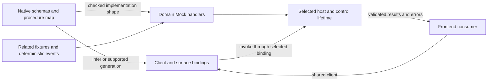

# Mock provisioning and frontend consumers

Use when a task authorizes a frontend to consume a runnable Mock through native contracts. Start from the canonical scenarios, existing domain model, native schemas/procedures and actual consumer. [Caller flows](contract-modeling/caller-flows.md#trace-a-complete-outcome) supplies the data and state questions; this method adds provision, host lifetime and consumer integration. Presentation-only edits retain the UI method. Declaration-only work can stop at its assigned boundary.

The result is a usable simulated supply and evidence of what the frontend can consume. It does not establish a production service. Select only the bindings needed by actual consumers; a shared factory and an in-process client may be sufficient. This method requires neither a general-purpose Mock framework nor HTTP, CLI and MCP implementations in every project.

## Separate derived mechanisms from domain behavior

Keep one native procedure map as the operation authority. Reuse canonical native types and validators according to [the source chain](contract-modeling/model-and-contracts.md#keep-one-native-source-chain); infer client inputs, outputs and errors through the selected stack. Do not invent a second DTO family for the Mock or manually restate its methods in each page, transport or generated file.

| Responsibility | Derive or reuse | Own explicitly |
| --- | --- | --- |
| Contract and boundary | Existing schemas, procedure paths, inputs, outputs and declared errors | Native meaning, refinements, JSON policy and supported dependency versions |
| Provision mechanism | Contract-derived client/server registration and schema projection where supported | Host construction, parser placement, error mapping, disposal and unsupported projection policy |
| Domain behavior | Native value types and the declared operation/result shape | Related fixtures, creation rules, guards, transitions, version changes and simulated external events |
| Surface adapter | Same procedure map and supported SDK/server/schema tools | The selected in-process, HTTP, browser interception or CLI binding and its actual protocol rules |
| Frontend consumer | Shared inferred client and returned snapshots | View projection, drafts, selection, cache policy, pending calls and visible recovery |

Prefer the stack's supported contract implementation/router facilities over handwritten dispatch infrastructure. A behavior-handler map implements the contract; it must not become a separately maintained operation catalog. Check its completeness and signature agreement against the native map. An added procedure with no behavior must fail compilation or a bounded initialization/coverage check; dispatch must fail closed with an explicit unsupported/implementation diagnostic if reached. Never supply generic success, schema-shaped random data or an old demo-state fallback. Do not invent a domain refusal code to conceal an unfinished handler.

Client inference, generated source and handwritten domain handlers are different artifacts. Record which actually exists. When generation is selected, its inputs come from the same procedure/schema source; output files have an owner and reproducible command, and consumer builds detect stale artifacts. Do not hand-patch generated results. A server registration, CLI command binding or schema/OpenAPI output can reuse that map without duplicating procedure definitions; each projection still owns its [surface policy](contract-modeling/model-and-contracts.md#preserve-meaning-in-each-projection). A schema export or typed SDK alias alone supplies no invocation path.

The following is a responsibility view, not a prescribed package layout or an implemented generator:

## Build coherent default supply

1. Select a complete outcome and its deciding branches from the canonical scenarios. Trace reads, creates, writes and continuations to owning operations. Name missing input supply or unsupported behavior before wiring the UI; fixture data does not create a missing contract operation.
2. Provide an explicit construction entry with a usable default scenario. Normal frontend startup must create or connect to that supply without test-only manual setup. Keep alternate seeds/scenarios as deliberate controls. Do not connect to production or silently switch to local arrays after failure.
3. Own a deterministic seed and fixture builder for the required related facts. Fix or inject clock, identity sequence, external events and scheduling as needed. Preserve project/resource relationships, revisions, scope, ordering and derived totals. Valid independent random objects do not establish a coherent world. Seeded randomness is suitable for bounded shape exploration, not a substitute for domain behavior.
4. Support normal creation as well as seeded reads. Check creation from the relevant empty state, defaults, stable returned identities, related-object initialization and subsequent query/command use. Do not hardcode all behavior to one seed ID or select the first fixture when an ID is missing. Seeded identity allocation must not collide with later creates. The contract owner decides whether a default belongs in the schema, creation operation or fixture.
5. Implement the smallest state behavior needed for the selected scenarios. Commands validate guards and update owned state/revisions; queries read without silently advancing lifecycle. Keep related facts consistent and return snapshots rather than mutable references into the store. Reject stale, wrong-scope or illegal-state requests under the native semantics without changing unrelated work. Inject external completion/decision/failure events instead of calling real providers.
6. Parse fixtures and exercise invocations with the owning runtime schemas. Document where raw input becomes parsed input, including defaults, coercion and transforms; use the same validator semantics for an in-process call and any selected transport. Validate outputs and declared error payloads too. A handler must not accept an unchecked shape merely because its TypeScript type matches. Preserve [schema input/output direction](contract-modeling/model-and-contracts.md#schema-direction-and-json-boundaries); avoid applying a transform twice.

Finite in-memory state can model a conflict or continuation without proving durability or real concurrent admission. Label serialized transition assumptions. A canned response remains scripted evidence even when served by a real host. Keep unknown, partial, accepted, completed and rejected outcomes distinct; follow the existing [deciding branches](contract-modeling/caller-flows.md#challenge-the-promise-with-deciding-branches).

## Choose the boundary the consumer needs

Choose the first adequate host for the actual question and deployment of the prototype. Reuse a supported protocol adapter rather than hand-encoding native RPC envelopes.

| Binding | Useful when | Evidence and remaining work |
| --- | --- | --- |
| In-process contract-derived client | An offline browser or local consumer needs fast default supply without a service | Exercises the selected validator/handler/client path; does not exercise wire serialization, network failures or HTTP |
| Mock host over actual HTTP | Consumers need a shared process, an independently callable endpoint or verification of the selected wire boundary | Exercises only the actual protocol/client/server cases run; owns listener lifetime, address and port, serialization and browser-origin policy where applicable |
| Browser request interception | An existing browser network client should run unchanged against simulated responses | Can exercise client request construction and browser behavior; registration, request matching, worker lifetime and unmatched-call policy are owned. Intercepted responses do not establish that a server received HTTP |

Transport choice does not change the domain fixture/transition owner. Reuse its behavior through the selected adapter. If several surfaces are required, keep procedure coverage shared and add only their distinct protocol policies. Inspect selected library versions before claiming native RPC, generic HTTP, schema export or CLI mappings are supported. Treat unsupported conversion as a named gap; a handwritten approximate schema cannot silently replace the runtime validator.

## Own host lifetime and controls

Define the actual state lifetime: per factory, browser tab, worker or server process; who shares it; what reload, hot reload or reconnect does; and when it is disposed. Create the host/client at that boundary and supply it to pages. Recreating it on render loses work; an accidental global singleton leaks state across independent scenarios. State retained only in memory has no restart-survival guarantee.

Keep reset, scenario selection, deterministic event/clock advancement, error injection and latency controls on a deliberate development/control surface. They configure simulated conditions; they are not extra product operations inferred from the contract. Provide only the controls needed to reproduce the assigned cases. Document their defaults and scope, including whether an injected error happens before a mutation or after an effect may have occurred. A timeout after a possible effect must preserve the contract's unknown-outcome semantics.

Reset must restore the declared seed, clock/ID allocation and control defaults, clear scoped caches/observations and stop or invalidate old timers, subscriptions and pending responses. Use a host generation or equivalent ownership check when older asynchronous work could repopulate the new state. Scenario changes need the same boundary policy. Dispose listeners, workers and timers under their owner; retain any intentionally shared process explicitly. Reset is a development action, distinct from retrying or cancelling a domain operation.

For a host reachable by other consumers, document its binding, sharing and reset behavior in the implementation's setup guide. Do not infer browser-tab isolation from the fact that the UI runs in a browser, or LAN reachability from a successful local page load. Keep mechanism diagnostics in developer-facing controls or evidence; product UI exposes useful pending/error/recovery information.

## Consume domain facts without duplicating their authority

Route domain reads and writes through one supplied client boundary. A page can project a result into view rows or labels; the result remains a snapshot of the owning resource. Keep shared adapters and fixture/state logic with their owning modules, rather than scattering contracts or Mock implementations through pages. Remove or explicitly quarantine old demo-state paths so a missing handler or rejected command is visible.

The UI owns selected objects/tabs, panel disclosure, comparison choices, focus/return context and uncommitted drafts. A draft initialized from a resource retains its editing baseline; a refresh or conflict must not silently overwrite it. Domain caches are replaceable snapshots with identity, scope and freshness rules, not an independent authority that can declare a command successful.

Define how successful writes update or invalidate affected queries, how rejected writes preserve known authoritative state, and how pending views recover from errors. Order responses by their request/resource/baseline context; an older query, a result from the previously selected object or a response from before reset must not replace newer state. Navigation or observer disposal releases local observation without inventing domain cancellation. If using optimistic changes, retain rollback/reconcile semantics and handle conflicts through the native result; do not hide stale revisions by retrying with the latest version automatically.

## Inspect field consumption and model gaps

Follow a representative action from input through the actual client, handler result and view update. Use the canonical scenario IDs and source links. In the existing consumer mapping or task evidence, record only the useful connections: consumer/action → procedure and needed fields → projection/guard/next-call use → observation or gap and its owner. A field can be consumed by identity matching, a guard, a subsequent request or recovery without being shown on screen.

| Finding | Judgment and next owner |
| --- | --- |
| Required fact or operation has no source | Under-modelled domain/API when the canonical scenario needs it; return the exact missing supply to the contract owner |
| Contract has the fact, but UI guesses or reads old demo state | Consumer/projection gap; wire the existing result and handle its variants |
| Valid fields form incompatible identities, revisions or relationships | Domain fixture/guard or representation-mapping defect; fix the owning cause rather than patching each page |
| Loading, focus, selected panel or unsaved local text | UI state unless the existing model assigns it domain responsibility; keep its interaction lifecycle with the UI |
| Business field is unused by this view or selected path | Record unused or unexamined consumption where relevant; examine other consumers and invariants before changing the contract. Direct display is not required |
| Product distinction exists in the UI but has no native meaning | Establish whether it is presentation, an accepted domain requirement or an unsupported proposal; do not mint runtime statuses to avoid that decision |

Missing required fields must produce an explicit gap or native failure rather than a convenient label, ID or default that makes the UI appear complete. Conversely, do not inflate the interface with every business field or delete fields solely to obtain a usage count. Preserve normal, empty, conflict, pending/decision and relevant recovery behavior at the depth required by the selected outcome. Keep exact product findings and revised definitions in their owners; this method is not a second product catalog.

## Deliver the supply and its evidence

Hand over the real construction/client entry, default and reset behavior, selected host/control lifecycle, authored cases, reproducible generation/start/check commands and known unsupported paths. Link existing implementation guides and the [evidence levels](contract-modeling/caller-flows.md#select-the-evidence-that-answers-the-question), rather than copying commands or results into this method. State separately what was authored, compiled, schema-validated, scripted, state-model checked, exercised through actual UI, or exercised over actual HTTP. A browser screenshot cannot establish command effects; retain the observed action/result/state connection. Production behavior requires its own implementation and evidence.

Select focused cases that can expose the changed mechanism: empty-state creation followed by read/write; related seeded facts and version-conflict rejection; missing handler failure; reset while a response is pending; and the selected adapter's meaningful error/serialization behavior. Use only applicable cases, and reuse canonical scenario cases instead of creating an independent test catalog. Actual UI evidence should include the task's decisive success and recovery branches. Respect the assignment's execution owner and limits; authoring this method does not authorize application suites or real-service probes.

Finish when the assigned default consumer can use the supply, material model/consumer gaps have an owner and the delivered evidence matches the observed boundary. A method-only contribution hands over usable guidance and static evidence; its receiver owns product execution and acceptance. Leave unsupported production guarantees explicit without implementing them to make a Mock claim look complete.
