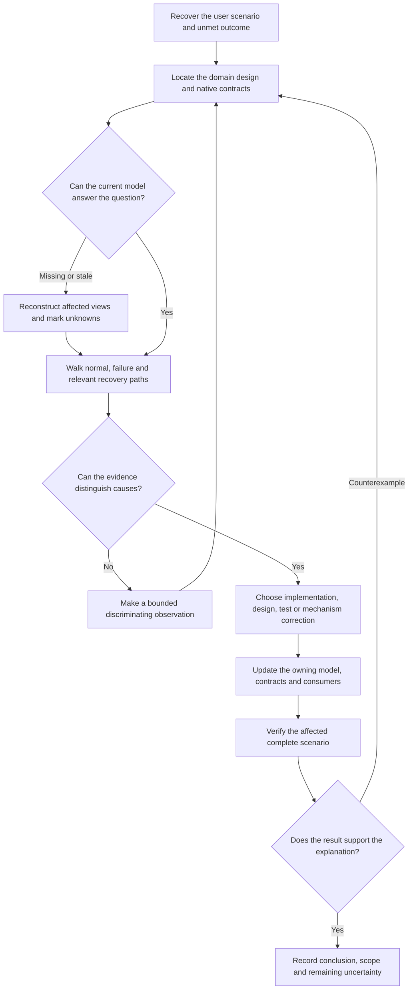
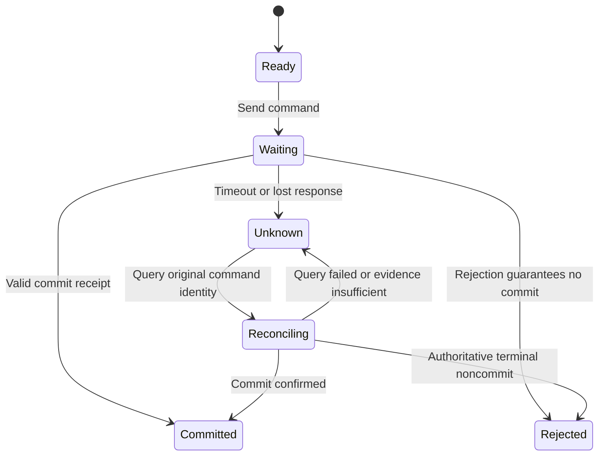

# Diagnose problems through systems and contracts

Use for repeated failures, sustained uncertainty or problems spanning responsibilities. Recover the user's intended outcome, examine the domain design and use evidence to distinguish design, implementation, test and environment causes. Passing tests and complete diagrams cannot replace professional judgment. This method applies within the current task's authority; a review request alone does not authorize implementation, live operations or delegation.

## Choose the diagnosis path

| Situation | Action |
| --- | --- |
| The cause is a bounded implementation defect and the relevant contract remains sound | Correct it directly and verify the affected scenario; reuse the existing model. |
| Similar failures recur, repairs move the failure elsewhere, exceptions spread across consumers, or the next activity no longer explains progress toward the user outcome | Pause edits and repeated runs that depend on the disputed explanation. Examine the design below; keep independent work ready. |
| Responsibilities, states, invariants or contracts contradict one another on first inspection | Examine the affected model and its basis immediately; do not wait for repeated failure. |



Return with new evidence or a revised hypothesis. If an observation cannot distinguish explanations, change the question or observation; do not rerun the same conditions indefinitely. A transient retry needs evidence that the relevant condition changed and a finite limit. Reconcile potentially partial effects under the operation's recovery contract before retrying.

## Challenge the goal and existing design

Old assignments, code, designs, test expectations, prior acceptance and Controller advice can all be wrong. Trace the original user need before deciding whether the current target and technical route should be implemented. Slow convergence signals a need to examine assumptions; it does not prove an architectural defect.

| Level | Judgment to make |
| --- | --- |
| Function and experience | Which objects does the user operate on, and what task must they complete? Has a tool limitation or implementation mechanism been mistaken for a user requirement? |
| Domain and rules | Who owns facts, authority, state and recovery? Which guarantees are necessary, and which mechanisms are replaceable? |
| Structure and architecture | Do boundaries, dependency direction and resource lifetimes support those responsibilities? Could several failures share one incorrect boundary? |
| Technical route | Does the platform or tool support the required promise? Can an existing capability, simpler mechanism or replacement remove growing simulation and exceptions? |

Point out an incorrect assignment with its basis, a falsifiable explanation and an alternative that meets the same need. Correct the existing task, owning design and contracts, and remove detours caused by the rejected assumption. Preserve required authorization, data and failure guarantees. If the uncertainty concerns how contributions serve the original outcome, also use [workflow change handling](workflow-management.md#respond-to-changes-at-their-owner).

## Step back and make the design inspectable

Start with how the affected domain expresses design. Locate its entry, authoritative design, native declarations and actual consumers. Check whether the existing model can answer this problem. Long prose, a directory inventory or a field list may need a focused relationship, state or constraint view before a design judgment is possible.

### Assess the existing model

| Model condition | Next action |
| --- | --- |
| It agrees with current contracts, consumers and implementation | Locate the failing path and broken guarantee in that model. |
| It differs from code or current requirements | Separate actual behavior, intended design and deviation; establish which source is stale rather than assuming either code or diagram is correct. |
| It is missing or cannot express the relevant question | Reconstruct the affected scope from native declarations, callers and evidence. Mark unknowns; existing implementation does not establish that its design is sound. |
| It is too broad to inspect | Select one complete scenario while retaining upstream/downstream, authority and consistency boundaries. |

### Choose views by the question

State what a view must answer before choosing its notation. Combine only the views needed; do not build a modeling tool merely to draw them. Reuse contract/symbol queries, dependency analysis, structured exports or small scripts to organize facts. Focused source reads resolve named gaps; repeated file dumps are not a model.

| Question | Useful expression | Meaning to expose |
| --- | --- | --- |
| Does the page support the user's task? | Page structure, wireframe, task flow; state-to-view mapping when needed | User objects, content hierarchy, actions, navigation, empty/error/recovery paths; a component tree alone does not express interaction design. |
| Are domain responsibilities coherent? | Object/interface/class diagram or relationship table | Identity, key attributes, operations, cardinality and invariant owners; distinguish objects, services and transport data. |
| Is a state combination or next action legal? | State diagram or transition table | State, event, guard, next state, effects and rejected/repeated/stale inputs; preserve independent state dimensions. |
| Are ordering, collaboration and guarantees complete? | Flow diagram; sequence diagram for multiple participants | Admission, calls, commit, external effects, response, failure, concurrency windows and recovery; show real atomic boundaries. |
| Can storage retain the required facts? | Entity relationships, keys/constraints, data lifecycle | Ownership keys, uniqueness, versions/compare-and-swap, retention/deletion and historical reconstruction; identify guarantees actually enforced by storage. |
| Does the API express the right boundary? | Native schema/signatures, contract table, call/sequence view | Identity, authority, results, errors, effects, idempotency/compatibility, and declaration-to-generation-to-consumer relationships. |
| Are amounts, capacity, ordering or consistency rules coherent? | Formula, predicate, decision or boundary-value table | Variables, units, domains, rounding, time boundaries, pre/postconditions and counterexamples. |
| Are wiring, dependencies and resource ownership sound? | Module/deployment graph or resource lifecycle | Selection entry, owner, dependency direction, acquisition/reuse/disposal, application/request scopes and process boundaries. |

An interface/class diagram does not require a class implementation. Use the domain's existing [modeling](../domains/modeling/AGENTS.md), [state](data-state-modeling.md) or [interface diagram](../documentation.md#architecture-and-interface-diagrams) methods where needed; native declarations remain authoritative for exact signatures and fields. Performance and repeated-work questions can add [data/query methods](../domains/data-query/AGENTS.md).

### Make the model traceable and falsifiable

| Concern | Make inspectable |
| --- | --- |
| Scope and legend | Scenario, version, coverage and whether edges mean dependencies, calls, dataflow or transitions. |
| Facts and basis | Current implementation, target design, selected decisions, hypotheses and unknowns; link declarations, callers or observations. Check source freshness and tool/query coverage before claiming completeness. |
| Agreement across views | How domain identity, storage keys, API fields and UI states correspond; show conversions where meaning or lifetime differs. |
| Guarantees and responsibility | The invariant owner and actual mechanism; what each step changes and preserves, and where atomic or authority boundaries are crossed. |
| Counterexamples | Which input or path would disprove the design? Could an omitted branch explain the failure? |

Walk one real normal completion and the relevant rejection/failure paths. Include concurrency, cancellation, lost responses and recovery where they matter. At each step compare legal actions, changed facts, external effects and caller knowledge. Locate the first contradiction, gap or unsupported assumption. Derive expectations from business requirements rather than copying implementation branches.

For a state guarantee, a small explicit model may suffice:

```text
T(s, e) = Accepted(s', effects) or Rejected(reason)
I(s) and accepted(T(s, e)) imply I(s')
```

Here `s` includes the relevant domain data, `e` is an event and `I` is the invariant retained after acceptance. State which facts must remain unchanged. This does not prove effects were executed or eventual completion; timing and liveness guarantees also need scheduling and dependency-availability assumptions.

### Example: committed facts and caller knowledge

This is an illustrative caller-observation state machine, not a server persistence model or a new interface requirement. Reconciliation and retry capabilities must come from the real contract. Edges represent changes in caller knowledge.



| Path | Design implication |
| --- | --- |
| The server commits and its response is lost | The durable fact exists while the caller remains uncertain; one `failed` state cannot express both. |
| Reconciliation finds no record | Absence alone may establish neither noncommit nor permission to retry; check query identity, completeness and concurrent work. |
| The user needs to continue | The UI needs reconciliation and correctly bounded actions; a generic retry prompt can duplicate submission. |

Choose similarly discriminating views in other domains. For example, a persisted object's existence, eligibility for a new operation and ability to resolve public metadata may have separate owners and lifecycles; merging them into one status can hide the cause.

## Question the mechanism before extending it

| Question | Judgment and action |
| --- | --- |
| Does the scenario require this mechanism? | A fixed-string dynamic import can be ordinary lazy loading. Arbitrary-string loading, `eval`, `Function` or runtime source construction require a concrete scenario and trust boundary; neither presume correctness nor reject them categorically. |
| Can the need be expressed more narrowly? | Compare fixed entries, explicit registration, generation-time validation or a narrow native interface. An unfamiliar tool is not a reason to build a general interpreter. |
| Which layer needs it? | Separate product runtime, build, test fixtures and audit tools. A fixture counterexample or diagnostic-tool limitation does not automatically expand product requirements. |
| Can the next step deliver a maintained result? | Identify durable reviewable source, reproducible inputs, actual consumers and applicable verification; otherwise bound it as an experiment. |

Judge experimental location separately from delivery provenance. An isolated worktree can hold maintained source. Code existing only in a temporary directory or disposable sidecar, without reproducible maintained inputs, remains experimental and must not become the assumed foundation for further expansion.

After an experiment answers its question, stop the route, retain its evidence and close it, or move necessary implementation to its proper source owner and connect verification. If it keeps expanding into interpreters, built-in/prototype emulation and new exceptions, reconsider removing, narrowing or replacing the mechanism. Without a concrete scenario, platform contract or confirmed runtime requirement, stop that expansion.

## Choose a correction that advances the outcome

| Explanation supported by model and evidence | Action and completion boundary |
| --- | --- |
| Sound design, implementation violates it | Correct the rule owner's implementation and verify actual consumers plus relevant failure paths. |
| Several symptoms share a faulty design boundary | Compare local repair with simplification/redesign: maintenance cost, consumer impact, migration/recovery risk and verification. Migrate the complete affected boundary after choosing. |
| Technical mechanism cannot meet the need | Replace or narrow it while preserving necessary guarantees. Explain any change to an actual user promise before seeking that decision. |
| Test expectation or assembly contradicts the real contract | Correct the test/assembly and its basis; retain the business guarantee and original failure rather than merely weakening assertions. |
| Environment interference or unknown mechanism | Make only bounded investigations that distinguish explanations; record the exact blocked step and keep product judgments separate. |

Update the owning model, native contracts, implementation, necessary generated output, actual consumers and existing task together; remove rejected detours. Resume implementation when the record establishes a supported cause or explicit discriminating hypothesis, the coherent correction and affected consumers, and the next bounded evidence plan. If the cause remains unknown, continue model analysis or a justified observation.

When correction is already authorized, carry it through implementation and focused acceptance. Organize work by complete business outcomes and professional responsibility using [coordination selection](workflow-management.md#choose-the-coordination-needed). Shared interfaces require their actual owners to coordinate. An outside opinion may help a substantive dispute when authorized; neither error-by-error patch assignments nor a committee is mandatory. Reconsider the explanation when new evidence contradicts it.

## Trace constraints to their authority

Professional owners judge domain solutions; a Controller coordinates and accepts the overall contribution. Confidence, position, dispatch and prior acceptance do not replace technical reasoning.

| Constraint basis | Use and correction |
| --- | --- |
| User outcome, permission or external promise | Link the original requirement. Do not turn Controller advice into a user requirement. Ask the user only for a genuinely changed promise or missing authority, explaining the concrete difference. |
| Domain invariant, protocol or platform mechanism | State the native contract and applicable conditions; separate guarantee from mechanism. Revise a disproved explanation without silently dropping authority, data or commit guarantees. |
| Current design, code, test or Controller advice | Treat it as falsifiable. Make authorized corrections that preserve shared guarantees directly; coordinate shared semantic changes with the relevant professional owners. |
| Freeze, sequence, single experiment or centralized execution | State the actual conflict, affected step and release condition. Do not generalize it into a capability restriction or bypass a real write conflict, lease or permission. |

Record correction in the existing task or domain design: **original assumption → user outcome and counterexample → alternative and shared impact → receiving owner and condition ending the old restriction**. Keep unknowns explicit. New mechanism evidence or a different falsifiable question may justify a fresh investigation; repeating unchanged conditions does not.

The professional/product owner must resolve the correction or state a concrete reason to retain the constraint. The Controller ensures the dispute receives a response, replaces the currently effective instruction and synchronizes affected owners, models, tests and acceptance conditions. Preserve historical meaning without treating superseded dispatch as current. Pause only dependencies affected by actual semantic, write or authority conflicts; use existing records rather than a new ledger or item-by-item approval process.

## Establish what existing observations can answer

Trace the actual user action through entry, dispatch, admission, business execution and response ownership. Reuse existing logs, traces and error projections, following the affected system's diagnostic contract and privacy rules.

| Observation | Facts to distinguish |
| --- | --- |
| Client and server | Correlate the same request and its declared operation identity; concurrent calls must not share mutable diagnostic state. Client cancellation does not establish server failure. |
| Loading and execution | Separate module acquisition, policy/identity denial, provider construction and business execution. Loading wait is not business duration. |
| Fault and protocol response | Preserve input errors, authorization denials and navigation/control responses. An unknown fault before business execution is not automatically bad input. Retain sanitized original stacks without logging the same exception at every layer. |
| Preparation and target scenario | Record build/startup/login failure separately and count target operations. Zero target operations establishes neither success nor failure of the target behavior. |

A stack locates a trigger, not necessarily the original resource-lifetime error. A correlation identifier does not prove context propagation is correct. Accept diagnostic capability and business correction separately. Do not expose credentials, cookies, request bodies or sensitive validation return values in logs, responses or receipts. For measurements, preserve units, population, attempts and coverage; nested durations are not additive. Use [observation methods](../domains/data-query/observation.md) where relevant.

## Advance by evidence cost and scope

State the competing explanations and disconfirming result, then choose the least costly evidence that can answer the question. Do not mechanically execute every layer.

| Question | Prefer | Does not establish |
| --- | --- | --- |
| Does the design contradict itself? | Scenario walkthroughs, relationship/state/flow models, boundaries and counterexamples | Implementation or storage enforces it. |
| Do contracts and wiring agree? | Source, types, generation differences and actual consumers | Execution success or UI usability. |
| Does a rule, migration or algorithm satisfy an independent expectation? | Focused unit cases, pure state models; bounded scripts/model checks where needed | Real storage atomicity, network behavior or external effects. |
| Does storage, authorization or adaptation provide the guarantee? | Relevant real-storage/HTTP integration or sandbox | All configurations, production external services or the full user journey. |
| Can the user complete and recover the task? | The affected complete client/browser scenario | External services or branches not actually exercised. |

Before execution, state what changed, the guarantee being checked, the expected result and what a contrary result would mean. Correct the smallest complete owning boundary. Follow [verification ownership and stopping conditions](workflow-management.md#bound-verification-and-integration) and the project's actual execution responsibilities. Preserve failures, version/scope and unverified behavior. Passing counts, increased timeouts and a single nonreproduction do not establish root cause. Read images only within the [image-use limits](../principles.md#quality-tests-and-images).

If locks, artifacts, databases or ports repeatedly block necessary verification, coordinate an isolated verification directory with fixed source under the existing execution responsibility. Isolate writable caches, artifacts, configuration, data and ports; a new directory pointing at the same writable state is not isolation. Record exact differences and transfer only reconciled corrections. CPU and memory remain shared, so bound concurrency. An environment problem explains only the steps it actually blocks.

## Retain one concise conclusion

Use the existing task and link owning models; do not create a parallel tracker. Keep enough for the next Agent to continue correctly:

| Concern | Retain |
| --- | --- |
| Outcome and model | User result, affected scope, design views and authoritative contracts. |
| Judgment and basis | Original hypothesis, counterexample/evidence, cause classification and remaining uncertainty. |
| Action and ownership | Decision, complete affected consumers, detour cleanup and receiving owner. |
| Result and stopping condition | Actual verification, applicable scope, remaining work and the next action that can change the judgment; stop when no necessary work remains. |

State the design judgment before the verification conclusion. Retain the evidence that rejected an old goal or design so context recovery does not revive it. Consume established check results by reference; another handoff does not require another factual audit.
