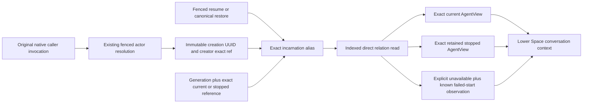

# Direct launch relationships

## Outcome and object model

The user inspects an exact Agent conversation, sees its direct creation source and directly launched Agents with native observed status, opens one exact conversation, and repeats in either direction. This should remain useful when an Agent stops, the daemon restarts, or another instance reuses the same name.

| Concept | Meaning and invariant |
| --- | --- |
| Agent instance | Exact scope/generation and native incarnation; names are labels, not complete identity. Reuse native ParticipantRef/management AgentRef and explicit stopped-reference mapping. |
| Creation edge | Immutable AgentX creation provenance from an initiating Agent instance to a created Agent instance. Persist at the creation boundary before Provider readiness. Never infer from messages, cwd or Claude parent fields. |
| External/unknown source | Human/API launch or unavailable exact source evidence. Distinguish known external from missing historical evidence; never fabricate an Agent edge. |
| Relation read | Direct upstream and bounded/paged direct downstream, including retained stopped targets. Status is a fresh native projection, not an edge property or task-completion claim. |
| Navigation target | Exact current or stopped conversation. Missing/retained-away targets remain explicit and cannot silently resolve to a same-name successor. |

## Selected experience

Use the existing conversation lower context area with compact direction groups: `启动来源` and `我启动的 Agent` (final equivalent labels may be refined). Each item shows name/title and native status and has an accessible conversation action. Keep the current subject, exact per-Agent drafts and return path. Selecting a related Agent in a different office must open that Agent's actual office/conversation. Work on narrow and embedded layouts through the existing responsive composition. Loading, empty, unknown, stale, failed and paged states must be distinguishable without persistent explanatory paragraphs. No full graph, new page, automatic send or automatic lifecycle mutation.

## Lifecycle and retention requirements

Initial creation records provenance once. Resume must not reparent original creation to the resume operator. A fork that creates a new Agent has its actual initiating Agent as creator, independently of the Provider session fork source. The native owner must resolve the existing resume/incarnation model into an explicit persisted/query contract and explain continuity; do not assume a name is stable identity. Operator/API launches carry no invented Agent parent. Failed startups retain truthful creation/launch-failure meaning. Stop, cleanup, retention and reset preserve exactness: return retained history where available and explicit unavailable otherwise. Do not build an independent transcript archive.

Existing `life.created.data.by` and `batch_launched` are historical name evidence, not sufficient exact upstream proof on their own. Backfill only when both endpoints can be unambiguously established; leaving legacy unknown is acceptable and preferred to broad migration heuristics. Claude `parent_name`/`parent_session_id` remain untouched by this delivery. Relation facts grant neither authority nor cascade-kill semantics. Relay/shared-host paths must either carry genuine exact origin or explicitly report unavailable; never attach an ambient inherited launcher as an exact origin.

## Structure and professional decisions

| Responsibility | Existing source boundary | Required result |
| --- | --- | --- |
| Provenance/identity | `src/agents`, `src/runtime/launcher.rs`, lifecycle/resume adapters, daemon storage | Cohesive native model, exact caller capture, atomic durable creation, retention semantics. Native owner chooses storage/indexes proportionately to actual access. |
| Read contract | `src/management/contract.rs`, store/service/HTTP; generated `web/management/api/native.ts` | Typed direct relation query, current/stopped mapping, bounded reads and generation fences. Native declarations own exact signatures. |
| Actual consumer | `web/agent-space/src/live`, existing conversation Blocks | Complete direct navigation, status/unknown/error disclosure, draft preservation and no lifecycle side effects. |
| Verification | Disposable native/HTTP/browser environment | Independent evidence for creation through actual launch path and rendered navigation, not a fixture-only claim. |

The qualified implementation owner owns exact technical decisions and extends this design before implementation with source-linked domain/storage/transport mapping, public signatures, resume/fork/retention policy and module structure. Establish the skeleton before filling behavior. Reuse existing storage and contract generators; introduce no universal relationship framework or unrelated stack. The controller owns scope and composition, not specialist schema design.

## Design alternatives and remaining questions

Rejected: reuse Claude parent fields (different identity/retirement semantics); join by launcher name (same-name misnavigation); scan all historical JSON on every UI refresh (unbounded/no deliberate query contract); full graph (user explicitly deferred); task assignment/owner tracking (distinct mutable relationship).

Professional owner must settle exact origin capture for each actual launch path, resume continuity, old-daemon capability behavior, index/retention policy and historical-reference mapping. Compatible technical refinements proceed within assignment; changes to user promises go to the controller. [Existing feedback](../../.inbox/agent-lineage.feedback.md) also proposes removing Provider-child participation; that wider recommendation is not authorized by this request and must not be implemented here.

## Source-grounded implementation model (pivula, 2026-11-15)

`ParticipantRef` is an execution incarnation, while `lifecycle_resume_store::reserve` and `attachments_store::restore` can recreate a conversation with a fresh incarnation. Store one immutable creation record and exact incarnation aliases rather than inventing a new creator on resume. A creation has one known Agent initiator, known external initiator, or unknown origin; it has no mutable parent. Its original created incarnation remains the downstream navigation target. A resumed incarnation shares the creation record and therefore the upstream and downstream query context, while an upstream item still names the actual exact initiating incarnation. This deliberately preserves stopped conversation identity rather than redirecting history to a resumed execution.

SQLite schema v26 adds `agent_creations` and `agent_creation_instances`, with indexed `(creator_creation,id)` downstream paging and primary `(name,incarnation)` exact lookup. They survive instance deletion and event retention, clear with managed generation reset, and contain no transcript archive. A nullable retained stopped-event pointer supplies the existing management AgentRef; absence/deleted history yields an unavailable target. Stop-event insertion records that pointer from the exact snapshot. No heuristic backfill: pre-feature rows and externally observed hooks remain unknown. Same-name successors receive fresh creation IDs. Creation and reservation commit in the existing native write scope; a failed process start retains its creation even if the live row disappears.

The launch host must retain its original invocation for daemon-side `service_store::resolve_actor`, independently of the child environment used for initialization. A capability probe refuses new clients against older launch daemons. A verified actor produces an exact edge; an invocation with no participant claims is external, and unresolved claims are unknown (never name-based guessing). Relay/shared-host reservations without genuine original caller evidence remain unknown. Shared native-root reservation preserves an existing launch fact and otherwise records unknown. Ordinary resume inherits the selected exact source's creation; legacy resume inherits unknown. Fork records its actual caller afresh, independently of the Provider fork source. Canonical attachment restoration installs the same alias. Provider child participation remains untouched.

Native `management::contract` owns `LaunchRelations {generation, origin, upstream, downstream, next}` and `RelatedAgent {name, incarnation, availability, launch_failure, agent}`. `agent` is nullable `AgentView`; availability is `available` or `unavailable`. Nullable `launch_failure` retains the native `cancelled_before_ready` observation on the exact incarnation when failed-start cleanup removes its row; it is an alias lifecycle observation, not a mutable edge status. Origin is `agent`, `external` or `unknown`. `GET /api/v1/agents/:name/launch-relations` requires generation plus the existing exact reference, optional `after` and `limit` (1..100). The cursor is an opaque creation UUID scoped to the subject's creation; ordering is ascending stable UUID, each page performs indexed bounded reads. Stale subject references fail using the existing native fence. Results project fresh native status and office membership through the existing AgentView mapper. Generated TypeScript uses the existing derive script.

`agents/launch_relations.rs` owns creation/alias persistence; `db/launch_relations.rs` owns schema and stop pointer maintenance; `management/relations.rs` owns bounded read projection and transport types remain in contract.rs. Space adds a compact lower conversation relation Block and LiveSpace exact read/open methods. Selecting a relation explicitly fetches its exact AgentView, pins it in page supply beyond member pagination, and uses the page controller to select the actual office and conversation. Drafts, cameras and notes remain page-owned. Periodic reads refresh status; loading/error/unknown/empty/unavailable/page controls are local. No lifecycle action occurs on navigation.

Development cases target atomic reservation/origin, stop/namesake fences, resume alias/fork distinction, bounded paging and reset. Independent acceptance owns HTTP/native launch/browser composition and final judgment. Candidate packaging uses a fresh artifact path with the existing `just package` recipe; installed/default executables and services are untouched.

## Refined composition decisions

The lifecycle owner selects internal `Creation::New` or `Creation::Resume(exact_source)` before launch reservation publishes any creation fact. Resume never inserts a transient new parent and then rewrites it. `inherit` refuses to replace an already published different creation. The original child runtime context still owns supervisor teardown; only the native reservation invocation retains the initiating caller. Relay clears worker actor claims and explicitly marks origin unavailable.

The lower relation Block is a separate optional ConversationLayout context slot between scrolling history and composer, capped to 28% of the reader with local scrolling. Each downstream page has 20 entries and previous/next controls; polling reads only that selected bounded page. LiveSpace retains at most 20 visited exact rows beyond ordinary member pages, revalidates them on refresh and removes stale capabilities on refusal. The native 1..100 bound remains independent of this presentation choice. Source failure disables relation actions; late reads and navigation are scope/generation fenced, and ordinary selection invalidates an outstanding relation navigation.

No paid Provider calls, installed executable replacement or live service mutation belong to development/acceptance. The concurrent mailbox/cat source is included in the same packaged browser artifact by agreement with its owners, while each feature keeps its own evidence and acceptance judgment.

## Source-to-consumer path map

| Actual boundary | Source and behavior | Evidence limit |
| --- | --- | --- |
| Local terminal/headless launch | Original `Client::invocation` reaches native Reserve; creation and process-binding reservation commit together | Development cases execute native Reserve; independent acceptance supplies actual originating Provider-substitute process and HTTP/browser path |
| Ordinary tracked resume | Fenced selected source supplies creation before new incarnation alias is inserted | Development case executes ResolveResume and ReserveResume; no reparenting |
| Tracked fork | Actual initiating caller supplies new creation, separately from selected Provider fork source | Development case executes ReserveResumeFork and ReserveResume |
| Canonical shared session restoration | AttachmentStore restores exact old source alias into its new incarnation; conflicting published creation is refused | Source integration and typechecked native code; separate paid Provider behavior is not claimed |
| Shared native-root reservation | Existing reserved creation wins; otherwise explicitly unknown | Source integration; no inference from shared-host ambient launcher |
| Relay launch | Adapter clears worker actor claims and sends unavailable-origin marker | Source integration; no cross-device exact origin support claimed |
| Pre-feature/unlaunched hook rows | Read remains unknown; first exact native child launch may add an unknown source alias solely to index its genuinely new child edge | Finite native unknown-origin case; no historical name backfill |
| Failed startup | Before reservation: no Agent created. After reservation: edge retained; CancelFailed retains exact cancelled_before_ready observation even if row is removed | Affected native failed-start case plus independent unavailable-target handling |

Relationship facts alone do not prove Provider readiness, task completion, delivery acknowledgement or authority over another Agent. Source integration, development cases and independent acceptance retain separate claims.

The rendered subject supplies its original scope/generation to `openRelated`; a stale rendered item cannot borrow a newer descriptor even when a target name/incarnation tuple repeats after reset. Late native responses are also refused after generation replacement or deliberate selection. Three focused consumer-method cases in `web/agent-space/tests/launch-relations.test.mjs` execute these refusals and cross-office/stopped navigation with draft preservation. The initial release attempt was stopped before an artifact existed to repair this consequential race; its source/archive/failed receipt remain preserved.

Mixed-version rollout boundary: the new launcher sends original caller invocation and probes CreationSupport. Older launch clients can still talk to the compatible daemon, but their child invocation does not establish an initiating Agent; those creations remain unknown rather than using AGENTX_LAUNCHED_BY as exact proof. The new management worker uses the accepted native binary. Installed/default launch executables are intentionally not replaced by selected-service rollout, so exact native CLI creation must use the accepted candidate executable explicitly (or an already configured scoped development path selecting it). Existing historical rows remain unknown. Rollback to the retained old service binary leaves additive v26 tables in place; existing stale-process schema handling does not archive a newer compatible database. Never restore an old whole database over current user state.

## R2 independent admission failure and bounded repair

Independent executor lagoza observed both clean external CLI and public HTTP launch fail before Provider spawn with `identity required: no AgentX participant in caller context` (runs acceptance-lagoza-r2-01 and -02). R2 remains immutable and is not eligible for selected-service adoption. The cause is a caller-boundary implementation error: the original initiating invocation correctly owns reservation/provenance, but was also passed to bootstrap instruction access, whose existing exact-child actor fence must resolve the newly reserved process binding. External callers resolve no actor; Agent callers resolve the parent and cannot access child instructions. Do not weaken context authorization or special-case HTTP.

The launcher now retains `reservation_client` for Reserve/ReserveResume and constructs the post-reservation `launch_client` from the child's own environment/process binding using `with_invocation`, preserving admitted generation, daemon identity and peer. Native context authorization is unchanged. The added boundary case covers external and Agent initiators, refuses original caller access to child instructions, permits the reserved child binding and verifies unchanged external/exact-parent provenance. Independent new-candidate acceptance must exercise both real external entry points plus the actual Agent tree/browser continuation.

R3 build inputs are a task-owned isolated reconstruction of r2's frozen source plus only this launcher repair and boundary case. This excludes concurrent later mailbox extensions without freezing their owner. Packaging uses existing `just package` with `CARGO_PROFILE_RELEASE_OPT_LEVEL=1`, `CARGO_PROFILE_RELEASE_LTO=false`, `CARGO_PROFILE_RELEASE_CODEGEN_UNITS=16`, jobs=2; it remains a standalone release-profile functional candidate, with performance unmeasured. R2's failed runs/build receipts remain historical evidence. HTTP aggregate launch failure conservatively returns Unknown because a reservation has already committed and cleanup is a separate native request; no automatic retry is implied.

## Independent lifecycle findings and current candidate

R3 external admission/tree/paging/browser passed, then R05 exposed a real stop retention gap: `finalize_instance_stop` inserts its event directly rather than through generic `insert_event_row`, so the new creation alias pointer was not retained. R4 records that pointer inside the same stop transaction. R4 HTTP and stopped-history browser then passed. R5 separates reservation-owner lifecycle bookkeeping from child-bound instruction access and includes read-only stopped `getTarget` observation while preserving the existing `addContext` receive-capability guard. R5 immutable SHA256 is `4085fd0a611199fc9ff182f05b019fdd5d9c27e9c0f5494ff8e4e37e6a76904c`; source/archive/assets/build receipts are in candidate-pivula-r5.

R06 fork failed after process start because its reserved row disappeared. R6 is a diagnostic-only candidate, never rollout eligible; its error identified row missing rather than reservation-owner mismatch. Investigation found the Qoder substitute treats every `--resume` as ordinary resume and ignores `--fork-session`, exposing the existing source Provider session from the fork child. Native canonical session binding then merges the placeholder into the source. A speculative r7 process-placeholder-precedence repair was rejected because it could steal an existing Provider session; only verified owned compiler PID2955985 was terminated before packaging completed, and source binding/launch_store were restored exactly to r5. R7 must never be deployed. Acceptance owner is confirming/fixing the substitute to model a new fork Provider session before reevaluating the unchanged r5. No live rollout has occurred.
