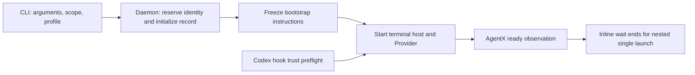

# Fresh launch latency audit

The strongest evidence is a delay before Codex starts. The running home daemon recorded `ReserveLaunch` at **9,032 and 17,351 ms application time, both with 0 ms queue wait**. Commit took 1.4 and 1.2 ms; the reported observers, subscription and watch work was also small (under 12 ms combined on either record). The project daemon recorded three reservations at **449–557 ms application time**; the two later requests also queued for **380 and 700 ms**. See the [sanitized observations](../../.artifacts/launch-performance-audit/live-summary.json). These requests are examples from the selected scopes, not attribution to a particular command by the user. The project and home default launch profiles point to Codex; both configure tmux for headless launch.

The [alias](../../src/cli/router.rs#L56) uses the same command as `launch`. The [CLI](../../src/cli/commands/launch.rs#L38) captures the caller, resolves profile and collaboration, and calls the [launcher](../../src/runtime/launcher.rs#L1401). Hook preparation runs before reservation in the explicit PTY path; the automatic path can defer it to the [runner fallback](../../src/main.rs#L237). Reservation and bootstrap must finish before ordinary terminal spawn. A background CLI can return with a scheduled terminal before the Provider starts. The launch receipt, Provider start and AgentX ready are separate milestones; first model response is outside this audit.

| Order | Finding and evidence | Correction and acceptance |
|---|---|---|
| 1 | [Name allocation](../../src/agents/names.rs#L252) projects every current instance in full and reads all `life` candidates to find distinct stopped names. [Bootstrap](../../src/runtime/bootstrap.rs#L410) makes the same historical query again for a line describing the name shape. [Creation cleanup](../../src/agents/binding.rs#L1030) runs two `SCAN kv` statements, even when the generated name has no subscriptions. On a retained snapshot with 103,833 KV rows (271 subscription rows) and 4,594 `life` rows, the name query took **24.9 s** on its first pass; the first cleanup's equivalent selection took **5.63 s**, the following cleanup **35 ms**. Disk/cache state varied; these times neither sum to nor partition the live samples. | Seek owner-specific subscriptions using a partial index; project current names without loading full rows; use a partial stopped-name index or an equivalent narrow lookup. Keep same stopped/non-placeholder reuse semantics and reduce or reuse the name-shape work during bootstrap. Keep the reservation transaction and exact identity/receipt fences. Measure index setup, single launches and bursts with light and historical data. |
| 2 | [Codex hook trust](../../src/integrations/hooks/codex.rs#L207) invokes `codex --version` even on hook-cache hits; the process-local `OnceLock` does not survive independent `agentx` calls. A miss launches a disposable app-server and waits for hook hashes; concurrent misses can run the same work independently. [Shared admission](../../src/integrations/codex/terminal.rs#L153) can also probe the version before [falling back](../../src/main.rs#L241). Observed live fallback was explicit about `0.170.0` required versus installed `0.171.0`. The controlled `auto` path invoked the version command twice; the sampled real `auto` path invoked it once, so two probes are path-dependent. | Share successful version detection between compatible checks, keyed to the actual selected executable/package identity with upgrade invalidation. Coalesce same-key hook preflights and skip known incompatible auto attempts. Keep trust verification, errors, pinned runtime identity, and forced shared semantics; qualify new Codex versions before enabling shared support. |
| 3 | [Single launches inside AI tools](../../src/cli/commands/launch.rs#L162) add a 15 s readiness budget even with `--go` or JSON. The [waiter](../../src/runtime/launch_status_client.rs#L105) uses notifications with polling fallback. [Some batch queries](../../src/runtime/launch_status.rs#L78) seek `type='life'` then filter JSON across historical rows. The no-ready fixture reached Provider at **1.67 s**, returned timeout at **18.86 s**, and still reported that one launch had been scheduled. | Index batch-specific ready/failure and batch record reads. Give callers an explicit return-on-start policy and preserve the existing ready contract and distinct timeout/failure status. Expose time to reservation, host start, Provider start and readiness separately; correlate them by the existing batch/request IDs. |
| 4 | Nested launches may run a [login shell](../../src/runtime/shell_env.rs#L25) on cache miss. Its [reader](../../src/runtime/shell_env.rs#L93) waits for exit before draining stdout, so a large environment or noisy shell startup can hit the 10 s deadline when it fills the pipe. This was located in source; no live incident was attributed to it. | Drain bounded output while the child runs, keep the timeout and fail-open environment policy, and measure with normal and oversized `.zshrc` output. Address after the confirmed hot paths. |

Do not start with alias parsing, prompt string assembly, replacing the terminal host, or changing the timeout alone. The isolated dry runs took 9–15 ms. Recent live `startup.spawned` records report 1–4 ms for the actual child spawn syscall path, which excludes runner preparation. A shorter timeout would not improve a slow `ReserveLaunch`.

## Evidence and reproduction

- [Isolated launch probe](launch_probe.py): `python3 .controller/daemon-performance-audit/launch_probe.py ~/.local/bin/agentx` and the same command with `--codex "$(command -v codex)"`. It uses disposable scope, workspace, tmux socket, Provider home and daemon. The real probe configures a dummy key, an unused loopback model endpoint, and no prompt; the fixture exercises the actual CLI, daemon, PTY runner and SessionStart callback. Sampled binary `agentx 0.7.31`, build `native-build-v1:9a32a24e-0e31-4af6-a637-3267481f9255`, SHA-256 `d8fff87c8822a9fb2b8aa3a29820dd4037ef78e0298e56504c91eb750175b672`, with Codex npm `0.171.0`.
- [Controlled Provider measurements](../../.artifacts/launch-performance-audit/fixture.jsonl) and [real Codex measurements](../../.artifacts/launch-performance-audit/real-codex.jsonl): forced PTY with a warm daemon and cold hooks reached real Codex at **3.56 s** and observed ready at **4.12 s**. Three warm runs reached Codex in **0.43–1.05 s** and first observed ready in **0.86–1.69 s**. The `auto` example returned from CLI in **0.20 s** but started Codex at **1.08 s**. These are small, instrumented, host-load-sensitive samples, not percentiles. Ready is sampled after CLI return; a version/preflight marker records its invocation, not completion.
- [SQL probe](launch_sql_probe.py): `python3 .controller/daemon-performance-audit/launch_sql_probe.py`. The [synthetic comparison](../../.artifacts/launch-performance-audit/sql-synthetic.jsonl) used 150,000 unrelated KV rows and 100,000 unrelated life events. Each baseline selector took approximately 600,000 VM instructions; the illustrated indexes reduced each to fewer than 200 at a 100-instruction measurement resolution. Selected rows were identical for the fixture, including legacy subscription keys, duplicate stopped names, placeholder stops and retained delivery-only subscriptions. Only victim selection was tested; write performance, migration cost and schema compatibility remain to be verified.
- [Retained snapshot results](../../.artifacts/launch-performance-audit/sql-snapshot.jsonl) sample the exact read predicates on [a pre-existing offline database](../../.artifacts/runtime-read-repair/before.db) in immutable read-only mode. Only `EXPLAIN QUERY PLAN` was run for the DELETE statements; milliseconds refer to equivalent SELECTs. High I/O pressure was observed during the cold sampling. The evidence establishes scale and a plausible live cost mechanism; the current logs cannot split the 17.35 s reserve operation by SQL leaf.

First follow-up: capture the per-leaf durations from reservation and bootstrap in a disposable representative scope, compare the scoped selectors, and validate exact name, fences, subscription membership semantics and failure/readiness results. Keep the previous [resume replay repair](codex-resume.task.md) separate: that incident was a stopped-session replay path; fresh launch does not run it. The audit performed no live launches and changed no live database, service, or installed binary.
