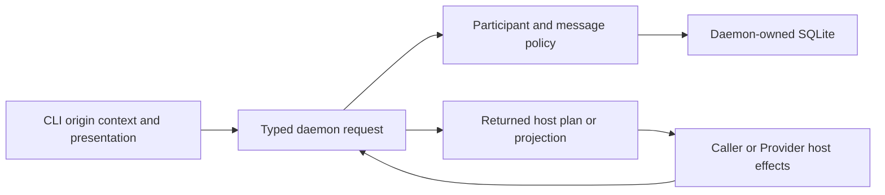

# Feedback

## HTTP management scope and TUI reuse (2026-11-15)

The user requests daemon-exposed HTTP capabilities for launching, inspecting, messaging, stopping and conversing with Agents from the Web. The user then clarified that “like the terminal interface” means the management TUI opened by `agentx`, not a Provider PTY mirrored into the browser. The [proposed management HTTP design](../../.docs/proposals/agent-management-http.md) records this corrected scope, source references, recommended composition, candidate resource endpoints and outstanding decisions. Do not introduce terminal streaming as a requirement of this request.

Source investigation confirms that TUI reads already use native daemon queries, while TUI mutations invoke same-binary CLI subprocesses. Launch/stop effects and transcript file reads still have runtime-host ownership. A daemon-managed HTTP entry therefore needs to compose those existing capabilities, not merely serialize every current native Request. Current workbench HTTP exposes only finite collaboration operations. The earlier assumption that a complete management API or daemon-owned transcript reader already exists is incorrect. This investigation changed documentation only; no live services or process state were changed and no executable support was established.

Tooling limitation: the codebase graph reports this repository as unindexed; direct source searches supplied the references. No reindex or repository-wide dependency analysis was needed for the bounded design question.

## Daemon restart identity and runtime continuity (2026-11-14)

The user asks whether an AgentX daemon crash/restart preserves existing Agent identity and relationships. [Client transport](../../src/daemon/transport.rs) handshakes per call and pins database generation rather than the previous daemon instance. [Persistent generation](../../src/db/reset.rs), participant/process/session bindings, native attachments, host registration tokens and inbox claims survive an ordinary same-database restart. Existing callers can resolve the same identity when their scope, process/session context and active bindings remain valid. Database reset/replacement and executable build-cohort changes are separate boundaries: old generations or incompatible old clients reject instead of silently rebinding.

Persistence is not transparent runtime continuity. [Hook clients](../../src/integrations/hooks/client.rs) acquire a missing daemon on new invocation; an existing Client call only reconnects and does not auto-acquire or replay. The [PTY delivery loop](../../src/messaging/delivery/host.rs) retries failed snapshots and logs heartbeat failures. The [stdio loop](../../src/integrations/codex/bridge/stdio.rs) propagates heartbeat/attachment/inbox IPC errors out of the loop and closes its native connection via [bridge cleanup](../../src/integrations/codex/bridge/session.rs). Thus even a brief daemon outage can terminate that bridge and its automatic delivery; successful persisted identity recovery does not prove a live client remains connected. Runtime owner follow-up should separate transient IPC outage recovery from stale binding/build/generation failures, retain uncertain in-flight operations without replay, and verify same-session continuation across restart. Existing restart and lost-reply process cases are in [daemon acceptance tests](../../src/daemon/acceptance_tests.rs); this source investigation did not rerun tests or interrupt user services.

## Compaction context recovery (2026-11-14)

The user subsequently requested configurable instruction sources, replacement/omission of the built-in guide, and internal generation hooks shared by startup and compact, anticipating team/role/skills content. The [context composition proposal](../../.docs/proposals/agent-context.md) records the recommended boundary, ordered sources, compatibility, native Provider differences and deciding cases. External command execution is deferred; implementation and native retention evidence are not yet established.

User follow-up: model compaction recovery as a shared kernel capability that can supply current participant identity, AgentX usage, and future task/team context. Recommended boundary for discussion: the kernel resolves authoritative participant-scoped facts and selects a bounded context snapshot; Provider adapters own native event timing, role/envelope rendering and delivery confirmation. Startup, compaction and resume may share context composition while retaining different inclusion policies. Existing `PrepareBootstrap`/flush receipts are an extension point, not proof of a complete recovery contract. Avoid an extensible contributor framework until additional implemented domains require it.

Codex requires a separate decision for persistent configuration (`developer_instructions`, or thread `developerInstructions`) versus hook-injected history (`additionalContext`). A configuration field being stored outside transcript history does not alone prove the exact model-visible prompt after every compaction path. Verify ordinary and shared native automatic/manual compaction before claiming retention or requiring full static reinjection. Dynamic task/team state should be reconstructed from its authoritative domains rather than old conversation summaries. These are investigation recommendations, not authorization or implementation of a new recovery subsystem.

Codex's [official hooks contract](https://developers.openai.com/codex/hooks/) documents `SessionStart` with `source: compact` and model-visible developer `additionalContext` before the next request. The AgentX [Codex hook registration](../../src/integrations/hooks/codex.rs) excludes `compact`, and its [production SessionStart handler](../../src/integrations/hooks/codex/client.rs) does not reinject bootstrap. Ordinary launch separately supplies `developer_instructions` through [launch arguments](../../src/integrations/launch_args/codex.rs); their actual retention across compaction and shared app-server thread behavior require native verification before concluding there is context loss or choosing reinjection. Claude's [production adapter](../../src/integrations/hooks/claude/client.rs) handles compact SessionStart and reoffers bootstrap; OpenCode and Qoder have separate native recovery paths. Pi and OMP currently inject bootstrap once per session without a compact hook. Other Provider events and output semantics vary. This is a source/documentation investigation, not an executed native compaction test or an implementation decision.

## Caller identity defaults in injected agent contexts (2026-11-14)

Observed friction: the user expects launched agents to omit repetitive caller `--name` arguments when their environment already carries identity context. [Launch preparation](../../src/runtime/launcher.rs) injects `AGENTX_PROCESS_ID` and `AGENTX_INSTANCE_NAME`; [invocation capture](../../src/service/context.rs) and [CLI session resolution](../../src/cli/client.rs) already support implicit bound callers, while [bootstrap guidance](../../src/runtime/bootstrap.rs) still requires an explicit name on every command.

Initial investigation disposition (superseded by the implementation below): no runtime or bootstrap behavior changed. A bounded follow-up should make the instruction conditional on a resolvable current caller, preserve verified actor/thread attachment checks in [participant resolution](../../src/agents/service_store.rs), and report expired injected bindings clearly instead of degrading to an unidentified caller. A bare environment name is a hint, not proof of the current participant. Nested agents may inherit parent context; shared sessions must retain their own attachment. Caller identity defaults do not imply defaults for recipient or operation-target operands. The existing bootstrap comment records stale-binding recovery as a reason for explicit names; address that behavior before removing the requirement globally.

Executed evidence: `just test --test cli_smoke send_strips_redundant_trailing_name_from_auto_resolved_sender -- --exact` passed (1 test, 52 filtered out). The [existing isolated CLI case](../../tests/cli_smoke.rs) registers a process binding, sends without a caller `--name` option using `AGENTX_PROCESS_ID`, and checks the resulting message. Its trailing `--name` text is after `--` and exercises message cleanup; it is not a caller option. This establishes the process-binding path in the source-built test binary, not name-only fallback or the running `fugu` session. Direct no-name invocation in this session remains constrained by its injected instruction requiring `agentx --name fugu` for every command; this is instruction friction rather than an executable rejection.

User design follow-up: remove the unconditional explicit-identity requirement from injected guidance and replace the public caller identity spelling with `--iam`. Recommended semantics: resolve ordinary managed commands from their injected process/session context; allow explicit `--iam` under the existing caller-selection and verified-actor conflict rules; reject missing, expired or conflicting required identity with actionable errors. [Launch preparation](../../src/runtime/launcher.rs) and [shared Codex thread configuration](../../src/integrations/codex/configuration.rs) inject context, but injection alone does not establish a still-current retained binding. A semantic rename must cover public global and standalone parsers, help/bootstrap/examples, script forwarding and affected tests; native Provider arguments after `--`, resource-name options in unrelated tools, and internal plugin protocol fields need separate ownership checks rather than blind text replacement. This was the design discussion and source inventory; the selected implementation below supersedes its pending status.

Implementation selected by the user: `--iam` replaces the public caller option without a `--name` compatibility alias. `start --name` remains its own registration input. The router captures `--iam` into the existing explicit caller claim; the start adapter passes its own `--name` as the lifecycle requested name. Existing session/actor fences remain authoritative; an injected name alone is not proof of identity. Bootstrap and fork guidance no longer demand a caller flag. Early standalone work/browser parsers and bundled workflows must use the same public spelling; internal Provider hook RPC and native arguments retain their own schemas.

Focused cases: automatic process-bound send with no caller option; explicit `--iam` before/after commands and mismatch behavior; missing or stale required actor; `start --name` distinct from `--iam`; `--name` rejected as caller option elsewhere; literal native/message tails; standalone parser and bundled script forwarding; root/subagent/fork guidance. Existing isolated fixture scope supplies disposable identities and data.

Implementation verification exposed an existing Events authority defect: `Client::call_with_context` assigns a fresh `observation_origin` per IPC attempt, but Events hashed the entire invocation as its retained peer identity. Begin succeeded and subsequent listener/observer/history operations failed with `StaleFence`. The shared Events peer fingerprint now omits this diagnostic-only correlation while retaining authenticated process incarnation and caller claims; listeners reuse that same fingerprint. Actual IPC host cases and the new implicit/explicit identity smoke cases cover this boundary. No running user services are restarted by verification.

Executed local evidence: the focused `iam_` CLI cases pass 3/3, the bundled workflows pass 4/4, Events/listen IPC and native cases pass 97/97, TypeScript checking passes, and plugin regressions pass 27/27. The final broad unit selection reports 752 passed, 1 ignored and one config-help comparison failure; that exact help case passes when isolated, so broad parallel execution remains a recorded limitation. Full CLI smoke reports 44/56 passing, with remaining configuration/Provider-hook/legacy-output and lifecycle/event expectations failing. Send delivery reports 21/23 passing; the two remaining assertions concern broken-output wording and external-send delivery status. These broad runs are not a full-suite acceptance receipt. Logs are `/tmp/agentx-iam-unit-final.log`, `/tmp/agentx-iam-help.log`, `/tmp/agentx-iam-regression.log`, `/tmp/agentx-iam-send-final.log` and `/tmp/agentx-iam-focused-final.log`. A concurrent attach implementation briefly failed to compile against optional `origin_device_id`; its owner corrected it before the final send build, with no change to that module by this task.

`just package` completed successfully and installed the local release at `.bin/agentx` (`agentx 0.7.31`). Packaged recursive help advertises `--iam` and `start --name`; packaged launch rejects caller `--name` with an unknown-option error. The offline explorer refreshed 89 help pages from the verified development binary; both JavaScript files pass `node --check`. No global installation or live-service restart was performed.

## CLI shortcut validation (2026-11-14)

The bounded `l/r/f/k` follow-up encountered two existing workspace formatting failures: an assertion needing wrapping in `src/relay/control.rs` and a trailing blank line in `src/agents/AGENTS.md`. The user explicitly requested immediate cleanup; the assertion is now split as rustfmt requires and the extra blank line is removed. Existing formatting policy already supports compact code (`max_width = 250`); no policy change was needed. Routine reversible formatting fixes should be resolved inline when authorized, with the smallest relevant checks.

`just package` completed with `agentx 0.7.31`. Isolated checks of the packaged binary passed for all four aliases across ordinary/topic/recursive/global-flag help, launch preview with literal native arguments, invalid launch counts, missing kill targets, and a stub Codex stdio version probe selecting `PASEO_AGENT_CWD`. Help/preview/probe checks left their data scope absent; invalid-argument checks used a separate scope with a preseeded update cache and created no database.

## Workbench visual and interaction refinement (2026-11-11)

After the first domain-workbench implementation passed bounded acceptance, the user reports inadequate visual style and interaction friendliness. They request a dedicated canvas/experience designer and require each feature to be organized from user scenarios and the actual metamodel. Behavioral correctness and legible type alone did not establish a satisfying workbench experience. [Experience refinement](tasks/flow-atlas-experience.md) owns scenario-led visual/interaction design and a separately published operable prototype; accepted semantics and existing demos remain preserved. The current callable-tool/skill catalog exposes no Design Canvas plugin, so an offline HTML/SVG prototype is the selected available medium. Actual visual causes remain hypotheses pending rendered walkthrough; no user preference is inferred from previous automated passes.

Subsequent user feedback on the actual18960 proposal identifies disconnected projections and asks whether flow/sequence can share expression, combine information and sit side by side. [Experience design's continuity proposal](../../tools/flow-atlas/design/experience.md#多视图连续性本轮用户反馈后的设计建议) records source-grounded analysis and recommended task layers/linked dual views. Current app already shares selection/scenario/presentation, but only one view is visible. A concrete semantic issue was identified by source+JSON reading: `workbench/views.js::sequence` with no selected scenario flattens all operation steps in declaration order, including mutually exclusive confirm/reject branches. This needs correction in an authorized view-continuity implementation; no source/runtime change or new executable acceptance is implied by this analysis. Same-scenario view linkage must share one checkpoint/player; cross-scenario comparison must keep independent facts and align semantic steps/phases rather than raw checkpoint indices. Original completed prototype outcome/evidence remains historical and bounded; user preference is not accepted by implication.

| Observation | Impact | Disposition and owner |
| --- | --- | --- |
| Spawn prompts carry task authority but no AgentX message ID; `send --intent ack` requires a reply ID. Several new workers encountered this on initial acceptance. | Repeating failed acknowledgements creates avoidable coordination noise and can obscure whether the task was accepted. | The team entry now permits one `inform` acceptance for a launch prompt; use normal correlated ack for real assignment messages. Controller owns this workflow correction; no unrelated messaging-code change is needed. |
| Root/controller context in older completed work says no Git metadata and references historical live workers. | A new worker could mistake history for current source/reset/delegation authority. | The current team route explicitly identifies `b118286`, preserve-all concurrent edits, actual new workers and historical-only Codex assignments. Controller owns this recovery clarification. |
| Initial development workers were launched through AgentX and were absent from the Paseo workspace/subagent lifecycle. | Platform task visibility, message routing and management were split across two control paths. | User selected Paseo. All six old owners checkpointed and released claims, successor children were created in the existing Paseo workspace, under the platform choice at that time. The current team route uses [AgentX-native orchestration](orchestration.md). Product-level AgentX autonomy remains independent. |
| Early compile attempts saw runtime visibility/RwLock and a not-yet-materialized `has_exited` declaration while implementation owners were still editing the same candidate tree. | Moving-source diagnostics mixed genuine compile defects with transient declaration races and weakened exact source/artifact evidence. | Integration captures a fixed candidate snapshot of build inputs after a coherent handoff, excluding runtime/live data, and compiles it with the sole sequential Cargo executor. Only relevant corrected inputs justify another snapshot/check. Snapshot results cover those exact bytes; later shared-tree edits remain unverified until their affected checks run. Integration owns this bounded correction. |
| The first Claude fixture exposed executable-hash work consuming a two-second deadline and an unbounded fixture cleanup path. | A timed-out fixture could leave owned resources running, and prewarming alone could conceal actual cold-client cost. | Daemon owner corrected timing; integration uses bounded stop/cleanup and a prewarmed controlled fixture. Final DD-12 keeps a separate unprewarmed acquisition workload. No live scope is used or cleaned by these fixtures. Exact results and remaining retry evidence remain integration-owned. |
| The first real s5 debug product built, but three process cases failed during artifact-hash startup before reaching behavior; the cold sample timed out around 15 seconds. | `wire::build_identity` hashes the executing image once per process, so new CLI processes repeat the cost. Debug artifact size and unoptimized hashing are plausible contributors; failed readiness alone does not prove a DB/singleton defect. | Integration builds release from the same fixed source and reuses the bounded product cases; daemon owns cost diagnosis without changing identity guarantees. Keep failed debug evidence. Any performance comparison needs matching build profiles/toolchain/workload; release-versus-debug observations cannot establish architectural speedup. |
| The matched release DD-12 comparison measured sequential list p50 6.70ms to 166.60ms and cold list 16.67ms to 319.66ms, with regressions in other workloads. | This is a material product-latency regression despite the completed bounded functional CLI slice. Per-process full-image hashing on the non-SHA-instruction host is a concrete causal hypothesis requiring isolated attribution. | Performance blocks final acceptance. Daemon's narrow existing-graph AWS-LC SHA256 backend correction preserves full-byte identity; architecture accepted it and integration owns the pinned dependency, equivalence and affected actual workload measurements. Do not close from a microbenchmark or hide the regression by changing deadlines or warmup. |
| Daemon documented that Unix authenticated peer PID may have unknown incarnation. Focused `relay/control_store.rs` inspection found optional owner/context equality and `is_alive` negation in reconciliation. | Two unknown identities could satisfy equality for a host grant; failed observation alone could be mistaken for proven owner death. These violate the declared external-effect ownership boundary. | Relay owns explicit nonempty identity admission/grant/completion and positive original-owner death/reuse evidence, preserving uncertain effects and no replay. The Relay Task will retain correction and targeted cases; existing s5 CLI/Qoder execution is independent. |

Record new substantive boundary or tooling friction with its source, consumer impact and responsible owner. Domain questions remain in their owning Task/design; this table should link rather than duplicate them.

## Terminal disconnect and Agent continuity discovery (2026-11-10)

The user expects a foreground window to be disposable while the same logical Agent continues running and receiving messages in the background. The existing [runtime-host responsibility model](../../.docs/architecture/runtime-hosts.md#responsibility-model) separates durable AgentX state, the caller-owned runtime host, and the Provider execution engine. A resident AgentX daemon does not itself establish a resident execution host for every participant.

| Current source or evidence | User-visible boundary | Follow-up disposition |
| --- | --- | --- |
| [Terminal presets](../../src/runtime/terminal/presets.rs) include macOS iTerm and tmux detached-session/split launches. Unix launch scripts use Bash in [terminal hosting](../../src/runtime/terminal/mod.rs). | iTerm is a window launcher, fish is the invoking shell, and tmux supplies a persistent terminal server; these are different responsibilities. Neither an iTerm preset nor invoking from fish establishes detached Agent execution. macOS behavior was not exercised by this source inspection. | Runtime/CLI documentation should distinguish opening a terminal, keeping its process alive, and reconnecting to that process. No new terminal backend is selected here. |
| [PTY signal handling](../../src/runtime/pty/mod.rs) exits the foreground host on terminal SIGHUP/output failure. The detached background path in [terminal hosting](../../src/runtime/terminal/mod.rs) redirects standard streams and uses `spawn_detached`. [Resume](../../src/runtime/resume_client.rs) prepares a Provider session relaunch; [terminal client](../../src/runtime/terminal_client.rs) exposes screen/injection operations. | Closing an ordinary foreground terminal can stop execution. `--headless` decouples the runner from the initiating terminal, but resume is not a transparent live-terminal reattachment and screen/injection is not a full attach/detach client. | Record the requested coherent background-host plus reconnectable-frontend outcome as an unimplemented product gap, not a defect in already accepted data ownership. No implementation, new Delivery or live runtime action is authorized by this explanation request. |
| [Bridge close](../../src/integrations/codex/bridge/session.rs) retires this attachment owner and closes only its transport; the [shared EOF case](../../tests/codex_shared_runtime.py) establishes a surviving sibling/backend. [Current support](../../.docs/codex-activation/acceptance.md#current-support-by-acceptance-boundary) is bounded to Linux Codex0.167.0. | The shared Codex backend survives a bridge disconnect, but the disconnected bridge's automatic delivery driver does not. Persisted pending mail and canonical resume do not prove unattended work after all clients leave, active-turn continuity, or automatic recovery from a backend crash. | A future selected continuity slice needs explicit host lifetime, exact logical-session reattachment and continued-delivery outcomes. Reuse the shared backend and existing identity/inbox contracts; do not infer a universal process supervisor from daemon persistence. |

Documentation friction: the [README stdio section](../../README.md#spawn) still states idle wake requires a client turn/poll without distinguishing the implemented shared app-server driver; [topology](../../.docs/codex-activation/topology.md) also retains historical selected-target wording beside current implementation facts. Current production source and attributed acceptance evidence control this explanation. Runtime/CLI owners should reconcile those passages in a selected documentation follow-up. Official OpenAI documentation fetches returned403 during this read-only investigation; no claim about newer native versions is derived from them. No product tests, Provider sessions, terminal launches or user-service changes were performed.

The user's follow-up exposes a concrete state-meaning gap: [native host release](../../src/runtime/hosts_store.rs) clears the bridge PID/endpoint and writes `inactive` with `native:disconnected`, while [bridge close](../../src/integrations/codex/bridge/session.rs) only closes its connection and retires its attachment. This status establishes disconnected AgentX control/presence, not a stopped native backend or completed/aborted turn. The bridge tracks native turn/approval events locally and renews registered roots every five seconds; [Codex hooks](../../src/integrations/hooks/codex/client.rs) report prompt/tool/Stop/Interrupt activity through the daemon. Stop here denotes a turn boundary and maps to `listening`, not process termination. A future presentation change should distinguish connection presence, Provider process liveness and native thread/turn activity rather than infer all three from one label.

Graceful PTY delivery exit reports `Finish`; abrupt host death cannot report its own exit. [Cleanup](../../src/agents/cleanup_store.rs) combines stored observations with positive PID/incarnation evidence in actual listing/maintenance/resume paths, while heartbeat expiry can mark stale presence without proving process death. The AgentX daemon is not the app-server byte proxy: the separate `agentx ... --stdio ... app-server` bridge speaks native WebSocket to Codex and typed AgentX IPC to the daemon. Headless uses the detached PTY runner for Codex and ordinary interactive tools, redirects outer standard streams to null/logs, and retains local delivery/heartbeat behavior; explicit Claude print mode is a separate backend. A resumed conversation alone cannot establish that its old OS process or in-flight tool survived; native CLI-internal backend behavior remains version-dependent and is not proved by AgentX's foreground wrapper exit.

### Headless reattachment clarification (2026-11-14)

Implementation follow-up: the user subsequently authorized configurable tmux headless hosting. [Terminal sessions](../../.docs/architecture/terminal-sessions.md) now owns the selected configuration/usage, and the [tmux Task](../tmux-headless/task.md) owns implemented support and exact execution evidence. The feasibility discussion below remains historical input.

The user explicitly wants to launch with `--headless` and later attach to the same live interactive process, without requiring a separate tmux workflow. This is a requested product capability, not evidence that a terminal client already exists. Current [launch backend selection](../../src/runtime/launcher.rs) retains a PTY for ordinary headless launches; explicit Claude print mode is a separate backend. The [background launcher](../../src/runtime/terminal/mod.rs) detaches the host, closes its outer stdin and redirects output to a log. The [PTY loop](../../src/runtime/pty/mod.rs) still owns the native child and screen, but reads fixed outer stdin/stdout and treats foreground terminal disconnect as host termination. The [injection protocol](../../src/runtime/pty/inject.rs) accepts one-shot text and SCREEN queries; [screen serialization](../../src/runtime/pty/screen.rs) exposes text lines and cursor metadata, not a complete terminal-state replay or live output subscription.

Runtime/CLI follow-up should extend this existing host with a reconnectable terminal client: byte-preserving input/output, an ordered initial screen restoration plus subsequent output, client-driven resize, and client disconnect that preserves the child, Agent identity and automatic delivery. The initial control policy can be one interactive client per host; slow/disconnected output clients must not stall the unattended Agent. Keep child stop/exit distinct from client detach, preserve current participant/host fences and leave process/terminal I/O with runtime rather than the domain daemon. These are source-grounded improvement directions for the user's feasibility question, not an implemented protocol or selected Delivery. No runtime or user service was changed or exercised.

#### Technical options and complexity

The discussion baseline is a local PTY-backed Agent with one interactive client. The host owns the native process, PTY, terminal model and automatic delivery for the entire session; a client owns only its connection and local terminal settings. Host running/stopped and client attached/detached are independent states. Attach first resolves the exact participant and current host through the daemon, then connects directly to the host's local endpoint. Reuse current process/participant fencing and authenticated local-transport mechanisms where appropriate; a terminal stream must not occupy the domain daemon's short request dispatcher or give a reused name control of a successor accidentally. Client detach returns to zero clients without changing the host or native task. Child exit is observed separately and closes the attachment with the actual result.

| Option | Fit and cost | Discussion recommendation |
| --- | --- | --- |
| Extend the current PTY host with a local attach client | Reuses process hosting, screen parsing and delivery. Adds framed binary input/output, resize, attach/detach/exit, bounded client queues and reconnect restoration. No external terminal-server executable. Shared protocol can cover Unix and Windows, but platform I/O and terminal-mode behavior still need separate validation. | Best fit for the current standalone AgentX product; moderate runtime work with a deliberately bounded first slice. This is a recommendation, not an accepted implementation choice. |
| Wrap tmux behind AgentX commands | [Upstream](https://github.com/tmux/tmux/blob/master/README) provides detached sessions and reattachment on Unix-like systems. AgentX can hide tmux invocation while still owning Agent identity and cleanup. Requires the extra executable, session-to-participant mapping and ownership-safe cleanup; Windows is not in the documented platform list. | Lowest initial engineering effort when Linux/macOS and an external dependency are acceptable. Keep this viable alternative rather than requiring users to operate tmux manually. |
| Wrap abduco or dtach | [abduco](https://github.com/martanne/abduco/blob/master/README.md) and [dtach](https://github.com/crigler/dtach/blob/master/README) implement smaller Unix session hosts. abduco documents incomplete-redraw compatibility cases; dtach explicitly omits terminal emulation and relies on application redraw. | Useful mechanism references, but they do not resolve the reliable screen-restoration requirement by themselves and add an external host beside the existing one. |

The native implementation can begin with the existing [atuin-vt100 dependency](../../Cargo.toml). Its pinned 0.19.1 [screen API](https://docs.rs/crate/atuin-vt100/0.19.1/source/src/screen.rs) provides `state_formatted`, `state_diff` and input-mode rendering for application cursor/keypad, bracketed paste and mouse modes. This reduces rendering work, but does not establish complete terminal-state fidelity. Current [screen ownership](../../src/runtime/pty/screen.rs) must supply a coherent attach snapshot followed by ordered live output. A raw-output continuation must handle pending UTF-8/escape sequences at the snapshot boundary; application redraw alone and replaying the diagnostic log are insufficient guarantees. Alternate-screen transitions, terminal queries, newer keyboard protocols, resize and restoration of the client's own terminal require explicit coverage before choosing the exact snapshot/stream representation.

The minimum local protocol needs attach admission, input bytes, resize, output, detach and child-exit results. A slow client gets disconnected or resynchronized under a bounded policy; its output queue must never block native execution or delivery, and silently dropping bytes while pretending the terminal stream remains intact is invalid. A second interactive client should receive an explicit busy result initially. The principal acceptance cases are detach/reattach during active work, unattended output and messages, abrupt client loss, child exit, resize, input-mode restoration, old-host/name reuse and slow-client behavior. These cases locate the real effort: a narrow demonstration is small, reliable local daily use is moderate, and multi-client, remote/browser attachment or cross-platform parity expands the scope substantially. This turn inspected source and upstream documentation only; no prototype, runtime test or delivery estimate has been established.

#### User-preferred simplification: configurable tmux hosting

The user favors making tmux the configurable default headless host to reduce implementation cost. This supersedes the native-host preference above for the current discussion: when the target machine has tmux, reuse its session lifetime, terminal state and attach/detach rather than build a new terminal streaming protocol. A tmux-backed headless launch remains an AgentX launch with normal identity, hooks and message delivery inside the tmux session. AgentX needs backend selection, exact participant-to-session/pane association and an attach adapter; cleanup must target only its owned pane/session. No global tmux-server shutdown is justified. A configured tmux backend should report a missing executable explicitly instead of silently dropping the promised reattachment capability.

Current-source limit: the [tmux terminal preset](../../src/runtime/terminal/presets.rs) already uses `tmux new-session -d`, and the current non-headless route can select it with `--terminal tmux --no-run-here`. However, the [background branch](../../src/runtime/terminal/mod.rs) executes and returns before terminal-preset dispatch, so setting the existing `terminal` preference does not make `--headless` use tmux. A headless-backend configuration and dispatch adjustment are therefore still required for the proposed default; the configuration spelling and `agentx attach` command are not implemented or selected by this feasibility discussion. This is a substantially smaller integration than the native protocol option, with Linux/macOS plus installed tmux as its explicit operating condition. No operator configuration or runtime was changed.

#### Launch-mode clarification before implementation

The user subsequently asked to compare three complete usage scenarios before proceeding: current-terminal launch, new-window launch and headless launch. Keep launch location separate from the selected terminal host. In an ordinary interactive shell, one foreground Agent currently reuses the invoking terminal by default; `--run-here` makes this explicit. The Agent is a separate native child under the PTY host, while the invoking shell waits. `--no-run-here` selects another terminal and the existing `--terminal` option overrides the configured terminal. Agent-originated, non-TTY and multiple-Agent invocations have different current defaults, so examples claiming universal current-terminal launch must show `--run-here` or state the single-Agent interactive-shell condition.

| Scenario | Current or intended selection | Lifetime and user return |
| --- | --- | --- |
| Current terminal, implemented | `launch --tool codex --run-here`; in an ordinary shell, one Agent needs no location flag | Uses the current visible terminal; closing it can terminate the Agent. Exit the native tool to return to the shell. |
| New terminal, implemented | `config terminal iterm` on macOS, then `launch --tool codex --no-run-here`; per-call `--terminal wezterm` overrides the configured value | Opens through the selected terminal preset. Window-hosted execution remains subject to that terminal's lifetime. The existing tmux preset is an exception because it creates a detached session. |
| Headless tmux, selected direction but unimplemented | Proposed `launch --tool codex --headless --terminal tmux`, followed by proposed `attach <name>` | Launch returns while tmux retains the PTY. Detach/terminal loss leaves the Agent running; attach reaches the same execution. |

Configuration design issue: a user may want iTerm as the default new-window terminal and tmux as the default headless host simultaneously. Overloading the single existing `terminal` default makes these scenarios interfere. Recommended refinement is a separate headless-terminal default (provisional key `headless_terminal`) while retaining `--terminal` as the per-invocation override of the selected mode. This refinement is proposed for the usage comparison, not an implemented setting. Window-only hosts such as iTerm should not be accepted as an explicit headless override; `--run-here` and `--headless` should not be combined. Existing native PTY headless behavior and compatibility need an explicit disposition before code changes. The user requested this model clarification during implementation preparation; no source changes or runtime/configuration mutation have been made for the feature.

## Environment loading discovery (2026-11-10)

The user expected `$AGENTX_DIR/.env` to load automatically and asked about workspace `.env`/`.envrc` support. Current native sources distinguish inherited invocation environment, scoped `config.toml`, launch-only `$AGENTX_DIR/env`, and the Codex-stdio-only early direnv preparation. See [`overlay_launch_env_observed`](../../src/runtime/launcher.rs), [`load_env_extras_observed`](../../src/config.rs), [`codex_project_env::prepare`](../../src/runtime/codex_project_env.rs) and [documented stdio behavior](../../README.md#spawn). Ordinary `--dir` does not activate the target project's environment. The launch env file ignores `AGENTX_*` keys and empty values; it cannot choose the current data scope or clear inherited values. No unified workspace dotenv policy, configurable env-file path or enable/disable setting exists in the current field catalog.

Discovery friction: [`help.rs`](../../src/cli/commands/help.rs) still names `config.env` while the current launcher reads `env`; [`ensure_config_file`](../../src/config.rs) retains only a legacy `config.env` existence check, not a loader. Runtime/configuration ownership should reconcile these names and document entry-point differences in any selected follow-up. This records the gap only; no loader behavior, settings, live processes or completed Delivery status changed.

The user subsequently proposed an explicit ordered `AGENTX_ENV_FILES` selector and reusable loading patterns, asking for design assessment. Recommended discussion baseline: map repeated CLI file options, the environment selector and a persistent `environment.files` array to one caller-owned dotenv loader; resolve relative paths against the selected workspace; apply files in order with caller environment winning by default and an explicit override switch; preserve empty values; reject explicitly selected unreadable/invalid files before acquiring services; expose source/status without values. File declarations are frozen for one pass and do not recursively load selectors found inside their contents. Common shared/project/local combinations fit the ordered list; executable `.envrc` remains a distinct authorized direnv source.

Bootstrap boundary: externally selected files may be loaded before choosing `AGENTX_DIR`; files selected by an already scoped `config.toml` cannot redirect that scope. An effective caller environment must survive nested-launch shell reconstruction and remain separate from daemon-global environment. Integration must reconcile the existing stdio direnv and legacy `env` override contracts rather than layering duplicate imports or silently changing their precedence. This is a proposed design discussion, not accepted interface syntax or authorization to implement; exact syntax, source ordering and supported entry points remain implementation-design work if selected.

Disposition: the user subsequently accepted this direction and explicitly authorized rapid planning/implementation. The [accepted environment-loading Proposal](../../.docs/proposals/environment-loading.md) now owns selected intent and the [separate bounded Delivery](../environment-loading/delivery.md) owns execution. This historical discussion is no longer an authorization blocker; native owns exact contracts/compatibility and independent acceptance owns actual support. Existing completed daemon/startup Deliveries remain unchanged.

## Delivery efficiency assessment

The user asked why progress had not converged and whether the cause was structural. This assessment reuses current source, original Tasks and the existing independent evidence; it does not initiate another review team. The scope is the current domain/client-daemon Delivery. Earlier Codex runtime work is separate.

| Evidence and qualification | Cause and consequence | Correction and owner |
| --- | --- | --- |
| The fixed [DB inventory](../../.docs/model/db-access.md) spans identity, messaging, runtime, clients and Providers. At the audit, [`cmd_list`](../../src/cli/commands/list.rs) still accepts `AgentxDb`, while the native Codex hook entry directly opens it; these are production paths, not only test fixtures. | Original business policy, caller context, persistence and process effects are coupled. IPC cannot be introduced safely by only replacing constructor calls, and new service modules alone do not establish a migrated product. | Existing domain owners preserve invariants while clients/runtime close actual entry paths. Track residual consumers in their authoritative inventory/Tasks. The target modular single-daemon direction remains justified; its performance remains unverified. |
| [Controller bindings](controller.md#runtime-bindings) split architecture, daemon, consistency, runtime and clients; lifecycle/launch leaves needed explicit later transfers, and Relay was separated from the already broad client assignment. | Independent domain work exists, but important user paths cross several owners. Large simultaneous migration plus uneven assignments creates handoff queues and repeated contract refinements. | Preserve stable owners and transfers. Prioritize complete product paths, with one clear missing-result owner at each edge; admit additional work only when it advances the accepted outcome. Controller owns scheduling; specialists retain design decisions. |
| Early moving-tree compiler failures required fixed snapshots. During this audit integration reported waiting for the declared but absent `agents/hook_store.rs`; consistency subsequently materialized it and runtime released matching Qoder/Cursor production consumers. Post-s2 execution remains pending. | Contract publication, callable implementation and verification were too easily treated as the same progress. Consumers could advance into incomplete dependencies; coherent compile handoffs arrived late. | Require a callable producer/consumer handoff for the affected path, naming any unresolved contract and actual owner. Integration keeps fixed snapshots and only relevant new checks. No whole-team barrier is required. |
| [Acceptance](../../.docs/architecture/acceptance.md) has passing focused s1/s2 and plugin evidence, but complete external product process/DB-handle/cutover/performance/package evidence is pending. | Controller reports emphasized activity and local test counts. Those are useful evidence but do not measure completion of the user's executable workflows. | [Product milestones](delivery.md#next-product-milestones) define the next concrete outputs. Reports distinguish implemented, independently verified and outstanding product behavior; avoid invented percentages and duplicated test counts. |

The current causal model is original cross-layer coupling plus insufficiently bounded concurrent migration and delayed product-path integration. It supports changing execution focus now; it does not establish that Rust-native contracts, domain ownership, Paseo or one daemon are intrinsically unsuitable. There is no measured breakdown attributing all elapsed time to compilation, model reasoning, tool latency or document volume, so those are not claimed as measured causes. Snapshot compilation and the sole integration executor protect shared resources; reduce incoherent handoffs rather than adding concurrent broad Cargo jobs.

This is the required product-path responsibility view. Each boundary needs a callable implementation and matching consumer; persistence and effect confirmation retain their different owners. Current evidence covers subsets. The next actions and evidence conditions belong to the existing [controller](controller.md#execution-focus-after-the-user-requested-efficiency-assessment) and Delivery rather than another plan or duplicated status ledger.

## Closure metadata

The controller's final documentation check found `tasks/relay.md` used `status: complete`, while the [Task schema](../../.agent-guides/refs/xschema/common-schema.md#task) requires `completed`. The outcome had already been accepted; the controller normalized that metadata and linked the final receipt without changing source or repeating executable checks. Closure should validate schema status values as well as narrative completion so a fresh agent does not infer an active assignment from inconsistent records. The assessment above retains its execution-time evidence; [accepted local completion](delivery.md#accepted-local-outcome) owns the final state and disclosed limits.

## Management observability discovery

The user identified a product gap after local Delivery acceptance: a management view should explain the AgentX runtime structure, daemon state, request activity, connection mechanisms and related events. The user further emphasized understanding daemon state from both client and server viewpoints, including configuration, environment variables, individual clients and a visible event stream. This was initially a candidate capability under product discussion. The user subsequently selected the separate [observability design proposal](../../.docs/proposals/agentx-observability.md) and its [design Delivery](../observability/delivery.md), prioritizing data/domain contracts and engineering/state governance before Web implementation. This completed Delivery remains the authority for the existing implemented support.

| Current evidence | Product implication | Design responsibility |
| --- | --- | --- |
| [`status`](../../src/cli/commands/status.rs) composes configuration, installed tools, Agent summaries, Relay health and logs. [`server`](../../src/daemon/server.rs) owns bounded admission and serialized dispatch without a management projection of their activity. | Combine runtime identity and health with bounded request counts, rejection/error outcomes, queue wait and execution time, current activity and recent history. A request can explain its related Agent/session and domain events. | The next capability design should define the investigation path and required observations before selecting dashboard widgets. |
| [Local IPC](../../.docs/architecture/daemon.md#wire-and-effects) permits at most one operation per connection; readiness probes also open connections. | Separate transport connections, readiness probes, requests, logical runtime hosts and registered notification endpoints. An idle short-connection count does not establish that no Agents are online. | Runtime instrumentation and presentation must preserve these distinct meanings. |
| A canonical data scope has its own daemon. The existing product-path responsibility diagram above still separates daemon state from originating-host effects. | Label scope, daemon incarnation/generation and observation freshness. Multi-scope aggregation requires explicit discovery/selection. Provider, PTY and remote effects remain unconfirmed until their actual owners report evidence. | Reuse existing native identities and domain outcomes; avoid inferring completion from request acceptance or same-name objects. |
| [`InvocationContext`](../../src/service/context.rs) captures originating cwd/environment and explicit claims per invocation; [`Client`](../../src/service/client.rs) retains that context and generation while calls use separate connections. [Configuration](../../src/config.rs) resolves scoped files and applicable environment overrides. | Distinguish daemon startup environment, scope configuration and the effective configuration of each observed invocation. Show source, applicable overrides, validation, capture time and scope; support comparing clients. Expose selected diagnostic fields with sensitive values redacted, rather than retaining arbitrary environment contents. | Native configuration resolution remains authoritative. A captured invocation is historical evidence, not continuous access to that process's current environment; environment claims do not authenticate a client. |
| Daemon observation starts when transport reaches it; existing domain events and returned host confirmations describe different stages. | Correlate client-observed connection failures/latency, daemon admission/dispatch observations and durable domain/host outcomes. Provide a filterable event stream linked to the selected request and runtime objects, with timestamps, source and retention gaps visible. | Each observation owner supplies its own evidence. Request timeout, server commit, reply delivery and external completion must retain distinct meanings. |

The recommended initial outcome is a local, read-only investigation path from an unhealthy or slow runtime through its affected request, Agent/session and last confirmed event. Presentation should consume native projections through a local adapter, preserving daemon-only managed storage ownership. Lightweight bounded runtime snapshots should remain inspectable during dispatcher congestion; high-volume request telemetry should have a separate retention policy from durable business events. Browser hosting, cross-scope discovery and later management actions remain design choices rather than accepted contracts.

## 2026-11-14 — Launcher PATH and split Node installation diagnosis

The user reported that the project AgentX warns about a different child AgentX and that a successful Codex npm update leaves `codex --version` at 0.167.0. Read-only inspection confirmed that `~/.local/bin/node` and `npm` link to Node v24.22.2, whose Codex reports 0.169.0, while the selected `codex` links into Node v24.14.1 and reports 0.167.0. Both AgentX binaries report 0.7.31 but are different build artifacts. `resolve_runner_binaries` in [the launcher](../../src/runtime/launcher.rs) prepends the selected Node directory, so `~/.local/bin/agentx` shadows the project build even when the parent shell selects the project build. The warning advice to put the project build first on PATH is insufficient for this collision unless Node selection is also aligned. A process-local PATH with the v24.22.2 bin first and the project `.bin` second resolves Node/npm/Codex and AgentX consistently; Codex reports 0.169.0. Trailing slashes in project PATH entries explain `.bin//agentx` without changing file identity. No launcher behavior, persistent shell configuration, installed binaries or running services were changed. Follow-up owner: runtime launcher diagnostic wording if selected for implementation.

### User-authorized local resolution

The user selected nvm-managed global packages and authorized repairing the local environment. Fixed `~/.local/bin` links for Node/npm/npx/hypit were backed up and removed; the default alias now selects v24.22.2. Late PATH overrides in `.zshrc` were removed, and `.zshenv` now adds user-bin directories only when absent, preserving inherited project/nvm precedence in nested shells. The project `.envrc` retains first-position `.bin` selection with its redundant trailing slash removed. The edited existing envrc was authorized again for direnv. This was an environment correction; launcher source and running services were not changed.

Standard `nvm reinstall-packages` encountered registry HTTP 404 for the existing `@superagents/pm@0.1.0` package. Twelve missing packages were therefore copied with their complete installed dependencies into the selected nvm prefix, preserving their versions and recreating 19 executable links; existing newer Codex/npm/corepack and hypit were retained. The normal new-version default package list includes the available tools, while the unavailable pm package remains installed locally and is excluded from automatic future installation.

Verification covered all migrated manifest versions and executable targets, successful `npm ls -g --depth=0`, Node 24.22.2/npm 11.19.1/Codex 0.169.0/Claude 2.1.296/TypeScript 6.0.2/pnpm 10.33.0 version probes, nvm switching between both installed versions, fresh and nested zsh command lookup, and source-matched runner directory resolution selecting the same project AgentX. The pnpm version probe was run outside this npm-managed project after its package-manager guard rejected the project-local probe. No Provider conversation was launched. Machine-local backups, the migration manifest and detailed verification are under `~/.local/state/agentx/environment-repair/20261114-191738/`. Existing terminals must apply the updated direnv environment and `nvm use default`; persistent files cannot retroactively rewrite an already-running shell's PATH.

### Shared app-server compatibility after the environment repair

The current shell's `codex --version` reports `codex-cli 0.169.0`, while the [shared service acquisition gate](../../src/integrations/codex/service/managed.rs) accepts exactly `0.167.0`. An AgentX binary built from that source and selecting this shell's Codex will therefore reject the shared `--stdio -- app-server` path; the native `--version` probe bypasses service acquisition and cannot establish app-server compatibility. Project-specific environments may select a different executable. No app-server launch was performed in this investigation. The Codex integration owner should evaluate and verify newer native versions before changing the gate; the existing [acceptance evidence](../../.docs/codex-activation/acceptance.md#current-support-by-acceptance-boundary) remains limited to its recorded versions.

### User direction and process-boundary clarification

The user rejects coupling AgentX releases to every Codex version and asks for a clear explanation of stdio, the AgentX daemon and the native app-server. This supersedes a per-version allowlist as the recommended long-term policy. The exact-version gate conflates an evidence boundary with a runtime capability boundary. Recommended correction: admit based on the actual management/transport/protocol requirements, preserve opaque native traffic where usable, and scope unavailable AgentX enhancements to their missing prerequisites. Native service ownership, thread identity and positive delivery-receipt checks remain necessary; accepting unknown versions must not imply guessing that a message was delivered. No runtime correction or new-version compatibility result is established by this explanation.

The existing [runtime-host responsibility model](../../.docs/architecture/runtime-hosts.md#responsibility-model) is the canonical process map. In current source, [the stdio host](../../src/integrations/codex/bridge/stdio.rs) directly composes two connections: native Codex transport and typed AgentX IPC through remote attachment/inbox/host adapters. The host calls [native service acquisition](../../src/integrations/codex/service/managed.rs), which invokes `codex app-server daemon start` when needed; the AgentX daemon does not execute this call or proxy the native conversation stream. [Native transport](../../src/integrations/codex/service/transport.rs) is WebSocket over a Unix socket; the outer client uses JSONL pipes. [Inbox calls](../../src/messaging/service_remote.rs) use AgentX IPC. The daemon persists messages and signals registered host wake endpoints; the bridge retrieves pending mail and issues native input, then confirms an exact recorded input through IPC. Bridge disconnect stops that connection's autonomous driver while the native backend and durable AgentX state have independent lifetimes.

Executable naming, native TUI versus app-server mode, stdio versus PTY transport and shared versus private backend deployment are distinct choices. Renaming the existing binary alone does not translate Codex argv into AgentX launch grammar. A future Codex-compatible entry could route both native modes; no wrapper, alias, installed executable or live service was changed here.

Native TUI clarification: installed Codex `0.169.0` help exposes `--no-daemon` and `--remote`. Its [official tagged TUI source](https://github.com/openai/codex/blob/rust-v0.169.0/codex-rs/tui/src/lib.rs) defines Embedded, LocalDaemon and Remote targets; `start_app_server` returns a connected client or starts an in-process app-server, with an eligible local-daemon connection failure falling back to embedded execution. This establishes an app-server layer in that version's TUI, not a separate app-server OS process for every launch. Ordinary [AgentX launch selection](../../src/runtime/launcher.rs) keeps the native TUI under its PTY host and does not select the AgentX stdio bridge; native backend selection remains Codex-owned. Conversation traffic bypassing the AgentX daemon does not remove daemon-backed hooks, identity, mailbox or lifecycle operations. Shared native service reuse is one bridge capability; its additional purpose is combining an unchanged outer stdio client with AgentX thread identity and autonomous input. No native conversation or user-service management was executed to establish this clarification.

### Direct native message delivery for ordinary Codex TUI: discussion

The user proposes delivering AgentX mail directly to the app-server used by the native TUI, avoiding dependence on hook opportunities and simulated terminal input. This is a coherent extension of the [existing native-input driver](../../src/integrations/codex/bridge/driver.rs); that production driver currently lives in the stdio bridge, not in a standalone daemon-to-TUI control connection. [Earlier native experiments](../../.docs/codex-activation/protocol-feasibility.md#native-control-channel-comparison) establish that a second connection can start a turn on an existing thread and the first subscriber receives lifecycle events. They do not establish complete native-TUI multi-client acceptance. The [official tagged outgoing router](https://github.com/openai/codex/blob/rust-v0.169.0/codex-rs/app-server/src/outgoing_message.rs) scopes notifications and server requests to connections and applies approval-capability/owner rules; another socket alone is insufficient.

A selected implementation should ensure that the TUI and AgentX runtime adapter use the same externally connectable native backend, bind the exact participant/home/backend generation/thread, establish required subscriptions and control routing, defer input while approval or user answers are pending, and commit mail only after matching native input evidence. An embedded app-server has no externally connectable endpoint merely because it shares app-server code. Native input removes hooks as the mailbox transport prerequisite; it does not bypass native hooks or user policy. Protocol connection placement inside the daemon versus an independent runtime host remains a deployment choice; long-lived Provider I/O must not block the daemon's request dispatcher. Required user outcome: an idle TUI thread receives another Agent's message and continues without a terminal keystroke or an unrelated tool/hook opportunity, while the TUI sees the actual work and retains approval/cancel controls. This records a design direction and its missing integration evidence, not an implemented migration or authority to replace live services.

Follow-up flow clarification: [ordinary Codex hooks](../../src/integrations/hooks/codex/client.rs) fetch pending mail on PostToolUse or on UserPromptSubmit carrying the terminal `<agentx>` trigger. The [PTY delivery host](../../src/messaging/delivery/host.rs) waits for pending mail and a safe input gate, then submits that trigger; mere absence of tool calls does not authorize typing into a busy or user-owned prompt. In shared stdio mode, the same hook adapter explicitly skips mailbox reads, while [the native driver](../../src/integrations/codex/bridge/driver.rs) supplies the complete message as a start/steer request. Hooks still perform bootstrap and status work. These are distinct automatic delivery modes, not opportunistic competing readers. SessionStart carries a native session ID and can bind ordinary AgentX identity, but does not by itself prove the TUI's selected socket or expose an embedded backend. Prefer explicit backend selection plus observed session binding for any future direct-TUI adapter; current ordinary launch has no complete endpoint discovery/registration path.

### Repeated terminal wake during compaction (2026-11-14)

The user reports many `<agentx>` terminal injections while an Agent compacts for roughly three minutes. The affected provider, executable version and incident logs are unknown; this is a source-level causal explanation, not a reproduced incident.

The [PTY host](../../src/messaging/delivery/host.rs) submits a wake, observes prompt clearing, then waits for mailbox cursor progress. [Verification policy](../../src/messaging/delivery/mod.rs) times out after ten seconds. For Codex and other non-Claude providers, unread pending mail selects Retry, or Reset after the third attempt. Reset still transitions to Pending rather than a stopped state; it is not a total retry cap. If the ordinary idle/screen gate continues to pass, the same unread mail can therefore cause repeated wake submissions. Proper active status blocks that gate, so compaction alone does not prove the loop will occur. The host has no explicit compaction gate in this path. Its ten-second silent-output idle recovery is explicitly disabled for Codex, but is another potential false-idle source for other providers. Current Claude verification instead enters WakeUnacknowledged on the first verification timeout with pending mail, suppressing further automatic submissions until progress or lifecycle recovery; earlier deployed behavior remains unverified. Render/clear timeouts are separate retry paths and are not covered by that verification latch.

The owning distinction is wake submission versus hook receipt versus native busy/compacting state. A delayed hook receipt does not establish that a wake was never accepted. A follow-up correction should retain an outstanding wake and pause while compacting/busy, rearming on authoritative progress or a bounded explicit recovery policy rather than treating a verification timeout as permission to resubmit indefinitely. Increasing the timeout alone would not establish this guarantee. Useful incident evidence: provider/build plus `delivery.verify_timeout`, `delivery.retry`, `delivery.failed`, `delivery.recovered` and gate transitions. No implementation, live reproduction or service changes were performed for this diagnosis.

#### Bounded correction: Codex unacknowledged wake guard

Following the user's request to fix this path, the PTY host now applies the existing Claude unacknowledged-wake latch to Codex verification timeouts. Codex render timeouts, lost/mixed prompt ownership and exhausted Enter retries also enter the latch after text was successfully written, closing alternate paths back to tag injection. The common paused-state entry publishes a provider-neutral diagnostic and retains heartbeat/endpoints. Cursor advancement or an empty pending snapshot rearms delivery; time and additional pending messages do not. Other providers retain their retry policy. This guard is local to the running PTY host; it neither adds durable compaction state nor changes exact mailbox receipts. A genuinely broken hook may require manual recovery/restart rather than automatic replay. Existing bounded Enter retries remain, but cannot restart tag injection after exhaustion. Validation is recorded below after execution; no running user process or packaged binary is replaced.

Validation: `just test --bin agentx messaging::delivery::tests` passed all 46 tests (0 failures), including Codex delayed acknowledgement/rearm, uncertain screen handling, existing Claude pause behavior and other-provider retry preservation. Changed Rust files were formatted with child-module traversal disabled. This establishes local compiled policy regression coverage, not reproduction against a live three-minute native compaction. No package/install or running-service replacement was performed.

### Codex upstream failure leaves participant active (2026-11-14)

The user reports that a Codex TUI can stop after an upstream error while AgentX still shows active. Current [hook installation](../../src/integrations/hooks/codex.rs) registers SessionStart, UserPromptSubmit, PreToolUse, PostToolUse, Stop and Interrupt. [The host adapter](../../src/integrations/hooks/codex/client.rs) marks ordinary prompts active and Stop/Interrupt listening; dispatch errors are logged while exiting zero. [PTY observation](../../src/runtime/pty/shared.rs) projects approval/readiness/input, not general native request failure, and host heartbeat establishes liveness rather than model progress. Therefore an error path without the idle hooks can retain active state. The exact user incident/provider build was not inspected.

The [official hooks guide](https://developers.openai.com/codex/hooks) provides PreModelRequest/PostModelRequest per attempt, including retries; PostModelRequest carries status completed/failed/cancelled, optional error and token_usage. AgentX currently does not install these callbacks. They can expose request failures and subsequent retries, but failed attempt is not proof of a failed whole turn. Official tagged [turn implementation](https://github.com/openai/codex/blob/rust-v0.169.0/codex-rs/core/src/session/turn.rs) invokes Stop hooks on the normal no-follow-up path, while its general model-error branch emits error and breaks without invoking that Stop call.

The [official app-server guide](https://developers.openai.com/codex/app-server) distinguishes error.willRetry=true (turn remains active) from turn/completed with failed/interrupted/completed and a structured error. [Current bridge observation](../../src/integrations/codex/bridge/session.rs) sets its internal thread state idle on turn/completed but ignores failure status/error; this is not a complete daemon-visible error projection. A correction should bind observations to the exact participant/session/turn, retain request error details separately from liveness, keep retrying turns active, mark definitive terminal failure blocked with an error context/detail (not process inactive), and clear the condition on newer authoritative progress. Reuse existing participant Status IPC instead of direct DB writes. Ordinary TUI has no implemented AgentX subscription to its native backend; attempt hooks alone cannot close the final-turn-state gap. Do not infer error from silence or a generic word in terminal output. This records diagnosis and design direction only; no additional runtime implementation or service changes were made.

Hook-only scope clarification: official PostModelRequest reports each model attempt with `status` (completed/failed/cancelled), nullable string `error`, nullable `token_usage`, model and turn_id; agent_id/agent_type are optional. The tagged native turn code reports stream-open failures and non-cancellation stream/outcome failures through `error.to_string()`. There is no documented structured error category, guaranteed HTTP status, final-turn flag or willRetry in this hook. Preserve the raw error; do not promise exhaustive classification or treat per-attempt failure as terminal. Tool exit failure, Hook process failure and provider process death remain distinct signal paths. PreCompact/PostCompact indicate boundaries rather than an exhaustive compaction-error report.

#### Hook-only request observation: proposed bounded design

The user requests a scheme that keeps displayed status up to date using hooks before any native app-server integration. Keep participant operational status and model-request observations separate: an attempt failure must not make a live process inactive, open the idle delivery gate, or claim the whole turn has definitively failed. Proposed observable phases are requesting, completed, failed and cancelled, expressly describing the latest accepted hook report, not an omniscient native execution state. Preserve the latest failure as history when a subsequent PreModelRequest reports another attempt; show a concise failure/retry annotation alongside the existing operational state.

Add a bounded native participant operation for a parsed model-request observation (participant, native session/turn, phase, model, nullable error and usage, report id). The host retains provider parsing and internal-agent filtering. The daemon validates the exact incarnation/session/attachment using the existing hook observation admission, deduplicates a repeated report, and commits the observation/event plus its latest projection atomically; the generic last-writer-wins Status call is insufficient. Persist accepted facts so daemon restart does not erase them. Hook acceptance must not claim mailbox delivery, alter idle eligibility, or overwrite approval/process-stop state. Stop/Interrupt and positive tool progress remain their own lifecycle signals. History must preserve late reports as such without replacing a newer known turn's current display.

Install PreModelRequest/PostModelRequest as synchronous bounded hooks and wait for daemon acknowledgement. Official tagged implementation waits for synchronous PostModelRequest before proceeding, reducing routine race exposure. The documented payload has no stable attempt id or producer timestamp, however; a daemon-assigned ordinal or receipt timestamp does not by itself correlate arbitrarily delayed pre/post callbacks within one turn. Do not claim perfect same-turn pairing, replay-free recovery or final-turn detection from these fields. If delivery times out/dies, expose observation uncertainty and retain diagnostics rather than fabricate success or infer stopped from silence; accepted-before-lost-ack reports can use retained operation readback, but an unaccepted hook report is not automatically durable. Do not add an outbox/replay subsystem to this bounded proposal.

Required cases before implementation acceptance: normal request; failed request followed by retry/success; interrupted request; stale session/retired participant; old-turn late callback; duplicate report and lost acknowledgement; daemon restart after accepted failure; hook/daemon failure; unrelated approval/tool/stop state preserved. Surface acceptance must verify that the error is visible rather than merely present in logs. This is a proposed design, not implemented support; current Hook wire and exact synchronous behavior remain the source constraints recorded above.

#### User correction: errors must be actionable domain state

The user rejects a display-only request annotation: future governance must query/subscribe to error state and initiate recovery after a policy-defined delay. This supersedes the previous proposal's decision to keep request failures outside operational state. Treat a failed model request as a first-class Error condition, explicitly meaning a reported request failure with no observed newer recovery, not proof that the native process exited or the entire turn is terminal. Consider a Recovering state upon an observed retry. Preserve process liveness and uncertainty independently; only Listening admits normal idle delivery. No policy may infer process death, final-turn failure, safe reinjection or retry success from error state alone.

Proposed next design: failed -> Error; observed subsequent request start -> Recovering; successful request -> Active; normal Stop -> Listening only if no unresolved Error remains; explicit interrupt -> an interrupted state/context; positive process exit -> Inactive. Retain error_since/last_failure_at, latest_progress, reason/source and scoped session/turn identity with atomic state events. Repeated failures restart failure quiet-period accounting; operator/policy retry intent is separate from observed retry start. Governance reads persisted state/events and decides eligibility under an explicit policy, rather than parsing display strings. Hook-only evidence still cannot prove whether an unobserved native retry is in flight; elapsed error age can make an Agent eligible for recovery evaluation, not by itself authorize duplicate input. No implementation or new state vocabulary is accepted by merely recording this discussion; revise the domain/state consumers and tests together if selected.

## Orchestration documentation correction — 2026-11-14

The user explicitly requires AgentX to coordinate its own engineering agents. Removed external-platform scheduling, profile and communication requirements from project/team entries and Task guidance. Historical worker IDs, completed execution receipts and actual outer-client compatibility evidence remain historical only. The current authority is [AgentX-native orchestration](orchestration.md); old migration checkpoints do not authorize new scheduling. Verified affected documentation with a targeted policy search and whitespace checks.

Hook-only request-error implementation is now completed for the documented Linux local/fixture scope. Canonical design: [model request errors](../../.docs/model/model-request-errors.md); implementation and test receipts: [Task](model-request-errors.md#completed-local-outcome). This supersedes the earlier display-only proposal; it adds governable `error` state, no `recovering` state, source-specific TUI presentation and no App Server integration.
