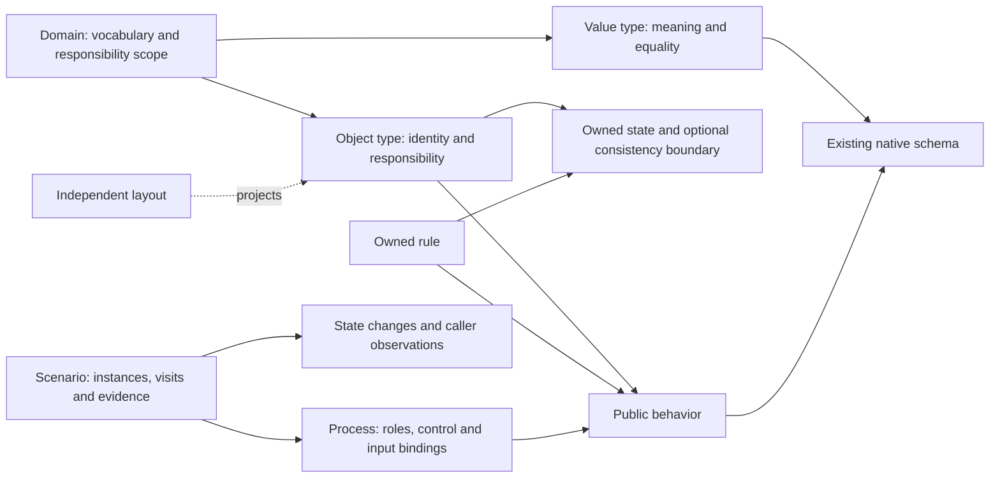

# Domain workbench semantic analysis

## Assignment

Read root/shared/local and tools/flow-atlas/design AGENTS guidance, the [parent task](flow-atlas-workbench.md), existing design/contracts.ts, source-binding.md and authoring/contracts.ts. The human wants a domain-model design workbench rather than a generic graph/trace renderer. Independently derive a minimal cohesive domain/process/scenario/dataflow model, identify the existing gaps, and challenge it against order/reservation success, rejection and a committed external effect with a lost response. Distinguish domain identity/value objects/aggregate invariants, application orchestration, adapter/transport and runtime deployment. Avoid assuming DDD requires event sourcing or a workflow runtime.

Write only this Task: working findings, proposed semantic relationships, concrete example, tradeoffs, first usable slice and uncovered guarantees. English agent-facing analysis; concise Chinese explanation may be included. Return precise recommendations to the parent. You own no code, canonical design docs, HTML, package, service or runtime writes. Do not run Node/Python/tsc/tests/browser/product commands or install anything. Static reads only. This is model research, not an extra acceptance/review gate. Record completed status and release your single claim when finished.

## Working basis and claim

Single write claim: this Task only, held during analysis by Paseo agent `8df02fe5-e121-4c64-85eb-89755bf6e8ee` and now released. Parent Task owns canonical integration. No executable, service, install, browser or product resources were claimed.

Method: derive concepts and invariant owners from the order/reservation scenario, then trace required data and distinguish control, state mutation and observation across success, refusal and lost acknowledgement. Apply [data/state modeling](../../../.agent-guides/scenarios/data-state-modeling.md) and [collaborative modeling](../../../.agent-guides/scenarios/collaborative-modeling.md) proportionately; prose, tables and small diagrams are sufficient, with no modeling program execution.

Static basis: [target contracts](../../../tools/flow-atlas/design/contracts.ts), [target model](../../../tools/flow-atlas/design/README.md), [target example](../../../tools/flow-atlas/design/example.ts), [source correspondence](../../../tools/flow-atlas/design/source-binding.md), [authoring contracts](../../../tools/flow-atlas/authoring/contracts.ts) and [authoring support](../../../tools/flow-atlas/authoring/README.md). Links are carrier-relative; canonical code may be refined concurrently by the parent.

Source-reading finding, subsequently challenged against the three outcomes below: Definition/Process/Scenario/Layout separation is sound. The coarse semantics arise because object identity/value meaning, consistency ownership/rules, step input supply and observer knowledge are not first-class relationships. Adding visual node kinds alone cannot resolve them.

## Semantic conclusion

Keep the four existing document authorities. Refine Definition into meaningful data, owned objects and capabilities; let Process compose those capabilities and bind their data; let Scenario witness identities, selected outcomes, actual changes and participant knowledge. A workbench should answer: “What is this concept, who may change it, under which rules, and where does this operation get its arguments?” A list of nodes, ports and arbitrary state patches cannot answer those questions.

The minimum is not a DDD catalogue. Entity identity, value meaning and consistency ownership are needed because the deciding example fails without them. Repositories, event buses, sagas, factories, event sourcing and a workflow runtime are not required by these scenarios.

### Relationships and authority



Arrows mean references/ownership as labeled, not runtime calls. This is a proposed semantic view; no diagram renderer or model execution was used.

| Concept | Minimal meaning and boundary |
| --- | --- |
| Domain | A named vocabulary/responsibility scope. `parentId` organizes scopes; it does not imply shared transactions, inherited ownership or deployment. Call a scope a bounded context only when its locally authoritative meanings and public translations are identified; an optional boundary annotation is enough, without requiring another registry. |
| Module | Source/capability organization inside that scope. Neither module containment nor a domain group establishes process location or atomicity. |
| Value type | Named domain meaning over an existing Schema: `Quantity`, `Sku`, `OrderId`, for example. Equality is by value; repeated `Quantity(2)` values need no object instance or lifecycle. Identical string schemas do not make OrderId and Sku interchangeable. DTOs can remain plain schemas unless they have additional domain meaning. |
| Entity object | Stable domain identity across state changes. A scenario's Atlas object ID identifies the model reference; its domain key identifies the business entity. A label, current state or array index identifies neither. |
| Owned state/consistency boundary | The facts an object may change while preserving its rules. An aggregate root is an optional declaration of one such boundary, with owned members; do not derive it from `kind: entity`, a module or a state event containing multiple writes. |
| Rule | An owned invariant, operation precondition or postcondition with stable references to the relevant state/input/result. Human text is design intent; a source link identifies an enforcement candidate, not a proof that it holds. |
| Operation | A capability owned by an object/service, referencing the native input/output schemas, allowed business decisions, applicable rules and declared state access. Its responsibility distinguishes domain decisions, application coordination and adapter work. `kind: service` alone cannot distinguish those layers. |
| Process | A use case with an application owner, roles, selected public operations, control edges and typed data bindings. It neither owns all participant state nor acquires permission to mutate roots directly. |
| Scenario | Concrete domain keys and role bindings, chosen visits/call IDs, input values, actual outcomes, state facts and evidence. World facts and what a caller learned remain distinct. |
| Adapter/channel/deployment | An adapter implements or translates a capability; a channel carries an interaction; a deployed process hosts objects. None changes domain identity or invariant ownership. Defer deployment modeling unless the example needs it; source paths are not deployment bindings. |

Composition/ownership, association, invocation, data supply and causal dependence must be different relationships. Order referring to a ReservationId does not own the stock reservation. A data edge does not imply a call; a call does not imply a state change; `after` does not provide an operation's required input.

An application API may truthfully return an `unknown` envelope, as the current native example does. Preserve that output contract; distinguish its reported lack of knowledge from StockPosition's business decision. A transport exception similarly does not establish that the stock command was refused or that its effect failed.

## Source-grounded gaps

| Current source | Decisive gap and recommendation |
| --- | --- |
| `ObjectType.kind`, `ObjectInstance` in [contracts](../../../tools/flow-atlas/design/contracts.ts) | Entities have no domain-key declaration, value meanings have no home, and `service` mixes application/domain/adapter responsibility. Add semantic annotations and explicit identity; keep type/instance separation. |
| `StateDefinition`, `Transition`, `Relationship` | Lifecycle edges and field schemas cannot express cross-field invariants, ownership or a consistency boundary. Add owned rules and optional ownership relations/root annotation. Independent fields stay independent. |
| `OperationPort`, `ProcessDefinition`, operation nodes | Method signatures exist, but a process has no input schema or argument sources. Add input bindings with path-qualified references and outcome availability; do not duplicate parameter definitions in process nodes. |
| `TraceEvent`, `StateWrite`, [design example](../../../tools/flow-atlas/design/example.ts) | Arbitrary status writes are possible although Order exposes no command, and one shared snapshot can mix participant uncertainty with remote facts. Connect changes to the owning operation occurrence. Keep call uncertainty distinct from actual stock state. |
| [Design example](../../../tools/flow-atlas/design/example.ts) and [native example](../../../tools/flow-atlas/authoring/examples/native-contracts.ts) | The former is authored and has no refusal fixture or explicit remote commit before loss. The latter's `lost` branch returns unknown before the stock decrement. Neither establishes the crucial committed-effect/lost-reply case. Add a design-only fixture; leave actual evidence with its implementation owner. |
| `ObservedStep` in [authoring contracts](../../../tools/flow-atlas/authoring/contracts.ts) | Observations retain operation/order/status, not input/output payloads. Current conformance cannot validate that confirm consumed the reserve result or that reserve quantity came from this order. Preserve that current coverage limit; payload correspondence requires a separately selected, explicit data witness. |

The example's inventory observation of 8 after a reply is an authored fact. A generic reservation ID does not supply a stock read, and even a `remaining` response describes a particular operation/read boundary, not necessarily current stock after later concurrent commands.

## Concrete minimal refinement for the parent

These are proposed contract changes for the parent to integrate into canonical design, not additional callable authoring APIs or a second normative declaration.

| Existing owner | Proposed addition | Necessary semantics |
| --- | --- | --- |
| Definition schemas/types | A small `ValueType` referencing `{domainId, schema, ruleIds}`; fields and parameter/result paths may reference its ID. | Reuse native Schema once. Semantic types add meaning, units/equality or identifier namespaces, not another field shape. Optional annotations are sufficient for simple DTOs. |
| `ObjectType` / `ObjectInstance` | An explicit responsibility (`domain`, `application`, `adapter`, `actor`, `resource`); entity identity definition plus scenario domain-key values; optional consistency-root/ownership declaration. | Responsibility is separate from the existing object kind. An owned child is not automatically another root. First slice can keep nested Reservation data inside StockPosition rather than require one canvas object per child. |
| Owned rules | Rule IDs, value-type or object owner, kind, statement, relevant field/input/result references and optional source binding. | Retain the declaration as intent. Known primitive Schema constraints can be checked; text rules and source references must not receive an “enforced” badge from structural lint. |
| Operation definition | References to applicable rules and declared reads/writes/owned transition. | A domain command may change its root; application operations delegate to domain capabilities. An app or adapter cannot claim a stock invariant merely by writing a trace patch. Query labels alone do not prove purity. |
| `ProcessDefinition` / operation node | Process input Schema and input bindings; optional output binding when the use case returns data. | Source alternatives: process input path, a prior selected step-result path, an explicitly supplied state read/checkpoint, or a literal. Destination paths reference the target's existing input Schema. Object construction from these references is enough; no expression language is needed. |
| Scenario visits/calls | Each concrete result binding resolves to a visit/call occurrence and outcome, with values supplied as authored evidence or an explicit observation witness. | Distinguish two visits of the same step. Result availability requires the producing branch and causal history, not merely a matching Schema or a preceding array index. |
| State/call projection | An actual change references its owning command occurrence; a caller observation identifies its subject and observer. | Start with observer-qualified call outcomes. Do not introduce an arbitrary multi-observer knowledge engine for this slice. If field-level observation writes remain, define the projection's viewpoint explicitly before mixing them with world facts. |

Use stable IDs and path segments/JSON Pointer, with no evaluated strings. A projection copies fields or builds a record; any genuine transformation points to an owned typed mapping and is displayed as opaque unless the tool has implemented that mapping. No handler or mapping function executes during inspection. Structural validation should flag missing required destinations, nonexistent/ambiguous paths, wrong branches and unavailable results. For open schemas, unions, complex refinements or unmodeled conversions, return explicit unresolved coverage rather than claim complete assignability. Concrete known scenario values can be validated against the existing input Schema without proving the general process mapping correct.

For the first usable dataflow slice, select sequential, acyclic paths with whole-result/field projections. Existing graph loops may remain valid as control design, but loop-carried values and parallel joins require explicit occurrence/merge semantics before dataflow support is claimed. If the project already owns an executable process or mapping, import it through an adapter; do not maintain a competing editable graph.

## Complete order/reservation example

This is a proposed business example, not a claim that the existing `prepareOrder`/`reserveInventory` implements these contracts. In particular, the current native input lacks an intent key and the source has no durable receipt, lookup contract or aggregate model. A target fixture may declare them, but an implementation adapter must reuse a genuinely corresponding native contract or report the mismatch.

### Owned objects and rules

| Owner | Identity, state and public behavior | Rules |
| --- | --- | --- |
| Sales `Order` | Entity/root keyed by OrderId. Owns one line `{sku, quantity}` for this bounded example, lifecycle `draft → awaiting-reservation → confirmed / rejected`, and the pending intent key. Commands: `beginReservation(key)`, `confirm(receipt)`, `reject(reason)`. | Quantity is a positive whole unit. Begin constructs a request from its owned line. Confirm requires a receipt for this order, line and intent. Rejection requires an authoritative refusal. Unknown delivery leaves lifecycle awaiting; it does not invent a new business status or erase the intent. |
| Stock `StockPosition` | Entity/root keyed by Sku. Owns `onHand` and reservation entries `{reservationId, intentKey, orderId, quantity}`. `available = onHand − sum(active reservation quantities)` is derived. Commands/query: `reserve(request)`, `findReservation(intentKey)`. | `available >= 0`; accepted reserve atomically admits the quantity and records the reservation in this root. One committed reservation per `(sku, intentKey)`; a conflicting request under a retained key is rejected. A successful receipt describes this root's committed decision. Insufficient stock changes none of these stock facts. |
| `Checkout` application service | Owns the use-case coordination, with a Process referencing both roots' capabilities. | Obtain intent identity before issuing the external call. Invoke Order commands for local lifecycle changes. Do not write stock or perform Order's receipt validation in an RPC adapter. |
| Inventory capability and RPC adapter | Checkout consumes a reservation capability; a selected adapter maps that capability to the inventory application's public operation, which delegates to StockPosition. | Offered/required signatures may share native schemas when semantics agree. The mapping must be explicit; a service endpoint is not automatically the aggregate method. Transport loss only changes delivery knowledge. |

Reservation has identity as an owned entry but needs no separate root, service or independently mutable canvas instance in this slice. A value type such as Quantity has value equality; a receipt is immutable evidence containing identity references, not ownership of the reservation. Order and StockPosition are independent consistency boundaries: there is no atomic “reserve stock and confirm order” transaction in this model.

Store onHand and reservation entries once; do not independently patch available as another authoritative field. Its formula is declared domain meaning. Display it through an explicit owned projection/query, or label the example's value 8 as an authored derived annotation until such a projector exists. This analysis does not establish an executable formula language or a computed-field compiler.

For the following authored alternatives, Atlas instance `order-42` has domain key `O42`, line `{sku: book, quantity: 2}`; stock instance `stock-book` has domain key `book`; intent is `K42`. A receipt `R42` carries the matching order, sku, quantity and intent. Scenario IDs and call IDs identify these illustrative alternatives, not real executions.

### Control and data supply

| Process step | Input source | Output/use and allowed next step |
| --- | --- | --- |
| `begin` → `Order.beginReservation` | Process input `intentKey = K42`; bound Order supplies O42/book/2 from owned state. | Returns `ReserveRequest{orderId: O42, sku: book, quantity: 2, intentKey: K42}`; Order becomes awaiting. Preparation refusal ends before any stock call. |
| `reserve` → inventory capability | Whole `begin` result; role binding selects the inventory capability for book. | Business `reserved(receipt)` permits confirm; business `insufficient(reason)` permits reject. Delivery unknown permits only the pending outcome. |
| `confirm` → `Order.confirm` | `reserve` result's receipt, only on reserved branch. | Order checks identity/matching intent and becomes confirmed. This command may itself reject stale/conflicting data; handle that as an explicit exception outcome, not successful completion. |
| `reject` → `Order.reject` | The explicit insufficient result's reason. | Becomes rejected, with no receipt; invalid local lifecycle still has an explicit refusal outcome. |
| unknown end | Caller observation of reserve call, retaining K42. | This attempt's trace can be complete while the business outcome is unconfirmed. No confirm, rejection, compensation or retry is invented. |
| optional recovery query | K42 retained by Order, supplied to `findReservation`. | `found(R42)` supplies a new authoritative receipt and permits confirm. A missing record alone does not prove that an in-flight request cannot still commit. |

The preparation/state-read source and the reserve result are distinct supplies. If the caller passed quantity 3 while the authored Order line is 2, matching integer Schemas would not make that mapping valid. Likewise, a receipt from O99/K99 must not confirm O42/K42 even though it has the same payload shape.

### Three decisive traces

| Scenario | Facts and order | Caller-visible result and retained state |
| --- | --- | --- |
| Success | Initially `onHand=10`, no reservations. Order begins with K42; reserve call `C1` reaches inventory; StockPosition commits entry R42/2 and derived available becomes 8; reply delivers the receipt; `Order.confirm(R42)` succeeds. | Order confirmed with R42. Stock owns the reservation; onHand stays 10. Receipt delivery and local confirmation are separate steps. |
| Rejection | Alternative initial stock is `onHand=1`, no reservations. Same requested quantity 2. Order begins; reserve `C2` returns insufficient without a reservation/state change; `Order.reject(insufficient)` succeeds. | Order rejected, no receipt. Available remains 1; no stock decrement, compensating action or “rollback” is shown. |
| Committed effect, lost reply | Initially `onHand=10`. Order begins; reserve `C3` reaches inventory; StockPosition commits R42/2; the response is lost; Checkout records delivery unknown. | World-authored stock is available 8 with R42. Checkout does not know that result; Order remains awaiting with K42. No reply event exists for C3 in the caller trace. The complete attempt ends unknown. |

```mermaid
sequenceDiagram
  participant C as Checkout application
  participant O as Order O42
  participant I as Inventory capability
  participant S as StockPosition book
  C->>O: beginReservation(K42)
  O-->>C: request O42/book/2/K42
  C->>I: reserve(request), call C3
  I->>S: reserve(request)
  Note over S: Commit R42 and quantity 2 in stock boundary
  S-->>I: committed receipt R42
  Note over I,C: Response to Checkout is lost
  Note over C,O: Delivery unknown; Order still awaiting
```

All commits in that diagram are authored assumptions, not observed execution evidence. `nature: change` records the root's committed mutation before delivery; the caller's unknown outcome refers to C3 and must not replace that known stock fact with unknown. A caller-only projection may display remote stock as unknown, but must label its perspective and must not draw a stock lifecycle transition “8 → unknown.” First-slice observer-qualified call outcomes plus Order's awaiting state suffice to explain this; general per-field, multi-observer knowledge can wait.

If recovery returns R42, append a new query call and result, then a confirm command; retain C3's unknown history. A late original reply stays correlated to C3. Retry would be a new call ID with the same domain intent, only when the actual provider contract supplies safe duplicate recognition; do not turn “no reply” or “not found” into permission to issue a fresh intent.

## Tradeoffs and rejected alternatives

- Retain the generic graph as a projection. Adding DDD labels to nodes without rule ownership/data supply leaves the actual user problem unresolved.
- Keep Domain as a documented scope and optional context boundary. Requiring a Domain/Subdomain/BoundedContext/Team/Deployment hierarchy would add distinctions the deciding scenario does not need.
- Use optional entity/value/consistency semantics. Requiring every object to be an aggregate, or every scalar to become a class and canvas instance, would obscure the model.
- Keep rules declarative or source-bound with explicit limits. Evaluating guard text, executing business handlers during export or inventing a general expression interpreter would change the tool's authority and complexity.
- Do not equate a domain invariant with a Schema, typecheck, diagram edge, successful method return or multi-object patch. Each has a smaller guarantee.
- Preserve observation separately from effects. A single `status: unknown` replacing world facts loses the decisive recovery case. A general epistemic simulator is unnecessary for the first slice.
- Avoid a workflow runtime, global transaction, event sourcing and automatic retry. They are implementation mechanisms, not consequences of having a Process or trace events.

## First usable slice and implementation handoff

The parent should integrate one cohesive design-only slice into canonical Definition/Process/Scenario contracts and examples: two owned roots, one application Process, named schema-backed value meanings, a few owned rules, input bindings and the three alternative traces above. Add the receipt mismatch/quantity mismatch as explanatory invalid examples. Keep application/adapter/deployment distinctions available in metadata and references; do not require the first canvas to expand every transport wrapper.

Minimum future executable outcome: inspect an Order and see identity, owned state, commands and rules; select its reserve step and trace each required input to an authoritative source; select each scenario and distinguish local lifecycle, stock mutation and caller knowledge. Reuse one set of semantic IDs across object/process/dataflow/state projections. This outcome needs semantic authoring/compiler work beyond existing inspector support; it is not established by producing another HTML or passing the design-only typecheck.

Implementable structural diagnostics: dangling rule/owner/field references; inconsistent domain-key schema; an owned change attributed to the wrong command/root; input destination not supplied; a result reference from an unavailable outcome/occurrence; known example input rejected by native Schema; confirm entered from the unknown branch. Rule statement truth, full Schema inclusion and arbitrary source behavior remain separately labeled, with unmodeled cases visible.

| Consequential guarantee | Real owner/mechanism needed | Present evidence/limit |
| --- | --- | --- |
| No oversell under concurrent reserve calls | Inventory root admission plus actual locking/transaction/conditional-write mechanism. | Reasoned rule only; no concurrent or storage execution. |
| A committed effect can be found safely after loss | Provider-defined effect/receipt retention, key scope, atomicity and recovery contract. | Proposed here; native example has no durable receipt or lookup support. |
| Duplicate/retried calls do not reserve twice | Actual provider's retained intent recognition and conflict behavior, including late calls/retention expiry. | No such guarantee established by Schema, this fixture or current native example. |
| A local order cannot confirm another order's receipt | Order-owned validation of domain identity, line and intent against its current lifecycle. | Required semantics and counterexample identified; implementation not exercised. |
| Data actually follows the declared mapping | Explicit payload witness or source-owned mapping used by implementation. | Current ObservedStep has no payload, so current trace conformance cannot prove it. |
| All source paths conform | Complete corresponding bindings/observations across relevant paths. | Current wrapper coverage is bounded; no arbitrary source inference or whole-project guarantee. |
| The view distinguishes facts from observations | Compiler/projector preserves effect owner, occurrence and caller perspective. | Target design obligation; existing state compiler is not inferred from authoring support. |

Unresolved implementation choices belong to the parent/provider owners: exact native receipt shape and trust boundary; persistence/dedup retention; how source mappings supply bounded witnesses without silently copying sensitive payloads; dataflow for loops/joins; and general observer-specific field projections. These do not block a complete design-only scenario. This Task supplies semantic recommendations, not another acceptance gate.

## Handoff and cleanup

Reasoning completed against the listed static sources and all three decisive outcomes. Only this Task was edited. No executable checks, business calls, tests, browser, service changes, installs, generated artifacts or messages to other agents were performed. Canonical integration belongs to [the parent Task](flow-atlas-workbench.md). The single Task write claim is released; no runtime resources require cleanup. Notify-on-finish carries this result to the parent without a separate message.
