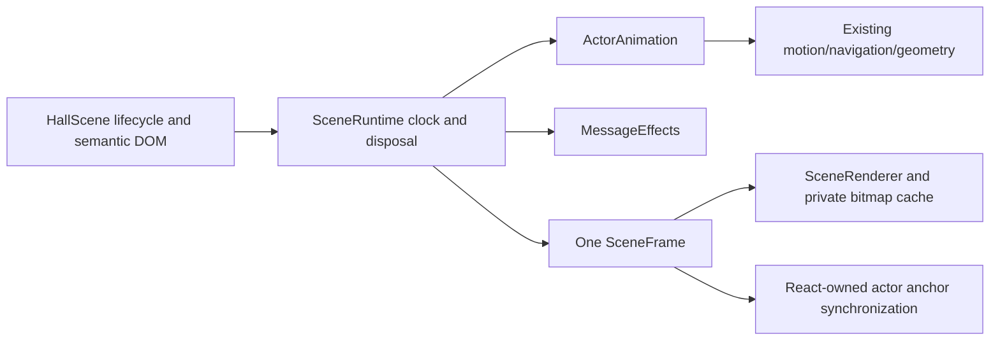

# Scene runtime engineering refactor

## Outcome and authority

User request #30845 authorizes a dedicated Agent to implement the engineering improvement discussed in #30833. Make the existing pixel-office rendering and animation code easier to understand and change through cohesive responsibilities, explicit state/lifecycle ownership and composition. Preserve current visual behavior and public React interaction contracts. This is a source refactor, not a service rollout or a new rendering engine.

Current module entry: [Space](../../web/agent-space/AGENTS.md). Retain [office behavior](design.md), [lounge/navigation refinement](lounge-refinement.md), [responsive composition](../../.docs/agent-space/responsive-space.md) and the accepted selected-service records linked there.

## Collaboration and ownership

Controller: space-responsive-zonu; reply to this identity through AgentX. One freshly launched project coder owns professional design, skeleton, implementation, current-model/module documentation and ordinary repairs through integration in HallScene. No further delegation. A separate fresh coder will own finite independent regression execution after source handoff because shared-clock/lifecycle and DOM/Canvas alignment are substantive state risks; avoid duplicate checks. The controller receives their evidence and closes the overall outcome.

Dedicated implementation isolation is explicitly user requested; the cohesive rendering/animation responsibility belongs to one owner, not per-file agents. Use project coder/Web, engineering-design and state-modeling methods. No new Skill, framework or dependency is required.

| Responsibility | Owner/result | Consumer |
| --- | --- | --- |
| State/lifecycle design, implementation and module guidance | Implementer; explicit boundaries, usable code and bounded static check | Existing HallScene/SceneSpace and future maintainers |
| Lifecycle/identity/animation and browser regression execution | Independent verifier assigned after handoff; finite evidence and cleanup | Controller acceptance |
| Scope/resources/closure | Controller | User |

## Design basis to refine

HallScene currently combines React lifecycle, RAF/timekeeping, per-actor movement, arrival/message deduplication, effect scheduling, Canvas caching/drawing, pointer input and DOM position synchronization. Existing HallArt already uses a class, and model/motion/navigation/geometry/art contain useful pure functions. The problem is mixed ownership and compressed expression, not absence of classes.

Recommended responsibility sketch (specialist owns exact interfaces and final file granularity): a scene runtime owning one clock/scheduler and cleanup; actor animation state; message effect state; Canvas renderer/cache. Runtime computes one explicit frame consumed by both Canvas drawing and the React-owned semantic DOM anchor synchronization. Retain pure functions/value types for layout, behavior projection, paths, camera and art. Compose concrete objects for stateful lifetimes; avoid inheritance trees, ECS, global event buses, DI containers, generic engine/plugin systems, or speculative renderer abstraction. Cache can remain renderer-private unless separation is earned.

Before substantial edits, record a concise structural/state design below or in a linked module-local design, then materialize contracts/skeleton and fill behavior. Keep exact professional decisions with the implementer. Public contracts should reveal which owner updates, samples, pauses/resumes and disposes state; time must be explicit and deterministic enough for focused tests.

## Retained guarantees

- Exactly one animation clock/scheduler per mounted scene, no RAF/listener leaks on dispose/remount; preserve pause, reduced-motion and visibility restoration behavior.
- Both Canvas and DOM actor anchors use the same sampled positions. Avoid per-frame React state updates.
- Exact Agent identity, per-office/App-owned memory, selected actor position and camera/zoom behavior remain intact. A changed seat coordinate frame is not an arrival.
- Retain current path/obstacle geometry, poses/timing, pixel-art palette/cache behavior, draw order, visibility limits, arrival semantics and bounded message flight rules.
- Scene animation only projects native facts; it cannot send messages or operate Agents. Preserve pending-Agent versus human-history distinctions.
- Preserve same complete responsive Space, source provenance/notices, existing API/controller/chat interfaces and current user resources.

## Write/resource scope

Implementer may edit `web/agent-space/src/scene/`, add focused regression cases under `web/agent-space/tests/`, update `web/agent-space/AGENTS.md` and its scoped scene documentation, and update this Task's design/handoff sections. Keep tests meaningful and behavior-based. Coordinate before changing files outside this cohesive scope; do not edit root manifests, Rust/native/API/chat or unrelated user changes. Shared working tree contains many pre-existing modifications/untracked files: do not reset, clean, stage broadly or commit them.

No service stop/restart/replacement, installed binary mutation, native package build or LAN rollout. Preserve :38023 and other listeners. Disposable frontend preview only, with a free non-default loopback port if needed; record and clean owned resources. Verification build must use a new external output path.

## Acceptance and execution ownership

Implementer: integrate the design into existing HallScene; run one scoped static typecheck after coherent edits (repeat only for subsequent relevant repairs). Preserve/author focused semantic scenarios where warranted, but independent executor owns final test/build/browser runs. Existing source-scraping assertions may need semantic updates; do not weaken their original guarantees to accommodate the refactor.

Verifier after handoff: select affected existing office-details/camera and new lifecycle/frame/effect cases, run scoped build (includes typecheck; do not separately repeat it), and one finite browser check of real refactored scene/DOM alignment, selection/pan, narrow layout, pause/reduced-motion and remount cleanup as supported by the harness. Use explicit demo supply or disposable host; no native mutation. Report authored vs executed evidence and gaps accurately. Do not run broad unrelated suites or repeat passed checks without a changed condition. Route substantive defects back to the implementer within the same assignment.

Completion requires actual HallScene consumer integration, comprehensible responsibility/state ownership, updated discoverable guidance, adequate finite independent evidence and disposal of test resources. Source acceptance does not imply installed/live adoption.

## Accepted local source outcome and closure

Controller accepts the complete refactor plus default-on discoverable Canvas tooling using [independent verification](scene-runtime-verification.task.md#completed-independent-outcome), completed in #31560. Runtime/actors/effects/renderer have explicit state and lifetime owners; the existing HallScene consumer shares a sampled frame between Canvas and DOM. `window.agentxSceneDebug` supplies default discovery, semantic objects and action contracts, existing-owner invocation, presented-frame observation and correlated real Canvas PNG. [Usage and exact contracts](../../web/agent-space/src/scene/debug/README.md) let a fresh Agent start without object IDs.

Independent evidence establishes the promised contribution within finite Linux Chrome/static-demo scope: reused six office and ten runtime passes, eight new debug passes, fresh scoped build, actual unknown-ID discovery→exact selection→committed presentation/capture, measured Canvas/DOM geometry, camera/draft/pan/close continuity, pause/reduced motion, three clean remount cycles and390/320/short-screen checks. The verifier preserves four attempts/continuations and their timing/tooltip/offscreen-camera assumptions; no source defect or source repair was established. Snapshot last-frame state and live DOM geometry may differ during React commit windows, as documented. Browser screenshot pixels include DOM only when obtained separately; Canvas PNG is canvas-only.

[Evidence manifest](../../.bin/scene-runtime-verification/vetule-20261115/manifest.json) identifies the accepted source/artifact and retained results. The external immutable build is `/tmp/scene-runtime-vetule-expanded-20261115-build`, JS `index-BwaZBXwh.js`. No repeated controller checks are required. All browsers and owned static hosts were closed; user services/native APIs/installed programs remain untouched. This is source acceptance, not :38023 deployment, native support, arbitrary browser/physical-mobile or pixel-perfect historical visual acceptance.

Implementation binding scene-runtime-vidore and verification binding scene-verification-vetule close at their declared boundaries. All source/resource freezes are released to the separately owned cat feature (#31534); subsequent changed source is not retroactively covered by this immutable evidence. No further work or service action is required in this Task. New maintenance returns through module guidance; a rollout needs its separate single owner/target plan.

## Design and handoff

### Structural and state design — vidore

Keep the existing art, geometry, navigation and motion functions as the value layer. Add a private `src/scene/runtime/` composition with the following cohesive owners; no public React prop changes or new dependencies.

| Owner | Contract and state |
| --- | --- |
| `contracts.ts` | `SceneInput` is supplied presentation facts; `SceneFrame` carries one sampled world/screen actor projection, elapsed decorative milliseconds, still flag and bounded flights. Prop anchor declarations move here and remain re-exported from HallScene. |
| `actors.ts` / `ActorAnimation` | `sample(input, elapsed, still)` owns exact-key motion entries and arrival deduplication; `restore(elapsed)` settles interrupted paths; `point(key)` reads the last sampled world frame. Layout seat changes reset coordinates without arrival replay. No DOM or browser clock. |
| `messages.ts` / `MessageEffects` | `sample(input, elapsed, wallNow, still)` owns seen IDs, geometry invalidation and bounded flight scheduling; `restore(messages)` drops flights and consumes hidden-period messages. No sending or native mutation. |
| `renderer.ts` / `SceneRenderer` | Own Canvas backing size, palette, bounded bitmap cache and existing draw order; `draw(frame)` consumes the exact runtime frame. `dispose()` releases cache references. |
| `runtime.ts` / `SceneRuntime` | Own one RAF handle, elapsed time, throttle and browser subscriptions through a narrow deterministic environment contract. `start`, `update`, `point`, `dispose` define its lifecycle. One callback presents the sampled frame to renderer and React-owned DOM anchors in the same task. |
| `HallScene.tsx` | Compose one runtime/renderer per effect lifetime, update supplied facts, retain semantic buttons/facts and pointer pan. No movement/effect/cache mutation in React. SceneSpace/App retain camera, office memory, selection and native supply. |

Lifecycle: constructed → `start` subscribes and wakes → running or quiescent (paused/reduced/hidden) → `update` or environment notification wakes → `dispose` cancels and unsubscribes permanently. Repeated start/dispose are harmless; updates after dispose do nothing. Wake cancels the previous pending frame and resets the timestamp baseline; elapsed decorative time advances only while visible and animated, capped at 100ms per tick, with existing 40ms drawing cadence. Paused/reduced motion still draws one settled frame, clears flights and schedules no continuation. Visibility changes clear flights, mark supplied messages seen, settle existing paths and reset timestamp baseline. Selection holds its supplied world point and releases by retargeting from that same frame. Actor samples and endpoint keys use exact identities; filtering dims but does not remove layout members.

Retain current constants and semantics: visible new arrival ≤1600ms, motion cap/navigation unchanged, messages newer than 4000 wall milliseconds only, ≤24 queued / first 6 presented, 700ms flights, seen-ID rollover at 256, cache at 512 and DPR at 2. Do not normalize historical future-dated message behavior or change unreachable route behavior during extraction.

### Scenario design and evidence boundary

Author focused deterministic cases for one pending RAF under repeated update/start, pause/reduced settling and no continuation, hidden restoration without time jump/replayed effects, permanent disposal/remount cleanup, shared sampled world/screen coordinates, exact incarnation replacement, selected hold/release, arrival deduplication and reflow reset, bounded/deduplicated/stale/removed-endpoint messages. Existing office-details/navigation and camera/browser cases remain verifier-owned. New test authorship is not execution evidence.

Codebase-memory discovery found only the unrelated xpm checkout indexed; use targeted current source inspection for this checkout rather than index another large shared tree. Inspected HallScene, SceneSpace, motion, geometry, office model cases and current behavior/refinement/responsive contracts. No graph-based completeness claims. Initial AgentX ack without a received message ID was rejected; acceptance was delivered with `intent=inform` instead. No source/runtime blocker.

## Selected discoverable Canvas tooling extension

The [overall selected plan](../../.docs/agent-space/canvas-tooling.md) records the user outcome, responsibilities, capability boundaries and acceptance path. User #31136 explicitly confirms planning and implementation delegation. The specialist design below owns exact technical contracts; continue the existing accepted implementation binding without another worker.

User #31003 accepts the diagnostic direction and explicitly changes the earlier suggestion: default-enable the global tool, provide `list`-style model/object discovery for an Agent with no prior object knowledge, and expose supported actions as machine-readable promises through the same discovery/call model. Earlier opt-in/read-only-only proposal is superseded. This extension is now part of the active source outcome; original refactor source evidence remains valid for its captured scope.

The same implementer vidore owns professional design, contracts, current Space adapter, actual consumer integration, documentation and ordinary repairs. No additional implementation agent or generic engine is required. Start with a reusable discovery/call contract plus one complete current Canvas adapter, not a cross-framework product. Implementation scope may include cohesive SceneSpace wiring for existing scene controls; existing callback/public behavior must be retained. Outside scene, only minimal App registration glue if concretely needed and reported; no native/API/chat redesign or service adoption.

Required capability, exact names/signatures owned by implementer:

- A documented global facade enabled by default in both dev and production builds. Discover interface/version/coordinate conventions, registered canvases, lifecycle/availability, object kinds, object lists/relationships and detailed inspection. No hard-coded object ID or application source knowledge is needed by a caller. Keep facade and registered scene adapters distinct; list active instances and unregister on disposal.
- Enumerate semantic objects including room-contained furniture (even if drawn into room bitmap), current actors, human endpoint and applicable props/effects. IDs/relations and details must distinguish exact actor identity, goal vs sampled location, draw visibility/filter/clipping, world/Canvas/page/backing coordinates and bounds where truthful. Explicitly mark unavailable facts rather than infer pixels or fabricate precision.
- Machine-readable action descriptors: identifier, purpose, applicable scope/target, parameter constraints, result meaning, current availability/reason and meaningful effects. Invoke only registered actions via validated arguments and existing owners/callbacks, never arbitrary method reflection/eval or direct internal mutation. Implement a useful bounded set of actual current scene operations (e.g. selection and available camera/pause controls) established by the specialist; no native send/start/stop actions are added.
- Serializable detached snapshots/inspection results, not mutable runtime references or arbitrary controller/transport dumps. Browser-automation-safe image transport; describe/capture actual Canvas pixels with correlated scene-instance/frame metadata, backing/CSS dimensions, camera and page rectangle. Reading consumes an actual presented frame rather than recomputing animation. Clearly distinguish no mounted scene, no presented frame, old object/instance, unsupported/unavailable action, invalid arguments and capture failure.
- Operation acceptance and next-frame presentation are distinct facts. Expose a practical way to determine the frame resulting from scene actions without claiming presentation from a callback alone. Preserve hidden/paused behavior, one scheduler, and cleanup; no always-on JSON serialization or second animation loop.
- Canvas PNG excludes DOM labels/tooltips/chat. Document how normal browser screenshots combine with object/DOM bounds. Browser automation can evaluate in the Space frame; cross-origin host postMessage bridge and remote RPC are deferred, not implied by global exposure. No query flag/auth handshake is added.
- Discoverable usage and a generic browser example: start from the global entry, list canvases/objects/actions, select an eligible discovered object without fixture ID assumptions, invoke a supported action, then inspect/snapshot/capture to verify outcome. This is final independent acceptance, not only a declaration/typecheck.

Exact structural contracts and boundaries must be recorded before code. Current unified frame design is the foundation. Avoid speculative schema frameworks, plugin registries, new dependencies or dumping every Canvas draw call. A small registry for actual mounted canvases and explicit typed action contracts is sufficient unless professional evidence requires more.

Coordination: verifier owns original finite state checks, then waits on expanded source handoff for final build/browser so passed baseline checks are not routinely repeated. Expanded assignment accepted by vidore in #31062. Baseline source files explicitly released by vetule in #31066; vidore may proceed with expanded source edits now. Any already-produced build/browser evidence remains historical for its exact input; rerun only affected expanded source conditions. Controller owns final composition acceptance.

### Source handoff — vidore

Integrated source is ready for independent execution. `HallScene.tsx` now composes `SceneRuntime` and `SceneRenderer`, presents the same sampled frame to Canvas and semantic actor anchors, and retains existing React callbacks, facts, exact selection and pointer pan. The original pure art/motion/navigation/model/camera owners are unchanged. `runtime/` materializes the five documented responsibility contracts; lifecycle state and subscriptions are private, actor/effect state accepts explicit time, and renderer owns only Canvas/cache state. No pending skeletons or new dependencies remain.

Discoverable current guidance: [scene ownership](../../web/agent-space/src/scene/AGENTS.md), routed from the module's AGENTS.md. Authored [10 deterministic runtime cases](../../web/agent-space/tests/scene-runtime.test.mjs) cover the designed lifecycle/frame/effect scenarios, including exact browser-listener cleanup. No source-scraping test expectation was changed; source inspection found no affected source-scraping assertions in the scoped existing tests.

Executed exactly one scoped static check after coherent source edits: `node web/agent-space/scripts/run.mjs typecheck` → exit 0. No unit/integration/browser execution or production/native build was performed by the implementer. Independent executor should run the new runtime cases, affected existing office-details/camera cases, one fresh external-output scoped build and finite actual Canvas/DOM/browser cases under the Task's ownership limits. Browser rendering, actual remount behavior, visual parity and camera integration remain unverified by this source handoff.

No service, installed program, native/API/chat file, root manifest or unrelated dirty work was changed. No preview/test server or other disposable process was started; no owned resources require cleanup. All changes are in the authorized scene/module guidance/tests/Task scope, uncommitted in the existing shared tree. Ordinary substantive repairs remain with vidore under this assignment; controller receives source and assigns final independent execution. This is source integration, not installed/live adoption or overall acceptance.

### Baseline verification and loader friction

Vetule #31066: six office-details cases pass; initial runtime test import failed before cases because Node24 strip-only rejects constructor parameter properties. Baseline scoped build passes at `/tmp/scene-runtime-vetule-20261115-build`. Disposable `127.0.0.1:46309` host was started then stopped; no browser launched. These are baseline-only results, not diagnostics acceptance. Controller response #31048 directs transform-capable runtime invocation (`node --experimental-transform-types --test web/agent-space/tests/scene-runtime.test.mjs`); vidore owns canonical command documentation correction. Expanded final tests/build/browser remain with vetule after integrated source handoff. No need to change runtime behavior to accommodate strip-only loader.

### Diagnostics structural and state design — vidore

Accepted expansion #31042 and verifier source release #31066/#31099. Baseline independent evidence: six office cases, ten runtime cases and scoped build passed. Runtime cases require `node --experimental-transform-types --test web/agent-space/tests/scene-runtime.test.mjs`: Node24 strip-only rejects TypeScript parameter properties before any case; documentation corrected, no runtime redesign. Verifier owns final expanded tests/build/browser; its baseline host is stopped.

Add a small `scene/debug/` boundary: `contracts.ts` owns serializable discovery/action/result contracts; `registry.ts` owns mounted-canvas registration and the stable facade; `space-adapter.ts` owns the current scene adapter/lifecycle/presented-frame observations and validated existing callback actions; `objects.ts` owns on-demand semantic projection. `README.md` owns usage and coordinate/capture limits. HallScene registers/disposes one adapter and calls `present` only after renderer plus DOM anchor synchronization. SceneSpace supplies its existing camera/pause/panorama owners through optional HallScene controls and shares their named functions with ordinary buttons. No App/native/API/chat edit is needed.

Global `window.agentxSceneDebug` is installed on module load in both dev and production, without a query. It stays available with an empty canvas list after scene disposal. The frozen facade exposes `describe()`, `list({kind: canvases|objects|actions, canvasId?, objectId?, objectKind?})`, `inspect({canvasId, objectId})`, `snapshot({canvasId})`, `invoke({canvasId, actionId, objectId?, args?})`, `capture({canvasId})` and `waitForFrame({canvasId, afterFrame, afterInputRevision?, timeoutMs?})`. All results use `{ok:true,value}` or `{ok:false,error:{code,message}}`; methods validate request shapes. Errors distinguish invalid arguments, no mounted scene, unknown/stale instance, no presented frame, unknown/stale object, unsupported action, unavailable action, callback failure, capture failure, disposed scene and frame timeout. Describe discovers version, method purposes, object kinds/relations and coordinate conventions. List actions supplies target scope/kinds, parameter names/types/ranges, result/effects and current availability/reason, including unavailable object-target actions when no target is supplied. No arbitrary reflection/eval.

Actions: `object.activate` calls the existing exact actor/human/prop callback (human toggles its existing feed); `camera.pan` accepts finite screen CSS dx/dy in [-10000,10000]; `camera.zoom` accepts factor [.1,10] through the existing constrained zoom function; `camera.panorama` invokes the existing panorama owner; `animation.pause` accepts a boolean through existing state ownership. No native operation. Object activation checks latest committed identity/filter/anchor availability as well as the presented object; stale targets cannot select a refreshed namesake. Scene actions require supplied controls and a nonzero viewport. Descriptors are generated from the same action definitions used for argument validation/invocation.

Frame state: adapter stores the actual last successfully presented SceneFrame and monotonically increasing frame ID. Each committed SceneInput gets a revision before runtime update. Invocation returns an acceptance receipt with request ID, current `afterFrame` and `afterInputRevision`; this only confirms callback acceptance. `waitForFrame` is event-driven (no RAF/polling loop), optionally requiring both a newer frame and newer committed input revision; it resolves immediately for an already matching frame, otherwise on a presentation, disposal or a bounded timeout. A no-op, hidden scene or unrelated update may not establish the requested outcome: caller must compare the returned snapshot state with requested semantics. Capture reads actual Canvas PNG and frame metadata in one synchronous JS call; it does not trigger drawing or resample movement. Serializable results are copied on request only; there is no per-frame JSON walk.

Semantic discovery includes rooms, work/lounge zones, exact actors, human endpoint, shared room-bitmap fixtures, work desks/chairs, interactive props, attention and message effects (pending aggregates mark individual pixel bounds unavailable). Each object has an opaque discoverable ID, kind/label/parent/relations, explicit world anchor/goal/sample where applicable, filtering/draw/viewport clipping, image-box bounds when derived from actual sprite geometry, and live DOM/page bounds when present. IDs encode exact scene facts and are always scoped to a canvas instance. Furniture stays inspectable even when composited into a room bitmap; descriptions do not imply interaction.

Coordinates distinguish world units, Canvas-local CSS pixels from the sampled camera, current client/page CSS rect, and backing pixels using actual Canvas dimensions. Sprite bounds describe image boxes including transparent padding, never opaque-pixel hit regions. Composite fixtures use the same local rounding/clipping as room art; room/zone geometry bounds are labeled as model geometry. DOM bounds are measured live at read time, explicitly distinct from last presented Canvas state. Canvas clipping is rectangular visibility, not an occlusion or DOM overlay assertion. Bitmap bounds logic will be shared with renderer where needed to avoid a second placement rule. Capture includes instance/frame/input revision, elapsed/still/camera/viewport, actual backing size, page/client rect and PNG data URL. PNG excludes DOM labels/tooltips/chat; ordinary browser screenshots and live DOM bounds complement it. Access is in the Space browsing context; cross-origin postMessage/remote RPC remain deferred.

Extension scenarios to author: generic registry empty/stale/lifecycle and detached results; action discovery/validation/availability and accepted-vs-presented receipt; last-frame/capture correlation; objects/fixtures/exact identity and coordinate mapping; wait resolve/timeout/disposal. Final independent browser starts with no IDs, discovers a usable actor/action and controls, invokes, observes a newer input/frame plus intended state, then captures real PNG and checks cleanup. Source implementation/static check follows this design; final execution remains vetule-owned.

### Expanded source handoff — vidore

Default-enabled diagnostic tooling is integrated into the actual HallScene/SceneSpace consumer. [Usage and ID-free browser example](../../web/agent-space/src/scene/debug/README.md) links the [overall plan](../../.docs/agent-space/canvas-tooling.md), [exact serializable contracts](../../web/agent-space/src/scene/debug/contracts.ts), registry methods and concrete action definitions. Both module/scene AGENTS.md route fresh readers there.

Implemented boundary: frozen `window.agentxSceneDebug` facade, mounted instance discovery, kinds/object/relationship discovery, exact inspection and snapshots, supported action descriptors with parameter constraints/result field types/meanings/effects/current availability, validated invocation, event-driven presentation waits and actual Canvas PNG data URLs correlated to the last presented frame. Actors, human endpoint, room/zones, work furniture, room-bitmap fixtures, interactive props, attention/pending/message effects are discoverable. Explicit unavailable/null bounds and endpoint anchors avoid fabricated pixel precision. Sprite selection/placement is shared with the Canvas renderer in `runtime/sprite.ts`; no animation resampling occurs during reads. Current live DOM rectangles and last-frame Canvas geometry are explicitly distinguished.

`HallScene` owns adapter registration/input revision/presentation publication/disposal; `SceneSpace` supplies its existing zoom/pan/panorama/pause owners through the same named functions used by ordinary controls. Object activation calls the existing actor/human/prop callback. No arbitrary reflection, native operation, second clock, per-frame JSON traversal, App/API/chat edit or dependency was added. The facade stays available with no mounted adapters; the most recent 64 retired mount IDs are recognized as stale, while empty-unknown requests report `no_scene`. Pending frame waits are resolved on disposal, and new mounts have distinct opaque IDs.

Authored [eight diagnostic semantic cases](../../web/agent-space/tests/scene-debug.test.mjs), not executed by implementer. They cover unknown-model lifecycle/pre-frame/stale/empty discovery, furniture/identity/coordinate semantics, detachment, discovered activation with acceptance-vs-input/frame observation, invalid/unavailable/stale actions, control callback ownership, correlated capture-port metadata/failure, timeout/disposal/remount. Real PNG pixels, actual DOM/Canvas alignment, browser interaction and UI continuity remain independent execution concerns. Supported new command: `node --experimental-transform-types --test web/agent-space/tests/scene-debug.test.mjs`.

Scoped static execution: first extension typecheck exposed a surplus registry parenthesis, then a description declaration incompatible with recursive Json typing; repaired syntax and replaced the cast with a dedicated typed interface description. The corrected scoped typecheck passed. A subsequent result-contract refinement added typed receipt field promises to action discovery; one relevant static recheck passed after that source change. Final command `node web/agent-space/scripts/run.mjs typecheck` → exit 0. No final unit/browser/build execution was duplicated.

Verifier can reuse its six office-details and ten runtime cases: `runtime/runtime.ts`, actors/messages, model/motion/navigation/camera geometry are unchanged since their passing baseline. Affected integration source is HallScene, SceneSpace, Canvas renderer/shared sprite value operations and new debug files/tests. Execute new diagnostic cases plus final fresh external-output build and the combined finite actual browser discovery/action/frame/PNG and retained-experience checks; no duplicate broad suites or separate typecheck. Any substantive ordinary repair remains vidore-owned.

No preview/server/browser was started by this implementation, and no owned process needs cleanup. User services, selected :38023, installed/default executables and unrelated dirty work remain untouched. Source is uncommitted and not adopted into live service. Writes are released for independent execution; controller owns final acceptance.

### Independent evidence received and implementation closure — vidore

Verifier #31560 reports completed [finite independent outcome](scene-runtime-verification.task.md#completed-independent-outcome), with the authoritative [artifact/source/evidence manifest](../../.bin/scene-runtime-verification/vetule-20261115/manifest.json). Its 6 office + 10 runtime baseline cases are reused; 8 new diagnostic cases and fresh expanded build passed. Actual Linux Chrome/static-demo execution covers default no-ID discovery, real exact activation, committed input/frame observation and PNG correlation, real Canvas draw/DOM anchors, camera/draft/pan/close continuity, detached/error/timeout outcomes, pause/reduced motion, three clean disposal/remount cycles, and 390/320/short layouts. The same expanded source required no source repairs during execution.

The verifier preserves four honest attempt/continuation records: immediate React commit vs last Canvas observation, independent focused-tooltip RAF, and retained-camera offscreen eligibility were executor-boundary/setup findings, resolved by stable checkpoints, tooltip dismissal and the discovered panorama action. These do not establish historical pixel-perfect visual parity or an invariant that live DOM always equals last presented Canvas during a pending commit. Current README preserves those limits and now links actual independent support.

All verification browsers and owned hosts are closed; implementation started no processes. No assigned implementation or ordinary repair remains outstanding. Source writes are released; controller can close using the linked independent evidence without duplicate checks. This source acceptance excludes physical-mobile keyboards, other engines, cross-origin bridges, native actions and LAN adoption. The separately owned new bigboss-cat outcome was coordinated with mavema in #31472: nigive owns its cat/feed semantics, and that future change must maintain diagnostic truth and the single-clock boundary without claiming this evidence for changed inputs.
