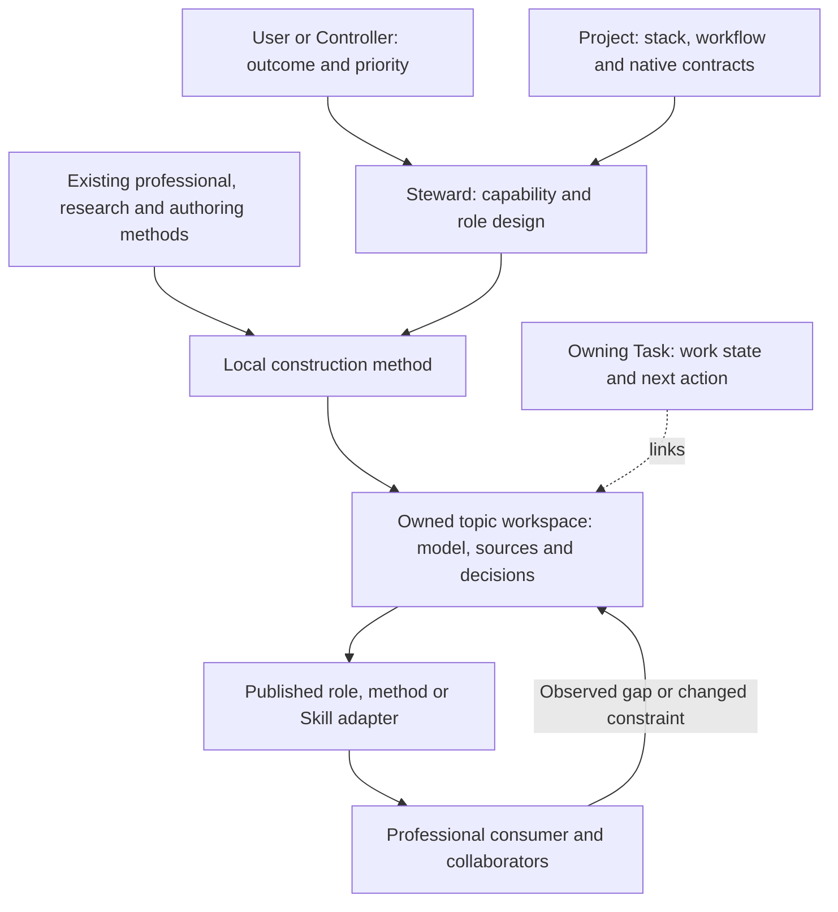
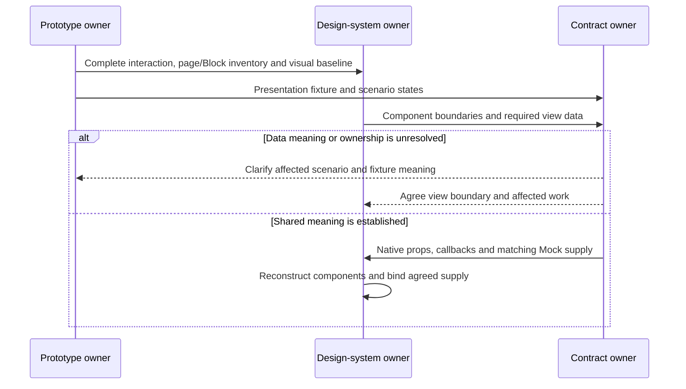

# Role and method steward design

## Problem and basis

The user needs an entry that builds professional roles around actual team scenarios and project constraints, researches methods/Skills, maintains design drafts and state, and preserves decisions for later inspection. The user explicitly prefers models, Mermaid diagrams and tables over large prose accumulations. The [discussion](../../.sketches/role-method-steward.md) retains the initiating reasoning and inspected sources.

Design maturity: candidate. This is the selected local implementation structure, not evidence of Agent behavioral effectiveness. Work progress belongs to the linked Task.

## Responsibility and dependency model

| Owner | Responsibility | Boundary |
| --- | --- | --- |
| User / Controller | Intended outcome, priorities, staffing and real assignment | Steward does not become the business Controller |
| Steward | Capability diagnosis, collaboration agreements, researched method composition and maintenance | No assumed expertise, runtime authority or routine message intermediation |
| Domain owner | Substantive domain judgments and shared contracts | Conflicts remain explicit until resolved |
| Design topic | Scenario, alternatives, rationale, maturity and evidence | No duplicate worker-status registry |
| Role prompt | Responsibility and action-triggered routes | No embedded research archive |

## Structural contracts

| Artifact | Public contract |
| --- | --- |
| `.agentx/roles/role-method-steward.toml` | Existing profile plus parent-relative prompt path; non-default project role |
| `.agent-guides/local/roles/role-method-steward.md` | Responsibility, authority, entry routing and handoff requirements |
| `.agent-guides/local/domains/role-methods/AGENTS.md` | Model-first construction, research/adaptation, state and maintenance workflow |
| `workspace-template.md` beside the method | Copy/adapt into an owned topic; embedded example diagrams are illustrative and must be replaced |
| This control topic | Current design, implementation evidence and bounded support |

Dependency direction is role → local method → existing shared methods or local template. No shared installed guidance is edited. No new Skill is needed to expose an already usable project-local method.

## Decisions

| Choice | Selected | Alternatives and reason | Risk / response |
| --- | --- | --- | --- |
| Entry | One project-local steward role | Prompt-only entry loses process; a new service/registry adds no needed capability | Role is not runtime authority; retain explicit boundaries |
| Method ownership | Local adapter over existing professional/research/authoring guidance | Copying shared methods creates competing sources | Links depend on this project layout; no portability claim |
| Record shape | One topic design plus native Task, split research when useful | Fixed multi-file bundles create empty documents | Template is adaptable, but rationale/evidence must remain recoverable |
| Expression | Semantic diagrams with decision/evidence tables | Prose-only obscures relationships; diagrams-only hide guards and rationale | Label meaning, scope and evidence; use prose where clearer |
| State | Native Task progress; separate design maturity and adoption evidence | A single ready/done label overstates support | Record version, environment and limits for every trial/adoption claim |
| Runtime profile | Existing `codex-gpt-6-1-sol-high` | Changing model defaults is unrelated; no new profile required | Actual instance adoption remains a separate observation |

## Validation design

| Case | Expected decision or artifact | Evidence planned |
| --- | --- | --- |
| Create a specialist in an unfamiliar area | Define scenario/collaborators before selecting researched methods; expose unknown prerequisites | Static path from actual role to method/template and research source |
| Repair prototype/contract/design-system handoff | Use one shared scenario and directional artifacts; preserve existing domain ownership | Source-linked static collaboration walkthrough |
| Fix a role's wording or broken link | Reuse current rationale/topic; update the affected owner only | Excluded-case walkthrough; no forced new workspace or Agent |
| Catalog search succeeds but required tool is absent | Keep candidate separate from usable capability; record prerequisite and blocked scope | Boundary walkthrough |
| Role prompt changes after launch | Published file changes do not imply refreshed running instance | Native role contract and CLI preview, with no actual adoption claim |

## Static walkthrough: existing UI collaboration

The following is a source-grounded model of the [prototype](../../.agent-guides/roles/prototyper.md), [contract](../../.agent-guides/roles/domain-contracts.md) and [design-system](../../.agent-guides/roles/design-system.md) responsibilities. It is a static maintenance example, not a newly executed handoff. The complete topic is the collaboration slice; individual prompts reference their owned responsibilities.

The steward diagnoses and maintains this agreement; it need not relay these ordinary exchanges. The design-system owner can work on independent visual foundations before data wiring is ready. The example imports no additional framework and gives no role authority over another owner's professional decisions.

## Open limits and maintenance

- Source-based synthesis is available; no comprehensive external method survey or new Skill installation has been performed.
- Static walkthroughs support interpretable routing, not observed role effectiveness. A future authorized business task should retain its input, artifact version and actual result.
- Keep the shared canonical-authoring-source question with any future shared publication; this local implementation does not require editing that source.
- Reopen affected design when workflow ownership, project stack, method prerequisites or observed results change. Keep unrelated established evidence.
