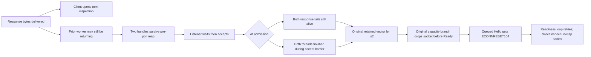

# Complete causal diagnosis

## Current handoff

Completed at the Controller-accepted diagnosis boundary (movi52025). Seven historical failures have established causes; [controlled causal result and final handoff](#controlled-causal-result-and-final-handoff-2026-11-18) additionally proves stale finished handles reach false-capacity rejection and both stale handles/true response tails can produce native Hello104. The original incident's specific close mechanism remains unknowable from its client-only log. The controlled result supersedes earlier pending admission hypotheses below. No internal fixes are authorized or applied. [Controlled evidence and commands](/tmp/agentx-web-sdk-movi/evidence/native-root-causes/controlled/README.md); [cleanup receipt](/tmp/agentx-web-sdk-movi/evidence/native-root-causes/controlled/closure.json). Movi owns treatment selection and overall cleanup/diagnosis closure.

Read root AGENTS, feature AGENTS/controller.task.md, debugger role and systematic troubleshooting guidance, prior web-sdk-adoption/integration.task.md final evidence, and applicable native module guides. User wants fundamental causes before deciding how to fix internal problems. Controller movi receives result; no delegation. Preserve dirty source/live data/services/installed programs. No internal production or test assertion edits yet; maintain diagnosis and reproducible evidence in this Task and linked artifacts. Author diagnostic harness only where needed.

Prior aggregate:3328 pass/20 ignored/8 failures from Cargo binary suite built in/tmp/agentx-web-sdk-movi/source. Three path fixture failures: paths::tests::test_is_test_temp_path_rejects_non_temp; db tests non-temp rejection and temp symlink to non-temp rejection. Four summarized as launch-relations/model-request/inbox migration expectations plus kill no-target. One Observation reset OS104 exact name/log lost. Treat those summaries as hypotheses, not established unrelatedness.

Own exact8 mapping and causes using retained test executables in/tmp/agentx-web-sdk-movi/target/debug/deps, prior transcript/evidence/source first. Recover actual old failure output from your own inspection of original executor transcript (vuhila) if needed, not by delegating. Narrow test listing/filter runs and relevant source comparisons to current/retained baseline; no costly full suite unless specific missing evidence genuinely requires it. Existing test binary may execute directly without build.rs. Record executable/source identity, command/stdout/stderr, expected vs actual, test-fixture vs product defect vs environment, and limits. For each case explain causal chain and justified repair options without weakening authority/validation or simply changing expected counts. Database tests only isolated owned temp data; never test an unknown old safety test against repository/live user scope before inspecting its behavior. No cleanup of evidence/resources owned by others.

Reuse one retained evidence directory/tmp/agentx-web-sdk-movi/evidence/native-root-causes. Current project source may differ from compiled snapshot; identify that explicitly. Do not conflate current pass with historical cause. No package/browser/native broad rebuild needed for diagnosis unless artifact absence truly forces it. Model gpt-6.1-sol with explicit final max override; confirm actual argv and exact binding once. Report completion to movi with concise causal table, evidence paths, unresolved questions and repair recommendations. Ordinary progress stays here.

## Active diagnosis checkpoint

Identity verified via AgentX and exact ancestor argv: lebi, debugger, profile codex-gpt-6-1-sol-high; gpt-6.1-sol high then max override, effective max. Native PID3788020 / PTY3788015. Original executor raw session recovered at `.codex/sessions/2026/11/17/rollout-2026-11-17T17-55-04-01a1e8ee-7659-7902-b896-e3ac2186be9a.jsonl`, line1636; full command aggregate retained in `/tmp/agentx-web-sdk-movi/evidence/native-root-causes/historical-suite.txt`. This recovers the formerly missing exact Observation case and Hello-stage OS104. Selective reproduction follows source/fixture safety inspection. No internal changes.

### Discriminating probes

Original retained test executable SHA256 `537a91f2db0dacdc3769d79c053f5dbe2962e9679a465fd1dcf448f339018046` reproduces all three migration `28 != 27` failures and kill unwrap on nonterminal rejection. Path predicate flips exactly as predicted when TMPDIR changes from `/tmp` to an owned child excluding the compiled manifest. DB negative fixtures must not be run with original `/tmp`: their hard-coded paths could open retained source `.agentx/agentx.db`; use excluding TMPDIR only for safe rejection controls. Observation single isolated run passes; no root cause claimed. Source shows admission reaps finished handles before waiting/accept, then uses stale handle count to drop new sockets at2; sequential requests can overlap the previous worker tail. Competing explanations are stale handle admission, actual two-worker pressure, spawn/resource failure, daemon/peer failure. Next bounded scheduling probe: at most24 exact reset-test processes, max4 concurrent, stop after first failure; measure exit/stderr and then instrument admission only if necessary. No broad suite/build.

Observation scheduling batch completed24/24 pass (4 concurrent exact-test processes), rejecting deterministic reset failure under that workload. GDB admission probe also passes; observed retained handle count0/1 only. Next observation changes mechanism rather than repeating: syscall-correlated exact test under one-CPU scheduling, preserving accept/close/write/reset and thread creation failures. A matching failure can distinguish admission drop from initialization/peer/OS failure; success will leave historical cause explicitly unresolved.

## Initial bounded diagnosis handoff (2026-11-18; controlled follow-up below supersedes Observation mechanism uncertainty)

Completed the bounded diagnosis contribution: all eight historical failures are exactly identified; seven have source-backed causes supported by retained executable controls. The eighth has a recovered original failure and an explicit unresolved transport-origin question with discriminating instrumentation specified below. **Do not interpret completion as eight established root causes, a green broad suite, or authorization to change internals.** Movi owns treatment/priority; native storage/test and daemon/Observation owners own corrections. No production or test assertion changes were made, and no delegation, Cargo rebuild, browser replay, installed/live action or evidence cleanup occurred.

### Recovered outcome and system model

The user wants trustworthy native failure attribution before choosing internal treatment. Production daemon owns SQLite schema/migration and exact generation; domain tests consume that evolving schema. Native CLI owns interactive selection versus noninteractive rejection; its router owns conversion of command `Err` to process failure. Test-only path tripwires protect database opening, using registered owned roots or canonical temporary geography as a backstop. Passive Observation uses a separate capped two-worker read-only listener and can fail before a reset assertion is reached. These four boundaries explain the observed symptoms without assuming one shared SDK/CORS cause.

Authoritative entries: [storage](../../src/db/AGENTS.md), [native daemon](../../src/daemon/AGENTS.md), [CLI policy](../../src/cli/AGENTS.md#omitted-lifecycle-targets), [mailbox](../../src/messaging/AGENTS.md), [labels migration](../../src/db/labels.rs), and [observability support](../../.docs/observability/README.md). The accepted earlier SDK result remains bounded by its Delivery; this diagnosis replaces unsupported descriptions of the eight as simply unrelated.

### Artifact and measurement identity

Original command: `CARGO_TARGET_DIR=/tmp/agentx-web-sdk-movi/target cargo test --locked --bin agentx`, cwd `/tmp/agentx-web-sdk-movi/source`;3356 total,3328 passed,8 failed,20 ignored,199.41 seconds. Original executor raw session is `.codex/sessions/2026/11/17/rollout-2026-11-17T17-55-04-01a1e8ee-7659-7902-b896-e3ac2186be9a.jsonl`, command aggregate at line1636 and final tool output at line1646. Exact output is retained in [historical-suite.txt](/tmp/agentx-web-sdk-movi/evidence/native-root-causes/historical-suite.txt), eliminating the earlier reset-name/log evidence gap.

Retained test executable: `/tmp/agentx-web-sdk-movi/target/debug/deps/agentx-3674aa32ef23d402`, SHA256 `537a91f2db0dacdc3769d79c053f5dbe2962e9679a465fd1dcf448f339018046`. This is the original3356-test executable, distinct from normal `agentx-5f7e8b5226a23c73` and frozen browser candidates. [Selective results](/tmp/agentx-web-sdk-movi/evidence/native-root-causes/selective-results.json) records exact commands, elapsed seconds, cwd, environment and outputs. All ten affected retained/current source files are byte-identical in [source identity](/tmp/agentx-web-sdk-movi/evidence/native-root-causes/source-identity.json); the compiler did not retain a complete historical source hash manifest, so source-to-artifact provenance additionally rests on original executable path, test count, symbols/line locations and matching failure output, not a claimed historical full-source hash.

### Exact eight-case causal table

| Historical exact test | Expected versus actual and reproduced observation | Supported cause / classification / treatment owner |
| --- | --- | --- |
| `agents::launch_relations::tests::launch_relations_v25_migration_preserves_existing_state_without_backfill` | [tests.rs:183](../../src/agents/launch_relations/tests.rs:183) creates owned DB, downgrades stamp to25, reopens; preserved row and unknown origin assertions execute successfully, then line193 expects27 and sees28. Exact retained test reproduces101. | Stale terminal schema expectation. [Storage head28](../../src/db/mod.rs:48) and migration loop through head at [mod.rs:765](../../src/db/mod.rs:765), including labels v28, conflict with hard-coded27. Storage/domain test owner should assert migration-to-current-head plus feature/data invariants; reverting production migration to27 is unsupported. |
| `agents::model_request_store::tests::version_24_migrates_in_place_without_losing_participants` | [tests.rs:116](../../src/agents/model_request_store/tests.rs:116) drops model_request, stamps24 and reopens; restored nullable field and session preservation pass, then line125 expects27 and sees28. Exact retained test reproduces101. | Same stale head expectation across an independently owned domain test. Keep field/session preservation and current-head invariant; no evidence of participant loss from this failure. |
| `cli::commands::kill::tests::test_kill_no_target_fails` | [kill.rs:578](../../src/cli/commands/kill.rs:578) calls command with no target, then unwraps `Result<i32>` expecting `Ok(1)`. Actual `Err` says explicit target required in noninteractive or JSON mode. Exact retained test reproduces101 before Session acquisition. | Test expects an obsolete command-layer error representation after interactive target selection was added. [run:266](../../src/cli/commands/kill.rs:266) intentionally propagates [require_terminal:13](../../src/cli/commands/target_selection.rs:13) through `?`. CLI/test owner should verify no effects and the appropriate nonterminal error at command layer, plus exit failure through the actual CLI; preserve interactive selection and cancellation. No kill operation or live service was reached. |
| `daemon::observation_acceptance_tests::reset_rotates_observation_epoch_and_rejects_already_queued_old_generation` | Original panic is [Fixture::inspect:133](../../src/daemon/observation_acceptance_tests.rs:133), unwrapping `LocalFailure { stage: Hello, kind: Io, os_code: Some(104), ... }`; clock `6c6057f9-4f1c-4f1a-941f-3f594e38d114`, monotonic172527ms, unix1794913707567ms. Exact single run,24 controlled runs, GDB admission run and single-CPU strace run all pass. | Historical inspection handshake reset is established; originating mechanism remains unresolved. Failure is before a diagnostic result, not evidence that epoch rotation/stale queue fencing is wrong. Daemon/Observation owner receives hypotheses and next observation below. Neither CORS nor a migration cause is supported. |
| `db::tests::test_open_raw_rejects_non_temp_path` | [mod.rs:1114](../../src/db/mod.rs:1114) expects path guard panic for compiled-manifest `.agentx-unsafe-test/agentx.db`; original test does not panic. With owned narrower TMPDIR excluding manifest, exact retained test panics with expected safety message and passes. Original `/tmp` baseline deliberately not replayed. | Fixture equates source location with non-temp ownership. Under original `/tmp`, compiled manifest is inside accepted canonical temp geography, so [guard:190](../../src/db/mod.rs:190) admits it. Test fixture defect with safety impact; test infrastructure/storage owner must create explicit owned inside/outside roots independent of source location. |
| `db::tests::test_open_raw_rejects_temp_symlink_to_non_temp_path` | [mod.rs:1132](../../src/db/mod.rs:1132) links temp/outside to compiled manifest then opens `outside/.agentx/agentx.db`; original does not panic. Narrower TMPDIR control produces expected rejection and passes. Original write-target baseline not replayed. | Same fixture premise: canonicalization follows the symlink correctly back into `/tmp`, so it is still a temp-tree path. This failure does not show symlink escape validation is broken. Fix the owned external target topology; never weaken canonicalization or registered-root rules. |
| `messaging::inbox::acceptance_tests::acceptance_a11_actual_v20_database_upgrades_in_place_without_losing_existing_provider_state` | [acceptance_tests.rs:285](../../src/messaging/inbox/acceptance_tests.rs:285) creates real owned v20 SQL fixture and reopens; first assertion at297 expects27 and sees28. Exact retained test reproduces101. | Third stale terminal schema expectation. Later assertions about provider rows/events/process bindings/new tables/no archive were not reached in this execution; do not claim those guarantees verified from this failing run. Mailbox/storage test owner should retain them and current-head checks, then run this complete case once after an authorized correction. |
| `paths::tests::test_is_test_temp_path_rejects_non_temp` | [paths.rs:342](../../src/paths.rs:342) expects compiled-manifest `agentx.db` to be outside temp. Exact retained predicate test fails with TMPDIR=/tmp and passes with owned narrower TMPDIR excluding manifest. Pure predicate: no DB opened. | Confirmed environment-dependent fixture defect shared with the two DB cases. [Canonical temp predicate](../../src/paths.rs:73) computes the correct current geography; fixture's implied location invariant is false in an isolated `/tmp` source lane. |

The three schema failures are version assertions, not expected row counts as summarized earlier. The common cross-cutting maintenance defect is hard-coded storage head duplicated across domain tests when v28 labels advanced the shared contract. This observation alone does not prove all migration semantics correct. The kill failure is a caller/test contract mismatch; it does not establish a product kill failure. The three path failures expose a source-location assumption and a hazardous test assembly; changing product authority or requiring builds outside `/tmp` would conceal that assembly defect.

### Safe path controls and recommended fixture shape

The predicate differential is strong causal evidence: same executable and compiled manifest, only TMPDIR boundary changes, with predicted fail→pass. Exact DB controls also reject before file open using `TMPDIR=/tmp/agentx-web-sdk-movi/evidence/native-root-causes/probe-7`; their manifests and stderr are retained in [db-guard-controls.json](/tmp/agentx-web-sdk-movi/evidence/native-root-causes/db-guard-controls.json). Historical baseline fixture destinations already exist and are regular snapshot files, not symlinks, per [target metadata](/tmp/agentx-web-sdk-movi/evidence/native-root-causes/unsafe-fixture-targets.json). They were neither opened nor removed by this diagnosis. There is no claim that old broad-suite execution was harmless to its own copied scope, or that metadata timestamps prove who created the files.

Recommended repair option: a bounded subprocess with explicit owned temp-root T and disjoint owned sibling N, both under disposable storage. Assert accept(T), reject(N), and reject(T/link→N), before any DB open; ensure N is not registered. This keeps source cwd/manifests and actual user scope out of safety tests. Setting TMPDIR narrowly is a diagnostic control, not a blanket fix for suites whose registered fixture roots have other contracts. Broader changes from geographic fallback to registered-only admission are a separate policy decision; not required by these three failures.

### Observation: hypotheses, evidence and unresolved question

Measured failure identity is the exact reset-case inspection handshake above. `inspect_existing` has a1-second finite deadline and opens one read-only connection per call; it authenticates peer, writes Hello and reads Ready before a native inspection request ([observation.rs:110](../../src/daemon/observation.rs:110)). A Hello-stage104 establishes connection reset during that phase; the original unwrap stack alone does not identify which call to `head`/`request`/inspect was active, whether reset had already happened, or which server path closed it.

| Competing explanation | Discriminating prediction and current evidence |
| --- | --- |
| Admission's retained handle count is stale, or previous response workers are still finishing | [run:420–440](../../src/daemon/observation.rs:420) reaps finished handles before poll/accept, then drops an accepted socket at retained len>=2 without a structured Busy reply. A worker can finish while admission waits, or remain alive after writing a response; clients can open the next request before JoinHandle completion. A correlated failing capture must show the drop branch and handle completion/active-worker state for the same connection. Source demonstrates the timing window, not that it caused this incident. GDB passing run saw only0/1 retained handles at admission. |
| Real two-worker pressure from additional concurrent inspection clients | Same close/reset symptom, but both worker connections are genuinely active. Need per-scope connection identities and worker-state snapshots on the failing branch. Exact fixture source exposes only one synchronous diagnostic consumer; other tests use separate scopes, so unrelated load is not itself evidence of shared-scope saturation. |
| Worker spawn/resource failure, listener/lease failure, or fixture daemon exit | Spawn failure after accept also drops the socket; listener exit can close queued clients. A failing trace must show clone failure, scope ownership loss or daemon/observer exit before response for this socket. No such failure occurred in retained passing syscall trace. |
| Reset epoch corruption, stale queued operation executed, or CORS regression | Would require returned inspection/native values violating epoch/generation assertions, or a correlated HTTP path. Original failure is native Hello I/O and supplies neither. Exact isolated test reaches all its semantic assertions successfully; this does not disprove a timing-dependent business defect elsewhere. |

Probe conditions/results are in [scheduling results](/tmp/agentx-web-sdk-movi/evidence/native-root-causes/obs-scheduling.json), [GDB commands/log](/tmp/agentx-web-sdk-movi/evidence/native-root-causes/gdb-observer.commands), and [single-CPU syscall command](/tmp/agentx-web-sdk-movi/evidence/native-root-causes/obs-syscalls-command.json). The bounded24-test process schedule used max4 concurrent owned processes; all passed. One GDB breakpoint run at admission and one affinity-constrained syscall trace also passed. These probes were to distinguish scheduling/admission mechanisms, not repeated acceptance checks. No historical failure was reproduced, so no causal claim about specific historical saturation is justified. The trace/debugger themselves change scheduling.

**Smallest next observation:** daemon/Observation owner adds diagnostic-only bounded instrumentation or debugger tracepoints on the three close paths (capacity, spawn failure, listener exit) and inspect entry, recording fixture scope, connection sequence, retained handles, finished flags/active connection count, current epoch/generation, OS error and thread identity without request content. Run only this exact disposable reset scenario under the original integration scheduling mix or a controlled response-tail/accept barrier; stop at first correlated Hello reset or a fixed finite budget. This distinguishes stale handles from legitimate saturation, spawn failure and daemon exit. Do not repeat the broad suite merely to hunt a transient or label24 passes a fix.

Repair options are conditional, not authorized changes: if finished handles cause rejection, recheck/reap at the actual admission decision with a deterministic scheduling case; if worker-tail occupancy is legitimate, specify read-side admission/Busy semantics and let the fixture tolerate only bounded transient passive-read failures while retaining exact semantic assertions. If spawn or daemon termination caused it, repair that owning lifetime/resource path. Converting all errors to retry or expanding worker counts would hide the contract question and is not justified. A read-only fixture retry may be appropriate because a transport reset is not a business result, but product capacity failures and actual reset invariant violations must remain observable.

### Treatment decision and falsification

Movi can propose bounded fixture/test maintenance for the seven established failures without a speculative product redesign. Storage/domain owners should replace hard-coded terminal-head assumptions while retaining old-schema inputs and all preservation assertions; CLI owner should align command-layer/CLI-layer error expectations and no-effect guarantees; test infrastructure owner should isolate negative path topology. The smallest verification is each of the seven affected cases with original intended invariants plus the explicit path inside/outside/symlink controls. Current passes do not replace these future corrected-scenario checks.

Observation remains a distinct unresolved native transport issue; receiving owner and next observation above are actionable. Do not close it as unrelated, as harmless test flakiness, or as a proven epoch/reset product bug. Any internal repair requires the subsequent treatment decision requested by the user. This Task is the feedback record for the discovered duplicated schema assumption, unsafe source-based path fixture and missing correlated admission evidence; no parallel diagnosis registry was created.

All probe subprocesses finished and fixtures own/drop their temporary daemons. No persistent diagnostic service was started. Evidence and original source-lane resources remain retained. [Evidence index](/tmp/agentx-web-sdk-movi/evidence/native-root-causes/README.md) owns exact output navigation; this Task owns judgment and next action.

## Continued controlled diagnosis (movi request51960)

The prior seven findings remain unchanged. Movi authorized diagnostic-only instrumentation/controlled scheduling after the bounded nonreproduction. Chosen equivalent to debugger I/O tracepoints: a standalone Linux LD_PRELOAD shim on the original retained test executable, source/library/runner only inside the existing evidence directory. No accepted source or executable is modified. It recognizes server-side observation sockets and Result frame tags without logging payload; records per-connection ID, fd, worker TID, response-write completion, close and thread exit. Modes: off control; hold first two response tails until the third accepted connection closes; release those tails inside third accept and wait for their kernel threads to disappear before returning to original admission. The latter forces a stale finished-handle decision while preserving original Rust instructions and limits. Predicted result: tail mode can drop third connection with2 active tails; stale mode can drop third despite0 active workers. Stop after one instrumented run per mode or instrumentation failure, with500ms barrier bounds and15s process bound. A produced Hello104 establishes causal sufficiency under controlled schedule, not historical attribution.

## Controlled causal result and final handoff (2026-11-18)

**Established:** the original Observation listener's capacity close path can produce the exact Hello-phase errno104 signature under two separately controlled schedules: two legitimate response-tail workers still alive, and zero live workers with two finished handles retained across accept. The latter is now observed behavior, not merely a source hypothesis. **Not established:** which of these mechanisms, spawn failure, or observer exit caused the original199.41-second broad-suite incident. That historical distinction is not recoverable from the original client-only unwrap output. Seven prior findings remain intact.

### Authorized diagnostic mechanism and boundaries

Movi request51960 authorized the smallest discriminating instrumentation, with current source/assertions and immutable candidates preserved. Used an equivalent I/O/debugger tracepoint route, avoiding a Rust build entirely: a Linux LD_PRELOAD helper interposes only libc `send`, `accept4`, `connect`, `recv`, `close` and `pthread_create` on the exact retained test executable. All sockets retain actual kernel behavior; original Rust admission, frame, peer/scope/generation validation, test code and assertions remain unmodified. Helper code reads only public frame discriminants to recognize Ready/Result and logs event names, sizes, connection ordinals, FD, TID, monotonic timestamps and errno; no frame payload is logged. Its stack wrapper reports when the original Rust thread start returns. The forced stale schedule additionally waits for both exact kernel TIDs to become nonexistent (`tgkill(...,0) -> ESRCH`) before returning from accept, so it does not mistake a response-complete worker for a finished thread.

Diagnostic files stay in [controlled evidence](/tmp/agentx-web-sdk-movi/evidence/native-root-causes/controlled/README.md). Source is [schedule-v2.c](/tmp/agentx-web-sdk-movi/evidence/native-root-causes/controlled/schedule-v2.c); final library SHA256 `2e6bfa243d9c12ede743ac6d55de50a2d044494abce20f95ba5bd6565fa4bdb9`. Retained Rust binary SHA remains `537a91f2db0dacdc3769d79c053f5dbe2962e9679a465fd1dcf448f339018046`. No current/accepted source, candidate or installed file was rewritten. C helper compilation only (`cc -shared -fPIC -O2 -Wall -Wextra -pthread ... -ldl`), no Cargo/npm/browser activity. Each barrier has500ms maximum and each process15/20-second outer timeout. These delays model valid response-tail/scheduler orderings; they are intentional diagnostic schedule interventions, not evidence the historical delay duration was500ms.

The experiment stopped once both mechanisms, the original branch, and client errno were distinguished. Initial v1 modes off/tail/stale captured kernel-close behavior. V2 adds client-error measurement; GDB off/tail/stale captures the exact Rust branch and retained vector. GDB all-stop inspection itself consumed more than the1-second client deadline, so it cannot supply the Hello104 timing conclusion. Two final instrumented direct runs remove that debugger pause while retaining the same controlled mechanism and error instrumentation. There were no more uninstrumented repetitions, no test assertion changes and no broad-suite replay.

### Causal chain

This is a controlled source/executable model of the failing transport, not a claim that the original broad suite followed either particular branch. The slot check snapshots historical JoinHandle retention, not current live-worker count. The max-two-worker safety invariant is preserved in both schedules; stale rejection is an admission-availability/accounting problem and is not evidence of too many workers or an authority bypass. Whether conservative transient rejection is allowed by the product's promised read contract remains an owner decision; the current caller-facing API already exposes LocalFailure.

### Observations and discriminating results

| Condition | Exact observed state and outcome | Causal judgment |
| --- | --- | --- |
| Instrumented off control | Original reset test passes; GDB capacity branch never hit. No deliberate response-tail hold. | The helper is not simply replacing the test's result/error or unconditionally closing its observation socket. |
| Tail schedule | First two Result body writes complete; exact server worker TIDs remain held before returning from send. Third accepted socket is closed while `held=2`. GDB breaks at [original drop line439](../../src/daemon/observation.rs:439) and prints retained vector len2, with both `agentx-observe` threads present. | Two genuine response-tail workers are sufficient for capacity rejection despite one synchronous diagnostic caller and no other clients. A client having received Result does not establish worker completion. |
| Finished-handle schedule | Third `accept4` has already accepted its stream; shim releases previous two tails and verifies both kernel worker TIDs gone before returning. GDB at the same original drop branch still shows retained vector len2 with previous observer worker threads exited. Direct run closes the third socket with `held=0`. | Finished handles left over from the pre-poll reaping step are sufficient for rejection with zero live workers. This distinguishes stale accounting from legitimate active-tail saturation. |
| Direct tail errno correlation | [v2-direct-tail/stderr](/tmp/agentx-web-sdk-movi/evidence/native-root-causes/controlled/v2-direct-tail/stderr): server accept third at monotonic9997079.631167572; close at.631179241 with2 held; synchronous client read fails at.631212113 with errno104 and0 received bytes. No Ready write exists for that server connection. | Capacity drop alone produces the original Hello failure class in~33 microseconds after close; no deadline, reset-epoch violation, spawn failure or daemon exit is needed. |
| Direct finished-handle errno correlation | [v2-direct-stale/stderr](/tmp/agentx-web-sdk-movi/evidence/native-root-causes/controlled/v2-direct-stale/stderr): worker TIDs4161857/4161858 return Rust start and disappear; accept barrier returns9997079.707938355 with `gone=2,held=0`; original server closes at.707946307; client first read gets104 at.707966770 with0 received bytes. No third Ready. | Stale retained handles alone are causally sufficient for the same Hello104, with the actual two workers finished before the admission decision. |
| Test result under controlled injection | Both direct cases pass: these first two held responses occur during startup; rejected inspection lands in `wait_snapshot`, which deliberately tolerates local transport errors and retries. The original incident panics in direct `Fixture::inspect(...).unwrap()` instead. | Demonstrates the fixture's different transient-read handling. Do not describe these overall passes as a fix or claim the historical unwrap was reproduced in the same test phase. The exact transport symptom is reproduced; original call-site timing is not. |

Connection correlation has an explicit convention: server accepted IDs count accepted observation sockets, while v2 client IDs count attempts, including initial endpoint-missing readiness attempts. In the two direct traces client attempt1 has no accepted peer, successful client attempts2/3 map to server accepted1/2, and synchronous client attempt4 maps to server accepted3. No clients run concurrently and no observation sockets from another scope enter this exact-case process. The timestamps, one outstanding attempt, no third Ready and immediate first-read104 identify the same third connection; do not equate the two ordinal namespaces without that mapping. GDB controls can have more initial failed readiness attempts, so their absolute client ordinal is not reused across runs.

### Root boundary and repair choices before treatment

The supported structural issue is **admission slot retention and caller knowledge have different lifetimes**. A delivered finite inspection Result permits the client to open another connection before its server worker has fully returned; separately, a worker may finish between pre-poll reaping and the actual admission decision. The retained vector therefore can be full for two different reasons. The test's direct read assumes neither can happen and unwraps a legitimate LocalFailure into a panic. This explains how an entirely native Hello104 can appear in the reset test without any bad reset result. It does not establish that every transport reset is harmless or that this exact historical reset had one of those causes.

| Owning boundary / option | What it addresses and cannot address | Smallest falsifying verification after an authorized change |
| --- | --- | --- |
| Observation admission owner: recheck/reap finished handles at actual admission, or derive capacity from explicit live reservations | Addresses stale handles observed with0 workers. Merely moving the reap earlier or increasing worker limit does not fix the lifetime distinction; an immediate reap still cannot guarantee all response tails are finished. No shared authority/schema change is necessary. | Controlled stale schedule must produce Ready/native read with0 old workers while max2 remains enforced. Deliberately hold2 true workers to ensure third does not spawn unbounded work. |
| Observation contract/fixture owner: explicitly tolerate bounded passive-read transport/admission failures where the test currently unwraps | Addresses true response-tail pressure as well as transient read refusal, preserving semantic assertions and finite failure. Do not retry mutations or weaken epoch/generation checks. Current startup helper already makes this distinction; direct inspect does not. | Controlled Hello104 must be observed and followed by a bounded fresh passive read once slots free; genuine returned epoch/stale-queue mismatch must still fail, and unavailable listener must terminate within the bound. |
| Transport owner: define/observe capacity rejection clearly, if an explicit Busy guarantee is desired | Today admission drops before Hello/Ready; client sees OS-dependent I/O, not a guaranteed domain Busy frame. A structured overload promise changes this boundary and needs bounded-resource design, not an extra unbounded responder thread. | Under2 occupied workers and under spawn failure, caller receives the selected finite error distinction without exceeding worker/resources or admitting an unauthenticated operation. |

Both admission accounting and fixture passive-read behavior may need treatment if the desired promise is reliable sequential diagnostic reads under normal scheduler delays. A stale-handle-only correction does not eliminate legitimate response tails, and blanket retries can hide sustained daemon/resource failures. Product/daemon owner selects the promised behavior; movi integrates that decision. Nothing here authorizes implementation beyond diagnosis.

### Irreducible historical evidence limit and minimal future diagnostic proposal

Original evidence retains only the client LocalFailure with stage/time and the unwrap source line. It does **not** retain accepted connection identity, observer vector/live-worker state, which direct `inspect` call was active, worker-spawn errno or observer-exit cause. Source and controlled experiments prove two sufficient mechanisms but cannot reconstruct those absent historical facts. A new naturally failing run would be a different incident, not a retroactive capture. No additional uninstrumented repeats or broad rebuild can remove this historical ambiguity.

Minimal retained diagnostic proposal for the owning daemon boundary: on capacity refusal only, record scope/daemon identity, monotonic time, per-listener connection sequence, retained handles, their finished flags and active inspection gauge; on spawn failure record the same connection sequence and errno; on observer exit record reason; record matching client attempt/scope/stage/time without payload. Capture at the actual admission decision, not a later aggregate. A test-only hook/barrier can force the two proven schedules deterministically for future correction. This is a bounded logging/trace proposal, not installed instrumentation or a new registry. It permits the next live-equivalent isolated incident to distinguish stale admission, true occupancy, resource failure and listener loss.

The controlled causal question requested in51960 is answered and the finite experiment stopped. Historical origin remains explicitly uncertain; movi receives both actionable treatment choices and that limit. No source/candidate/live resource was altered, and all diagnostic child processes have exited. Seven established failure explanations remain unchanged.
