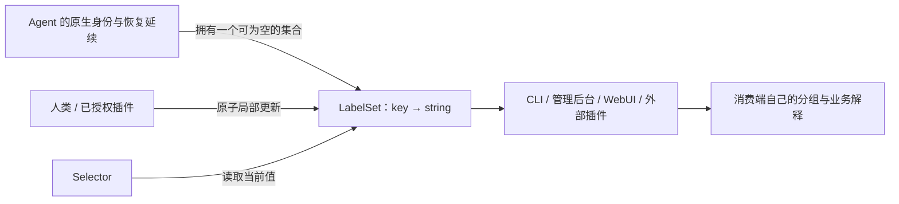

# Agent Labels 设计建议

用户已认可单值 labels 的整体设计，并明确要求数据库与索引保证合理的性能路径；本文据此确定首版关系表与索引方案。用户随后授权由专门 Controller 组织 Agent 完成落地，见[实现 Delivery](../.controller/agent-labels/implementation.delivery.md)与[已接受提案](proposals/agent-labels.proposal.md)。正在进行的 [Agent 元数据清理](../.controller/agent-metadata/cleanup.task.md)继续按其原有边界执行；它不负责实现本文。设计过程、预览和验证见 [Task](../.controller/agent-labels/design.task.md)，交互说明见[过滤与分组示例](../.sketches/agent-labels/index.html)。下文新增命令、字段、表、事件和接口的实际支持由实现 Delivery 与原生声明记录，不能仅据设计或实施授权认定当前二进制已经支持。

## 结论与设计依据

建议首版采用 `Map<LabelKey, string>`：每个 Agent 可以有多个 label，同一个 key 只有一个字符串 value。先不增加独立 `tags`、数组值或特殊的 default label。多个维度的键值已经覆盖过滤、消费端分组和业务打标，额外的集合类型暂时没有必须满足的场景。用户明确表示，多值 tags 若增加复杂度，可以先不做。

```json
{
  "labels": {
    "project": "atlas",
    "feature": "search",
    "review/state": "pending",
    "acme-board/lane": "in-progress"
  }
}
```

这里有四个 label。`review/state=pending` 是业务方记录的审核状态，不会改变 AgentX 的 `active`、`listening` 或 `blocked`。原生名字和精确实例引用负责寻址，workspace 负责成员归属，已采用 Role 负责岗位事实；labels 提供与这些事实并行的可变分类。

| 用户场景 | 所需能力 | 本设计的回答 |
| --- | --- | --- |
| 筛出同项目、同功能的 Agent | 多维过滤，组合条件 | `project=atlas` 与 `feature=search` 同时成立 |
| 后台或 WebUI 按业务分类组织 Agent | 消费结构化 labels | 消费端选择一个 key 分组，并自行定义名称、顺序、颜色和缺失分组 |
| 插件记录审核阶段或看板位置 | 独立命名、局部更新 | 插件写自己的前缀，例如 `review/state`，不会覆盖其他 key |
| 普通用户给 Agent 做几个备注式分类 | 无需先建分类定义 | 直接使用 `project`、`feature`、`priority` 等 key，无需注册 label |
| 同一维度同时挂多个值 | 集合语义 | 首版暂不覆盖；不把逗号字符串、JSON 字符串或多个重复 key 暗中解释成集合 |

## 对象、责任与边界

| 对象 | 含义与责任 | 身份或约束 |
| --- | --- | --- |
| Agent | 已有 AgentX 参与者及其原生恢复延续 | 原生精确实例引用；正式 resume 延续由现有创建关系确认 |
| Label | 一个 key 与一个字符串 value 的分类事实 | 在一个 Agent 的 labels 中，key 唯一 |
| LabelSet | 一个 Agent 当前的全部 labels | 无序有限映射，独立 revision；空映射是合法状态 |
| LabelSelector | 对当前 labels 的只读谓词 | 不改变 Agent、消息或 label；不构成身份或权限 |
| Consumer policy | 消费端对已知 key/value 的解释 | 插件或产品自己拥有枚举、分组、展示与业务规则 |



AgentX 负责存取、校验、精确对象绑定、原子更新和统一选择器语义。消费端负责判断某个业务值是否有效、是否过期以及它触发什么展示或业务动作。例如只有审核插件能够确定 `approved` 的业务含义；写入这个值本身不证明审核真的发生。需要权限、强制流程或接受条件时，业务方必须在自己的正式操作中执行这些规则。

首版没有 LabelDefinition 资源、分类目录、颜色元数据、命名空间注册中心、继承规则、TTL、自动状态同步或 label 触发器。labels 也不自动写入启动提示词、上下文或 Provider 会话。

## 数据与命名规则

| 项目 | 建议规则 | 原因 |
| --- | --- | --- |
| key | `name` 或 `namespace/name`；最多一个 `/`，两段各 1–63 个 ASCII 字符 | 简单 key 便于人工使用，带前缀 key 便于插件减少碰撞 |
| 每段字符 | 小写字母或数字开头、结尾；中间允许小写字母、数字、`.`、`_`、`-` | 例如 `project`、`acme.review/state`；不自动改大小写 |
| value | 1–256 UTF-8 字节的字符串；允许中文及内部空格；禁止首尾空白和 Unicode 控制字符 | 可读且适合 CLI/JSON；非法输入报错，不静默裁剪 |
| 比较 | key 与 value 都精确比较；value 区分大小写，不做 Unicode 归一化、类型转换或分词 | 各消费端和数据库得到相同结果 |
| 缺失 | key 不存在表示“未声明” | 不能从缺失推断 `false`、`pending` 或其他业务默认值 |
| 清除 | 删除 key | 不使用空串、`null` 或字符串 `"null"` 代表删除 |
| 数量 | 每个 Agent 最多 64 个 key；全部 key/value 的 UTF-8 字节总量最多 16 KiB | 对外契约有界；上限是首版建议值 |
| 空集合与顺序 | `labels: {}` 表示已知为空；对象没有业务顺序，文本展示按 key 排序 | 不把插入顺序或主标签变成隐藏语义 |
| 特殊保留 | `agentx/` 前缀保留；首版不生成任何内置 label | 为将来的原生约定留边界，不制造当前默认值 |

`"false"`、`"0"` 都是普通字符串。`"frontend,backend"` 是一个完整值，过滤 `feature=frontend` 不会命中它。数组、布尔值、数字、对象和 `null` 作为 value 都拒绝。JSON 对象重复 key、同次 CLI 重复设置同一 key 也拒绝，避免静默丢失输入。

建议人工使用无前缀 key，插件使用稳定产品前缀，例如 `acme-review/state`。两个插件使用同一个 key 表示它们有意共享同一含义并协调写入。前缀只是命名约定，不是认证信息或独占写权限；不能因某条 label 看起来像“系统生成”就信任其作者。`agentx/` 保留校验是内核规则，不代表引入插件权限系统。

## 为什么不设 default label 或多值 tags

`labelname=tag`、`labelvalue=tags` 有两种解释。若 `tags` 是普通字符串，只能精确匹配整个字符串；若它是数组，就必须再定义去重、顺序、包含/相等、追加/删除成员、并发修改和单值字段的区别。把这些规则只藏在名为 `tag` 的 key 后面，会让通用 labels 出现特例。

| 方案 | 表达能力与代价 | 判断 |
| --- | --- | --- |
| 字符串映射 | 多个分类维度，每个维度一个值；查询和更新统一 | 首版建议 |
| 所有 key 都是字符串集合 | 自然表达同一维度多值，但所有读写和选择器都需要集合语义 | 当前需求无需承担 |
| 字符串与数组混合 | 兼有两者，调用方必须分支处理每个 key 的类型 | 不建议 |
| 特殊 `tag`/default label | 表面操作少，实际仍需要一个集合模型及特殊规则 | 首版不加入 |

默认 LabelSet 是空映射，不是一个自动插入的默认 label。首版不提供 `--tag` 或 `--tags` 快捷入口。若后续确实需要“一个 Agent 同时属于前端、后端、紧急多个自由标签”，再单独设计明确的 `tags: string[]` 或统一集合模型，并处理兼容性；不预留假数组或建议用户将列表编码进字符串作为结构化替代。插件自己的描述性字符串可以包含逗号，AgentX 仍把它当不透明单值。

## 写入契约与并发

核心操作是“修改这些 key”，不是“上传整个 labels 对象”。下面是目标语义轮廓，不是新增可执行 schema；具体 Rust 声明应在实现时进入原生边界，HTTP/TS 从它派生。

```text
GetLabels(exact_target, expected_generation)
  -> LabelSnapshot { labels, revision, exact_target, generation }

PatchLabels(exact_target, expected_generation, request_id,
            set: Map<LabelKey, string>, remove: List<LabelKey>,
            if_revision?: Revision)
  -> LabelSnapshot + changed

SelectAgents(existing_scope, selectors: List<LabelPredicate>, existing_page)
  -> existing_agent_page with labels and labels_revision
```

`exact_target` 复用原生 [ParticipantRef](../src/agents/attachments.rs)；浏览器继续通过既有 [AgentRef](../src/management/contract.rs) 适配，不把名字、显示标题、label 或 JS 浮点时间戳当作精确写入凭证。generation、调用者及请求身份沿用现有服务边界。revision 是该 Agent 的 labels 专用不透明字符串，客户端只能回传或比较是否相等；它不跟随心跳等无关变化。

| 操作或竞争 | 结果 |
| --- | --- |
| 设置已有 key | 只替换该 key 的值；未提及 key 保持原值 |
| 删除不存在 key / 设置相同值 | 成功但 `changed=false`，不增加 revision，也不产生变更事件 |
| 同一 key 同时在 set/remove，或同一输入中重复 key | 拒绝整次请求 |
| 任一字段非法，或更新后的集合超限 | 拒绝整次请求，不做部分写入 |
| 未带 if_revision 的两个请求修改不同 key | 顺序提交，两者均保留；不发生整张 map 的相互覆盖 |
| 未带 if_revision 的两个请求修改同一 key | 最后提交的值生效；这是普通分类编辑语义 |
| 带 if_revision，当前 revision 已不同 | 返回冲突和可重新读取的目标；不自动覆盖或重试业务决策 |
| 名字被复用、实例已被替换或 generation 改变 | 返回原生 stale-target/generation 类错误；不转向同名新实例 |
| 重用 request_id 且请求相同 | 复用现有原生去重/回执机制，返回第一次已记录的结果 |
| 重用 request_id 但请求不同 | 拒绝；不能让一次请求变成另一次业务更新 |

所有校验、目标检查、revision 条件、局部修改、revision 增长及可观察变更在一个 daemon 写事务内完成。没有独立 labels 守护进程。成功响应表示元数据已经提交；不表示任何外部业务动作完成。

UI 编辑推荐带 `if_revision`，冲突时刷新并保留用户草稿。插件持续维护自己的独立 key 可以只局部写入；涉及“若仍为 pending 才批准”等业务判断，需读取后带 revision 提交，冲突后重新判断。整个 LabelSet 的 revision 可能因其他插件写入而冲突，这是首版为简单一致性接受的代价，不增加每个 key 的独立版本。

超时后保留 request_id 和精确目标，先查询既有操作回执，或用同一 request_id 重送同一请求。重复回执包含的是原操作结果，不一定是最新 labels；需要当前状态时重新 GetLabels。不得换新 request_id 盲目补写旧值，因为这可能覆盖期间合法的新值。没有永久 exactly-once 承诺，回执保留窗口沿用既有原生契约。

## 过滤契约

首版只支持精确值、值不等、存在和缺失。CLI 每个 `--label` 是一个条件，重复 option 表示 AND；原生/HTTP 使用同义的结构化谓词，避免各自实现一门表达式语言。每次最多 16 个条件，相同条件去重；条件超限报错。没有 OR、正则、数值比较、通配符、集合运算或整条自由文本查询。

| CLI 条件 | 谓词 | key 缺失时 |
| --- | --- | --- |
| `project=atlas` | key 存在且值等于 atlas | false |
| `project!=atlas` | key 不存在，或值不等于 atlas | true |
| `project` | key 存在 | false |
| `!project` | key 不存在 | true |

“存在且不等于”写作 `--label project --label 'project!=atlas'`。这是特意明确的缺失规则，消费端不能把 `!=` 实现成 SQL 对 null 的普通比较。无条件匹配当前作用域内全部 Agent；`project=atlas` 与 `project=comet` 同时出现会得到空结果，不会悄悄变成 OR。

比较符只在 key 后识别一次，后续完整字符串是 value，例如 `note=a=b` 匹配值 `a=b`。逗号不拆分条件；带空格、`!` 等 shell 字符时给整个条件加引号。空值条件、非法 key 和非法表达式报错，不能当作无匹配静默返回。

过滤永远与既有 workspace、设备、访问范围、状态和分页限制取交集；labels 不扩大查询权限，也不把不同数据作用域合并。必须先过滤，再计数与分页；不能先拿第一页才在浏览器筛选，并声称得到全量结果。一次响应应在同一读取快照内取得 labels、revision 和对应 Agent 引用。跨页沿用既有分页一致性规则，不新增冻结全量快照承诺；持续变更期间应允许刷新。

首版落实当前 Agent 列表的 native/CLI 与管理 HTTP 过滤。历史事件不自动使用“Agent 现在的 labels”做历史筛选，`events sub` 也不在首版增加动态 label 成员订阅。将来需要这两类过滤时，必须另行决定按事件发生时值还是观察时值匹配，以及订阅开始、离组和重连语义。

labels 不作为 `send`、`kill` 或路由的隐式收件人语法。插件若要针对筛选结果执行已有操作，应取得该次结果中的精确引用，再逐个明确提交；筛选结果会变化，不保证构成原子批量操作。首版没有按 labels 自动群发或批量停止。

## Agent 生命周期与保留

原生代码已经区分一次创建及其精确 resume 别名，见 [launch_relations.rs](../src/agents/launch_relations.rs) 与 [lifecycle_resume_store.rs](../src/agents/lifecycle_resume_store.rs)。利用这条已确认的延续关系保留 labels，不从同名、相同 session 文本、相同 workspace/Role 或 Provider 父子关系推断继承。创建事实本身仍是不可变来源；labels 放在单独的可变存储中。

| 场景 | labels 行为 |
| --- | --- |
| 普通新建、自动目录收件人新建、外部会话首次采用 | `{}`，除非本次显式提供初始 labels |
| 创建时提供 labels | 与精确参与者预留一同提交，第一条列表观察即可见；不是进程就绪后补写 |
| 心跳、压缩、状态改变、重新绑定同一个参与者 | 保持原值和 labels revision |
| AgentX 正式 resume 延续同一创建 | 保留该 Agent 当前 labels 和 revision；恢复较早对话也不会回滚业务分类 |
| fork / 新子 Agent | 默认 `{}`；不继承父 Agent 的业务阶段或其他分类 |
| 同名被回收后用于另一个新 Agent | `{}`；不根据名字找回旧值 |
| 停止或启动失败 | 保留已提交 labels，服从既有保留/删除策略；启动失败不伪装成就绪 |
| 数据作用域 reset | 随原生创建/别名数据一同清除并换代 |
| 只有 Provider 会话文件、没有可验证原生来源的恢复 | 视为新的采用，默认空；不猜测旧 labels |

普通查询显示当前 labels。停止时可在原生历史快照记录当时的 labels 与 revision；较早、没有该字段的快照表示“未记录”，不能显示为当时确定为空，也不能拿当前值回填成历史事实。首版只允许修改仍有可验证当前参与者行的 Agent；纯历史记录只读。停止后正式恢复时读同一创建的当前 labels。

labels 是持久分类，不是“当前轮次状态”的自动维护机制。因此 resume 也会保留 `review/state` 等业务值；需要每轮重置的插件必须在自己的工作流中显式更新。跨设备及跨数据作用域没有自动合并或复制，远端写入仍须在拥有该参与者的作用域执行。

## 调用者路径与拟议命令

以下命令已进入本次 Delivery 的源码，实际可执行支持以[实现与验收记录](../.controller/agent-labels/implementation.delivery.md)为准；不代表已安装程序或运行服务已经采用。

```sh
# 创建：每个参数恰好设置一个 key/value
agentx launch --label project=atlas --label feature=search

# 已有 Agent：读取后只修改自己的 key
agentx labels get luna --json
agentx labels set luna review/state=pending
agentx labels set luna review/state=approved --if-revision REV
agentx labels remove luna review/state

# 列表：先服从原有作用域，再按所有 label 条件过滤
agentx list --label project=atlas --label feature=search --json
agentx list --label review/state --label 'review/state!=approved'
agentx list --label '!review/state'
```

`set`、`remove` 适配同一个 PatchLabels 操作，多个 key 一次原子修改；混合 set/remove 的完整能力由原生 API 提供，无需为 CLI 增加另一套语法。`self` 可以沿用既有调用者解析；普通名字也只在请求入口解析为当次精确引用，后续不得重新按名字执行。创建 labels 默认空；首版不加 profile、Role、环境变量、父 Agent 或目录级的隐式 labels 合并。

完整插件场景：插件通过正式启动结果或当前列表取得 `generation + exact_target + labels_revision` → 写入 `review/state=pending` → 审核业务完成后带最新 revision 更新为 `approved` → 管理台按这个 key 分组。任何一步发生 stale-target、revision 冲突或未知请求结果，都按上文核对并继续，不能凭 label 文本确认原生动作完成。CLI 文本成功信息走 stdout，错误走 stderr 并使用既有非零退出约定；JSON 返回原生 labels/revision/精确目标，不输出需要反向解析的展示标签。

## 消费端与插件约定

| 责任 | AgentX 内核 | 管理后台、WebUI 或插件 |
| --- | --- | --- |
| 分类数据 | 原样存取、统一校验与过滤 | 选择已知 key 和业务词汇 |
| 分组 | 返回真实值和精确对象 | 选择一个 key；缺失进入“未标注”；unknown value 仍可见 |
| 显示 | 返回普通文本，不注入样式或动作 | 安全文本渲染，自己定义颜色、图标、显示名、折叠和排序 |
| 业务状态 | 不解释、不自动同步 | 维护自己的状态含义、更新者和新鲜度要求 |
| 原生运行与权限 | 继续以正式字段和用例为准 | label 不授予权限，也不证明运行、成功或完成 |

不认识的 key/value 应保留并可查看；已知 key 出现未知 value 时展示原值并退回默认样式，而不是隐藏 Agent 或报整个页面失败。`labels:{}` 表示已知没有 label；连接到尚不支持 labels 的旧服务时，消费端须依据既有版本/能力兼容契约显示“不支持”，不能伪造空分类结果。首版不为 labels 单独建立协议版本体系。

一个 key 单值使分组天然互斥：每个 Agent 在该维度只落一个组。跨维度组合视图由消费端派生，不写回新的内核字段。分组计数若只基于已加载页面，必须标为“本页”；若产品需要完整分组总数，应通过同样 scope/selector 的完整查询或后续明确聚合契约得到，不能把分页内计数伪装为全部。

## 原生实现边界与存储建议

项目采用 Rust 原生服务、SQLite daemon 与已有管理 HTTP/TS 投影链，不因这次设计引入 oRPC、独立服务或新的通用元数据框架。

| 边界 | 实现义务 |
| --- | --- |
| `src/agents/` | 拥有 LabelKey/LabelSet/Predicate、读取/局部修改契约及身份/生命周期规则；邻近声明写清精确语义 |
| daemon-owned store | 在原生事务内解析精确对象、校验调用者、generation/revision 和请求去重；提交数据及变更通知 |
| `src/db/` | 用新增 schema 迁移保存可变 labels；保持现有原生行、创建记录、历史和回执不变 |
| native listing / `src/cli/` | 复用同一个谓词和查询边界；适配上述命令，补充离线 help 和稳定 JSON |
| `src/management/` | AgentView 增加 labels/revision，增加明确 labels 读写和列表筛选的 HTTP 适配；沿用精确 AgentRef/generation 与请求边界 |
| management TS / Web 消费端 | 从原生契约生成字段；按产品所需做筛选/分组，避免另写一份业务标签存储 |

### 原生持久化与身份实现状态

labels 的原生声明现位于 [labels.rs](../src/agents/labels.rs)，存储实现位于 [labels_store.rs](../src/agents/labels_store.rs)，可执行 schema 与查询构造位于 [db/labels.rs](../src/db/labels.rs)。当前源码接入 schema v28、原有 Participant 服务叶子、预留事务及 reset；这表示实现源码已形成，编译、固定候选和独立验收状态仍以 [native Task](../.controller/agent-labels/tasks/native.task.md) 与 [Delivery](../.controller/agent-labels/implementation.delivery.md) 为准。下文设计实验数字保持原有证据边界。

实现复用现有 creation UUID 和精确 `(name, incarnation bits)` 别名，正式 resume/canonical restore 继续指向同一 owner。连接注册 `agentx_incarnation(created_at)`，直接输出 u64 bits 的十进制字符串，在 SQL 的当前行/别名 join 中核验身份，随后才 LIMIT。除下表所列覆盖/反向索引，v28 增加当前本地参与者的 adopted-workspace/name 部分表达式索引，使范围查询具备持久索引入口；不新增另一张可写成员关系表。

标签页按名字升序，用绑定归一化 selector、workspace/directory、generation 的不透明 keyset 游标。选择和该页一次批量装载在同一原生读取快照内完成，最多 100 个当前精确目标、6,400 个 label 行，无自动总数。正向条件的联合索引与 scope 索引由 SQLite 实际统计选择；负向/缺失使用 owner/key 反向存在检查。查询遵守 caller deadline，并限制最多 2 秒、2,000 万条 SQLite VM 操作，资源耗尽返回可辨认的 Unavailable，不能返回假空页。这些是当前源码的有限预算，不是延迟 SLA。

### 物理表与索引

首版直接采用独立关系表，取代此前“JSON map 存储、后续再索引”的初步建议。JSON 仅是 API 表示；数据库中每条 label 占一行，不在查询时解析所有 Agent 的 JSON，也不为每个业务 key 动态建表或建索引。可执行的设计 DDL 在 [storage.sql](../.sketches/agent-labels/storage.sql)，它是独立实验输入，不是已安装的生产迁移。

| 表或索引 | 键与内容 | 支持的访问路径 |
| --- | --- | --- |
| `agent_label_sets` | `owner_creation` 主键，`revision` 整数 | 读取/条件推进某 Agent 的 label revision；删除最后一个 key 仍保留版本 |
| `agent_labels` | `(owner_creation, label_key)` 主键，`label_value` 非空文本 | 同一 Agent 的 key 唯一；单 key 更新/存在检查；按 Agent 读取全部 labels |
| `agent_labels_by_key_value_owner` | `(label_key, label_value, owner_creation)` 联合覆盖索引 | 从精确 key/value 找 owner；只指定 key 时也能使用索引前缀 |
| `agent_creation_instances_by_creation` | 在既有别名表上补 `(creation, name, incarnation)` | 将筛选得到的 owner 反向关联原生精确实例；避免扫描整个别名历史 |

两张新表均用 `WITHOUT ROWID`，主键就是物理查找结构，避免另存一个无业务意义的 rowid 和重复主键树。label 文本使用 `COLLATE BINARY`，保持契约中的精确比较。label 行外键关联集合头，集合头外键关联既有 `agent_creations(id)`；均启用 `foreign_keys=ON`，原生创建删除时级联清除 labels。既有创建 UUID 保持身份权威，不因查找便利用可复用名字作为 label owner。

没有集合头的受支持 Agent 视为 `{}` 和 revision `"0"`；首次有效更新建立头，实际变化才推进 revision。整数 revision 在 API 序列化为不透明字符串，删除全部 labels 后不能删掉集合头重用版本。revision 达 SQLite 有符号整数上限时拒绝更新，不能转成浮点数或绕回。数据库约束非空值、字节长度、唯一 key 和引用关系；原生操作另行校验命名、Unicode、64 个 key 与 16 KiB 的集合上限，不能声称 DDL 已单独执行这些跨行规则。

现有正式 resume 别名指向同一 owner，因而无需复制 rows。旧的当前参与者若尚无创建映射，首次有效写入须由既有创建关系原生操作建立 `origin=unknown` 的身份映射；这只建立可追踪身份，不推造历史创建者。读查询不为获取空 labels 产生写入。只有经过验证的当前精确实例或原生保留来源可以关联 owner。

### 查询、分页与装载

| 查询 | 首选访问方法 | 实际工作边界 |
| --- | --- | --- |
| 单 Agent 所有 labels | 主键前缀 `owner_creation=?` | 读取该 Agent 的最多 64 行 |
| 精确 `key=value` | 覆盖索引的 `(key,value)` 前缀 | 访问该键值的匹配 owner；不会读取所有 labels |
| 正向存在 `key` | 覆盖索引的 key 前缀，或对已选 owner 做主键探测 | 常见 key 可能匹配大量 owner，不保证它是稀疏条件 |
| 多个正向条件 AND | 从有选择性的正向条件取候选，再用 `(owner,key)` 主键逐项验证 | 不把多张 labels 表直接宽连接成重复 Agent 行 |
| 缺失 `!key` | 对原生 scope 中候选做 `NOT EXISTS(owner,key)` | 需要枚举所选范围，单次检查走主键 |
| `key!=value` | `NOT EXISTS(owner,key,value)` | 正确包含 key 缺失；正向 `value<>?` 会遗漏缺失并扩大扫描 |
| 当前页全部 labels | 对该页去重后的 owner 做一次有界 `IN (...)` 批量读取 | 页大小最多 100，最多返回 6,400 行；避免每 Agent 发一条 SQL |

例如精确匹配使用 `WHERE label_key=? AND label_value=?`，参数绑定后从覆盖索引取 owner；同一 owner 的附加条件使用主键 `EXISTS`。反向条件不能直接用一个“不是这个值”的索引范围得到所有结果，因为未拥有这个 key 的 Agent 在 labels 表中没有对应行。负向查询的成本应按 scope 内候选数解释，不能承诺所有条件都是常量时间。

保留两种简单执行路径：范围小或条件很常见时，按已有列表顺序扫描 scope 候选并做主键探测；条件稀疏时，从标签索引得到候选，再验证原生 scope/身份、排序和取页。由查询计划与实际分布选择，不为这次功能建立自研优化器。实验里的 `CROSS JOIN` 专门固定 label-first 路径以测量其成本，不代表生产所有参数都强制这一顺序。

原生精确映射不能用名字或浮点转十进制文本代替：已有别名 `incarnation` 是 `created_at.to_bits()` 的字符串。label-first 路径通过反向索引获得别名后，批量关联当前行并在原生边界校验精确 bits、generation 与成员 scope；scope-first 则批量解析当前精确引用后，通过既有 `(name,incarnation)` 主键取得 owner。已经停止或被替换的旧别名须在取最终页前排除。大量 resume 别名会增加 label-first 的候选工作，范围内当前 Agent 较少时应采用 scope-first；不能把索引返回的每个历史别名都当作当前 Agent。

排序与原生列表的既有规则保持一致；过滤和精确身份/scope 检查必须在最终 `LIMIT` 之前完成。选择性路径可能为匹配候选建立临时排序树，这是对候选排序，不是对全部 label 行排序；不能因看到临时树就承诺零排序。分页使用既有游标/keyset，避免深页 `OFFSET` 逐页跳过旧结果；游标须绑定归一化后的 scope 与 selector，条件改变后重新开始分页。

列表默认取 `limit+1` 判断下一页，不附带精确总数或所有分组总数。原文“先过滤，再计数与分页”只规定计算次序，不要求每次同时计数。负向条件的精确总数可能需要检查全部 scope，按用户明确请求单独计算，不放在每次轮询刷新中。首版保持本页分组计数；未来全量分组聚合必须有明确范围与单独预算。

源码当前的 [management list](../src/management/store.rs)会混合当前行与 stopped 事件，并在逐项 `live_view` 时读取额外数据。实现 labels 时必须在昂贵 AgentView、未读消息、状态及对话投影之前完成筛选；不能把所有完整 Agent 先装入内存再过滤。带 labels 的查询必须在原生契约显式限定当前参与者范围，并拒绝历史页游标；无标签条件的既有历史列表保持原语义。此次不为 labels 扫描全部 stopped JSON，也不以当前分类冒充历史分类。

### 写入、维护与性能验收

一批修改在同一个既有 daemon 写事务中：核验精确目标/请求回执 → 读取集合头和条件 revision → 读取该 owner 的有界 label 行以校验最终容量 → 仅 UPSERT/DELETE 变化的 key → 推进 revision → 保存事件与回执。每个变化行只维护主键和一个联合索引，不重写其他 owner，也不维护 JSON、关系表两个可写副本。无变化不写 revision，冲突或任一失败整体回滚。沿用现有 WAL、事务及提交后通知策略，不为性能关闭生产同步或绕开唯一写入者。

查询应接受既有截止时间/取消约定，并限制条件数、页大小和原生候选工作。极稀疏或负向条件可能扫描整个 scope 才能判断无结果；达到预算须显式中断/返回可辨认的资源限制，不能返回一页空结果冒充“没有匹配”。数据库统计按现有维护边界更新，迁移后/分布变化时检查真实 `EXPLAIN QUERY PLAN`；不在每个请求中执行 `ANALYZE`，不凭索引声明推断优化器一定选择它。

已用 [可复现实验](../.sketches/agent-labels/check_storage.py)在临时磁盘 SQLite 数据库运行设计 DDL与现有创建表 schema，原始 SQL、参数、查询计划、计数和时耗在 [storage-evidence.json](../.controller/agent-labels/storage-evidence.json)。该次 SQLite 3.45.1、WAL/NORMAL、预热缓存和 `ANALYZE` 后的合成样本包含 100,000 个 owner、975,000 条 labels、10 个 workspace，每个 scope 10,000 个 owner；scope 是实验投影表，并非已实现的原生 scope 索引。

| 实验操作 | 结果量 | 5 次预热样本的中位耗时 |
| --- | --- | --- |
| 读取一个 Agent 的 labels | 10 行 | 0.028 ms |
| 精确 key/value 找候选 | 100 个 owner | 0.102 ms |
| 范围内两个正向条件 AND | 20 个 owner | 0.296 ms |
| 负向条件取第一页 | 101 个 owner，含下一页探测 | 0.350 ms |
| 负向条件计算精确总数 | 检查 10,000 个 scope 候选 | 40.488 ms |
| 一页批量装载 labels | 100 个 owner，950 行 | 1.796 ms |

计划确认 label 等值/存在使用覆盖索引，单 owner、附加条件与装载使用主键，创建反查使用新增别名索引；同时确认稀疏候选排序存在临时树。唯一 key、非法空值触发整个 revision/label 事务回滚、旧 revision CAS 拒绝和外键检查也通过。20 次“单 key+revision”独立事务中位 0.073 ms，仅用于观察该实验的索引写入代价。

这些数值证明给定样本中的索引路径与有限 SQL 行为，不是线上延迟保证：未包含真实 scope 解析、多个 resume 别名、冷缓存、并发 daemon 工作、网络、完整 AgentView 或真实硬件分布。实现验收必须以实际 Rust SQLite 版本、生产查询参数和真实调用路径补测稀疏/高频 key、负向/无匹配、深页、重度 resume 与状态刷新，保留计划和端到端耗时，确认没有全量 label 扫描、N+1 labels SQL 或强制全量计数。当前无需引入 Redis、全文索引或额外缓存服务。

`labels_changed` 是目标原生变更通知：实际变化时携带精确目标、owner、generation、新 revision、set/remove 差异和既有调用者/请求引用；空操作不发通知。它供消费者失效缓存或观察变更，不是通用插件自动化引擎，也不宣称可以从历史事件完整重建 label 状态。响应与事件在同一原生写入边界建立，不能靠 WebUI 乐观状态充当已提交结果。

初次升级现有 Agent 不回填任何旧分类：新功能的当前值为空，历史未记录仍未知。新增表与索引在原生迁移事务创建，失败保持原版本与原数据；managed reset 依次清 label 行/集合头，再清既有别名与创建记录，不留下孤儿。新增存储/API 改动按实现时项目的 schema 与 native protocol 规则升级；此次设计不预设下一个 epoch，不修改或重新采用当前运行服务。

## 建议首版范围与验证交接

首版形成一条完整路径即可：创建时设置 → 已有 Agent 局部修改 → native/CLI/管理 API 查询与过滤 → Web 消费结构化数据并按一个 key 分组。复用现有操作回执、版本及宿主边界。多值、隐式默认、label 群发、自动动作、复杂查询、历史筛选、动态订阅及跨作用域合并均不纳入首版。

实现时的决定性检查：多 label 正常路径；精确值/缺失/不等的统一结果；空值与重复 key 拒绝；不同 key 并发更新均保留；同 key 的条件更新冲突；整次非法修改无部分效果；重复 request_id 与未知结果核对；正式 resume 保留、fork/同名新建隔离；先筛选再分页；旧历史未知不被填为空；HTTP/TS/native 类型与真实 UI 的一致消费。沿用项目已有测试设施，按影响运行集中验证。

本次实际完成的证据为源码调查、已认可方向的设计契约、独立 SQLite 物理方案实验和合成数据 HTML 交互。它不证明 native labels、生产数据库迁移、并发调用控制、管理 API 或外部插件已经实现。后续实施以本文确认后的设计及单独实现任务为准。
