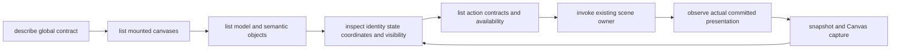
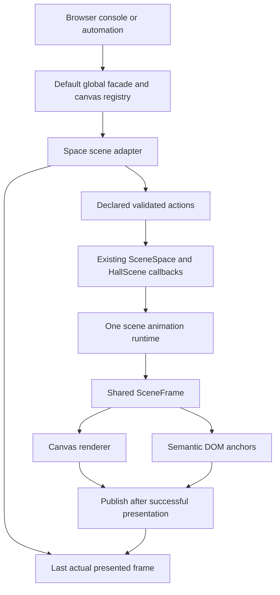

# Discoverable Canvas tools: selected outcome and delivery plan

## DancingAI integration

The [completed integration](../../.controller/office-details/dancingai-integration.task.md) adds the default local Page tool and public object-provider mapping to the normal Space entry. The existing `agentxSceneDebug` remains the scene/action authority; DancingAI adds shared source/relationship/bounds/image browsing and native facade discovery. Semantic snapshots are not mutable actor instances. Default static builds carry the pinned no-build browser distribution; no runtime sibling-checkout dependency or second animation loop. Actual production-static Chrome evidence covers 61 objects, invoke/frame confirmation, scene PNG, scope renewal and UI lifecycle. Existing selected LAN :38023 and installed binaries remain separate. See [consumer usage](../../web/agent-space/src/scene/debug/README.md#dancingai-entry).

## Need and current state

Browser automation sees Canvas pixels without their object semantics. An Agent with no application source or object-ID knowledge needs to discover the Canvas model, inspect actual rendered state, discover promised operations, invoke them and collect correlated visual evidence. User #31003 selected default availability, list-style discovery and explicit action contracts; #31136 confirms the full plan and implementation delegation. These supersede the earlier opt-in/read-only proposal.

The [runtime refactor and diagnostic design](../../.controller/office-details/scene-runtime.task.md#diagnostics-structural-and-state-design--vidore) owns specialist decisions and exact target contracts. Source implementation and finite independent Linux Chrome/static-demo acceptance are complete. Read [accepted source outcome](../../.controller/office-details/scene-runtime.task.md#accepted-local-source-outcome-and-closure) and [actual independent evidence](../../.controller/office-details/scene-runtime-verification.task.md#completed-independent-outcome). Current LAN service adoption is outside this source outcome; future source changes require their own affected evidence.

## Product boundary and consumer

| Item | Selected result |
| --- | --- |
| Consumer | Agent-driven browser automation in the Space browsing context, plus ordinary browser-console callers |
| Entry | Default-enabled `window.agentxSceneDebug` in development and production |
| Reuse boundary | A small serializable discovery/inspection/action/capture contract and mounted-canvas registry; one complete current Space adapter |
| Objects | Discoverable semantic model: canvas → rooms/zones → actors/furniture/props/effects, with exact IDs and relations |
| Operations | Only explicitly registered, described, validated scene actions routed through existing owners |
| Evidence | Latest actual presented frame, world/screen/page/backing coordinates and truthful bounds; correlated Canvas PNG |
| Limits | PNG excludes DOM labels/tooltips/chat; normal browser screenshots complement it. Frame-internal evaluation is supported. Cross-origin host bridge/remote RPC and native Agent actions are separate capabilities. |

Generic means the discovery/call structure is reusable. Object kinds and actions belong to each adapter; an adapter need not expose another scene's concepts. Do not build a new rendering engine, a plugin ecosystem, cross-framework SDK or arbitrary code execution.

## Discovery and feedback model

No step requires a fixture name, hard-coded object ID or knowledge of the scene source tree. Discovery describes callable request/result shapes, object/relationship conventions, coordinate conventions and errors. List summaries locate objects; inspect supplies details. Composite room art must retain semantic furniture discovery even when no individual Canvas draw call exists for a fixture.

Distinguish source presentation facts, target motion, sampled position, Canvas drawing and current DOM geometry. An available operation describes purpose, target, parameters, result semantics, effects and current availability/reason; its declaration and invocation must share one implementation definition. An action receipt means the callback was accepted. A later presented frame and comparison with intended state establish the observed outcome; an unrelated newer frame alone does not prove success.

## Architecture and ownership

The [specialist structural design](../../.controller/office-details/scene-runtime.task.md#diagnostics-structural-and-state-design--vidore) is the single source for module/signature/state decisions; current source types become the implemented contract. The global facade must not expose mutable runtime objects, transports or controllers. Inspection serializes on request; registration adds no animation scheduler. Mount/dispose registers/unregisters the current instance, and stale references fail clearly. Canvas absence, pre-first-frame state, invalid arguments/targets, unavailable actions, timeout/disposal and capture failure remain distinguishable.

## Delivery responsibilities and conditions

| Owner | Cohesive assignment | Finish condition |
| --- | --- | --- |
| scene-runtime-vidore / vidore, project coder, gpt-6.1-sol with max reasoning | Professional design, contracts/skeleton, registry, complete Space adapter, existing-owner action integration, focused cases, usage/example and ordinary repairs | Integrated source with discoverable docs and one appropriate scoped static check; actual final execution handed to verifier |
| scene-verification-vetule / vetule, independent project coder with max reasoning | Finite semantic/build/browser execution of the real discovery-to-operation-to-evidence path and retained rendering guarantees | Linked actual outcomes, material defects resolved, owned host/browser cleaned |
| space-responsive-zonu | Scope, task/resource bindings, dependency coordination and acceptance | Complete promised source outcome with adequate independent evidence; truthful support and rollout boundary |

One implementer keeps registry/adapter/frame contracts cohesive. Independent execution is justified by state/lifecycle and public action semantics, not by file count; no extra design/review agents or nested delegation are required. Runtime refactor baseline is already usable and independently checked. Diagnostics design/contracts precede their implementation. Final build/browser waits for stable expanded source handoff; ordinary repairs remain with vidore and reopen only affected checks. [Implementation Task](../../.controller/office-details/scene-runtime.task.md) and [verification Task](../../.controller/office-details/scene-runtime-verification.task.md) own execution status, not this plan.

## Acceptance scenarios

| Scenario | Required observation |
| --- | --- |
| Unknown model | On a fresh production build with no debug query, discover the global contract, active canvas, kinds, related objects and available actions without fixture IDs |
| Truthful inspection | Inspect sampled and goal coordinates, visible/filter/clipping state and semantic furniture; returned data is detached and bounds have stated meaning |
| Supported operation | Discover an eligible object/action, invoke using discovered parameters and observe the intended state through existing UI ownership |
| Presentation correlation | Separate acceptance from committed frame; capture PNG with matching instance/frame metadata and correct Canvas/backing/page dimensions |
| Lifecycle/errors | Empty/unmounted/stale states, invalid/unavailable operations and wait/disposal/timeout return explicit results; remount has no stale registration or scheduler/listener accumulation |
| Retained experience | Canvas/DOM coordinates, selection/pan/close/camera/draft continuity, desktop/narrow layout, pause/reduced-motion and one animation clock preserve existing behavior |

Use meaningful state/behavior tests and one finite actual browser integration flow. Preserve passed baseline evidence rather than repeat it for reassurance. A scoped build is fresh and external; its included typecheck is not repeated separately by the verifier. No source/text assertions substituting for real behavior, and no claim of visual parity or diagnostic functionality solely from typechecking. Document actual limitations.

## Resources and closure

All work remains uncommitted within its declared source/test/docs scopes unless separately directed. Preserve unrelated working-tree changes, installed/default binaries, user Agents, selected :38023 and all other live listeners. Disposable tests use an owned unused loopback port and are cleaned. Closure updates the scene/module entry and usage/example so a fresh Agent can discover and use the tool without conversation history. Source acceptance and running-service rollout are separate facts; do not restart/deploy as part of this assignment.
