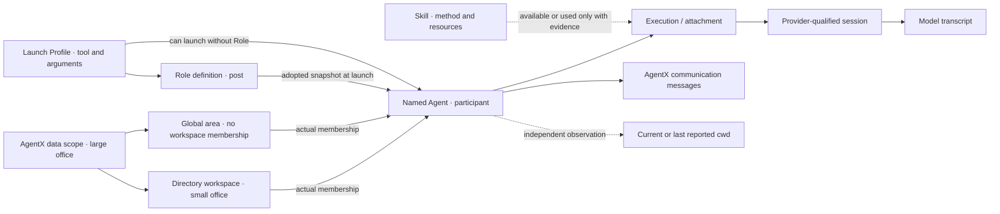

# Agent space: one office system, native AgentX meaning

## Recommendation and boundary

Use **one selected AgentX data scope as the large office**, **directory workspaces as small offices**, **Role definitions as available posts**, and **actual named Agents as people**. A team is the people belonging to one workspace. Profile supplies launch configuration; Skill supplies reusable methods/resources. Neither is a person. The Chinese UI vocabulary is `Agent 空间 → 全部办公室 → 目录办公室 → 成员`, with separate `岗位` and `技能` views.

The core user path is: locate a directory office → see its actual members and available posts → open a named Agent → read its communication/model record and compose → return without losing identity, drafts or camera context. Choosing a post prepares a future launch; opening a person selects an existing Agent. These must remain distinct interactions even when only one Agent currently uses that post.

This document recommends the complete bounded conceptual adaptation under the [Task](../../.controller/agent-space-alignment/task.md). It defines no HTTP methods, schemas, service, storage migration or deployment. Native meanings below are source-grounded; the office navigation is a proposed UI projection. The [frontend](../../web/agent-space/AGENTS.md) remains an **offline sample**, with synthetic state and local notes; historical transplant acceptance does not establish slice-1 acceptance. Real API adaptation is separately owned by gabi. Preserve the existing LAN preview on `:18967`; no implementation or service changes are part of this design.

## Slice-1 implementation status

The offline semantic adaptation is implemented in source under the [active Task](../../.controller/agent-space-alignment/implementation.md), with its structural design, exact cases and execution status in [frontend work](../../.controller/agent-space-alignment/frontend-work.md). Known canonical/empty/nested offices, separate global/unknown membership, named current/stopped exact references, available posts versus adopted snapshots, unavailable Skills and separate messages/model/notes readers are frontend-local illustrative facts. Independent executor pura reported scoped build/typecheck, state/browser/camera/short-screen success, including the repaired first-render/resize seat-placement case; exact evidence and acceptance status belong to the [verification record](../../.controller/agent-space-alignment/verification.md). This verifies the documented local offline slice and does not establish live API support. Later slices and native semantic conclusions below remain unchanged.

## Native object model



The two membership arrows are alternatives: an Agent has one adopted directory membership or the native global value, not both. The diagram represents meanings, not new database objects or a service topology.

| Object | Meaning, identity and relationship | Authoritative basis |
| --- | --- | --- |
| AgentX data scope | The canonical AgentX data directory selects shared configuration, database and daemon. It contains many workspaces and a global membership area. One machine can have several scopes; one repository directory is not automatically a separate scope. | [Domain model](../model/README.md), [role usage](../roles-workspaces.md) |
| Directory workspace / team | Canonical directory path adopted as collaboration membership. Team means its member set, without another editable Team ID, member list or leader record. Zero members is valid. | [`LaunchCollaboration`, `workspace`](../../src/agents/workspaces.rs), [selection and discovery](../../src/config/roles.rs) |
| Role definition | File-defined reusable post: name, origin/path, description, profile reference and fixed instructions. Names are resolved in a namespace; the same short name can denote different definitions. There may be zero, one or many Agents launched from one definition. | [`ResolvedRole`, `resolve_role`, `list_roles`](../../src/config/roles.rs) |
| Effective Role / adopted Role | “Effective here” means the definition selected by current resolution for a workspace. “Adopted by this Agent” means its launch snapshot. Changing a file does not change existing Agents; a deleted definition can still have historical/adopted users. | [Role usage](../roles-workspaces.md), [`LaunchCollaboration`](../../src/agents/workspaces.rs), [resume snapshots](../../src/agents/lifecycle_resume_store.rs) |
| Launch Profile | Named tool plus reusable native argument configuration in the selected scope. Multiple Roles and Agents can use one profile. An explicit launch profile may override a Role's referenced profile; saved provenance and effective launch arguments remain separate facts. It is not an avatar/persona profile. | [`LaunchProfile`](../../src/config/profiles.rs), [`LaunchProvenance`](../../src/runtime/launch_profile.rs), [usage](../launch-profiles.md) |
| Skill | Reusable instructions/resources exposed by the relevant agent environment or Provider. A Role can refer to Skills in its instructions; this is not a native structured Role→Skill assignment. Availability, reading a Skill and executing its method are different facts. There is no native AgentX Skill participant or workspace-wide Skill registry in the inspected contracts. | [Local Skill format](../../.codex/skills/.system/skill-creator/SKILL.md), [Provider `skills/list` pass-through](../../src/integrations/codex/bridge/session.rs), [transcript Skill normalization](../../src/transcript/shared.rs) |
| Named Agent / participant | The actual `@name` is the primary human label. Native exact identity includes canonical name and incarnation. An Agent may have no Role. Normal fresh launches create new instances; explicit native resume can continue logical identity. | [`ParticipantRef`](../../src/agents/attachments.rs), [identity helpers](../../src/agents/identity.rs), [`Reserve`](../../src/agents/launch_service.rs) |
| Execution / attachment | Runtime generation and a current attachment/control binding are separate from participant identity. A participant has at most one current attachment; shared hosting can contain several participants/sessions. These are details, not room/person identities. | [`ExecutionId`, `BindingId`, `Attachment`, `AttachmentStore`](../../src/agents/attachments.rs) |
| Provider session | Provider + Provider scope + native session ID. It can survive an execution, be resumed, or be forked into another session. Session ID alone is not an Agent reference or proof of a running process. | [`ProviderSessionKey`, `AttachmentIntent`](../../src/agents/attachments.rs) |
| cwd | The independently reported execution working directory. It can differ from membership, including after `cd`. A stored path may only be last known. Display it as `工作目录`, never as an inferred team. | [`AgentView.directory`](../../src/management/contract.rs), [`cli::workspace`](../../src/cli/workspace.rs) |
| Conversation / messages / transcript | “Conversation window” is UI terminology for a reader anchored to an exact Agent. AgentX messages carry actual senders, recipients, intent, thread and reply relationships. Provider transcript is a separate session record. No new durable Conversation ID is needed to preserve the window. | [`MessageView`, `ExchangeView`, `TranscriptPage`](../../src/management/contract.rs), [transcript correlation](../../src/transcript/service.rs), [management semantics](../agent-management/design.md) |
| Status / observation | Native runtime state, latest available observation, operation outcome and human task completion are separate dimensions. A live-looking sprite, reply or successful send receipt cannot establish task completion. | [Native status projection](../../src/agents/lifecycle.rs), [management operation states](../../src/management/contract.rs) |

### Offices, discovery and membership

Current discovery walks upward to the nearest **`.agentx/roles/` directory**; even an empty role directory marks a boundary. A `.agentx/` directory alone is not this marker. Explicit `--workspace PATH` accepts a canonical directory without a role directory; explicit `--workspace global` chooses no directory membership. Do not silently broaden discovery to every `.agentx` directory to fit the metaphor.

Selection precedence is explicit workspace → explicit directory discovery → existing Agent's adopted membership → inherited `AGENTX_WORKSPACE` → shell cwd discovery. [`cli::workspace::selected`](../../src/cli/workspace.rs) puts persisted actor membership ahead of mutable environment defaults. [`select_workspace`](../../src/config/roles.rs) handles the remaining selectors. `--dir` also selects the process working directory; `--workspace` independently selects membership.

Recommended display eligibility is the union of **supplied known memberships**, **supplied directories with role markers**, and **directories explicitly opened by the user**. Keep the origin distinguishable in details. An explicitly browsed directory without a marker is a directory context; show its resolved native workspace and a separate explicit-membership option in a future launch form. Browsing does not create membership or a new office configuration. Offices supported by known explicit membership remain visible without a marker. Empty marked offices remain visible even without Agents. A known historical membership remains reachable from history when its directory is missing; disable unavailable directory-dependent actions and retain the original path.

This union is a **display policy**, not an existing native “list every office” operation. Native role discovery only resolves a selected workspace and its ancestors/global namespace; it does not recursively enumerate all projects. Complete directory enumeration is a supply gap [G1](#supply-requirements). Initially present the known set, its coverage and an `打开目录` action when an actual directory-selection capability is available. Do not run an unbounded filesystem crawl or present unseen directories as nonexistent.

Nested paths may form a navigation tree. Parent/child in that tree is filesystem ancestry, not team containment: `/projects/app` does not count members of `/projects/app/web`. Ancestor headings used only for navigation need no fabricated team. Symlink aliases resolve to the same supplied canonical workspace. If canonicalization is unavailable, retain an unresolved directory entry and do not merge it by textual resemblance.

The root office shows every known workspace once, plus **`全局成员`** once. Native default `agentx list` includes selected-team and global rows together; [`visible`](../../src/cli/workspace.rs) implements that convenience. The UI may separate global rows into a labeled neighboring section to prevent double counting, while preserving access from a selected office. Do not draw a global Agent as a member of each room. **Global role origin and global membership are unrelated**: a global Role can launch an Agent into a directory team.

### Posts, launch configuration and Skills

- In a selected office, `岗位` lists currently effective Roles, with compact `本地` / `继承` / `全局` origin indicators. Detail reveals the exact source path, referenced profile and description. “Effective here” is derived using native resolution, not reimplemented by the browser. An optional detail expansion can show shadowed definitions.
- Short selectors search nearest workspace, ancestors, then global; nearest definition replaces the whole farther definition. `local:NAME` limits to this workspace's own Role directory; `global:NAME` limits to scope-global. Invalid selected files are errors, not a reason to fall through. These errors belong on the affected posts view, with existing members still readable.
- The selected `default = true` declaration governs directory-message routing. It does not make its Role a manager permission, make every instance its endpoint, or cause ordinary launches to adopt it. At most one default declaration is allowed per namespace; inherited fallback uses the declaring workspace's endpoint, not a newly invented child controller. The UI needs native route/binding evidence to show an actual recipient.
- A post is a category, not one seat reservation. Two Agents sharing a Role have two independent identities and drafts. Zero Agents is `暂无成员使用此岗位`, not an inactive person. Show current matching members by adopted definition source; keep historical snapshot use distinct when the definition changed or vanished.
- An ordinary Agent gets `未采用 Role` when native supply confirms that fact. Missing Role data is `岗位未知`. Never infer `controller`, `fronter` or another Role from name, model, parentage or prose. Role instructions influence behavior but do not grant browser/native authorization.
- Profile appears as launch configuration in post details, launch preparation and Agent provenance. It does not create another office/person layer. A Role's profile reference, an Agent's adopted profile and the Provider's observed model must not be collapsed into one `model` field.
- `技能` is a separate compact resource view for the selected, explicitly identified environment/context. Show source and availability only if supplied. Per-Agent “used Skill” needs an actual usage event with context; a Role prompt mention or a `skills/list` result proves neither use nor success. With no compatible catalog, show `技能列表未提供` locally and defer Skill controls; do not seed a false empty catalog or animate Skills as people.

### Identity, history and state

Use the actual native references throughout selection, drafts, cache, history and actions. The current management contract identifies a record by **scope + dataset generation + name + exactly one of incarnation or stopped event**. Keep numeric identities opaque strings. A display name, Role name, provider session or cwd is never an action target. Backend/adapter owns correspondence between native references; the browser must not manufacture it.

| Observation or transition | Required presentation |
| --- | --- |
| Fresh launch accepted; no process/session ready yet | `启动中` when native state supports it. Do not draw a fully ready worker from the existence of a role or operation receipt. |
| Native `active`, `listening`, `blocked`, `error`, `launching`, `inactive` | Suggested labels: `活动中`, `等待消息`, `受阻`, `运行错误`, `启动中`, `不活跃`. Preserve native detail; unknown/new values use `状态未知`. `blocked` needs a reason before saying “waiting for user.” |
| Explicit stopped record | `已停止`, reachable through `历史`. Stop is not archive, deletion, task success or process cleanup proof. Current inactive/stale observations do not automatically become stopped history. |
| Same name appears with another incarnation | A distinct exact target. Leave old reading/drafts attached to their old reference; show `当前实例已变化` and let the user explicitly open the current one. Never retarget an in-flight send. |
| Native resume / fork | Resume may continue a logical Agent/session while exact incarnation/binding changes. Fork creates its own Agent identity. Use returned native correspondence; no inference from matching name/session, no automatic draft transfer. Offer explicit copy-to-current only with a visible new target. |
| Provider session resumes | Model transcript may include earlier exchanges. AgentX communication for an exact execution has its own native time/event bounds. Do not combine them into an apparent single chat timeline. |
| Missing/failed/partial refresh | Keep last known data visibly stale and preserve drafts. Unknown is not zero, stopped or absent. Removed current rows do not prove native deletion; retain the selected reference until its exact read is resolved. |
| Send/launch/stop operation accepted, running, succeeded, failed or unknown | Show that operation's result independently of Agent status. `已接受` is not delivered/read/answered. Retain uncertain request identity and query the existing receipt before retry. |

These labels adapt [`AgentStatus`](../../src/service/queries.rs), the actual [stored status projection](../../src/agents/lifecycle.rs), and the [management contract](../../src/management/contract.rs); they are not a proposed replacement native state enum. Browser “new since I last read” may be a UI-local cursor. Native unread in [`listing_store`](../../src/service/listing_store.rs) concerns the Agent's mailbox consumption; it does not say the human viewer has unread content. Neither may be replaced by the fixture's generic `attention` boolean.

## What changes from Bots and the earlier transplant

The [migration inventory](../../web/agent-space/public/notices/migration-inventory.json) identifies exact original/destination files. The original [Bot definitions](../../../paseo-bots/shared/bot.ts), [core schemas](../../../paseo-bots/shared/core/schemas.ts) and [hall](../../../paseo-bots/web/hall/HallHome.tsx) are read-only provenance, not AgentX authority. Source links outside this repository are available only in the authoring checkout. The migration already removed their runtime/configuration layers; this design must not restore them.

| Old concept or earlier transplant field | Retain / change / remove / defer | Concrete adaptation and affected source |
| --- | --- | --- |
| Bots `Bot` with persona, title, soul, playbooks, skills, archive and runtime policy | **Remove** as a second entity; **change** reusable duty to native Role | Native Role owns duties/config reference; named Agent owns actual runtime identity. Do not mechanically rename an entire Bot record to Role. [Migration scope](../../.controller/agent-space/implementation.md#provenance-inventory-and-scope-decisions), [original Bot](../../../paseo-bots/shared/bot.ts) |
| Bots `BotGroup` / Team, configured members and leader; directory `exact/subtree` routing | **Remove** independent authority; **change** to native workspace membership/routing | No new team CRUD, membership copy or leader list. Default endpoint is a distinct native route, not the first `controller` sprite. [Original schemas](../../../paseo-bots/shared/core/schemas.ts), [`workspaces.rs`](../../src/agents/workspaces.rs) |
| Bots display `AgentProfile` / avatar/name metadata; clone/relaunch identity | **Remove** persona-profile authority; **retain** local portrait; **defer** lifecycle actions | Native Launch Profile is unrelated to persona. “Another Agent in this Role” is fresh launch, “resume” is native continuation, “fork” is separate native identity; no ambiguous `克隆` action. [Original profile reference](../../../paseo-bots/shared/core/schemas.ts), [profile usage](../launch-profiles.md) |
| Source/plugin `runtimeId`, registered providers, workspace contributions and plugin grants | **Remove** as a second platform | Selected AgentX scope supplies one authority context; Provider/tool is Agent detail. Do not add a Source/Bot/Plugin runtime bridge for the visual scene. [Migration scope](../../.controller/agent-space/implementation.md), [`App.tsx`](../../web/agent-space/src/App.tsx) |
| Bots library/Skill installation, connected apps/MCP, permissions, attachments/voice, Bot archive/settings | **Defer** unsupported controls; retain licenses | Native Skills and capabilities need their own supplied context. No inert buttons implying support, permission mirror or Bots config migration. [Current module boundary](../../web/agent-space/README.md) |
| `AgentResource.id` | **Change** | Opaque view key derived from the exact scoped native reference; keep full reference in the adapter, not a name-only key. A sample-only key stays explicitly synthetic. [`offline/model.ts`](../../web/agent-space/src/offline/model.ts), [`controller.ts`](../../web/agent-space/src/offline/controller.ts) |
| `title`, `description` | **Change** | Primary label `@native-name`. Secondary row shows adopted Role and native status detail. No fabricated job/persona from text. Role description belongs to post detail, not a replacement Agent identity. [`fixture.ts`](../../web/agent-space/src/offline/fixture.ts), [`Directory.tsx`](../../web/agent-space/src/Directory.tsx) |
| `workspace: {workspaceId} \| null`; supply `workspaces: {id,title}[]` | **Change** | Exact canonical membership or confirmed global; unavailable data is independently unknown. Directory display names are basename plus disambiguating path, not editable team identity. Supply known empty offices separately from members. [`offline/model.ts`](../../web/agent-space/src/offline/model.ts), [`scene/model.ts`](../../web/agent-space/src/scene/model.ts) |
| `source: {id,title}` | **Change** | Offline/live quality and selected scope are context metadata; tool/provider belongs on Agent detail. Remove `source.id` from room grouping inside one scope. Never name every room `离线样例 · …` in the aligned model. [`roomTitle`, `projectHall`](../../web/agent-space/src/scene/model.ts) |
| `model`, `createdAt` | **Change** / **retain with evidence** | Actual model is optional and source-qualified; current profile name is not the model. Creation observation can order supplied Agents, but must not reconstruct incarnation bits from a formatted date. Missing times use a stable deterministic order without invented dates. [`offline/model.ts`](../../web/agent-space/src/offline/model.ts), [management fields](../../src/management/contract.rs) |
| `state: running/idle/ready/closed/failed/unknown`, `attention` | **Change** | Use native state/detail plus separate freshness, action capability and viewer-reading cues. A closed fixture is not proof of a stopped Agent. Replace `attention → 未读` and automatic failure→task-failed implications. [`HALL_STATE_LABEL`](../../web/agent-space/src/scene/model.ts), [`Directory`](../../web/agent-space/src/Directory.tsx) |
| Room inference from supplied Agents; sort and work/rest animation | **Retain** art/layout; **change** projection | Rooms derive from eligible offices, including empty ones; seats from actual current members. State filters dim/hide matches without creating/moving membership. Work/rest poses are decorative; unknown/stale/blocked is never visually advertised as healthy “ready.” [`projectHall`](../../web/agent-space/src/scene/model.ts), [`motion.ts`](../../web/agent-space/src/scene/motion.ts), [`HallScene.tsx`](../../web/agent-space/src/scene/HallScene.tsx) |
| Archive cabinet and `closed` filter | **Retain** access pattern; **change** semantics | `历史` opens exact stopped records for that office/global area. Do not equate stopped with Bots `archived` or remove old records when a namesake appears. [`SceneSpace.tsx`](../../web/agent-space/src/scene/SceneSpace.tsx) |
| `HistoryRecord` with synthetic `user/assistant`, reasoning/tool “completed” | **Retain** reader/disclosure; **change** factual mapping | AgentX messages display actual sender/recipient, not every sender as “你.” Provider records use supplied exchanges/blocks. Do not synthesize missing reasoning/tool results from text. Existing `ExchangeView` is coarser than the transplanted block UI. [`History.tsx`](../../web/agent-space/src/conversation/History.tsx), [native transcript](../../src/management/contract.rs) |
| `mode: offline`, local notes and fixture defaults | **Retain** until real supply; **change** sample scenarios | Keep visible offline marker and `添加笔记`. Aligned samples use fictitious native-shaped names/membership/posts and are explicitly examples, not evidence about live Agents. Do not mix notes into a real sent-message log. [`fixture.ts`](../../web/agent-space/src/offline/fixture.ts), [`Conversation.tsx`](../../web/agent-space/src/conversation/Conversation.tsx) |
| `selectedId`, `workspaceId="studio"`, draft map, camera/return memory | **Retain** one state owner; **change** selection scope | Default to large-office overview; selection includes exact Agent/office and record kind. Preserve per-reference drafts and scope-specific camera across scene/chat. No second independent conversation controller. [`controller.ts`](../../web/agent-space/src/offline/controller.ts), [`App.tsx`](../../web/agent-space/src/App.tsx), [`SceneSpace.tsx`](../../web/agent-space/src/scene/SceneSpace.tsx) |

## Concrete information and interaction plan

### Large office and small office

Keep the current pixel world, contact rows, chat reader and responsive layouts. Add meaning to the existing hierarchy rather than introducing a replacement dashboard or art system.

```text
Agent 空间     [selected scope]                          场景 | 聊天
全部办公室    [directory/Agent/post search]              freshness / partial cue
├─ app        /projects/app              3 members
│  └─ web     /projects/app/web          2 members
└─ 全局成员                            1 member

Selected office: web · /projects/app/web
[成员 2] [岗位 4] [技能] [历史]
scene / compact roster                  local Agent reader
@luna · fronter · 活动中                @luna · fronter
@mora · fronter · 等待消息              消息 | 模型记录
                                       history scroll / composer
```

Numbers above are illustrative. Only native-supplied members count as members. Post counts mean definitions, never vacant people. The large-office scene renders one room per known eligible workspace and a distinct global area; the companion office tree/list makes large sets navigable without requiring a huge zoomed-out canvas. Show a short directory name with the distinguishing path available in the row/details. No top-level runtime-source selector is needed inside one selected scope.

Selecting an office filters membership exactly and keeps global access adjacent. Its heading shows path, current-member count and a compact partial/stale cue when relevant. Members remain the main content; `岗位`, `技能` and `历史` are local lists/panels, not parallel management applications. An empty office still offers its known posts and `暂无成员`; it has no ghost characters. Selecting a post opens its description/origin/profile and real matching members. Selecting an Agent opens the same reader in either presentation. Available future actions use the relevant native capabilities; absence of a capability is not a simulated success.

`联系目录入口` is a deliberate secondary action once route supply exists. It must show the actual resolved workspace/Role/recipient, including parent/global fallback, before sending. Clicking a room or Role never sends or starts anything. If no endpoint exists, a later explicitly labeled action may say `启动入口并发送`; route ambiguity/error must remain visible rather than choosing an arbitrary same-Role Agent. Native routing behavior stays with [`endpoint_lookup`](../../src/agents/workspaces.rs).

### Agent detail and continuation

Header: `@name`, adopted Role or confirmed no-Role indicator, native state and a compact freshness indicator. Detail disclosure: exact membership, independently reported cwd, Provider/tool, optional observed model, adopted profile/Role provenance and available session/history references. Keep internal incarnations in copyable detail, not as large labels. A current Role catalog change is visible only where relevant; do not overwrite the Agent's adopted Role description with the current file.

The reader has `消息` and `模型记录` tabs. Messages show native authors, recipients and reply/thread context; own outgoing messages are labeled from actual sender identity. Provider model records retain supplied session provenance and may include earlier executions. Existing reasoning/tool folding is reused only when the returned data includes those blocks; otherwise render the actual exchange summary without fake details. Empty transcript, unavailable Provider data, failed load and empty message history are different states. Local notes remain a visibly separate page-local mode. Opening records must not consume the Agent's mailbox or invent delivery/read receipts.

Offline composer remains `添加笔记`. A future connected composer clearly names the exact recipient and uses real operation receipts. Entering an office or switching read tabs does not send. If supported, stop/resume/fresh launch belong to contextual menus or a focused launch panel, with capability/ref validation from the native owner. No giant lifecycle toolbar or `克隆 Bot` is necessary for the core read/send workflow.

### Continuity and viewport behavior

- Keep one page-owned selection/draft owner as today. Key drafts by scope, generation and exact Agent reference; tab/view/office changes do not overwrite them. A hidden selected Agent remains recoverable through its reader/recent selection. On a stale reference, retain unsent text until the user explicitly chooses another target.
- Keep scene camera memory per scope/office context, along with return framing and reader size. Selecting a person pans at the existing zoom; close restores the prior overview; scene↔chat, resize and history return preserve context. Office changes select that office's framing instead of accidentally reusing another office's coordinates.
- Choose portraits and seats deterministically from presentation keys. They do not grant identity, ownership or authority. Role/catalog refresh must not move existing people merely because available posts changed. “Pause actions” remains decorative animation control, not Agent pause.
- On desktop, keep office navigation, active scene/roster and a local reader within the working viewport. On narrow screens, collapse the office navigator and show roster/reader locally with a clear return. Short-height reader uses the existing full-stage fallback so its composer remains reachable. Preserve the [accepted camera and layout guarantees](../../.controller/agent-space/implementation.md#governing-camera-model).
- Put origin explanations and exact references in focus/touch-accessible detail/Tooltips. Keep identity, state, path disambiguation, errors, partial coverage and unsent/unknown operation state visible where they change a decision. Color, sprite poses or explanatory banners are insufficient.

## Representative directory and two people in one post

This is an authored scenario, not a read of the running user's filesystem or team:

```text
AgentX scope /agentx-data
  roles/reviewer.toml                         global Role
/projects/atlas/.agentx/roles/
  controller.toml                            default Role
  fronter.toml                               inherited by web
/projects/atlas/web/.agentx/roles/             empty boundary directory
/projects/atlas/web/src/                      ordinary working subdirectory
```

The web office is `/projects/atlas/web`. Its effective posts include parent `fronter`, parent default `controller`, and global `reviewer`, all with their origin displayed. Two independent launches select parent `fronter` and adopt membership `/projects/atlas/web`:

| Display | Adopted membership | Adopted post / configuration | Reported execution facts |
| --- | --- | --- | --- |
| `@luna` | `/projects/atlas/web` | Parent `fronter`; profile `codex-deep` at its launch | cwd `/projects/atlas/web`; Provider session A; currently active |
| `@mora` | `/projects/atlas/web` | Same definition `fronter`; its own saved profile/arguments | cwd `/projects/atlas/web/src`; Provider session B; currently listening |

Both are web-team members regardless of cwd, and both appear separately. A later `cd /tmp` by luna changes its reported cwd, not its office. An Agent using global `reviewer` with web membership also sits in web; global origin does not move it to the global area. A no-Role Agent can join web normally. Conversely, an Agent explicitly launched with global membership while working inside web sits in `全局成员`.

Opening either person selects its exact reference and own draft/history. If luna's Provider exposes a Skill, list it as available in that context; only a real usage observation can show it was used. Neither availability nor use creates another person. If mora stops, its exact record remains under web history. A native resume can continue its saved session with a new exact incarnation; an unrelated new `@mora` must remain distinct. The same Provider transcript may contain earlier turns while the AgentX message intervals stay native-bounded.

Clicking `联系目录入口` for web resolves parent `controller` at the atlas workspace; it does not select luna or mora and does not create a web controller automatically. Two compatible same-Role instances with no native endpoint binding remain ambiguous for routing even though both are perfectly valid visible members.

If web had **only `.agentx/`**, automatic directory discovery would choose atlas. An explicit web membership could still exist and be displayed. If web later declares its own `fronter`, its current post shadows the parent's, while luna and mora retain their parent snapshots. This is why catalog definitions, adopted posts and current membership must be separate facts.

## Supply requirements

The user requested API-owner assessment; see the [consumer assessment request](api-supply-request.md) for priorities and the requested disposition. This table remains the canonical semantic fact inventory.

Consume gabi's published/native API results at the existing App supply boundary. This table identifies facts and owners, **not proposed endpoints or duplicated DTOs**. The inspected current [`management/contract.rs`](../../src/management/contract.rs) and [API design](../agent-management/design.md) are the baseline; presence in CLI/native storage does not establish Web availability or a running server version.

| ID / caller need | Current supply and owner | Required disposition |
| --- | --- | --- |
| G1: discover offices and know coverage | Selected scope/project in `Descriptor`; native selected-directory resolution in [`config/roles.rs`](../../src/config/roles.rs). No complete scope-wide directory catalog in the current management contract. | API owner supplies known/canonical directory contexts and discovery coverage, or the first read integration honestly uses known memberships only. Include empty known marked offices when available. Do not infer total coverage or invent Team storage. |
| G2: group exact members and retain historical membership | [`workspaces.rs`](../../src/agents/workspaces.rs), [resume snapshots](../../src/agents/lifecycle_resume_store.rs) own membership. Current `AgentView` exposes `directory`, not membership/Role. | This is required before claiming native office grouping. Supply adopted canonical membership, confirmed global versus unavailable, and exact current/stopped references. cwd-only APIs can show a flat roster, not the promised office model. |
| G3: show effective posts, adopted posts and directory recipient | [`ResolvedRole`](../../src/config/roles.rs), [`endpoint_lookup`](../../src/agents/workspaces.rs) and [`roles` CLI](../../src/cli/commands/roles.rs) own resolution/origin/default rules; Web projection absent. | Need safe role metadata/origin, current resolution errors and adopted source/provenance. Routing needs actual target workspace/endpoint or explicit absence/ambiguity; do not derive recipient from post count. Full prompt disclosure is unnecessary for the office view. |
| G4: exact selection, paging, freshness and safe actions | `Descriptor.generation`, `AgentRef`, `AgentPage`, `AgentView` capabilities and `Operation` exist. Listing is local-origin and bounded; metadata coverage is narrower than native records. | Reuse exact refs/generation and page all needed results or label partial counts. Preserve unknown raw values, observed read freshness and stale selected records. Do not promise remote teams or complete inventories from the local management list. |
| G5: configuration and observed execution detail | Current `ProfileView` supplies profile name/tool/description; native launch provenance is richer. Current Agent view has tool/session/directory, no actual model or adopted profile. | Use available facts, omit unknown optional detail. Distinguish current profile catalog, adopted launch configuration, actual model and actual current cwd. API/Provider owner supplies richer observations if selected later. |
| G6: actual communication and model history | `MessagePage`, `TranscriptPage`, durable operation receipts exist; [`ExchangeView`](../../src/management/contract.rs) does not expose arbitrary reasoning/tool blocks. Native unread is Agent mailbox state, not browser reading state. | Preserve authors, time/event bounds, pagination, unavailable reasons and actual transcript granularity. UI-local new-content marker is possible but must be labeled separately. No message-delivery or Skill-use inference from transcript prose. |
| G7: launch a post, resume, stop, or contact a directory | Current management `LaunchInput` has tool/profile/directory/prompt, **no Role or independent workspace selector**. Native Role launch and endpoint routing exist elsewhere with [documented runtime restrictions](../roles-workspaces.md#验证边界). | Basic existing actions can use supported native capabilities; Role-based launch/directory sending require the API owner's aligned supply before activation. Do not substitute a prompt/profile launch and claim Role membership. Fresh launch, resume, fork and route+send remain distinct. |
| G8: available/used Skills | Provider-specific `skills/list`, native tool arguments and some transcript observations exist. No unified catalog, Role Skill binding, or complete per-Agent Skill-use history was found. | Defer catalog/usage mutations. Show `未提供` instead of zero. Later provider-qualified availability/use must distinguish source/context, freshness and absence from unsupported observation. |

No design decision is waiting on a routine preference. G1–G3 and the Role/workspace part of G7 are real supply dependencies for the full office experience; G5/G8 richer detail is optional. The current local management surface can already support an exact flat Agent reader with messages/model exchanges and its existing bounded actions. It cannot yet establish full conceptual alignment merely by relabeling `directory` as `workspace`.

## Finite later adaptation slices

The user accepted this plan and authorized proceeding. Slice 1 source is implemented and independently verified within the documented local offline boundary under the [offline implementation Task](../../.controller/agent-space-alignment/implementation.md); later slices remain dependent on the separately owned authoritative API supply. Design acceptance alone does not establish executable support; the frontend work record distinguishes authored source/cases from executed evidence.

| Slice | Cohesive result | Changed frontend owners / readiness condition |
| --- | --- | --- |
| 1. Align the offline semantic example | Whole office/member/post distinction, exact synthetic refs, global/empty/history/unknown cases, retained scene/chat behavior; still visibly offline. | `offline/model.ts`, `fixture.ts`, `controller.ts`, `App.tsx`, `Directory.tsx`, scene projection and reader labels. Reuse existing art/layout. No transport or native changes. |
| 2. Bind authoritative read supply | Known office overview, actual membership/Role provenance, exact Agent selection and coverage-aware counts. | App's replaceable supply adapter consumes G1–G4 and available G5; native-generated types remain with API owner. If G2 is missing, limit to flat roster rather than misleading rooms. |
| 3. Complete communication/history continuation | Actual sender-aware messages, separate Provider records, bounded history paging, honest unavailable/unknown states and native send receipts with retained drafts. | Existing reader/controller plus native G4/G6. Fine-grained reasoning/tool folding only when supplied. Confirm stale/namesake behavior before enabling sends. |
| 4. Add selected native actions and optional Skill detail | Deliberate post launch or directory contact only with supplied Role/workspace/route semantics; existing stop/resume capabilities remain exact-reference operations. Skills display only from a qualified catalog/use observation. | Native owner resolves G7/G8 first. No new Bot/Team/plugin configuration system. Lack of Skills never blocks the core member/read/send path. |

Each slice should preserve the established camera, draft and responsive-reading guarantees. Verification belongs to the later assigned implementer/executor and the changed promises; this design adds no parallel reviewer or broad test framework.

## Finite design checks and evidence limits

| Case | Required result from the model |
| --- | --- |
| Empty role-marker office; Role with zero instances | Office/post are discoverable without a phantom person. |
| Two named Agents from one inherited Role | Two exact members and drafts; one available post with correct origin. |
| Nested cwd and explicit workspace differ | Membership decides office; cwd remains detail. Parent counts exclude child members. |
| Global Role in a local office; global member working locally | Role origin never changes membership; global person appears once. |
| No Role versus unavailable Role data | `未采用 Role` and `岗位未知` differ; no forced classification. |
| `.agentx` without roles; explicit marker-free membership | Automatic discovery and explicit membership remain distinct; browsing creates no domain record. |
| Default role inherited; several compatible instances | Native route owns target/ambiguity; UI does not nominate a controller. |
| Stopped/resumed/forked/namesake Agent | Exact references stay separate; native continuation can be shown without retargeting drafts/history by name. |
| Role/profile edited after launch | Current catalog changes; adopted snapshot remains historical fact. |
| Missing Skill catalog/model/blocks; partial or failed read | Unknown/unsupported is explicit; no manufactured data or complete counts. |
| Accepted/unknown send or stop; active/blocked Agent | Operation state, runtime state and task completion stay separate. |
| Switch office/view/tab, close/reopen, resize | Identity/draft preserved; no implicit send, zoom jump or inaccessible composer. |

At design acceptance, these cases were traced against native declarations and transplanted source for this design. They were **not** run against a new UI, API or live Provider. No tests/build or new browser review were performed or required for the two design files. The existing [migration acceptance](../../.controller/agent-space/verification.md#final-independent-result--completed) covers the earlier offline transplant only. The [working record](../../.controller/agent-space-alignment/design-work.md) owns this design's source inspection, assumptions and handoff disposition.
