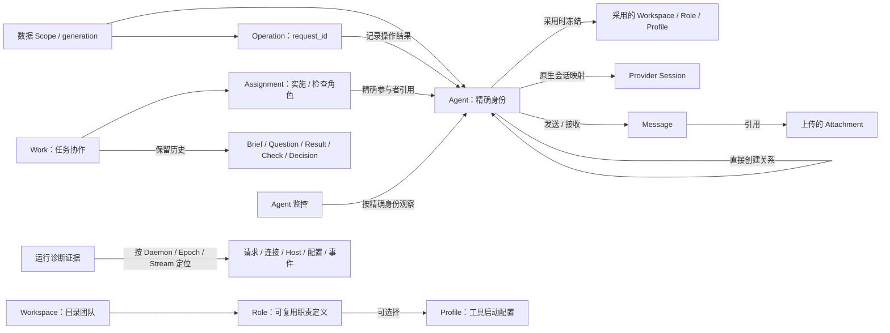
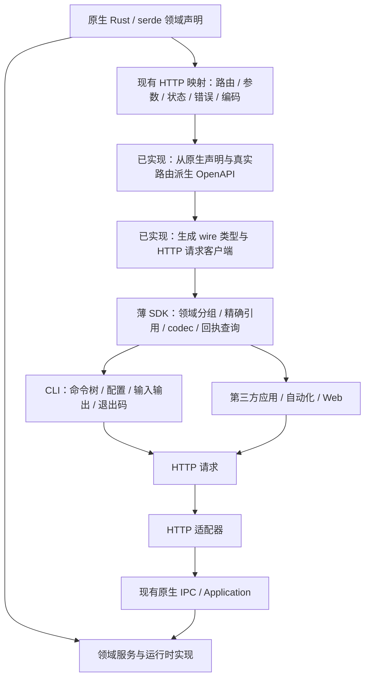
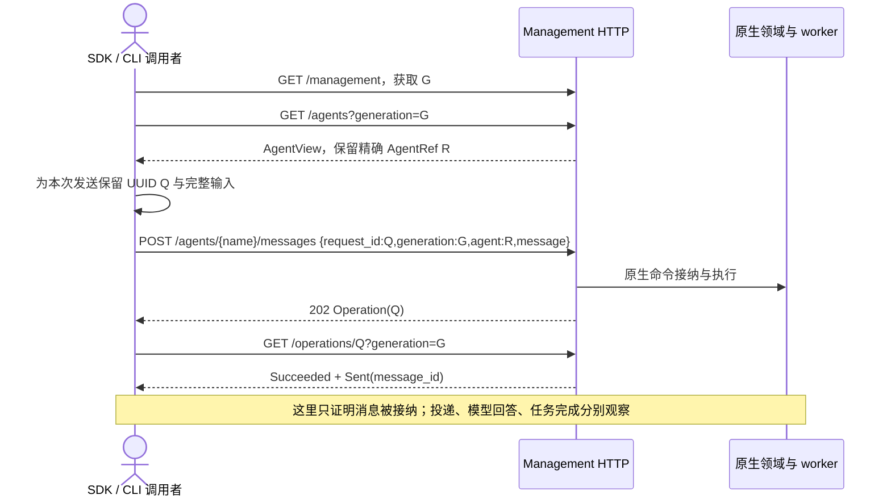

# AgentX：对象 → HTTP → SDK → CLI 全景

后续如何从现有 Service 契约构建这套体系，见[已授权的实施规划](../proposals/contract-service-projections.md)、[契约设计](service-contract-design.md)与[Delivery](../../.controller/contract-service-projections/implementation.delivery.md)：先交付一条真实调用闭环，再扩展全部选定公开能力；Controller lezi 负责实施分派与集成，实际状态以 Delivery/Tasks 为准。

你的判断成立：清晰的对象、关系和操作契约，能让 SDK 的类型与请求代码大部分机械生成。还需要明确 HTTP 映射、调用身份、精度、错误和异步结果等边界；CLI 还需要一层面向使用者的命令设计。对象清晰让这些工作有据可依，但不会自动补出尚未公开的 API。

本页核对当前工作区源码，日期为 2026-11-17。HTTP 路由、三份源派生 OpenAPI、`@agentx/client` SDK 与 `agentx-http` CLI 已在源码和独立 Linux/public-package 集成边界实现；下文保留的 SDK 方法名、operationId、`agentx-api` 命令和表格仍是全景索引，其中 `agentx-api` 是历史设计名称，实际 CLI 名称是 `agentx-http`。这是一份源链接的能力全景，不是新的运行时操作注册表；准确字段和行为仍由 Rust 声明、HTTP 适配器和 [contract-service-projections Delivery](../../.controller/contract-service-projections/implementation.delivery.md) 拥有。安装/live adoption、付费 Provider/model delivery、自动 Inspector recovery-success、原生 retention-gap transition、source-Web browser acceptance 和其他平台仍按 [full acceptance evidence](../../.controller/contract-service-projections/tasks/full-acceptance.task.md) 的边界处理。

可直接打开[交互全景图](index.html)：按领域筛选，在同一行查看 HTTP、SDK、参数、结果和 CLI。页面离线工作，不调用 AgentX。维护时运行 `python3 .docs/api-panorama/render.py` 从本页的接口表重新生成；使用 `python3 .docs/api-panorama/render.py --serve --port 38085` 提供局域网静态预览，仅暴露本页、图和明确链接的公开源码。

首批五操作的实际源派生规范和数值编解码约定见 [Management OpenAPI](openapi/README.md)；其生成、包消费与真实 HTTP 验证状态由对应 Task 记录。

## 1. 先看对象关系



图中的连线表达业务关系，不是外键、所有权或 HTTP 部署声明。Workspace→Role 表示发现范围；角色可从父级或全局发现。Work 的实施／检查角色与可复用专业 Role 是不同概念。上传附件与 Provider 会话 Attachment 也不是同一种对象。

| 对象 / 引用 | 身份与关系 | 对外使用要点 |
| --- | --- | --- |
| Scope / generation | 数据集范围与代次；代次随重置／替换变化 | 管理操作携带 generation；旧代次不能自动换成新代次重试 |
| AgentRef | `name` + `incarnation` 或 `stopped_event`，后两者必须且只能有一个 | 名称用于定位；完整引用防止同名新实例被误操作 |
| Workspace / Role / Profile | 当前目录发现结果与 Agent 已采用快照分别保留 | 当前 Role 的 profile 可为空；已采用的 RoleView 有具体 profile；不互相回填 |
| Message / Attachment | 消息 ID、精确收件人、附件 ID | 收到接纳回执不等于已投递、已读或已完成任务 |
| Operation | generation 内的 UUID request_id，绑定原始命令 | `Accepted / Running / Succeeded / Failed / Unknown`；成功结果仍需解释具体业务效果 |
| WorkRef / Assignment | `scope + generation + project + id`；assignment 绑定精确参与者 | Work revision、Brief revision、结果 ID、检查 ID 各有含义 |
| Inspection Snapshot / Episode | 设置、启用后的观察、分析、持续错误恢复记录 | 历史从采集启用开始；恢复已入队不表示模型已执行或恢复成功 |
| DaemonRef / Epoch / Stream | 运行实例、观测时代、事件流与游标 | 不把过期、缺口、不可比较或连接失败转换成空成功 |

## 2. 完整生成和调用链路



OpenAPI 是 HTTP 契约的派生产物。当前权威链是 Rust/serde → 有限类型闭包派生 → 三份实际 OpenAPI → generated wire types → `@agentx/client` SDK 与 `agentx-http` CLI；management 的普通 JSON 与 Workbench/Observation 的 marker-integer wire 保持分离。完整生成、package 和独立组合证据见 [OpenAPI artifacts](openapi/README.md)、[consumer package README](../../packages/agentx-client/README.md) 与 [full acceptance evidence](../../.controller/contract-service-projections/tasks/full-acceptance.task.md)。

| 边界 | 已有源码 | 生成 SDK 前需要补齐 |
| --- | --- | --- |
| Agent 管理、目录路由、Inspector | [management/contract.rs](../../src/management/contract.rs)、[web.rs](../../src/management/web.rs)、[inspection/contract.rs](../../src/inspection/contract.rs) | 已实现三十条管理路由的 schema、路径／查询／body 映射、operationId、安全边界与错误响应；未公开内部收集/执行输入 |
| 只读运行观测 | [BrowserRead](../../src/observability/web/api.rs)、[HTTP 契约](../observability/browser-api.md) | 已实现闭合枚举的 OpenAPI 表达、整数 codec、原生失败与 HTTP 失败的区分；保留被动观测边界 |
| 任务协作 | [service.rs](../../src/collaboration/service.rs)、[ApplyCall](../../src/collaboration/web/api.rs)、[HTTP 契约](../collaboration-workbench/browser-api.md) | 已实现 Read／OperatorCommand 的 tagged union、revision、结果未知和查询恢复 |
| SDK / CLI | [@agentx/client README](../../packages/agentx-client/README.md)、实际生成 spec 与 package | 已实现生成器/版本、公开包入口、独立连接配置、命令投影与 bounded Linux 实际调用验证；未覆盖项见 full acceptance |

实际公开包已经按这个边界组合 `management`、`workbench`、`observation` 三个客户端。它们仍是不同 listener，甚至复用了 `/api/v1/read` 路径；`createAgentXClient` 通过独立 URL 保持边界，不改变服务拓扑。安装、使用和生成入口见 [consumer package README](../../packages/agentx-client/README.md)。

## 3. SDK 与 HTTP 全量对照

建议 SDK 根结构如下；方法和参数的完整清单在后续三个表中。对照表同时给出建议 CLI，省去另一份独立接口清单。

```text
AgentXClient
├─ management
├─ agents              ─ labels / messages / launchRelations
├─ workspaces / roles / directory
├─ attachments / humanMailbox / officeActivity
├─ operations
├─ inspection          ─ settings / analyses / continuation
├─ workbench           ─ connection / works
└─ observation         ─ scope / runtime / configuration / events
```

参数缩写：`G`＝管理 generation；`R`＝完整 AgentRef；`P`＝分页参数；`W`＝管理写入信封 `{request_id, generation, ...}`。`W` 不能把 request_id 当作每次网络尝试都重新生成的值。普通管理读取在 query 中传 G/R；管理写入在 JSON body 中传 G/R。

### 3.1 管理入口：30 个 HTTP 方法／路径组合

此表以管理 URL 为基地址，省略共同前缀 `/api/v1`。`stop` 与 `kill` 是同一能力的两个现有路由，SDK 建议只保留清楚的 `kill` 命名，避免把它和停止参与混淆。输入中的 `?` 表示可省略；未标 `?` 的业务输入为必需，G/R/W 按上文展开。

<!-- panorama:management -->
| SDK 建议方法 | HTTP | 输入 | 结果 / 语义 | CLI 建议路径 |
| --- | --- | --- | --- | --- |
| management.describe | GET /management | 无 | Descriptor：generation、project、tools、profiles、limits | management show |
| workspaces.list | GET /workspaces | G | WorkspaceCatalog，含发现覆盖率 | workspaces list |
| roles.list | GET /roles | G；workspace | RoleCatalog；定义中 profile 可为空 | roles list --workspace PATH |
| directory.inspect | GET /directory-entry | G；directory | DirectoryEntry；纯路由预览，不创建 Agent | directory inspect PATH |
| directory.send | POST /directory-messages | W；directory；MessageInput | 202 Operation；结果含实际 recipient、created、消息接纳 | directory send PATH --text TEXT |
| agents.list | GET /agents | G；after?；limit?；current_only?；label[]? | AgentPage；label 为 AND，仅 current_only=true 可用 | agents list |
| agents.get | GET /agents/{name} | G；R | AgentView；含能力、采用事实、文件绑定、labels | agents show NAME |
| agents.launch | POST /agents | W；launch: LaunchInput | 202 Operation → Launched；启动错误与 partial 信息保留 | agents launch |
| agents.kill | POST /agents/{name}/kill | W；R | 202 Operation → Stopped；保留原生终止语义 | agents kill NAME |
| agents.kill (HTTP alias) | POST /agents/{name}/stop | W；R | 同 kill；建议 SDK/CLI 不增加同义方法 | agents kill NAME |
| agents.stopParticipation | POST /agents/{name}/stop-participation | W；R | 202 Operation；停止 AgentX 参与，遵循原生生命周期 | agents stop-participation NAME |
| agents.resume | POST /agents/{name}/resume | W；R | 202 Operation；仅能力允许时恢复 | agents resume NAME |
| agents.fork | POST /agents/{name}/fork | W；R | 202 Operation；仅 Provider 支持时分叉 | agents fork NAME |
| agents.transcript.request | POST /agents/{name}/transcript | W；R | 202 Operation → TranscriptPage；有界快照，无输出流 | agents transcript NAME |
| agents.launchRelations.list | GET /agents/{name}/launch-relations | G；R；after?；limit? | upstream、downstream、next；不可用目标不能按名字替代 | agents relations NAME |
| agents.messages.list | GET /agents/{name}/messages | G；R；after?；limit? | MessagePage；next_after、has_more | agents messages list NAME |
| agents.messages.send | POST /agents/{name}/messages | W；R；MessageInput | 202 Operation → Sent；不代表已投递或回答 | agents messages send NAME --text TEXT |
| agents.labels.get | GET /agents/{name}/labels | G；R（当前本地实例） | LabelsSnapshot；labels、revision | agents labels get NAME |
| agents.labels.patch | POST /agents/{name}/labels | W；R；set?；remove[]?；if_revision? | 202 Operation → LabelsPatched；原子 patch 与回执 | agents labels patch NAME |
| operations.get | GET /operations/{request_id} | G；request_id | 原操作状态、result、error；用于查询与恢复 | operations show ID |
| attachments.upload | POST /attachments | query: G、name、media_type?；body: 原始 bytes | 201 Attachment；10 MiB；不是 multipart | attachments upload FILE |
| attachments.download | GET /attachments/{id} | query: G；id | 二进制内容；响应 MIME／下载头有独立规则 | attachments download ID |
| humanMailbox.list | GET /human-mailbox | G；before?；pending?；limit? | HumanMailbox；未处理总数独立于当前页 | mailbox list |
| humanMailbox.handle | POST /human-mailbox/handle | generation；ids[] | 200 HumanMailbox；显式、单调标记处理，不等同阅读 | mailbox handle ID... |
| officeActivity.list | GET /office-activity | G；after?；limit? | OfficeActivity：接纳的消息寻址与创建活动 | office activity |
| inspection.get | GET /inspection | G | Snapshot：settings、coverage、observations、jobs、attempts | inspection show |
| inspection.configure | POST /inspection/configure | Configure{generation, expected_revision, enabled, recovery} | 200 Snapshot；settings revision 冲突拒绝 | inspection configure |
| inspection.analyses.create | POST /inspection/analyze | Analyze{generation, request_id, observation_ids[]} | 200 AnalysisJob；与管理 Operation 不同 | inspection analyses create |
| inspection.analyses.cancel | POST /inspection/cancel-analysis | CancelAnalysis{generation, id} | 200 AnalysisJob；确定性分析的取消 | inspection analyses cancel ID |
| inspection.requestContinuation | POST /inspection/continuation | RequestContinuation{generation, episode} | 200 RecoveryAttempt；queued 仅表示消息入队 | inspection continue |
<!-- /panorama -->

Inspector 的四个 POST body 保留原生外部标签，例如 `{"Configure":{"generation":"G","expected_revision":0,"enabled":true,"recovery":{"enabled":false,"error_duration_seconds":600}}}`。SDK 可提供易用参数，但生成客户端必须发送这个实际 wire 结构。`Collect`、`RunAnalysis` 是内部输入，不生成公开方法。

### 3.2 Workbench：3 个 HTTP 入口，15 项逻辑操作

以下均在 workbench URL 上；JSON 使用原生外部标签。共同读信封 `C={generation,read}`；共同写信封 `A={generation,command_id,work,expected_revision,command}`。project 固定在服务启动配置，不接受 HTTP 切换。写入需服务以 `--collaboration` 启用。

<!-- panorama:workbench -->
| SDK 建议方法 | HTTP | 输入 | 结果 / 语义 | CLI 建议路径 |
| --- | --- | --- | --- | --- |
| workbench.describe | POST /connection | {} | Descriptor：固定 scope/project、generation、available、limits | workbench show |
| workbench.works.list | POST /read · List | C；Page{after?,limit} | Response::Read(List)，含 next | work list |
| workbench.works.get | POST /read · Detail | C；WorkRef | WorkDetail：资源、完整有界历史、eligibility | work show ID |
| workbench.works.candidates | POST /read · Candidates | C；Page{after?,limit} | 可用参与者 Candidate[] | work candidates |
| workbench.works.command | POST /read · Command | C；command_id | Option<Change>；未找到不证明先前没执行 | work command ID |
| workbench.works.thread | POST /read · Thread | C；WorkRef；ThreadPage{after?,limit} | 任务线程消息页，不产生结构化报告 | work thread ID |
| workbench.works.create | POST /apply · CreateWork | A；brief；implementer；checker；work=null；expected_revision=null | Applied(Change) 或 Rejected(Failure)；创建不自动分派 | work create |
| workbench.works.updateBrief | POST /apply · UpdateBrief | A；BriefInput | 新 brief 与资源 revision；保留旧历史 | work brief ID |
| workbench.works.bind | POST /apply · BindParticipant | A；role；ParticipantRef | 指定实施／检查参与者，保留精确身份 | work bind ID |
| workbench.works.dispatch | POST /apply · DispatchAssignment | A；role | 接纳 assignment 消息，不证明模型启动 | work dispatch ID |
| workbench.works.note | POST /apply · SendNote | A；roles[]；text | MessageAccepted；不产生 Result 或 Check | work note ID |
| workbench.works.answer | POST /apply · AnswerQuestion | A；question_id；text；amendment? | 答复；可同时修订 brief | work answer ID |
| workbench.works.requestCheck | POST /apply · RequestCheck | A；result_id；reason | 明确检查请求；发布结果不会自动检查 | work check-request ID |
| workbench.works.accept | POST /apply · AcceptResult | A；ResultSelection{result_id,check_id,brief_revision} | 明确接受被选结果与检查依据；有资格约束 | work accept ID |
| workbench.works.requestChanges | POST /apply · RequestChanges | A；result_id；check_id?；reason | 退回并保留原结果与检查记录 | work changes ID |
<!-- /panorama -->

`ParticipantRef` 与管理 AgentRef 的 wire 结构不同：协作引用是 `{canonical_name,incarnation_bits:u64}`，经专用整数 codec 编码。必须显式转换，并拒绝把 stopped_event 当作当前协作参与者。现有 HTTP 只接收 OperatorCommand；`Progress / Question / Result / Check` 四类 AgentReport 仍走原生 Agent 身份链，不能通过 OpenAPI 增加一个 `--iam` 参数就伪装成同等权限。

### 3.3 Observation：2 个 HTTP 入口，14 项逻辑操作

此处是被动运行诊断，区别于上面的 Agent 监控 Inspector。只读取已有证据，不启动 daemon。共同信封 `O={expected_daemon:DaemonRef|null,read:BrowserRead}`；scope 来自独立 listener 的启动配置。下面 `/read` 的各种后缀是请求体枚举名，不是额外 URL。

<!-- panorama:observation -->
| SDK 建议方法 | HTTP | 输入 | 结果 / 语义 | CLI 建议路径 |
| --- | --- | --- | --- | --- |
| observation.scope | POST /scope | {} | ScopeRef；不证明 daemon 可用 | observe scope |
| observation.runtime.snapshot | POST /read · Snapshot | O；无业务参数 | 运行概览与覆盖信息 | observe snapshot |
| observation.runtime.requests.list | POST /read · Requests | O；RequestSelection；RuntimeList{before?,limit} | 请求观察页；limit 1..64 | observe requests list |
| observation.runtime.requests.get | POST /read · RequestDetail | O；RequestObservationRef | 精确 daemon 内的请求证据 | observe requests show REF |
| observation.runtime.connections.list | POST /read · Connections | O；RuntimeList{before?,limit} | 连接观察页 | observe connections |
| observation.runtime.peers.list | POST /read · Peers | O；RuntimeList{before?,limit} | peer 观察页 | observe peers |
| observation.runtime.hosts.list | POST /read · Hosts | O；RuntimeList{before?,limit} | host 观察页 | observe hosts |
| observation.runtime.clientReports.list | POST /read · ClientReports | O；RuntimeList{before?,limit} | 客户端报告页 | observe reports list |
| observation.runtime.clientReports.get | POST /read · ClientReportDetail | O；ClientReportRef | 报告详情 | observe reports show REF |
| observation.configuration.head | POST /read · ConfigurationHead | O；expected:ObservationEpoch 或 null | 当前观测头；不是重新计算配置 | observe config head |
| observation.configuration.get | POST /read · ConfigurationLookup | O；ConfigSnapshotRef | 已保留配置快照 | observe config show REF |
| observation.configuration.compare | POST /read · ConfigurationCompare | O；CompareConfig{left,right,fields} | Compared 或 Incomparable；保留比较依据 | observe config compare LEFT RIGHT |
| observation.events.describe | POST /read · EventsDescribe | O；无业务参数 | 事件流描述，提供合法窗口／游标来源 | observe events describe |
| observation.events.read | POST /read · EventsRead | O；ObservationRead{window,limit} | 事件页、缺口／过期等分支；limit 1..256 | observe events read |
<!-- /panorama -->

表内共 59 行：管理 30（含 kill/stop 路由别名）、Workbench 15、Observation 14。实际 HTTP 方法／路径组合为 **35**；共用入口中的 tagged union 不能逐行冒充成 59 个 REST endpoint。若去掉 kill 的兼容路由别名，领域消费者视图为 58 项。

对应地，OpenAPI 应有 35 个唯一 operationId，例如 `agentsLaunch`、`agentsMessagesSend`、`workbenchRead`、`workbenchApply`、`observationRead`；同源以外的同名路径保留各自规范边界。`stop` 兼容路径可用单独的 `agentsStopLegacy` 标识。普通生成器会生成 `workbenchRead/apply`，不会凭一个 `oneOf` 自动推导出 `works.create/accept` 这套业务方法。后者由保留 tagged union 的薄封装供给，CLI 命令树也需要有意声明；不能把表内建议命名说成现成生成结果。

## 4. CLI 命令树与参数全景

建议用临时名称 `agentx-api` 表示独立 HTTP 客户端，避免把以下设计误认为当前 `agentx` 语法。当前原生 CLI 继续通过本地 IPC 调用原生服务；HTTP CLI 与它共享领域能力，不意味着必须把现有 CLI 全部改走 HTTP。

约定：`[...]` 可省略；`(a | b)` 二选一；`...` 可重复。以下列出全部命令与主要参数，未重复写入每行的公共 options 见下表。

```text
agentx-api [GLOBAL] <resource> <action>
├─ management show
├─ workspaces list
├─ roles list --workspace PATH
├─ directory
│  ├─ inspect PATH
│  └─ send PATH MESSAGE [WRITE]
├─ agents
│  ├─ list [--after CURSOR] [--limit N] [--current-only] [--label SELECTOR]...
│  ├─ show NAME [EXACT]
│  ├─ launch [--tool TOOL | --profile PROFILE] [--role ROLE] [--workspace PATH]
│  │         [--directory SERVER_PATH] [--title TEXT] [--prompt TEXT]
│  │         [--label KEY=VALUE]... [WRITE]
│  ├─ kill NAME [EXACT] [WRITE]
│  ├─ stop-participation NAME [EXACT] [WRITE]
│  ├─ resume NAME [EXACT] [WRITE]
│  ├─ fork NAME [EXACT] [WRITE]
│  ├─ transcript NAME [EXACT] [WRITE]
│  ├─ relations NAME [EXACT] [--after CURSOR] [--limit N]
│  ├─ messages
│  │  ├─ list NAME [EXACT] [--after ID] [--limit N]
│  │  └─ send NAME [EXACT] MESSAGE [WRITE]
│  └─ labels
│     ├─ get NAME [EXACT]
│     └─ patch NAME [EXACT] [--set KEY=VALUE]... [--remove KEY]...
│               [--if-revision REV] [WRITE]
├─ operations
│  ├─ show REQUEST_ID
│  └─ wait REQUEST_ID [--poll-seconds N] [--wait-timeout-seconds N]
├─ attachments
│  ├─ upload FILE [--name NAME] [--media-type MIME]
│  └─ download ID --output FILE|-
├─ mailbox
│  ├─ list [--before ID] [--pending | --all] [--limit N]
│  └─ handle ID...
├─ office activity [--after ID] [--limit N]
├─ inspection
│  ├─ show
│  ├─ configure --if-revision REV (--enabled | --disabled)
│  │             (--recovery-enabled | --recovery-disabled) --error-duration-seconds N
│  ├─ analyses create --observation ID... [--request-id UUID]
│  ├─ analyses cancel JOB_ID
│  └─ continue --episode FILE|-
├─ workbench show
├─ work
│  ├─ list [--after CURSOR] [--limit N]
│  ├─ show ID
│  ├─ candidates [--after CURSOR] [--limit N]
│  ├─ command COMMAND_ID
│  ├─ thread ID [--after EVENT_ID] [--limit N]
│  ├─ create --brief FILE|- --implementer-ref FILE --checker-ref FILE [WORKWRITE]
│  ├─ brief ID --brief FILE|- [REVISION] [WORKWRITE]
│  ├─ bind ID --role implementer|checker --participant-ref FILE [REVISION] [WORKWRITE]
│  ├─ dispatch ID --role implementer|checker [REVISION] [WORKWRITE]
│  ├─ note ID --role implementer|checker... --text TEXT [REVISION] [WORKWRITE]
│  ├─ answer ID --question QID --text TEXT [--amendment FILE] [REVISION] [WORKWRITE]
│  ├─ check-request ID --result RESULT_ID --reason TEXT [REVISION] [WORKWRITE]
│  ├─ accept ID --result RESULT_ID --check CHECK_ID [--brief-revision REV] [REVISION] [WORKWRITE]
│  └─ changes ID --result RESULT_ID [--check CHECK_ID] --reason TEXT [REVISION] [WORKWRITE]
└─ observe
   ├─ scope
   ├─ snapshot
   ├─ requests list [--selection FILE] [--before ID] [--limit N]
   ├─ requests show REF_FILE
   ├─ connections [--before ID] [--limit N]
   ├─ peers [--before ID] [--limit N]
   ├─ hosts [--before ID] [--limit N]
   ├─ reports list [--before ID] [--limit N]
   ├─ reports show REF_FILE
   ├─ config head [--expected-epoch FILE]
   ├─ config show REF_FILE
   ├─ config compare LEFT_REF_FILE RIGHT_REF_FILE [--field FIELD]...
   ├─ events describe
   └─ events read --window FILE|- [--limit N]
```

### 4.1 公共与命令输入矩阵（建议）

这里不把每个嵌套对象拆成几十个旗标。Brief、Episode、观测窗口、复杂引用可以用结构化 JSON 文件或 stdin 输入；共享类型与校验来自契约。管理文件使用实际普通 JSON；workbench／observation 文件中的整数使用其 wire 标记，CLI 内部解码为 bigint。两者不得混用。

| 范围 | 参数 / option | 类型、默认与约束 |
| --- | --- | --- |
| Global | `--management-url URL`、`--workbench-url URL`、`--observation-url URL` | 对应服务的 origin；默认未设置，仅调用该领域时要求；不默认三者相等 |
| Global | `--config FILE` | 默认 `$XDG_CONFIG_HOME/agentx-api/config.json`，XDG 未设置则使用 `~/.config`；默认文件可缺失，显式文件不存在则报错 |
| Global | `--timeout-seconds N` | 每次 HTTP 尝试，正数，建议默认 15；上传可显式增大；超时不证明操作未执行 |
| Global | `--format text\|json` | 默认 text；json 模式 stdout 仅输出机器结果 |
| Global | `--help`、`--version` | 无网络副作用；未给子命令显示帮助 |
| 管理与协作请求 | `--generation G` | 默认从对应描述符读取一次；已保存回执／重试使用原代次；不会在 stale 后自动更新 |
| 管理精确目标 EXACT | `--incarnation I` 或 `--stopped-event E` | 未提供时先按名称只读解析并冻结引用；存在多种候选则拒绝并要求明确输入；脚本建议显式给定 |
| 管理提交 WRITE | `--request-id UUID`、`--wait`、`--poll-seconds N`、`--wait-timeout-seconds N` | UUID 默认每个新意图生成一次；默认不等待；poll 默认 2 秒；等待上限默认 120 秒；查询等待退出不会撤销操作 |
| 消息 MESSAGE | `--text TEXT` 或 `--file FILE\|-`；`--intent request\|inform\|ack`；`--reply-to ID`；`--thread NAME`；`--attachment ID`... | text/file 必须且只能选一个；intent 等默认省略；附件默认 []；使用服务返回的附件 ID |
| labels / launch | `--label KEY=VALUE`、`--set KEY=VALUE`、`--remove KEY`、`--if-revision REV` | 保留完整字符串值与显式空值，按原生 labels 规则校验；同键 set/remove 冲突不擅自覆盖 |
| LaunchInput | tool、profile、role、workspace、directory、title、prompt、labels | labels 默认 {}，其余省略后按原生解析策略；tool/profile 不能作为两个独立启动基底；目录指服务所在主机的路径 |
| 管理分页 | `--after` 或 `--before`；`--limit N` | 只在命令树标明处可用；管理默认 50，最大 100；各游标来源和方向独立，不跨资源复用 |
| mailbox | `--pending`、`--all` | 默认 all；只改变列表筛选；阅读列表不自动 handle |
| 附件 | FILE、`--name`、`--media-type`、`--output` | upload 默认 basename(FILE)，media_type 默认省略；upload FILE 可为 `-`，此时必须给 name；download 必须给 output，已有目标文件拒绝覆盖 |
| Inspector | `--if-revision`、enabled、recovery-enabled、error-duration、episode、observation、request-id | configure 的四项业务输入完整提供；enabled false 与 omission 不等价；episode 从当前观测获取；analysis request_id 默认 UUID |
| Work reads | `--after`、`--limit` | 默认 limit=32，必须满足 descriptor.limits.page；Thread after 是事件整数，其余 after 是资源 cursor |
| Work writes WORKWRITE | `--command-id UUID` | 新意图生成一次；丢失回复后查 `work command ID`；精确重试保留原命令及代次 |
| Work revision REVISION | `--if-revision REV` | 默认先读取详情并冻结 work revision；显式值优先；冲突后展示 current_revision，不自动覆盖 |
| Work payload | brief、amendment、participant-ref、role、result、check、brief-revision、reason | brief 包含 title、goal、criteria[{id,text,required}]、source?；创建需两个精确参与者；accept 的 brief-revision 默认来自详情中被选结果的依据，显式值优先；其余参数按命令树必需性处理 |
| Observation common | `--expected-daemon REF_FILE` | 仅 `observe` 读取继承，默认 null；有精确引用时保留其 daemon 归属，不因重启重新基准化 |
| Observation inputs | `--selection FILE`、`--expected-epoch FILE`、`--field FIELD`...、`--window FILE\|-` | selection 省略则 SDK 提供 AllRetained；expected_epoch 默认 null；field 省略是 All；window 必需且源自 describe/read |
| Observation page | `--before ID`、`--limit N` | runtime 默认 32、范围 1..64；events 默认 128、范围 1..256；before 必须为正 |

持久设置采用 `built-in < config < ENV < CLI`。建议 ENV／config 映射：

| CLI | ENV | config key |
| --- | --- | --- |
| --config | AGENTX_API_CONFIG | 不从它自己选择的配置中读取 |
| --management-url | AGENTX_API_MANAGEMENT_URL | management_url |
| --workbench-url | AGENTX_API_WORKBENCH_URL | workbench_url |
| --observation-url | AGENTX_API_OBSERVATION_URL | observation_url |
| --timeout-seconds | AGENTX_API_TIMEOUT_SECONDS | timeout_seconds |
| --format | AGENTX_API_FORMAT | format |
| --poll-seconds | AGENTX_API_POLL_SECONDS | poll_seconds |
| --wait-timeout-seconds | AGENTX_API_WAIT_TIMEOUT_SECONDS | wait_timeout_seconds |

其余目标、业务 payload、generation/revision、request_id/command_id、分页、一次性 `--wait` 和输出文件是显式单次意图，不从 ENV/config 注入。options 可在其命令及下级路径中继承；Global 可放根或子命令后；未知 options 拒绝。单次命令至多一个输入使用 stdin。非交互调用不弹确认或选择器。`operations.wait` 是 SDK/CLI 的轮询组合，不是新 HTTP endpoint。

建议退出语义：0＝明确拿到该命令承诺的结果（异步提交仅指 Accepted）；1＝确定失败或拒绝；2＝语法／配置错误；3＝提交后结果未知或等待截止；130＝中断本地观察。回执 ID 与原 generation 必须在提交前保留，并在未知结果时输出；stderr 放诊断／进度。以上是新 CLI 的设计，不修改现有 CLI 的退出码。

## 5. 一个完整调用场景



若第一次 POST 后断线，查询同一个 Q；若需要显式重试，保持 Q 与原始输入一致。`Unknown` 要保留未知语义，不生成新 UUID 再发送。已获取 R 后发生同名替换，精确引用应拒绝该操作；不能把 R 静默换成新 Agent。`--wait` 的 Ctrl+C 仅停止等待。

SDK 可把重复步骤收敛为 `operations.wait()`、`agents.resolveExact()` 等薄组合。不能把“等待消息接纳”和“等待 Agent 回答”合成一个含糊的 success，也不能替用户自动接受 Work 结果。

## 6. 什么可以生成，什么需要有意设计

| 可以机械派生 | 需要明确保留的策略 |
| --- | --- |
| request/response 类型、枚举、nullable、引用关系 | 名称查询与精确身份、当前定义与已采用快照 |
| URL、method、query/body、二进制下载、基础错误结构 | 接纳／完成／投递／已读／任务接受的区别 |
| operationId 对应的底层调用、schema 校验和帮助字段 | 丢失回复后的查询、request_id 生命周期、版本冲突 |
| CLI 参数类型与基础解析骨架 | resource/action 命令树、文件/stdin、人类／机器输出 |
| 文档和接口对照表 | 三个 listener 的连接配置、整数编码和错误分类 |

当前管理接口大多使用普通 JSON，并把重要身份 ID 表达为字符串；它仍含 `u64` 计数与 revision，不能宣传所有数字都天然对 JavaScript 安全。Workbench／Observation 将所有原生整数编码成 `{"$integer":"decimal"}`，SDK 解码为 bigint。OpenAPI 层必须描述真实 wire，并由薄适配器处理 ergonomic 类型；不能统一强转 Number。

| 边界 | 失败的实际表达 | SDK 要保留的区分 |
| --- | --- | --- |
| 管理 HTTP | 非 2xx：`{error:{code,message}}`；400 InvalidInput、403 Forbidden、404 NotFound、409 Conflict/StaleReference、422 Unsupported、503 Unavailable/OutcomeUnknown、500 Internal | HTTP 接纳失败与已接纳 Operation 的 Failed/Unknown 分开；Operation.error 当前是字符串，不能宣传全链路已有闭合错误枚举 |
| Workbench | HTTP 错误是 `{error:CODE}`；200 也可能是原生 `Rejected(Failure)` | InvalidInput、Forbidden、StaleReference、RevisionConflict、NotFound、Capacity、Ineligible、Closed、CommandConflict、Unavailable、OutcomeUnknown 均需保留 |
| Observation | HTTP 错误是 `{error:CODE}`；200 的 ReadResult 可能含 LocalFailure，Inspection 内也有原生失败 | HTTP 成功不代表 daemon 可用、证据当前或内部查询成功；stale/gap/coverage 作为数据保留 |

一些现有管理字段仍是 String，例如 status 或 endpoint status。文档中的可选语义不能被生成器当作由 Rust 自动证明的闭合 enum；若发布契约要收紧，需要由其原生拥有者明确声明并验证兼容性。

当前 listener 没有通用 Bearer/OAuth 身份服务。管理写入沿现有人类操作入口，消息发送者为 bigboss；Workbench HTTP 只开放 operator 命令；Observation 只读。管理服务检查数值 Host 与端口，提供 Origin 时要求同源；Workbench／Observation 的 API 请求要求精确 Origin。因此非浏览器 SDK 也需要适配相应 Host／Origin 约束，浏览器跨源调用不能假设 CORS 已开放。未来如需互联网服务或 Agent 身份远程报告，应单独设计访问与主体授权，不能只在 SDK 添加 token 字段。

## 7. 全项目边界：哪些能力还不能从当前 OpenAPI 生成

| 原生 / 本地能力 | 当前 HTTP 状态 | 全景中的处理 |
| --- | --- | --- |
| Profile CRUD、Role 文件维护、默认团队配置 | 描述符／目录只提供部分读取与启动供给 | 可以读取已公开部分；管理文件编辑不假装已有远程接口 |
| 当前终端、tmux attach、PTY 输入输出、终端新窗口 | 管理 HTTP 是结构化管理，不是 PTY 镜像 | 不生成 `terminal exec`、`attach` 等虚构命令 |
| listen、持久订阅、通用业务事件查询、delivery report、bundle | 原生 IPC 有独立契约；观测事件不是完整业务事件 API | 先设计被选择的公开能力，再扩展 SDK；已有分页消息不等同 listen |
| AgentReport Progress/Question/Result/Check | Workbench HTTP 明确只接 OperatorCommand | 先补可验证 Agent 权限链，不能直接暴露内部 enum |
| daemon status/restart/reset、环境／配置写入、Relay 运维 | 有原生或本地入口；不属于本次三套 HTTP 的公开集合 | CLI 的本机运维与 HTTP 产品调用分开表达 |
| Provider hooks、host 注册、claim/finish/ticket、原始数据库操作 | 内部可信端口 | 不作为资源 CRUD 整体外翻 |
| 文件绑定的 Task/Delivery | AgentView 有只读绑定投影；不等同 Work | 不把源文件工作状态与协作 Work 合并，也不声称已有 Task CRUD |

准确内部边界可从[原生 Application](../../src/service/mod.rs)、[参与者](../../src/agents/service.rs)、[消息](../../src/messaging/service.rs)、[事件](../../src/events/service.rs)、[查询](../../src/service/queries.rs)、[维护](../../src/service/maintenance.rs)、[Relay](../../src/relay/service.rs)继续定位。现有 CLI 全量语法仍由[CLI 入口](../../src/cli/AGENTS.md)及[现有命令导览](../../.sketches/cli-explorer/README.md)负责，不用本页建议命令替代。

## 8. 已实施链路与后续边界

1. 三套 HTTP 边界已各自导出完整规范，覆盖本页 35 个方法／路径组合，以及 13 项 BrowserRead、5 项协作 Read、9 项 OperatorCommand 的实际 tagged union。原生声明与路由拥有来源，不手抄第二套 DTO。
2. `@hey-api/openapi-ts` 0.99.0、TypeScript 5.9.3 与 lossless-json 4.3.3 已生成三套底层客户端；公开 `@agentx/client` 组合入口补齐三套连接配置、codec、精确引用和回执等待。实际 tarball、hash 与 57 文件重复生成证据见 [full consumer Task](../../.controller/contract-service-projections/tasks/full-consumers.task.md)。
3. `agentx-http` 已按本页资源命令树复用 SDK；独立组合验证覆盖精确 Agent→消息→同一回执、断线恢复、stale/epoch、Workbench 接受链、附件与被动 Observation。剩余 Provider/model、自动恢复成功、原生 retention-gap、source-Web browser 和跨平台证据继续按 acceptance 表标注，不由设计表格推断。

本页的表格和 `agentx-api` 命名保留为可读的设计索引；实际实现入口是三份 OpenAPI、`@agentx/client` 和 `agentx-http`。检查与局限见 [contract-service-projections Delivery](../../.controller/contract-service-projections/implementation.delivery.md) 与 [full acceptance Task](../../.controller/contract-service-projections/tasks/full-acceptance.task.md)；原始调查记录仍见[全景研究 Task](../../.controller/api-panorama.task.md)。
