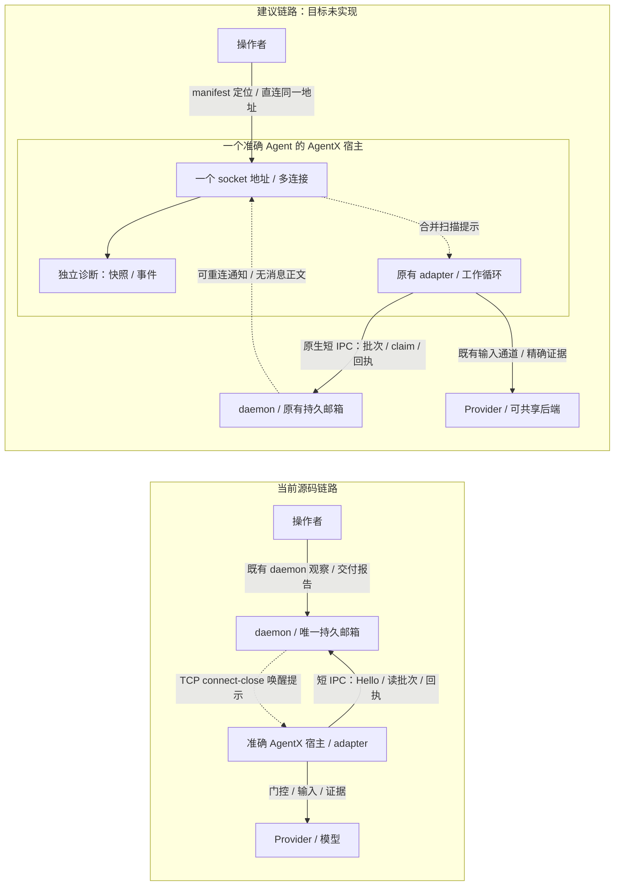
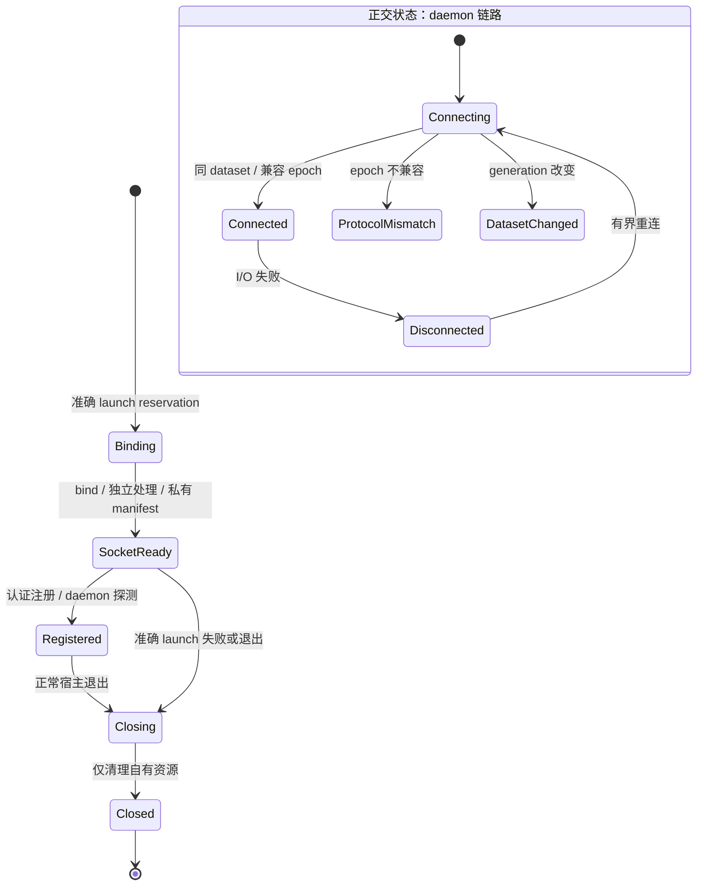
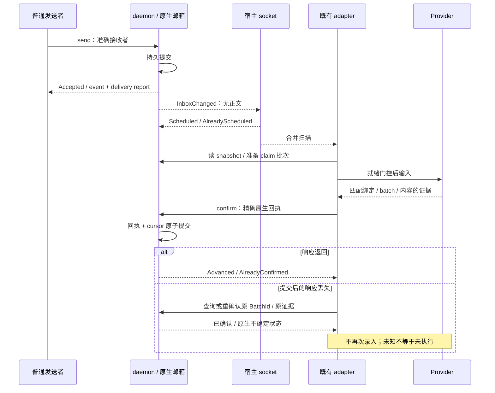

# 每个 Agent 的专用 socket：谁接电话，消息存在哪里？

建议每个准确启动实例的 **AgentX 长驻宿主** 持有一个本地 socket；daemon 和操作者连接同一个地址。它让人直接查看宿主状态、交付卡点与安全运行日志，订阅变化，执行有限维护。消息正文、排他批次与消费回执仍归 daemon 的唯一持久邮箱；长连接只改变通话方式，不产生第二份可靠消息队列。

**状态：独立讨论后的方案建议，尚未获得用户接受或生产实施授权。** [交互全景](http://192.168.2.178:39731/)是同源静态解释，所有故障状态均为模拟，不连接实际 daemon。[Proposal](../proposals/agent-runtime-socket.md)拥有范围与取舍，[Rust 草案](../../.controller/agent-debug/contracts.rs)拥有设计签名，[讨论 Task](../../.controller/agent-debug/discussion.task.md)记录专业讨论与浏览器观察。原作者 fano 的[早期 Task](../../.controller/agent-debug/design.task.md)保留历史依据；nezi 先前的覆盖检查不构成独立架构接受。

## 一眼看清：当前与建议

三件事分别回答不同问题：**可寻址端点**回答“找到哪一个宿主”，**持续会话**回答“是否复用一段通话”，**原生邮箱与回执**回答“消息是否持久、是否确认消费”。一个端点可以接受多个短请求和长订阅；daemon 的可重连会话是建议的实现方式，失去它不能造成消息丢失或授予重输权限。

### 当前能证明什么

| 当前来源 | 已有能力 / 不应推断的能力 |
| --- | --- |
| [service client](../../src/service/client.rs)、[transport](../../src/daemon/transport.rs)、[wire](../../src/daemon/wire.rs) | 本地认证短 IPC：Hello 后一个业务调用。scope、peer、dataset generation、daemon instance 与协议 epoch 各有含义；同 epoch 不要求相同 build。 |
| [NotifyServer](../../src/runtime/notify/server.rs)、[hosts](../../src/runtime/hosts.rs)、[PTY host](../../src/messaging/delivery/host.rs) | localhost TCP 连接即关闭，只是唤醒提示；注入口另有请求/响应。宿主读取持久 snapshot，经过 Provider 门控。空闲恢复轮询为 30 秒。 |
| [inbox](../../src/messaging/inbox.rs)、[store](../../src/messaging/inbox_store.rs)、[attachments](../../src/agents/attachments.rs) | 原生排他批次、claim 阶段、精确回执及 cursor 推进；断线和输入不确定性不能当作重试证明。 |
| [Codex bridge](../../src/integrations/codex/bridge/stdio.rs)、[driver](../../src/integrations/codex/bridge/driver.rs) | 外层 AgentX 宿主持有连接与 attachment controller；官方 app-server 后端可共享。关闭一位 Agent 不得停止共享后端。 |
| [daemon inspection](../../src/daemon/observation.rs)、[journal](../../src/observability/journal.rs) | 既有独立观察通道可绕过部分业务 dispatcher 阻塞，保留事件缺口；不能替代 daemon 整体不可用时的宿主直连。 |
| [PTY trace](../../src/runtime/pty/trace.rs)、[logging](../../src/log.rs) | 有现存日志来源，但可能含终端正文与敏感上下文；不能直接将 raw trace 全量暴露给新端点。 |

[消息修复 r2 已完成并接受](../../.controller/message-delivery/result.md)，不再是本设计的执行依赖。它提供准确 event 的 Pending / Confirmed / TargetRetired / Unknown 观察，以及认证宿主的 `last_poll`；`send --delivery-status EVENT` 不重发、不消费、不改活动状态。声明来源为 [delivery_report](../../src/messaging/delivery_report.rs)、[message service](../../src/messaging/service.rs) 和 [host contracts](../../src/runtime/hosts.rs)。受控 Linux Codex/Qoder 的普通 send、兼容 daemon 重启与原生恢复路径已在独立候选验证；不是新 socket 的运行证据，也不代表 live/default 已采用。

[故障诊断](../../.controller/message-delivery/diagnosis.md)证实原 protocol2 宿主在 protocol3 daemon 的 Hello 阶段被拒，尚未读到 mailbox。未复现同 epoch 持久积压丢失，也没有“旧长连接断了”的已证原因。长连接不能升级已经加载的旧程序；原进程仍保留，升级/恢复需要另行协调。更早的事件时间线仍有未知，不能扩大根因结论。

## 端点归属、身份与发现

| 对象 | 唯一职责与边界 |
| --- | --- |
| Participant | 复用准确 `ParticipantRef`，含行 incarnation，绑定 canonical scope 和 dataset generation；名字与 label 仅用于定位。 |
| Endpoint | 同一 participant 宿主寿命内使用新 `EndpointId`，附准确 host PID / OS incarnation。宿主退出后不转给同名后继。 |
| Attachment | 复用 `ActivationTarget` 与 owner；启动期可缺失。绑定改变更新 revision，排队旧绑定命令在效果前拒绝。 |
| Manifest | 宿主原子发布的私有 locator：完整 EndpointRef、地址、进程证据、版本/build；文件只能帮助发现，不能代替握手认证。 |
| 原生批次 | `BatchId / ClaimPhase / DeliveryReceipt` 仍由原生 inbox 所有者维护；socket 通知和日志 cursor 没有推进消息 cursor 的权限。 |
| 维护关联 | 只关联这一个 endpoint 内的有限维护请求与观察结果；不是持久业务 ledger，不承担 Provider 输入去重。具体精简见下。 |
| 诊断事件流 | `EndpointId + stream nonce + sequence`；有界易失观察，不与 mailbox EventId 或 daemon observation epoch 混用。 |

建议首个平台为 Linux Unix-domain stream socket，复用当前本地 peer/framing 基础。按现有 `/tmp/agentx-<uid>` 私有目录纪律生成短路径，使用 scope 与 EndpointId 的 hash 定位，bind 前检查 Unix 路径长度。manifest 位于 `<scope>/.runtime/agents/<participant-hash>/<endpoint-id>.json`，权限私有，原子替换，no-follow 校验；不能包含 secret、argv 或 environment。不能把名字、cwd、TMPDIR 或任意可写路径当作身份。

daemon 通过已有认证 process/native host registration 的扩展注册与查询端点；operator 通过现存 scope 的 manifest 或显式 endpoint-file 直连。读发现不创建 scope、不启动 daemon、不打开 managed SQLite。双方握手均比对完整 scope、dataset、participant、EndpointId 与内核进程身份，名字解析只执行一次，随后固定准确引用。旧 manifest、PID 复用或同名新实例必须拒绝，不能静默追随。

### 启动、退出和兼容性

`SocketReady`、daemon 注册、Provider 就绪、交付消费是不同事实。daemon 断线不关闭宿主 listener；Provider 卡住不等于宿主不可达；socket 超时不证明进程死亡。宿主崩溃是异常不可达，不保证经过正常 Closing 状态。

建议只对明确启用该能力的新启动模式要求端点 readiness；启用后 bind 失败必须明确 launch failure，经现有准确失败清理路径处理已启动 child。未启用、旧宿主与不支持的平台显式报告 LegacyWakeOnly / Unsupported，不假称已具备端点，也不全局阻断旧启动。最终“每个启动 Agent”的目标需全部受支持宿主完成后才成立。

宿主退出时停止准入、结束观察订阅、保留效果未知的诚实状态，compare-remove 自己的 registry/manifest，只 unlink 自己的 socket inode；不关闭共享 Provider 后端。参与者在同一进程内重绑定，也须关闭旧 endpoint 并发布新身份，不能把已连接客户端偷偷改向新对象。

crash 后 manifest 可能残留。只有准确 OS 进程 incarnation 与资源所有权证明其死亡，才可清理；活但不可达不是删除许可，心跳超时不是 lease 失效。后继启动总有新 EndpointId。

daemon 同 dataset、同业务 epoch 的重启可有新 instance/build：宿主重新认证并注册原 endpoint，重读积压。generation 改变时停止注册/交付并报告 DatasetChanged，不自动接管新数据；协议不兼容时报告 ProtocolMismatch，不退回弱校验。新 host-endpoint epoch 与 daemon 业务 epoch 分开，才能在业务协议不兼容时保留诊断；旧宿主没有这个新 listener，不能承诺该能力逆向生效。

### 宿主模式与支持边界

| 模式 | 建议归属 / 验证义务 |
| --- | --- |
| 普通 PTY、当前终端、新窗口、tmux headless | 既有 PTY runner 持有 listener；不改 tmux attach 与 Provider child 所有权。先做真实垂直切片。 |
| 共享 Codex app-server | 每个外层 AgentX bridge/controller 一端点；即使共享 ExecutionId/backend，也有各自 participant、binding、owner、队列和 EndpointId。必须验证 sibling 隔离。 |
| 直接 Codex stdio | 长驻 wrapper 供应进程/子进程观察；没有 adapter 证据就不宣称自主 inbox delivery 或 Provider probe。 |
| hook/plugin/native-mod/ACP | 使用外层已启动宿主，不让短命 hook 抢占 socket；仅公开 adapter 实际支持的能力。 |
| 外部已采用但未包裹的进程 | 明确 NoHostEndpoint / Unsupported；补 resident supervisor 是另一个实现决定。 |
| macOS / Windows | 现有 daemon 有平台 adapter，不代表新宿主端点已验证。后续按需验证 Unix peer / named pipe，不能回退未认证 TCP。 |

## 一条地址，三种语义

建议 daemon 为每个 endpoint 复用一个可重连会话，合并 `InboxChanged` 并可查询状态；operator 可以短调用或事件订阅。同地址不要求同一个 connection，也不要求内容推送。短调用方案同样能保持正确性；选择常驻会话的收益是减少握手、方便观察链路，代价是连接配额、重连和慢读者治理。

协议复用现有 4-byte big-endian length + serde JSON、有界编码和绝对 I/O deadline，提取原生机制而非导入 daemon 业务 dispatcher。建议 host endpoint epoch 1：先处理小版本 envelope，再解码操作，不兼容明确 UpgradeRequired。不能保证未来所有旧解码器永远兼容；实施时验证独立诊断握手实际可用。

同 OS user 具有这里列出的本地诊断/维护权；不是跨机器认证人类身份。`role=daemon` 只是声明，daemon-only 通知仍需内核 peer 与独立认证 daemon Ready 身份验证。验证缓存随 daemon owner 更换而刷新；刷新不能阻塞诊断 lane，未验证时返回 UnverifiedDaemon。任何通知都不构成回执证据，任何 JSON 字段都不赋予任意控制权限。

RequestId 关联传输，OperationId 关联有限维护结果，BatchId 关联原生交付；三者不能互相替代。响应可按 RequestId 乱序返回；订阅带独立 cursor。相对请求 timeout 在服务器转一次本地 deadline；EOF 不是取消，CancelSubscription 只停止观察。

### 有界性先于“看起来在线”

必须有输入/输出帧、连接、并发请求、订阅、维护队列和单连接 writer 上限；诊断有独立保留预算，维护串行或 coalesced，慢订阅显式 Gap / SlowConsumer，过载在接受维护前返回 Busy。daemon 业务提交只发布有界提示，不等待 socket I/O。诊断只读非阻塞 owner-published 副本，不等待 Provider、SQLite、工作循环或维护锁。

现有 inspection 的 64 KiB input / 512 KiB output 可以作为复用起点；旧稿中的 16 connections、8 requests、2 subscriptions、queue16、10秒 ping / 3次缺失、250ms–5s backoff 仅为待测参数例，不是架构承诺或容量证据。是否发 heartbeat、具体 budget/backoff 应由第一个可运行消费者和故障测试决定；缺 heartbeat 只能判断 Unreachable，不能判 Dead 或释放 claim。原有 30秒 idle poll 是当前源码事实，不是新 heartbeat 协议的正确性租约。

## 消息如何走完；丢响应如何继续

| 看见的事实 | 证明范围 |
| --- | --- |
| Accepted | 消息已持久接受；不证明宿主读到。 |
| HostReceived / Scheduled | 一次合并扫描已安排；不证明 Provider 输入或消费。 |
| ProviderAdmitted / ProviderVisible | 分别是输入请求接受与 adapter 可证明的输入可见；屏幕文字不自动等于精确原生证据。 |
| Consumed / NativeConfirmed | 原生回执与 cursor 的既有边界已提交；不等于模型开始。 |
| ModelStarted | 独立 Provider/hook 观察；可 Unknown / Unsupported，不从前面阶段猜测。 |

丢、重复或乱序提示不需要 durable hint ACK：启动、重连、转空闲、恢复轮询与 daemon 重启协调都会重新读取唯一邮箱。原生 prepare/claim 继续排斥并发 hook/native/显式输出消费者；回执、cursor、状态在既有事务内验证提交。socket 不新增消费 RPC。

输入已发而回执未知时，保留原生 issuing/admitted/uncertain 前驱 claim，按原 batch 和准确证据核对。断线、过期、屏幕安静、宿主替换都不是“没有输入”的证明；不能超时释放、强制确认或盲目重输。

## 故障、诊断和有限维护

| 分支 | 直连端点能提供什么 | 安全继续 / 明确限制 |
| --- | --- | --- |
| daemon 不可用或业务 dispatcher 饱和 | 宿主快照、最后 native poll/失败阶段、本地安全事件；标明时间与过期 | 兼容同 dataset 重连后重读邮箱；不靠诊断读自动启动 daemon。 |
| 业务协议不兼容 | 新端点报告 host/daemon epoch 与失败阶段 | 显式升级/原生恢复已加载宿主；旧程序不会自动长出端点。 |
| Provider 停滞或审批/输入被占用 | adapter 最后已知状态、pending/claim/门控原因，支持时进行有界只读 probe | 不新增 prompt、不越过审批、不停止共享后端；未观察不能伪装 idle。 |
| confirm / 维护响应丢失 | 原 batch 核对；仍保留的维护结果关联 | 不把 EOF 视为未执行；不把维护结果丢失当作邮件重输授权。 |
| 宿主 crash、SIGSTOP、整进程死锁、OS 耗尽 | socket 可能完全不可读；外部只能得准确不可达/最后观察 | 转既有 daemon/OS 观察；超时不授权接管，不宣称跨进程 crash immunity。 |
| 慢订阅 / 事件淘汰 / 宿主重启 | Gap / StreamChanged / loss counters | 日志缺口不能变成“期间无错误”；不会回放已丢事件。 |

### 快照、日志和监控

快照复制各 owner 非阻塞发布的事实：端点与 host revision、lifecycle、可缺失 attachment、daemon link、最后成功 poll 与失败 stage、Provider readiness/approval/input ownership、pending window、outstanding BatchId/ClaimPhase、已知回执、队列/丢事件计数。每个子观察带 source、observed_at 与 Known / NotObserved / Unsupported / Unavailable；组合快照不是跨系统一致事务，最后观察也不是实时内部模型状态。

监控是快照 + 状态事件订阅。复用 [existing journal](../../src/observability/journal.rs) 的有界机制，host 使用自己的 stream identity，不伪造 DaemonRef / daemon observation epoch，不建新数据库。建议从现有上限约束起步，具体 record/page/bytes/age 配额在实现中验证，producer 不因日志阻塞业务；保留丢失计数。

允许输出结构化 allowlist：event key、severity、phase、稳定失败种类/OS code、准确消息/批次/请求关联、安全 count/duration、进程事实、freshness/loss。不包含 message body、terminal bytes、transcript、argv、environment、token、任意路径或 raw error text；无任意文件 tail。旧 raw trace 仍由原资源保护，过去未采集的安全历史明确缺失。CPU/RSS 或模型统计只有已有被选来源实际供应时才支持。daemon 历史仍向原 daemon observer 查询，分别报告可用性。

初次 `after=None` 从当前最老保留记录开始，空流返回本 stream 的 sequence-zero cursor；之后用 `(EndpointId, stream nonce, sequence)` 续读。一次 read 固定 frontier；淘汰返回缺失范围 Gap，stream 改变返回 StreamChanged。订阅只复用同样有界页，取消仅停止观察。原草案 `EventRead.after` 强制 cursor 却没有首个 cursor 供应路径，独立检查将其改为可选初始读取。

### 最小操作面与维护精简

| 操作 | 前提 / 结果与效果 |
| --- | --- |
| Describe / Ping / Snapshot | 认证本地 caller + 准确 endpoint；返回能力、限制、进程/协议/build 与带来源时间的状态。Ping 只证明 handler 可响应。 |
| ReadEvents / Subscribe / CancelSubscription | 上述权限，初始读取或准确 cursor，有限 page/filter/frontier；显式 gap，停止订阅不取消业务。 |
| InboxChanged | 认证 daemon + 准确 endpoint/dataset；只合并扫描，提示 revision 无业务顺序权威。 |
| RescanInbox | 认证本地 operator / daemon + 当前 host revision；安排原有读取路径，得到 NoPending / Pending / Blocked，不能绕过 claim。 |
| ProbeProvider | 同上 + 准确当前 binding 或注册进程；adapter 只读、有界、无新回合/审批/后端重启。不存在能力时返回 Unsupported。 |
| ReconnectDaemon | 保留准确 dataset、peer 与兼容性要求；重新获取/认证连接与注册，不启动/重启 daemon，不采用新 dataset。 |
| ObserveOperation | endpoint + 原 OperationId；返回仍保留的 Pending / Running / Completed / FailedBeforeEffect / Unknown，缺失时明确 NotRetained，不能当作“未执行”。 |

维护精简已经 nezi 从需求/消费者角度评议同意，仍属待用户接受的专业建议：使用 endpoint + 客户端 nonce 关联有限操作；仅保证结果记录保留期间同 ID/同参数复用、异参数冲突，保留时长/容量由 Describe 声明；非终结记录持续保留，终结记录至少从终结时刻起保留声明时长，时间只由服务器本地测量，无需客户端构造宿主时钟。重复请求必须带原有 canonical command 与原 fence，保留期内直接返回原状态，不先用新 revision 将其误判为新请求。非终结执行不静默淘汰，先保留容量再接受，满则 Busy。结果过期或宿主消失后只报告 Unknown / NotRetained，不承诺跨保留期恰好一次。客户端不自动重发未知操作；这里只能在重新检查准确对象后，为扫描/只读探测/重连显式新建幂等调度请求。重复扫描仍由原生 mailbox claim 防止重复输入。这些限制不允许未来把 kill、shell、强制释放 claim 或终端注入塞进同一重试策略。

旧稿客户端必须构造“宿主单调时间 + 15分钟窗口”，但 Describe 未提供该时钟，导致真实 caller 无法供给输入。严格跨窗口去重若确有需求，需要单独明确票据/时间/保留策略；当前三项有限维护不足以证明这套协议必要。OperationId 是结果关联，不是永久业务幂等键；用户若要求更多维护效果，需要重新设计效果与恢复保证。

| 维护操作 | 幂等 / 并发 / 重试界限 |
| --- | --- |
| RescanInbox | 调度可合并到已有扫描，不承诺请求和扫描次数一一对应。业务交付去重依赖既有原生 claim/receipt，而非维护 ID。结果未知后可人工以新关联请求安排一次扫描，但不直接重输消息。 |
| ProbeProvider | 只读、有界，串行维护 worker 限制并发，adapter 不支持则拒绝；超时是观察未知，不表示 Provider 无输入。经准确绑定复查可重新探测，不创建任何模型回合。 |
| ReconnectDaemon | 加入同一连接协调器，合并重复重连；保留 dataset 与既有 uncertain native call，不因重连自动重放效果或取消 Provider。失败后可显式新建一次连接尝试，但不启动 daemon、不迁移 generation。 |

host revision 在准入和排队后效果前检查，发布的 binding/readiness 改变才更新；入队和 ledger 自身不能让 fence 立即失效。效果前变化返回 StateChanged / StaleBinding；已开始效果则返回实际已知结果或 Unknown，不能伪称无效果拒绝。宿主死亡丢失本地结果不能改变原生 mailbox/claim。

## 实施边界、验证与仍需选择的内容

**本讨论没有实施授权。** 建议在另行授权后用可验证的纵向切片递进，顺序已与 nezi 从需求/消费者角度讨论同意，仍待用户接受；阶段不会缩减最终目标，也不允许把 ping 原型声称为完整能力。

| 阶段 | 最小可用结果 / 为什么这样切 |
| --- | --- |
| S1：准确 PTY 闭环 | 一个真实 PTY host 的 listener/manifest/认证/lifecycle、独立 snapshot/安全事件、直接 CLI、daemon 同端点提示与重连、RescanInbox；普通 send → 原 adapter → 原生回执，并验证断线/不兼容/丢回执/Provider 阻塞。先证明同地址与可靠性边界真的组合起来。 |
| S2：共享 bridge 与完整操作 | 每 root host 一端点与 sibling 隔离；ProbeProvider / ReconnectDaemon 按 adapter 能力落地，有界结果关联/事件恢复。S1 不宣称这些已完成。 |
| S3：声明覆盖与采用 | direct stdio、其余既有 launch composition 及目标平台分别交付能力或显式不支持；覆盖受支持启动模式后才可声明“每个启动 Agent”。混合旧/新宿主验证、候选接受、特定范围启用、live adoption 逐项区分。 |

建议代码归属：`runtime/agent_endpoint/{contracts,server,client,discovery}.rs` 承担新边界；`runtime/hosts.rs` 与 daemon-only `hosts_store.rs` 承担准确注册投影；PTY runner 与 Codex bridge 各自组合；messaging postcommit 仅发布有界提示，daemon outbound worker 承担 I/O；原 observability/log owner 供应有界安全事件机制；原 CLI owner 派生 `agentx runtime inspect/watch/maintain` 候选语法，读操作不 autostart。这些路径与命令为设计，不是现有命令承诺。

独立 endpoint protocol 仍需验证现有 native reader 是否兼容新增 registration leaf；必须选择可加的新 capability 或明确业务 epoch 变化的保留计划，不因新 feature 直接换掉 live daemon、再次留下一批不兼容旧宿主。第一阶段保留既有 wake 与 fallback，避免同时承担迁移/回退。

### 场景验收义务：未执行的新端点验证

| ID | 决定性证据 |
| --- | --- |
| AS-01 等待；AS-02 活跃转空闲 | 普通 send 经同 endpoint 调度，真实 host/adapter 出现精确回执与下一 fixture 回合；草稿/审批和活跃门控不被破坏。 |
| AS-03 提示丢失/重复/乱序、注册晚到 | 启动/idle/fallback 重读积压且仅一次输入；通知回包从不推进 cursor。 |
| AS-04 同 epoch daemon 重启 / 不同 build | host endpoint 不变，认证新 daemon instance，原 dataset/batch 恢复；丢 hint 与丢 confirm response 分别检验。 |
| AS-05 业务 epoch / dataset 变化 | direct snapshot 诚实返回 mismatch / changed，保持 backlog 与 freshness；无 generation 接管或虚假健康，显式恢复另行验证。 |
| AS-06 Provider 停滞 / daemon 饱和 / 慢订阅 | 配置负载下 direct snapshot 有界响应且不等待 adapter，probe 有界超时、gap 可见；host crash 正确不可达。具体响应预算由实现声明后测量。 |
| AS-07 不确定输入 / 前驱 claim | 输入后、confirm 前、commit 后 reply 前断线：依据原证据核对，不重复输入；不完整历史保持 Unknown / Blocked。 |
| AS-08 同名 / shared sibling / stale manifest / PID复用 | 错 scope/generation/incarnation/endpoint/binding/OS incarnation 在效果前拒绝；关闭一 host 不停 shared backend。 |
| AS-09 维护重复/延迟/丢响应 | 保留期内同 ID/参数复用、异参数冲突，满则 Busy；结果不在时返回 NotRetained / Unknown，不自动重发，不宣称跨过期永久去重。 |
| AS-10 认证 / 畸形帧 / 生命周期 | 长度分配前校验，role JSON 不授予权限；只读发现不启动 daemon；启用模式 bind failure 明确失败，退出仅释放自有 inode。 |
| AS-11 日志与订阅 | 真实 allowlist callsite，经 direct client 可读；正文/secret canary 不泄露，首次 cursor 可获得、frontier/gap/stream change/cancel 正确。 |
| AS-12 启动模式供给 | PTY/tmux、两个 shared root hosts、direct stdio 分别有准确可达 endpoint 与真实能力声明；其他平台不从 Linux fixture 泛化。 |

使用 disposable scope、独立 source candidate、真实 CLI/daemon/host 与确定性 Provider 替身，保留准确身份、阶段证据与有限失败时间；不使用付费模型调用或手工 `term inject` 冒充普通送达。类型草案和浏览器只验证各自边界，不能替代上述生产消费者运行。

### 选择状态

建议保留：host-owned 准确端点、daemon/operator 同地址、唯一持久邮箱、独立有界诊断、Linux-first 本地认证、有限维护、原生 Rust 定义链。真正替代：短调用可替代 daemon 常驻会话而不改变交付正确性；daemon-only 代理无法覆盖 daemon 不可用；Provider-owned 端点与共享后端/单 Agent 生命周期不匹配；持久推送正文需第二套邮箱与 ACK，当前没有必要；任意 shell/终端控制超出有限维护。

已与 nezi 讨论并整合（#45291）：维护关联窗口精简、S1/S2/S3 的交付顺序、新宿主启用边界、待测心跳/负载参数。nezi 检查了早期桌面全景的需求覆盖；vimu 独立检查了架构与实际 caller 的时钟/cursor 供给缺口。两者均不等于用户接受或生产验证。最终交付不能靠一直默认不启用规避每个受支持启动 Agent 的端点承诺。用户仍可改变长会话偏好、同 UID 权限、Linux-first 平台范围或维护集合；不把内部建议写成已经接受的用户承诺。远程/多用户、raw content logs、强制停止、热替换与所有平台一次齐备均会改变范围，当前没有暗中选择。

实施还欠：原生 transport factoring、准确 additive compatibility 证明、Provider capability 供应、独立事件源组合、实测负载/保留预算与平台验证。候选接受和 live adoption 分开；旧运行程序不能被新文件热升级。回退不删除旧 mailbox/claim，不重启用户服务、不覆盖已接受 artifact。原消息修复、原始 incident 进程、现有 live/default 与其他预览不在本设计变更范围。
