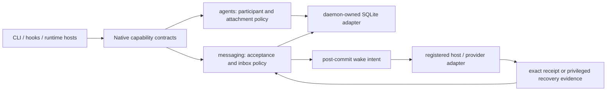

# Identity and messaging consistency

The accepted direction is the [single-binary daemon proposal](../proposals/domain-driven-agentx-daemon.md). The [owning Task](../../.controller/domain-daemon/tasks/consistency.md) records execution and evidence. This document preserves domain meaning and design; native Rust declarations are authoritative and implementation support remains bounded by integration evidence.

## Domain and responsibilities

| Owner | Owned facts / callable capability | Excluded responsibility |
| --- | --- | --- |
| `agents` | Participant identity, explicit invocation binding, canonical session lineage, attachment ownership and stale-callback fences | Provider-native DTOs, stdio/PTY lifetime, daemon-global launch environment |
| `messaging` | Message validation/routing, durable acceptance/readback, frozen mailbox claims, receipt and evidence-based recovery | CLI syntax/presentation, claiming that accepted input means agent work completed |
| `db` | Schema, SQLite transaction/savepoint mechanics, durable records and persistence adapters | Generic database-method RPC, provider I/O or interpreting missing responses as no effect |
| Daemon composition | Canonical data scope/generation, authenticated caller/host context, construction of persistence adapters | Reimplementing domain policy in IPC handlers |
| Runtime/provider host | Actual external input/output, process observation and correlated native evidence | Direct durable mutation or blind retry after unknown external effect |

## Identity and lifetime

[ParticipantRef](../../src/agents/attachments.rs) combines canonical name with exact `created_at.to_bits()`. A name, PID, provider session ID or shared backend generation is not sufficient row authority. `ExecutionId`, `AttachmentOwnerId` and `BindingId` separately identify runtime generation, controller and attachment epoch. A binding is fresh after reattachment or owner replacement.

The provider supplies opaque `(provider, scope, session_id)` to `ProviderSessionKey`. Canonical session lineage survives a live-row deletion, retaining snapshot, ancestry and delivered cursor. Restoring a stopped participant creates a fresh incarnation and refuses a name now owned by a different participant. At most one active session attachment and one active participant attachment exist. Deletion or fenced stop revokes only the deleted incarnation while preserving open claims.

Daemon attachment persistence must receive the authenticated registered host's PID and OS process identity. Persisting the daemon's own PID would make a long-lived service appear to own every attachment. A different controller may replace ownership only after explicit retirement/deletion or positive OS exit/PID-incarnation evidence. Missing process observation, elapsed heartbeat and a new execution ID do not prove the old controller ended.

Client invocation identity and effective launch context are explicit values. Client adapters capture cwd, selected provider/session/process bindings, launch correlation and effective environment. Domain operations validate durable bindings/fences; they never inspect daemon-global environment to choose a client participant or launch metadata.

## Durable message acceptance

Message submission accepts a stable request identity scoped to the canonical store/database generation and a complete normalized intent: actor identity/fence, body, envelope and explicit routing targets. The same request ID with different intent is a conflict. Replaying the same accepted request returns the retained event/result and original recipient set, even if live recipients or thread membership later change.

The SQLite write scope performs actor validation, existing-outcome lookup, routing, message event insertion and acceptance-result insertion atomically. Thread membership and request-watch records belonging to acceptance must share that transaction. A failed write leaves neither an event nor an accepted result. The response is returned only after commit; a lost response is recovered using the same request ID or explicit outcome lookup. An unavailable lookup is an observation failure, not proof that the message was never accepted.

Validation retains current message length, exact target//remote routing, self exclusion, sender namespaces, thread seed/reuse, reply correlation, ack-loop and envelope semantics. Native [participant operations](../../src/agents/service.rs) and [message operations](../../src/messaging/service.rs) are callable through their daemon stores and [application composition](../../src/service/application.rs); the owning Task records executed scope separately.

External wake/relay/provider I/O runs only after the write lock is released. Wake success is advisory and does not change durable acceptance. A crash after commit but before wake leaves the accepted event available to normal durable scans; replay does not create a second event or a second uncontrolled external effect.

## Delivery and recovery

[PendingInbox](../../src/messaging/inbox.rs) remains the authority for prepare/freeze/claim, issuing, confirmation and predecessor reconciliation. All hook/native-input/explicit-listen consumers share the same durable claim per session lineage. Preparation freezes the eligible bounded message window, raw messages, formatted context, consumer and correlation; unrelated events never extend its receipt frontier.

| Boundary | Durable state / allowed conclusion |
| --- | --- |
| Accepted message transaction commits | Message exists and is routable; no input/receipt/completed-work claim |
| Claim preparation commits | One consumer owns a frozen window; no external input yet |
| Issuing commits before external I/O | External input may occur; response loss is uncertain |
| Exact consumer receipt confirms | Exact target, batch and through-event cursor advance atomically and forward-only |
| Old binding is retired | Late normal receipt cannot mutate successor; unresolved claim remains |
| Separate predecessor reconciliation | Exact recorded receipt or privileged complete no-input evidence is checked against old/new fences and durable lineage |

Successful hook or tool output requires a successful write and flush. Provider evidence requires adapter-verified exact thread, batch and frozen content. Admission, cancellation, turn completion, timeout and a missing response never confirm delivery. `NeverIssued` applies only while Prepared; rejection proof must match the attempt; complete-history proof requires a nonempty source reference and remains privileged provider/recovery evidence.

## Decisions and feedback

Reuse existing attachment/inbox ports rather than inventing claim or lease protocols. Use one small durable acceptance ledger rather than event sourcing or a generic RPC persistence facade. Keep provider-native and AgentX session identities separate. Keep source-owned domain declarations canonical; IPC serialization derives from their Rust types.

Open implementation questions are recorded in the Task: exact released caller/native-service paths, hook lifecycle coverage, and source/API ownership changes. Acceptance cases are domain-authored there and executed independently by integration. No source-built process may inspect a live database or service for this work.

[PTY policy](../../src/messaging/delivery_service.rs) consumes runtime's registered host/child lease; terminal output, screen observation and timing remain in the host. Live mutations require the current explicit binding. Exit observations use retained token, authenticated host PID/incarnation and child identity, permitting an absent old row while rejecting a successor. Launch failure and stop cleanup commit with their events; [post-commit notification deferral](../../src/db/post_commit.rs) drops effects on savepoint rollback and releases them only after the outer commit. Client lifecycle and runtime launch extraction stay within the Participants domain and use explicit originating invocation context.

Operator kill admits external effects through the existing [lifecycle ticket](../../src/agents/lifecycle_service.rs). If the target's own hook or exact registered host retires the killed row before CompleteKill, the [canonical stop core](../../src/agents/hook_store.rs) retains its complete frozen cleanup plan in that same transaction, keyed by generation and exact participant. Completion validates the original ticket/peer/owner and the root's captured PID/incarnation/killed marker/initiator before recovering that outcome. An absent row without this evidence remains unknown; namesake successors cannot inherit old cleanup authority. Retained retirement and planned effects remain distinct from completed host cleanup, and every recovered signal still needs its captured nonempty OS incarnation checked by the host. This uses owned recovery records rather than a universal effect queue.

## Internal system cleanup

The finite internal [SystemCleanup](../../src/agents/service.rs) decision is separate from self-session and operator admission. [cleanup_store](../../src/agents/cleanup_store.rs) applies the actual consumer's existing policy and composes the same child-first retirement core. It is not another IPC request, arbitrary target/reason RPC or universal effect queue.

| Actual consumer | Domain admission | Native result and host disposition |
| --- | --- | --- |
| Listing | Positive process death; 120-second placeholder expiry; existing inactive/exit clock tiers with shared wake grace and live/unknown PID protection; stale remote presence expiry | Listing.cleanup freezes the retired plans; CLI executes them after the committed response and enriches the frozen records' diagnostics locally. |
| Maintenance ReapDeadProcesses / TUI sweep | Throttled positive process exit or positively observed different stored incarnation; no clock-only death | Maintenance::Cleanup carries the plan to the TUI host. Summary is a pure projection and has no discarded cleanup result. |
| Zero-wait launch observation | Expired local placeholders only, followed by exact stored diagnosis and required batch events | Hosts::LaunchStatus returns cleanup plus frozen diagnostic records. The actual launch client owns waits, stop execution, log reads and terminal capture. |
| Resolve/Preview Resume | Exact selected participant and positive process evidence before source selection | ResumeResolution retains selection and cleanup together; its host executes effects before preparing launch. ReserveResume validates source/process state without another cleanup. |
| Binding session switch | Canonical binding owns the old identity and has already migrated PID/terminal state to the new identity | DB-only `soft_retire_switched` keeps the old cursor/row, saves subscriptions, removes old bindings/subscriptions and records the required stopped event. The continuing process receives no stop/track effect. |

The system handler verifies the authenticated peer and owns a write scope from the current row/process fence through descendant enumeration, snapshots, required cleanup and retained result. Any descendant with an independent PID defers an identity-guarded parent stop without retiring any part of that tree. No unavailable OS observation authorizes a takeover or a signal. Existing self/operator callers preserve their full hard-stop semantics and signatures.

The standard retained request helper binds cleanup mode, full normalized invocation and observed peer to the database generation. Lost replies recover the original frozen plan with the same request ID, and successor validation rejects a reused name. ResolveResume instead uses `cleanup_in_write_scope` inside its full native intent/result retention, avoiding a second request key. Row absence on a later read does not attest host cleanup completion. Host execution rechecks captured nonempty OS incarnation before any signal, escalation or survivor tracking.

Stored status and `try_finalize_launch_failure_detail_stored` never read a log or execute tmux. The latter atomically checks the original participant/session/process/status and propagates a required status/event write failure. Caller-only `capture_launch_failure_evidence` enriches presentation using the frozen original record; it cannot reclassify durable launch readiness. Legacy mixed helper consumers remain visible in the [storage disposition](../model/storage-boundary.md) until their actual owners finish migration.

## Claude hook generation and actors

The native [Claude contract](../../src/agents/claude_service.rs) owns finite generation, activity, stop and output decisions under Participants. Its [store](../../src/agents/claude_store.rs) combines durable process/session/validated-lineage facts with bounded envelope evidence supplied by the originating host. Message content, markers, summaries and a supplied owner name never select an identity. A fresh AgentX fork preserves its reserved participant; persistent fork configuration alone cannot replace later payload sessions. Root/child routing precedes lifecycle and delivery, and historical SessionEnd only cleans its own scoped state.

An Actor preserves exact root/participant/session/agent-id relationships and is revalidated for every mutation. Child hooks share a validated primary root and canonical root-owned allocation; a missing child never inherits root authority. Shell capabilities bind exact tuple and actor incarnation. Terminal tuple revocation precedes optional actor routing and survives a failed later observation. Stop ownership binds authenticated peer, nonempty OS incarnation and retained token; unknown process observation cannot steal it. Host polling and exact process cleanup stay external, and committed retirement returns the same retained frozen plan after reply loss.

Combined output confirmation reuses canonical mailbox and bootstrap receipts after the complete stdout flush. A single transaction confirms those facts and optional informational Task history; a failed required status/event write rolls them all back. Task history has a separate exact frontier, while root mailbox cursor advancement requires its own frozen claim/receipt. Async dispatch and unrelated global watermarks never confirm delivery. Print readiness is a post-flush domain event using originating launch context. Exact declarations, consumer release, authored cases and independent evidence are tracked in the [owning Task](../../.controller/domain-daemon/tasks/consistency.md#callable-claude-hook-domain-release); source readiness alone is not product acceptance.
