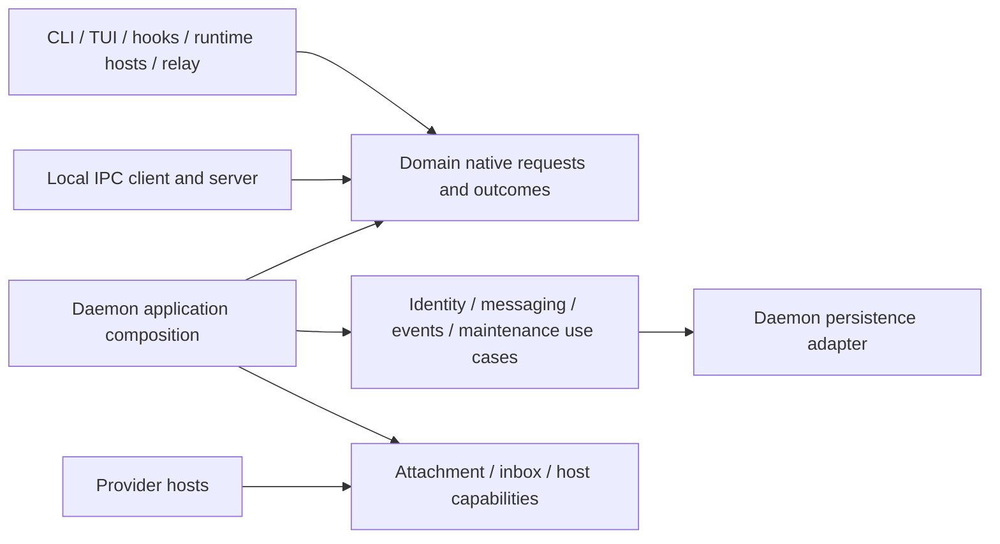

# Native capability contracts

[`service::Application`](../../src/service/mod.rs) is the daemon's injected application boundary. `Request` and `Response` are native tagged sums over domain-owned operation/outcome types. Serde projects these exact Rust declarations onto local transport; there is no independent IDL or generic database/command API. CLI grammar, output formatting and external Provider protocols retain their existing owners.

Arrows mean source dependency. Application composition chooses concrete persistence and binds domain handlers. The daemon transport accepts the `Application` capability; it does not select domain policy. Existing implementation modules can retain private storage helpers without making clients or host processes storage owners. No package-per-domain or generic forwarding layer is required.

## Caller and scope contract

[`CallerContext`](../../src/service/context.rs) contains a stable request id, captured invocation configuration, optional absolute deadline and expected database generation. `InvocationContext` carries cwd/environment/TTY facts, explicit identity claim, process binding id, provider session, attachment target and optional actor capability. These values originate with the caller. Domains validate identity against durable state and appropriate capabilities.

`RequestContext` adds the local transport's observed `CallerProcess`, current daemon instance and durable database generation. It is not decoded from the request body. A transient CLI caller is not automatically the long-lived runtime owner; registered host evidence must bind the actual owner. Attachment construction maps that verified process into domain-owned `AttachmentOwnerProcess`, preserving positive OS exit/incarnation takeover checks.

Client process environment may select its configuration and effective launch environment. The daemon must never infer a different client's identity, cwd, Provider session or launch provenance from its own startup environment. Scope selection occurs before service acquisition and is canonicalized by lifecycle ownership.

`InvocationContext::capture` captures the originating client's cwd, environment, claimed `AGENTX_PROCESS_ID` and TTY observations once. Parsed flags and Provider/session mappings then refine that value. A host that already captured its effective environment maps that snapshot directly rather than recapturing daemon or ambient state. Full forwarded environment is invocation configuration; durable launch history retains only its declared AgentX/Provider provenance fields, not arbitrary secrets.

Optional `launch_context` preserves the existing caller-captured launch metadata. Git branch, terminal and pane/process handoff observations belong to the originating host, never daemon recapture. Capturing launch metadata may consume a one-shot terminal handoff file, so launch/session initialization selects this step explicitly; ordinary read-model/TUI context capture must leave that handoff intact. Snapshot content remains a configuration claim and does not authenticate process ownership.

## Domain authority and effect meaning

| Contract | Native authority | Required meaning |
| --- | --- | --- |
| Participant use cases | [`agents/service.rs`](../../src/agents/service.rs) | Domain validates actor/row/incarnation and supplies typed identity/read models |
| Session attachment | [`agents/attachments.rs`](../../src/agents/attachments.rs) | Exact participant/execution/binding/controller; canonical Provider-session lineage |
| Durable message acceptance | [`messaging/service.rs`](../../src/messaging/service.rs) | Atomic normalized input, actor/request identity, durable event and acceptance; lost reply can reconcile |
| Inbox and receipt | [`messaging/inbox.rs`](../../src/messaging/inbox.rs) | Exclusive frozen claim, issuing before possible effect, exact evidence and forward-only cursor |
| Activation policy | [`messaging/activation.rs`](../../src/messaging/activation.rs) | Provider-neutral offer/coalescing; native Provider admission is not delivery |
| Host operations | [`runtime/hosts.rs`](../../src/runtime/hosts.rs) | Runtime owner registration, distinct wake/inject capability and fenced lifecycle; daemon handler in `runtime/hosts_store.rs` |
| Events / queries / maintenance / relay | Source locations in [handoff](../../.controller/domain-daemon/contracts-handoff.md) | Native typed filters/projections/use cases; no public SQL, row patch maps or argv |

The first released participant/message declarations are a consumable skeleton. Consistency owns their completion and any signature refinements; cross-domain additions are coordinated through the aggregate owner. The handoff owns exact active source release, rather than a second signature listing here.

Lifecycle and launch policy remain nested in Participants. Extracted native leaves and daemon handlers belong under `agents`: the product client owner may author the exclusive lifecycle pair, and the runtime owner the exclusive launch pair, while consistency retains participant invariants, module exports and dispatch. The [source handoff](../../.controller/domain-daemon/contracts-handoff.md) fixes the exact leaves. General PTY/hook delivery likewise separates daemon-owned mailbox decisions from runtime-owned Provider/output effects. Adding a new adapter does not justify a second participant domain or a database-shaped IPC interface. Required participant/binding/event mutations share the relevant transaction and propagate failure; best-effort handling applies only to effects explicitly declared optional.

## Failure and compatibility

[`ServiceError`](../../src/service/error.rs) expresses actionable application errors. Transport decoding/connect/write/lost-reply failures remain transport-owned. A dropped connection after write cannot distinguish committed, executing or unexecuted work. Message submit may reuse its stable id only because its domain supplies durable identical-input acceptance. Generic automatic mutation replay is forbidden. External Provider effects require the existing evidence/recovery protocol.

Protocol compatibility, package version, native build-cohort identity and database schema version are separate. Native serializations and operation semantics are stable per operation. An additive operation does not gate shared calls; unknown tags receive a typed refusal before dispatch. Package version and build cohort are diagnostic and do not gate admission. The [selected build identity model](../model/state-ownership.md#native-build-compatibility) embeds a generated stamp in loaded code; full-file SHA remains exact artifact audit, not mandatory per-client I/O or peer authorization. Native source/invalidation support for this correction remains with daemon/integration. A daemon instance changes on process restart; persistent database generation changes on replacement/reset. Generation fences reject stale writes instead of reconnecting to a stale file. The durable DB key is the sole generation authority; its in-memory mirror must be published before readiness and after reset commit, before another dispatch. Publication failure invalidates the mirror and stops admission. Maintenance replacement coordinates with the dispatch owner and persistence owner. Build, process and platform support are established only by independent acceptance.
