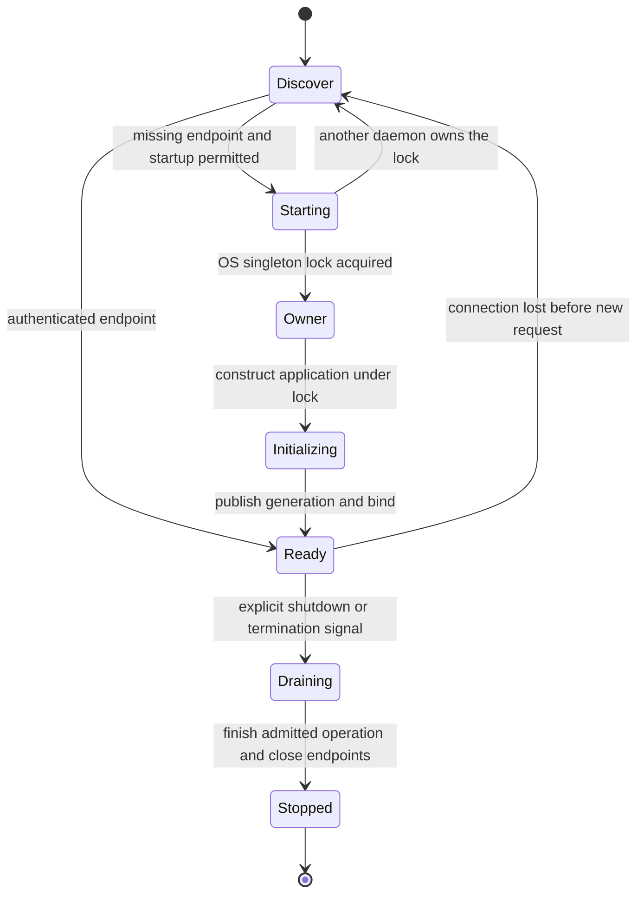

# Daemon lifecycle and local IPC

The [proposal](../proposals/domain-driven-agentx-daemon.md) owns the selected product direction. The [direct calls Task](../../.controller/direct-calls/task.md) owns the current wire and upgrade evidence. Native application declarations under `src/service` own operations; transport serializes those declarations and never dispatches SQL, command argv, arbitrary method names or untyped operation payloads.

## Responsibilities and mechanism choice

| Owner | Responsibility | Source |
| --- | --- | --- |
| Lifecycle | Canonical data scope, singleton ownership, endpoint discovery, startup/readiness, compatible process identity, shutdown | `src/daemon/` |
| IPC boundary | Bounded frames, absolute deadlines, authenticated OS peer, native operation encoding | `src/daemon/` |
| Client binding | Explicit invocation context and native application call over IPC; no persistence fallback | `src/service/client.rs` |
| Application composition | Construct domain services only after scope ownership; serialize SQLite-backed use cases | Native `src/service` composition |
| Product entry | Enter daemon mode before client environment preparation; preserve pure/local commands | `src/main.rs` and CLI router |

Existing [notification sockets](../../src/runtime/notify/mod.rs) carry connect-and-close wakeups and cannot become a service API without changing their purpose. Standard Unix-domain streams provide a maintained local byte transport and OS caller identity with the existing Rust/libc dependencies. Serde derives on the native service contract are the single encoding definition. Local IPC retains that transport; the [management HTTP adapter](../agent-management/design.md) separately serves the browser and maps bounded product operations to the same native services. WebSocket has no current bidirectional event-stream requirement. The application owns the short native envelopes and framing bounds.

Source references: [UnixStream](https://doc.rust-lang.org/std/os/unix/net/struct.UnixStream.html), [File::try_lock](https://doc.rust-lang.org/std/fs/struct.File.html#method.try_lock), [Linux socket credentials](https://man7.org/linux/man-pages/man7/unix.7.html), and the existing [absolute-deadline poll adapter](../../src/integrations/codex/service/transport.rs). Platform claims require integration evidence. Linux peer identity uses `SO_PEERCRED`; macOS uses local peer credentials/PID. Windows uses [native named pipes](../../src/daemon/windows.rs), a protected current-user DACL, network-client rejection and kernel peer PID plus token-user SID checks. Lifecycle directories receive explicit inheritable current-user ACLs, including redirected scopes; ACL failures stop startup. Lifetime/startup lock handles deny delete-sharing. Windows frame I/O uses overlapped operations with absolute deadlines; cancellation is reaped before buffers or OVERLAPPED storage are released. This uses the existing windows-sys dependency, not a second wire protocol. Linux/macOS/Windows runtime support must be established separately by integration; source implementation is not runtime evidence.

## Ownership and state

The canonical data directory is the singleton key. Clients resolve it from their own invocation environment through [path resolution](../../src/paths.rs); the daemon receives an explicit path. Relative paths become absolute before acquisition, and existing symlink aliases converge through filesystem canonicalization. A scope-owned `.daemon` directory is separate from resettable `.tmp` data. An OS lock is held for the complete database/application lifetime, acquired before database open or migration. Lock files are never unlinked for normal shutdown. Reset must retain this directory and coordinate its database-generation fence with the application owner.

A spawned child is not ready. The ordinary listener binds only after the application has published its database generation. A stale filesystem socket is removed only by the process holding the scope lock. The endpoint is owner-private and may use a fixed short runtime directory keyed by a digest of the canonical scope, avoiding Unix socket pathname limits and caller-specific `TMPDIR` selection. The lock, not a PID file or endpoint existence, establishes ownership. Removing/replacing live ownership files outside the managed reset contract is unsupported; requests check the live ownership handle before dispatch.

## Wire and effects

Ordinary IPC and passive Inspection each use one authenticated `Call → Result` exchange on their own endpoint. The [native Call envelope](../../src/daemon/wire.rs) contains the canonical Scope, optional expected daemon instance, originating context, stable request ID, optional expected database generation, and the native operation. The server first checks the authenticated OS peer and Scope. It recognizes the operation tags from the native declarations, then deserializes the parameters. Unknown operations return `Unsupported`; malformed parameters of known operations return `InvalidInput`. Existing operations preserve their wire shape and meaning when another operation is added.

The client binds the destination without requesting a descriptor. The CLI reads the persistent development binary selector from a private daemon projection; the daemon refreshes it at startup, on explicit changes, and on database reset. A current-Scope operation can execute immediately and pin the generation from its reply; a call that needs an existing generation uses the retained value or makes one explicit status read if none is available. The result carries the daemon's Scope, process and generation and echoes the request ID. A daemon restart changes process instance; a data replacement changes generation. The dispatcher rejects requests that crossed a reset while queued. Participant names used by callers are claims; domain services still enforce exact identities, attachments, and authorization. The package version, protocol number and embedded build ID are diagnostic fields.

All frames have an 8 MiB size bound. A deadline covers an entire read/write, including partial fragments and interrupted syscalls. At most 32 connection workers, 16 queued writer requests, and 4 queued read-lane requests protect the process from idle or slow clients. I/O and operation waiting use one 30-second maximum deadline, capped by any earlier caller deadline. Compatibility adds no eager full-image work before acquisition or calls. Explicit status reads use two seconds; startup lock contention plus readiness has a 15-second bound. Automatic start sets explicit canonical `AGENTX_DIR` and cwd on the same executable; no readiness follows from spawn success. Scope startup logs are private and no operation is replayed by acquisition. One application dispatcher owns SQLite writes and generation changes. A separate daemon worker uses a read-only WAL connection for selected Management and file-binding reads. Each result is fenced against the retained generation; slow reads and file enrichment do not occupy the writer queue. An unavailable or full read lane does not fall back to the writer. A scoped admission thread constructs/owns its platform Listener and bounded connection workers; Unix listener poll or the Windows pending-connect event wakes it immediately without waiting for an application Job. Both loops retain the five-millisecond control/stop/generation observation interval. No wire worker or admission thread opens the database or borrows application state. An expired queued request is rejected before dispatch. Once admitted, a timeout or dropped reply does not cancel a committed mutation or prove that its effect did not occur. The client reports an unknown outcome and never silently replays it; idempotency/reconciliation belongs to the operation contract.

Domain responses can carry explicit work for the originating host without extending the IPC transport. Relay's native [`ReceiveResult`](../../src/relay/control_service.rs) carries admitted control effects and frozen wake ports; [runtime notification](../../src/runtime/notify/wake.rs) owns allowed-port snapshots and connect-and-close emission, while the [relay client](../../src/relay/client.rs) emits hints through its bounded notifier after dispatch. The [relay model](relay.md) owns wake filtering, dropped-hint recovery and control-effect grant/completion semantics. A local wake hint grants no process ownership; mutating host effects still require a stable observed `CallerProcess.incarnation`, and two missing incarnations never establish ownership. This response path needs no new IPC channel and does not change other domains' notification policy.

Shutdown stops new operation admission, finishes the current application call, rejects remaining queued work, closes the listener and releases database resources before the singleton guard. Listener construction/readiness/runtime failures signal stop and return to the dispatcher; an admission panic is converted to an unavailable failure after cleanup. Dispatcher exit or unwinding likewise signals admission to stop. Admission's drop guard closes the Listener and joins every tracked connection worker, including error/panic paths, before the scoped thread joins and application/lease can drop. A second queue drain handles workers racing with stop; dispatch itself refuses a stopped request. Connection workers finish within their fixed I/O deadline, so an idle connection may delay shutdown by up to 30 seconds. Windows pending accepts cancel and reap their OVERLAPPED state before storage release. Unix endpoint cleanup checks the inode and never removes a replacement endpoint. Process restart changes the daemon incarnation. SQLite `service:database_generation` is the sole durable generation. The transport mirror is published from committed application state before readiness and after replacement; invalid publication clears it, and an invalidated/poisoned mirror stops admission. Expected generation is rechecked on the application thread after queueing. Database generation changes on managed replacement/reset according to the maintenance contract; ordinary reconnect must not silently attach a stale caller to a replaced database. Compatibility failure is explicit and does not kill an existing process or fall back to SQLite.

## Operator status and recovery

普通命令会自动获取缺失的守护进程。查看状态用 `agentx daemon status`；协议不兼容时，用 `agentx daemon restart` 显式恢复。两者均在参与者身份、项目环境和 dev-root 设置之前执行，默认遵循 `AGENTX_DIR`，未设置时使用正常的 home scope；`--scope PATH` 可覆盖环境，相对路径以调用目录为基准。不读取配置文件选择另一个 scope，不要求 `--iam`。

| 场景 | 调用形式 | 成功的含义 |
| --- | --- | --- |
| 查看当前环境选择的 scope | `agentx daemon status` | 输出 scope、状态、当前客户端版本/cohort，以及可取得的内核 peer 与 Ready 信息；不创建目录、修复权限、启动进程或打开 SQLite。 |
| 单独诊断另一 scope | `agentx daemon status --scope PATH` | 显式路径优先于环境；缺失 scope/无持有者的缺失端点显示 stopped。仍持锁但未提供端点时显示 unavailable。 |
| 协议升级后恢复选定 scope | `agentx daemon restart --scope PATH` | 已核实的旧 owner 完成优雅停止并释放 singleton，当前可执行文件提供兼容 Ready；保留数据及 owner.lock inode。 |

`status` 直接读取选定 Scope，报告 stopped、running、running-incompatible 或 unavailable。前 3 种返回 0，unavailable 返回 1。旧服务返回协议拒绝时，使用提示里的 `agentx daemon restart --scope PATH`。成功会保留数据；首次迁移完成后，把仍由旧版宿主运行的 Agent 重开一次。

重启持有与冷启动共用的启动锁。新版服务先返回准确实例，再在另一个经过核实的连接上处理带实例标识的 Shutdown。遇到旧版时，[迁移路径](../../src/daemon/legacy.rs)只用已发布的协议 4 或 3：核对内核 peer、Scope、进程实例，在返回旧 Ready 的同一条连接上发原生 Shutdown，并等待 Scope 锁释放。macOS、Linux 和 Windows 使用相同的关闭语义。未核实、失败、结果不明或超时都不会启动替换进程；不会发强制信号或删除锁。

启动锁等待上限为 15 秒，停止和锁释放观察上限为 35 秒，随后启动另有 15 秒。若业务写入后断线，保留原请求 ID；CLI 消息可以在同一 Scope 以 `agentx send --receipt REQUEST_ID` 查原回执。查不到回执时，原结果仍不确定。实际平台和发布包验证见[直接调用验收](../../.controller/direct-calls/task.md)。

## Cases for independent integration

| Case | Required observation |
| --- | --- |
| Two clients start simultaneously, including symlink scope aliases | Only one application constructor opens the scope; both clients observe the same ready daemon |
| Child starts but application initialization fails | Acquisition reports unavailable; no readiness claimed and no DB fallback |
| Stale socket after crash | New lock owner can replace it and answer a fresh status read |
| Live incompatible daemon | Client receives incompatible; no replacement, kill or database access |
| Changed native source/assets/build inputs | Build ID can change independently of compatibility; existing operations reuse the live daemon |
| Same-copy identity / executable path replacement | Running process keeps loaded diagnostic identity; shared operations do not depend on the diagnostic build number |
| Deadline during partial frame / slow stream | Absolute deadline expires without unbounded allocation or extension per fragment |
| Frame exceeds bound / malformed native enum | Reject before dispatch, preserve server availability |
| Worker/queue bound exhausted | Explicit busy/unavailable within bounded time; no unbounded threads or allocation |
| Application held at a test barrier | A status call completes before releasing the application, proving independent listener/Job readiness |
| Stop with one in-flight and another queued call | In-flight call completes; queued call rejects without application dispatch; admission/workers join before lease reuse |
| Listener construction/readiness failure | Dispatcher observes stop/error, no application call executes, and scoped cleanup permits later scope acquisition |
| Client sends forged PID/identity | Application receives OS-authenticated process evidence or a rejection |
| Reply lost after mutation | Caller gets unknown outcome; transport performs no automatic retry |
| Graceful shutdown then reconnect | New admission stops, existing application call drains, ownership is released only after application drop |
| Managed reset / generation replacement | Old generation is rejected before a new mutation |
| Long canonical scope and differing `TMPDIR` | Clients discover the same short endpoint and the same scope owner |

All cases use disposable directories. Cargo execution, executable build and fixture ownership belong to integration; Linux process evidence does not establish macOS/Windows runtime support.

## Implementation and receiving verification

[Scope](../../src/daemon/scope.rs), [frame I/O](../../src/daemon/frame.rs), [platform peers/listener](../../src/daemon/platform.rs), [Windows binding](../../src/daemon/windows.rs), [transport](../../src/daemon/transport.rs), [server](../../src/daemon/server.rs), [wire](../../src/daemon/wire.rs) and [typed client](../../src/service/client.rs) implement the selected lifecycle contract. [Module guide](../../src/daemon/AGENTS.md) routes source ownership. The implementation owner authored frame size/fragment deadline, scope singleton/replacement, invalid generation publication, queued deadline/reset and Windows pipe peer/frame cases. [Integration](../../.controller/domain-daemon/tasks/integration.md) owns the historical execution and independent real-process fixtures, including epoch-1 same-version different-cohort rejection. The [protocol compatibility Task](../../.controller/domain-daemon/protocol-compatibility.md) supersedes that rejection policy for current epochs. Integration s1 compiled a fixed test harness and passed all six authored Unix/source boundary cases; see the [Task receipt](../../.controller/domain-daemon/tasks/daemon.md#independent-verification-receipt-s1). The later [s2 receipt](../../.controller/domain-daemon/tasks/daemon.md#independent-verification-receipt-s2) compiled and passed the formerly failing Claude real IPC fixture after hash-readiness/cancellation fixes. Subsequent full-digest product/process evidence remains in integration's Task. The new [embedded cohort source handoff](../../.controller/domain-daemon/tasks/daemon.md#selected-embedded-native-build-cohort) requires its own real Cargo invalidation, compatibility and DD12 evidence; prior fixed artifacts do not verify it. Native Windows/macOS execution and complete Delivery acceptance remain separate unverified outcomes.

### Historical full-digest startup evidence

The earlier full-digest implementation produced a 217 MB debug executable; eight cold clients consumed their fixture's 12-second observation at 100% CPU and explicit daemon readiness exceeded its bound. The [s5 receipt](../../.controller/domain-daemon/tasks/daemon.md#independent-verification-receipt-s5) preserves that observation. Matched release DD12 then retained a material regression even after AWS-LC backend correction. The [corrected receipt and fixed-release diagnostic](../../.controller/domain-daemon/tasks/daemon.md#corrected-digest-evidence-and-residual-dd12-disposition) distinguish exact artifact audit from product latency and trace overhead. Architecture consequently selected the embedded native cohort contract above. Its real-Cargo invalidation and native compatibility/copy/path-replacement cases subsequently passed within integration's documented single-toolchain/Linux scope. Full-file artifact audit remains independent.

Integration's [cohort receipt](../../.controller/domain-daemon/tasks/daemon.md#cohort-result-and-independent-readiness-correction) measured zero errors and substantially reduced full-image cost, but serial/concurrent list and start still regressed against the matched baseline. Source and traced Hello/accept waits identified independent listener and Job readiness coupled to one timed loop. The scoped admission correction above removes that coupling while preserving the existing control tick and native call counts. Its eight affected server/scope cases passed, including independence, stop/queued rejection and panic/listener-failure cleanup. [Actual admission DD12 evidence](../../.controller/domain-daemon/tasks/daemon.md#verified-admission-result-and-remaining-performance-disposition) now places warm sequential/concurrent list and events at or below the retained matched baseline's p50/p95 with zero candidate errors. Cold acquisition and manual start retain measurable overhead; controller/integration own final performance disposition. This is one local Linux run with no Provider/network workload, not universal parity or final Delivery/platform acceptance. No further daemon tuning is selected from these results.

The corrected release also passed three affected actual process cases: concurrent canonical/alias/independent-scope acquisition with readable descriptor ownership, compatibility-family rejection, and restart/reset/follower-no-fallback behavior. The [controller-accepted bounded Task](../../.controller/domain-daemon/tasks/daemon.md#completed-scope-and-receiving-boundary) releases source/resources to final integration. Cold/start absolute overhead remains disclosed: cold includes another process and initialized/published generation before ready; start keeps durable creation, snapshot rendering and confirmation after actual output flush. Current readiness-only acquisition plus a repeated first-call Hello is an explicit possible future composition improvement, with no measured attribution or implementation selected. Final combined-source performance/cutover/package and native Windows/macOS execution remain Delivery/integration outcomes.

### Peer identity and compatibility boundaries

`CallerProcess.incarnation` is an observed value, not a caller-supplied claim. Linux/Android derive it from boot ID plus `/proc` start ticks; macOS/iOS from `proc_pidinfo` start time; Windows from process creation FILETIME. Observation failure is `None`. Linux/macOS peer authentication can therefore establish same-user PID/UID while leaving incarnation unknown; Windows named-pipe validation rejects an unknown incarnation. Any domain that grants a durable host or external process effect must require a nonempty incarnation and must not treat two missing values as equal. Positive `has_exited` evidence may retire an owner; failed observation or `is_alive` uncertainty does not authorize takeover.

The build cohort is a nonsecret diagnostic value, not process authorization or byte attestation. [Generator](../../build.rs) recursively watches current source/embedded assets plus manifests, lockfile, generator, existing toolchain/configuration and relevant user build environment; Cargo owns target/host/profile/features/compiler unit separation. New inputs/local dependencies outside that closure require extending it. Clean reruns can conservatively mint new cohorts, while a successful unchanged Cargo cache/relink can reuse one. Arbitrary final-crate compiler overrides and post-link native edits are not certified by the stamp; see the [model](../model/state-ownership.md#native-build-compatibility) and [Task boundary](../../.controller/domain-daemon/tasks/daemon.md#selected-embedded-native-build-cohort). Full-digest helpers are retained under cfg(test) for artifact audit only; production uses neither a runtime image cache nor pathname/mtime identity substitution.
