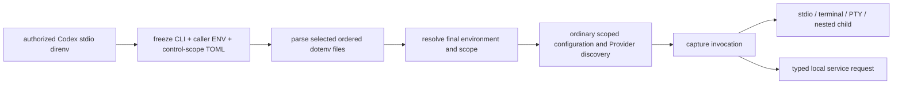

# Native environment loading

This is the detailed source contract for the accepted [environment-file proposal](../proposals/environment-loading.md). Native declarations in [`runtime/environment.rs`](../../src/runtime/environment.rs), [`config::EnvironmentSettings`](../../src/config.rs), [`InvocationContext`](../../src/service/context.rs) and [`AgentxContext`](../../src/runtime/context.rs) own exact types. Independent acceptance has verified the Linux local finite scope described below on a packaged `agentx 0.7.31` candidate. [Canonical evidence](../../.controller/environment-loading/evidence.md) owns exact inputs, artifacts, attempts and cleanup; [Delivery](../../.controller/environment-loading/delivery.md) owns repository artifact promotion and any live runtime cutover.

## Use ordered sources

```sh
agentx --env-file ~/.config/agentx/shared.env --env-file .env --env-file .env.local launch --tool codex
AGENTX_ENV_FILES="$HOME/.config/agentx/shared.env,.env,.env.local" agentx launch --tool codex
agentx --env-file .env --env-override launch --tool codex
agentx --env-file .env --no-env-override launch --tool codex
agentx config env_files '[".env",".env.local"]'
agentx config env_override true
agentx config environment --json
```

The persistent form is scoped to the current AgentX data directory:

```toml
[environment]
files = ["~/.config/agentx/shared.env", ".env", ".env.local"]
override = false
```

| Input | Mapping and meaning |
| --- | --- |
| Repeated `--env-file PATH` / `--env-file=PATH` | Ordered CLI list, replacing ENV/TOML. One `--env-file=` or `--env-file ""` disables lower lists. An empty selector mixed with other files is rejected. |
| `AGENTX_ENV_FILES` | Comma-separated ordered list; whitespace around entries is trimmed and empty entries are omitted. An explicitly empty value disables the TOML list. Use CLI/TOML for a path containing a comma. |
| `[environment].files` | TOML string array; `[]` explicitly selects no files. Empty path entries are invalid. No default file discovery, glob or recursive include. |
| `--env-override` / `--no-env-override` | Last CLI occurrence wins. CLI > ENV > TOML > false, independently of list selection. |
| `AGENTX_ENV_OVERRIDE` | `true/false`, `1/0`, `yes/no`, `on/off`, case-insensitive with surrounding whitespace trimmed. Empty means false. Invalid input fails without echoing the value. |
| `config env_files '<JSON string array>'` | Writes a TOML string array while preserving comments/unrelated settings. `--unset` removes the declaration. `config environment.files` is an alias. |
| `config env_override true\|false` | Writes the same boolean; `--unset` removes it. `config environment.override` is an alias. |

Environment controls are AgentX options before the first `--`; everything after it remains opaque Provider/script/message data. Existing AgentX options' values remain opaque too. The implementation strips only these new controls and retains `--iam`, `start --name`, `--go`, help and other command arguments.

## Freeze control scope before file data



The **selector scope** is explicit command `--scope` where supported, otherwise the original caller's `AGENTX_DIR`/home scope, after authorized stdio direnv and before dotenv. Freeze both list and override from that scope. Each higher-priority setting shadows the lower declaration, including its type validation. A final scope selected by file data does not trigger another selector/configuration pass.

For example, caller `AGENTX_DIR=A`, `A/config.toml` with `environment.override=true`, and an external CLI/ENV file containing `AGENTX_DIR=B` selects B for downstream ordinary configuration/service use. A's boolean controls the external file because it was frozen first; B's environment selector declarations are not evaluated. Without override, an inherited `AGENTX_DIR=A`, including any inherited empty value under the ordinary variable-preservation rule, wins over file data. An external source can supply `AGENTX_DIR` when the caller has none.

A TOML-selected file cannot declare `AGENTX_DIR`: reject it before acquisition, even if its attempted value would be shadowed. An explicit command `--scope` remains final; external `AGENTX_DIR` data is withheld for that invocation. The originating environment remains a literal caller snapshot rather than being rewritten to impersonate an explicitly selected passive diagnostic scope. The receipt distinguishes `selector_scope` and final `scope`.

Relative source paths use the selected local project: a fresh local launch's `--dir`, workbench/work `--project`, otherwise originating cwd. Codex stdio retains its established `--dir` > nonempty `PASEO_AGENT_CWD` > cwd preparation and pins the canonical project before dotenv. A remote launch's directory remains target-owned; local files use originating cwd and are not distributed. Absolute paths and bare `~`/`~/` home expansion use originating HOME/USERPROFILE. No automatic parent-directory dotenv scan occurs.

## Values, parser and failure

The caller wins by default, including empty values. Later files and later duplicate assignments replace earlier file values; override true lets them replace inherited values as well. `AGENTX_ENV_FILES`, `AGENTX_ENV_OVERRIDE` and internal `AGENTX_ENV_RETAIN_KEYS` encountered in file data are withheld and reported, so selectors cannot recurse.

The parser is pinned [`dotenvy 0.15.7`](https://docs.rs/dotenvy/0.15.7/dotenvy/), consumed through its read iterator rather than its global environment loader. Its [upstream parser/iterator source](https://docs.rs/crate/dotenvy/0.15.7/source/src/) supports quoted values, comments, export assignments, multiline strings and dotenv variable substitutions. Substitution follows dotenvy's originating process environment/preceding assignments; it never executes commands. Use single quotes for literal dollars such as `TOKEN='literal-$-text'` or `TEXT='$(command text)'`. This small parser dependency replaces neither legacy env parsing nor direnv. The existing `shell-words` parser does not implement dotenv data/quoting; a shell evaluator would introduce executable behavior that this feature does not select.

An explicitly selected missing, unreadable, invalid, NUL-containing or `.envrc` file fails before managed-state/Provider acquisition. Errors expose the source path and a bounded syntax/I/O classification, never the parser's raw source line or secret values. `.envrc` is accepted only by the existing authorized direnv stdio path; it is not dotenv.

## Existing sources and process ownership

| Boundary | Source ordering and ownership |
| --- | --- |
| Codex stdio | Existing authorized direnv re-entry runs once first; its imported values/deletions become caller input. Dotenv follows the default/override rule above. Native executable pinning follows effective dotenv preparation, before preflight/hooks. No automatic authorization. |
| Ordinary local CLI/workflows | Prepare dotenv before dependent configuration and invocation capture; a local `run` child inherits that environment. No daemon is needed for source inspection or workflow execution without explicit identity resolution. |
| Launchers | Frozen originating environment → current-terminal or clean login-shell base → restore selected originating keys → existing config export → legacy child env → explicit per-launch overlay → fresh per-child identity. Empty dotenv values survive. Identity scrubbing still occurs at its existing launch boundary. |
| Legacy `<AGENTX_DIR>/env` | Existing parser and child-only timing remain. Non-`AGENTX_*`, non-empty values override the child base/config; empty placeholders and all `AGENTX_*` assignments remain ignored. It is not a source selector or scope redirect. |
| Workbench | Local startup prepares the environment before acquisition and retains its invocation configuration; browser requests clear participant/session/capability claims and cannot select another scope/project or environment. |
| Passive observe/daemon status | Originating source preparation is local and read-only apart from that process's environment; existing explicit scope/no-acquisition/read-only policy remains. |
| Internal daemon serve, PTY runner, relay worker, update worker | Bypass file loading. Their already-prepared environment is consumed through the existing exact entry contract. |
| Managed Codex PTY callbacks | On Unix, newly launched sessions use their effective launch environment and retained key names for high-frequency callbacks. They do not re-read dotenv or dev-root settings per callback. Session hooks, shared app-server and legacy commands retain their existing environment behavior. See the [implementation task](../../.controller/observability/codex-hook-performance.task.md). |
| Help/root version/native stdio version | Bypass dotenv source loading and automatic update-cache/worker effects, so poisoned/missing selectors do not cause file reads or scope creation. Existing explicit-project stdio direnv probe behavior remains. |

`InvocationContext.environment_file_keys` and `AgentxContext.environment_file_keys` carry variable names, never authority. A bounded JSON name list in internal `AGENTX_ENV_RETAIN_KEYS` lets a freshly started runner/nested AgentX process retain those values across another clean-shell reconstruction without reloading the source. It contains no values, grants no identity and cannot be set by dotenv data. Each request/host uses its own explicit snapshot; the daemon never installs caller values into its global process environment.

## Inspection and verification ownership

`agentx config environment [--json]` is local/passive, bypasses dev-root/session lookup and automatic update-cache/worker effects, and does not edit config. It reports project, selector/final scope, list/boolean source, ordered loaded paths/status/counts, and each selected variable's final `inherited` or source-file index provenance. Values are always withheld. Explicit configuration mutation retains existing locking/private file writes. To recover from a bad selected list while editing it, explicitly disable the list with `--env-file=`; an invalid override can be reversed with `--no-env-override`.

Native cases live in [`runtime/environment/tests.rs`](../../src/runtime/environment/tests.rs) and [`config/file.rs`](../../src/config/file.rs), with passive-update regressions in [`cli/router.rs`](../../src/cli/router.rs). Independent execution passed the original 52 scoped cases and the two new routing cases after the causal help/update fix. Passed unaffected checks were retained; native authors performed no compiler, formatter, test, package or live runtime execution.

## Independently exercised support

The [canonical independent evidence](../../.controller/environment-loading/evidence.md) records the final corrected package, retained earlier outcomes and causal failures. This receiving update records the supported boundary without duplicating individual receipts.

| Linux local boundary | Actual independent result |
| --- | --- |
| Selection, values and inspection | CLI/ENV/TOML list and boolean precedence, empty values, control/final scope, project-relative sources, safe failure, frozen selectors and withheld-value provenance passed. A strict no-CLI/ENV/TOML-selector baseline also passed. |
| Passive metadata | All 13 tested help/version/local diagnostic shapes passed with absent scopes and poisoned selectors, without update-worker/scope effects. The first candidate's real help/update defect and its narrow correction remain in evidence. |
| Local child composition | Finite foreground, background, nested stdio and marked clean-shell reconstruction retained expected values/cwd. Direct stdio echoed 16,384 bytes exactly and propagated exit status 37. |
| Isolation and existing sources | Concurrent originating contexts on the same unchanged daemon and a second scope stayed distinct. Legacy nonempty normal-key overlay and real authorized direnv default/override behavior passed. |
| Workbench startup | A relative selected file bootstrapped the intended scope/project; the finite HTTP check returned 200 after the source file was deleted. This establishes startup capture and HTTP availability only. |
| Artifact and resource closure | Corrected compilation, causal package/version check and final source/resource audit passed. Fixed product inputs remained unchanged, recorded fixture incarnations were no longer executing, owned roots/listener/endpoints were cleaned, and protected runtime identities/prior repository image were preserved. |

These results cover Linux local finite recipients and the workbench HTTP check. They do not establish real paid Provider conversations, every Provider/terminal/window combination, macOS/Windows behavior, remote source distribution or browser rendering. Candidate verification is distinct from installing an executable or replacing a live project service; consult Delivery for that later artifact/runtime state.
