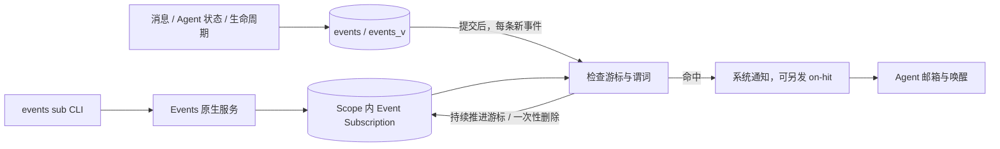

# AgentX 事件订阅与一次性提醒

当前公开入口是 `agentx events sub`。它把规则登记到目标 Scope：**新事件写入后，如果匹配规则，就给订阅接收者发消息。** `--after` 和 `--before` 比较事件时间戳；没有新事件时，即使时钟跨过边界，也不会触发。同一个命令的 `--in` 模式由本地 daemon 的时钟驱动，即使没有新事件也会到期。

## 命令与生命周期

| 命令 | 行为 |
| --- | --- |
| `agentx events sub [FILTERS]` / `agentx events sub 'SQL WHERE'` | 从当前事件末尾开始登记规则，返回 `sub-…` 后退出。结构化过滤器和位置 SQL 可以同时用，按 AND 合并。裸 `sub` 显示帮助；历史命中数或最近一条只是登记时的预览。 |
| `agentx events sub list [--history]` | 列出普通活动订阅和本地待处理提醒。`--history` 额外列出所有保留的提醒结果。远端 `list --device ID` 仍只查看普通订阅。 |
| `agentx events unsub ID [--device ID]` | 删除普通活动订阅；本地也可用完整 `rem-…` ID 取消待处理提醒。普通订阅 ID 仍可省略 `sub-`。 |
| `agentx events [--last N] [--all]` / `--wait [SEC]` / `--follow` | 分别查历史、在当前进程等匹配、流式读到 stdout。`--wait` 到时返回超时结果；`--follow` 可以接着 `--after-id` 读。两者都不会登记长期业务通知。 |
| `agentx listen [FILTERS]` / `agentx events launch [BATCH_ID]` | 前者等当前 Agent 的邮箱或过滤命中，必要时建一个随等待周期结束的临时订阅；后者专等启动批次的结果。 |

`sub` 默认持续触发，`--once` 首次命中后移除。`--on-hit TEXT` 另外用登记时确定的发件人类型发一条消息，支持 `@mention`；标准系统通知仍会尝试发送。默认以当前 Agent 为接收者；本地 `--for NAME` 从 Agent 列表取精确名或第一个前缀匹配，`--as NAME` 和 `-b`（`--as bigboss`）允许无 Agent 身份的 shell 登记。事件上的 `--agent NAME` 是筛选条件，与 `--for NAME` 无关。Relay 的 `--device` 在目标设备登记、列出和删除；创建必须明确给 `--for`、`--as` 或 `-b`，远端 `--for` 按目标设备名单确认。指定外部署名不等于建立外部收件箱。

权威入口：[CLI 参数](../../src/cli/commands/events.rs#L31)、[原生命令处理](../../src/cli/commands/events_client.rs#L191)、[本地登记与接收者解析](../../src/cli/commands/events_client.rs#L480)、[Relay 对应实现](../../src/relay/control_store.rs#L492)。

## 订阅哪些事件

| 事件类型 | 事实与可用过滤条件 | 示例 |
| --- | --- | --- |
| `message` | AgentX 消息；`--from` 筛发送者，`--participant` 看发送方或投递接收方，`--mention` 查显式提及，另有 `--intent request\|inform\|ack`、`--thread`、`--reply-to`。 | `agentx events sub --from peso --intent inform --once` |
| `status` | Agent 状态 `active / listening / blocked / inactive / launching / error`，以及 `--context`、`--cmd`（shell 工具动作）、`--file`（识别到的写文件工具动作）。`--idle NAME` 展开为 `--agent NAME --status listening`；`--blocked NAME` 类似。 | `agentx events sub --idle peso --once`；`agentx events sub --file '*.py' --once` |
| `life` | Agent 生命周期；`--action` 的 CLI 选项为 `created / started / ready / stopped / batch_launched / launch_failed / launch_blocked`。 | `agentx events sub --agent peso --action stopped --once` |
| 跨类型条件与派生匹配 | `--agent` 匹配事件的 `instance`，`--type` 限定类型；`--after` 含下界，`--before` 不含上界。`--collision` 比较不同 Agent 在 30 秒窗口内、同一路径的写文件工具事件；用户订阅还要求与订阅接收者相关。 | `agentx events sub --collision` |

一般同一选项的多个值按 OR、不同选项按 AND；时间的多个边界分别按 AND；不能混用要求不同事件类型的专属条件。文件和命令是 AgentX 已记录的工具活动，不是文件系统监视或任意进程监视。`--idle` 等下一条 `listening` 状态事件，不会因为 `peso` 登记前已经处于该状态而立即触发。完整列名与过滤语义见 [`events_v`](../../src/db/mod.rs#L585) 和 [过滤器编译](../../src/events/filters.rs#L162)。

## 对象与触发链路



| 对象 | 职责和身份 |
| --- | --- |
| `Event` | Scope 内的已发生事实。`events` 保存 `id / timestamp / type / instance / data`；`events_v` 投影消息、状态和生命周期字段供匹配；`EventQuery` / `EventPage` 只读。 |
| `FilterMap` / `predicate` | 结构化选项编译为 SQLite 谓词，可与生 SQL 拼接；原生入口经事件读取边界验证用户谓词。匹配的是当前这一条事件，必要时查询相关事件，例如碰撞。 |
| 普通 `Subscription` | 原生 `Subscribe { filters, predicate, owner, once, on_hit }`；持久化为 `kv['events_sub:<id>']` 的 JSON：`caller / sql / filters? / last_id / created / once / on_hit_text? / caller_kind?`。ID 是规则输入的短哈希，已有相同键时报告已存在；它不是单次定时任务的业务 ID。`last_id` 初始为登记时的最新事件 ID，匹配要比它新。 |
| 内部记录 | 同一前缀还容纳 `listen-*` 临时一次性规则、`reqwatch-*` 请求无回复观察和 `delivery_only` 的线程成员关系。前两种参与事件匹配；线程成员只用于路由。普通 `ObserverSpec` 则是 `events --wait/--follow` 的临时刷新端点，不建业务订阅，也不确认收件。 |
| 通知与附加消息 | 标准通知由 `[agentx-events]` 写成系统消息，并尝试唤醒目标 Agent；这条路径要求当时有同名 `instances` 记录。附加消息按普通消息规则解析提及，无定向范围时可能广播。系统通知跳过订阅匹配；附加消息携带反应链，防止订阅循环触发。 |

代码入口：[原生请求与响应](../../src/events/service.rs#L97)、[服务存储适配器](../../src/events/store.rs#L186)、[持久记录](../../src/db/subscriptions.rs#L1)、[提交后分发](../../src/db/events.rs#L417)、[逐条匹配与清理](../../src/db/subscriptions.rs#L598)、[系统通知的收件解析](../../src/db/subscriptions.rs#L983)。

订阅与 CLI 进程寿命分离，有磁盘记录。Agent 停止时，相关条目可写入停止快照；受跟踪的同身份 resume 恢复条目，最多重放停机间隔中最近 1,000 条事件，新 Agent 复用名字不继承停止快照。这个机制与 daemon 重启不同：提交后分发是进程内的，现有一次性命中也没有把消息入队和规则消费做成一个有回执的原子操作。`--once` 表示规则命中后移除，不承诺 Agent 已收到或已执行。参见 [停止快照与恢复](../../src/db/subscriptions.rs#L340)、[提交后效果队列](../../src/db/post_commit.rs#L139)。

## 一次性时间提醒

从 `agentx events --help` 或 `agentx events sub --help` 的 “One-time reminder” 一节进入。等待外部工作时，可以在结束当前回合前登记提醒，用返回的 ID 确认状态是 `pending`，醒来后再检查外部结果；如果仍未完成，再登记下一次回查。

```sh
agentx events sub --in 10m --message '回查外部任务结果'
agentx events sub --for peso --in 2h --message '检查外部任务'
agentx events sub list --history
agentx events sub show rem-…
agentx events unsub rem-…
```

用 `s`、`m`、`h` 或 `d` 指定整数延时，范围为 1 秒至 365 天。当前 Agent 是默认目标；`--for NAME` 选定另一个当前本地 Agent，并冻结其身份。代设也需要有效的 Agent 调用身份；只有创建者或原目标可以取消。提醒不接受事件过滤器、SQL、`--once`、`--on-hit`、`--as`、`-b` 或远程 `--device`。正文仅作消息，即使包含 `@name` 也不会扩大收件范围。

| 状态 | 含义 |
| --- | --- |
| `pending` | 已登记，等待到期；可取消。 |
| `enqueued` | 已持久写入原目标邮箱。`delivery_event_id` 指向该消息；不代表 Agent 已读或 Provider 已处理。 |
| `failed` | 处理时原目标已停止、启动失败、缺失或已被替换；`failure_reason` 解释原因。 |
| `canceled` | 到期入队前被主动取消；不产生消息。 |

原生 [Events 接口](../../src/events/service.rs) 以 UTC 毫秒接收并返回截止时间。`show` 返回稳定 JSON，含 `kind: "time"`、精确目标、状态、正文和结果。断线后的同请求重试沿用原提醒 ID；每次重新执行创建命令会得到新 ID。普通事件订阅没有提醒历史。提醒保存在独立的 [SQLite 表](../../src/db/reminders.rs)，Scope reset 会一并清除。

[daemon 调度](../../src/events/reminders.rs) 在空闲及处理普通写入通道请求之间推进。待处理时检查间隔为 100 毫秒，每轮最多处理 32 条，当前请求及大批量会增加延迟。过期提醒在 daemon 启动时按当时的目标状态补处理；消息和状态在同一事务提交，重启不会再写消息。启动还会分批唤醒过去 24 小时内已入队、仍未读且身份一致的目标。普通订阅忽略系统提醒，邮箱和按 Agent 读取的会话历史检查身份围栏；Scope 级事件历史仍可观察到这条事实。

没有绝对时间、周期任务、人类收件箱、远程定时或脚本执行。[交付记录](../../.controller/time-reminders/implementation.task.md) 区分本地源码、构建、隔离验收与运行服务采用。
