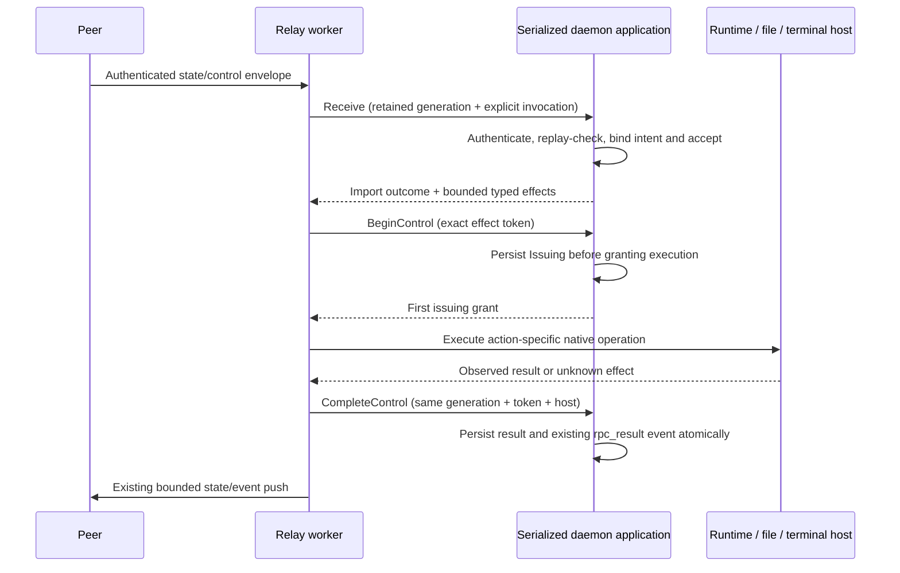

# Relay replication and remote control

The existing MQTT peer envelopes, AEAD associated data, replay windows, state timestamps, peer reset timestamps, event cursors and bounded push/backfill protocol remain authoritative. This design refines their local process boundary. Source implementation and independent execution status are tracked in the [Relay Task](../../.controller/domain-daemon/tasks/relay.md); a selected boundary is not proof of support.

## Responsibilities and native contracts

| Boundary | Owner and contract |
| --- | --- |
| MQTT connection, sealing, enqueue/PUBACK, polling and deadlines | Relay network worker; [client](../../src/relay/client.rs), [push](../../src/relay/push.rs), [control client](../../src/relay/control.rs) |
| Authenticated receive, import/reset/cursor policy and durable control decisions | Daemon-only [service adapter](../../src/relay/service_store.rs), [pull adapter](../../src/relay/pull.rs) and control store |
| Local typed requests/results and finite control plans | [Native Relay declarations](../../src/relay/service.rs); no SQL statement, argv dispatch or arbitrary record patch request |
| Provider/terminal/process/file effects | Relay worker host calls the actual runtime, transcript and scoped configuration ports after Receive returns |
| Participant identity, lifecycle and subscriptions | Existing native participant/lifecycle and event handlers; daemon decisions call these in process |

No Receive handler calls a local IPC client, waits for a Provider, performs MQTT I/O or imports CLI command helpers. Pure queries and durable mutations remain in the existing domain handlers. The worker carries its canonical scope and captured invocation explicitly; daemon startup environment is not remote execution configuration.

Relay-owned import/departure/backfill wake hints are frozen with runtime's `snapshot_all_wake_ports` and returned in ReceiveResult or the native Backfill response. A bounded worker notifier performs local TCP fan-out after dispatch; saturation may drop a hint because durable event polling remains authoritative. The existing finite wake-kind allowlist excludes injection and session-creation endpoints. Domain-owned subscription and lifecycle post-commit notification policy remains with those domains.

The native `Snapshot { own_device }` read returns `RelaySnapshot { queued, peers }` for local status and peer targeting. Queued counts use the stored push cursor and the existing local-origin event predicates; peer mappings, sync timestamps and ordered base agent names are read only by the daemon. The originating client supplies its own UUID for exclusion; the handler never reads a device file or recaptures the environment. One peer entry per short mapping preserves all `off --all` targets, including retained aliases for one UUID. Status presentation retains its per-device grouping, online sorting and display limits at the client. Missing/unparseable numeric display values retain their existing defaults; SQL and row-decoding failures return errors rather than a successful empty/up-to-date snapshot.

Local status/health consumers use `get_relay_status_client` and `relay_health_client` through native Status. Its daemon-scoped observation feeds the shared pure `derive_relay_health`; the obsolete DB-taking `observe_relay`, `get_relay_status` and `relay_health` adapters are removed after their actual client callers migrated.

## Control identity and transitions

A control record is located by database generation, relay group, authenticated envelope source and the stable wire request ID. Action, target, normalized input and initiator label are compared inside the record. Changing the action/input under one identity conflicts; putting changed input in the lookup key would permit a second effect. Existing one-way `relay_off` uses its original source/timestamp identity, never a generated request ID. Inner sender metadata must agree with the authenticated outer source when present.

| State and trigger | Required behavior |
| --- | --- |
| Fresh supported request | Persist normalized intent; execute pure domain operation atomically or return an Accepted host plan |
| Accepted + first exact host BeginControl | Persist Issuing and return the single execution grant |
| Duplicate Accepted | May re-offer the same plan to its original host; BeginControl still grants once |
| Duplicate Issuing or missing host completion | Surface an unknown/in-progress outcome; never auto-reissue |
| Issuing + exact completion | Atomically store result and emit correlated peer result |
| Duplicate exact completion | Return the retained outcome without executing or emitting another completion |
| Conflicting input, replaced generation, token/host mismatch | Reject; no external action and no mutation to a successor |
| Completed request redelivery | Re-emit its retained correlated result when needed; never execute again |

Records and worker admission are bounded within Relay. Capacity exhaustion rejects before an external action. A bounded host queue is a scheduling adapter, not a second application protocol. Mutating host actions are never retried because of timeout, worker death, expired freshness or a lost reply. A reply timeout means the remote outcome may exist. Read-only screen queries retain their existing client retry allowance with separate wire requests.

The native limits are 32 active effects, 32 control events per envelope, 64 KiB normalized input and 2 MiB completion. At most 64 answer bodies are retained for up to 300 seconds; compact intent/completion digests remain for the database generation even after an answer is consumed or pruned. This bounds active work without an arbitrary lifetime request cap. If OS evidence proves an owner exited or its PID was reused, reconciliation retires the active plan to a durable unknown outcome and frees its live slot; it never transfers the execution grant. A late completion still requires the original host/token/generation and matching completed outcome.

All worker host plans require an observed nonempty process incarnation at admission, re-offer, BeginControl and CompleteControl. An authenticated local PID with unknown incarnation cannot acquire an execution grant; pure in-process queries retain their existing policy. Incarnation observation failure is unknown, never evidence of exit or permission to transfer an effect. Reconciliation requires positive `has_exited(pid)` or two observed nonempty incarnations that differ. Legacy records with unknown incarnation can retire only on positive process exit. The [daemon peer contract](../../.controller/domain-daemon/tasks/daemon.md) owns platform observation semantics.

| Existing peer action | Execution boundary and result | Recovery after uncertainty |
| --- | --- | --- |
| `launch` | Worker calls the runtime launcher with explicit scope/context and retained Client; returns native LaunchResult plus observed terminal preset | Launch reservation is separate from OS creation; never repeat a possibly issued launch |
| `kill` | Worker uses the exact admitted ParticipantRef, native kill ticket and recorded PID incarnation; returns signal/pane fields including PermissionDenied | CompleteKill can recover an exact canonical concurrent self-retirement outcome under the original ticket; missing evidence stays unknown, never signal again |
| `resume` | Worker calls native resume_fenced with the admitted local participant when present; exact source/stop digest/fork-child fence reaches launch reservation through the retained Client | A reserved source is distinct from OS launch; lost reply or completion never permits replay |
| Global `config_get` / `config_set` | Worker reads/writes scoped config through its canonical validator/lock/atomic writer; Provider permission application stays at host | File replacement and Provider updates are distinct effects; partial application is unknown and never auto-retried |
| Per-instance `config_get` / explicit `config_set` | Native participant projection and finite Lifecycle mutation share the intent/receipt transaction | Lost reply resolves through retained receipt; failed mutation rolls back before retaining error |
| Per-instance timeout reset to configured default | Worker resolves the scoped file/env default, then invokes exact admitted Lifecycle::SetTimeout through the same Client | File resolution and native mutation are ordered host work; uncertain mutation is not reissued |
| `relay_off` | Worker publishes the authenticated departure and edits scoped enabled configuration, then clears native worker state; one-way form retains wire identity | Publication/disable may already exist when reply is lost; no invented request or automatic repeat |
| `term_screen` | Worker performs exact-participant terminal read; returns content | Existing outgoing screen-only retry allowance uses a separate request identity |
| `term_inject` | Worker revalidates the admitted terminal endpoint, including before the separate enter operation | Text/enter may have been partially written; unknown completion never repeats input |
| `transcript` | Native source selection plus host Provider file parsing; exact live participant or explicit origin is preserved | This is an observation; result pruning still retains its completed-request binding |
| `events` | Native projection-authorized query with payload budget and bounded shrinking | No arbitrary table/SQL effect; retained result or explicit completed/result-unavailable |
| `sub_create` / `sub_list` / `sub_unsub` | Existing in-process event domain handlers; mutation and correlated receipt commit together | Lost reply reuses retained intent/result; changed input conflicts |

## Replication and evidence boundaries

Push exports through one retained-generation client, seals/enqueues externally and compare-and-swap commits the cursor through that same client. Local enqueue and PUBACK do not prove peer import or completed remote work. Backfill persists pending correlation only after actual enqueue and exact gap matching; failure to persist that required correlation returns an error, never a successful publication confirmation. Repeating a backfill read request is permitted by its action-specific contract, unlike mutating remote actions. State import preserves reset/timestamp ordering, short-ID collision checks, repaired gaps and authenticated departures.

Explicit local push notifications use `trigger_push_client(&Client)` and `notify_relay_daemon_client(&Client)`: every WorkerPort query retains that Client's scope and generation. Both ambient and supplied-client entries share immediate TCP notification, the existing 150 ms startup retry and absent-worker spawn policy. These best-effort host hints do not prove export, publication or peer import; worker readiness/spawn retains its originating host scope.

Scoped reset/disable shutdown uses `worker::stop_relay_worker_client(&Client)`. The worker publishes a PID/incarnation sidecar beside the legacy numeric pidfile; the port locks that scope, validates the retained Client and owner record, rechecks the original OS identity before each signal, confirms exit or known reuse, and then performs transactional `WorkerStopped` plus required runtime-key cleanup through the same Client. Each native request rolls back partial KV changes and propagates failures. Unknown identity, successor replacement, incomplete termination or lost cleanup replies return an unknown/error outcome and retain evidence. This host port never stops the application/data daemon.

Independent cases must cover lost enqueue/commit replies, duplicate/out-of-order envelopes, changed intent under one request ID, BeginControl reply loss, reset/stale completion, worker admission saturation, constrained remote event predicates, bounded answer shrinking/backfill and unavailable daemon. Fixtures use disposable scopes and loopback peers only. Installed binaries, user credentials, live peers and user service lifecycle are outside this source delivery.

The Relay source cutover is complete within isolated native-fixture scope: independent s5 established the retained control contract cases, and fixed s7 compiled and passed the new affected control/service cases. Exact receipts and skipped-case accounting remain in the [Relay Task](../../.controller/domain-daemon/tasks/relay.md#current-outcome) and [integration ledger](../../.controller/domain-daemon/tasks/integration.md). These results establish the exercised native boundary; full remote/paid-peer host execution and final Delivery-wide acceptance remain separate.
