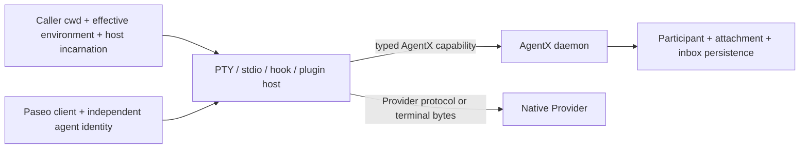

# Provider and runtime hosts

This document owns the host boundary and Provider support evidence for the [domain daemon Task](../../.controller/domain-daemon/tasks/runtime.md). Rust declarations own exact callable contracts. [Native Codex evidence](../codex-activation/acceptance.md) describes earlier supported native behavior; it does not establish daemon-migration acceptance.

## Responsibility model

AgentX owns participant/message semantics. A runtime host owns its processes, stdio/PTY, native protocol connection, caller environment and delivery observations. The official Codex app-server owns native sessions and backend lifetime. Paseo owns its own agents/scheduling. Closing an AgentX protocol connection cannot shut down the shared native backend or retire another host's attachment.

Use existing attachment incarnation/execution/binding fences and mailbox claim/receipt types. A host registration must additionally identify the authenticated caller PID and OS process incarnation; the daemon's PID never represents the host. Wake endpoints are connect-and-close notifications; terminal injection endpoints are request/response capabilities. A successful wake, RPC admission or turn completion is not a message receipt. Hooks acknowledge only after the host's complete output write and flush. Native input acknowledges only exact thread/batch/frozen-content evidence.

Caller cwd/effective environment is captured before IPC and carried explicitly. The [originating environment contract](environment.md) specifies authorized stdio direnv, frozen CLI/ENV/control-scope dotenv selection, final-scope resolution and child-only legacy env ordering. Its native implementation carries selected variable names with each invocation so nested clean-shell reconstruction retains the caller's selected values; source release and independent support remain linked separately there. Native Provider configuration remains in the host. Do not mutate daemon-global environment to run a hook. Scope canonicalization, daemon generation and wire compatibility belong to daemon/service composition. A failed IPC request has no managed SQLite fallback.

Environment-loading [independent support](environment.md#independently-exercised-support) now establishes the packaged Linux local finite selection/launch/stdio/nested-shell/direnv/legacy paths, unchanged shared-daemon context isolation and finite workbench startup/HTTP check. Exact artifact/source/resource facts belong to [canonical evidence](../../.controller/environment-loading/evidence.md); this does not extend Provider-native conversation, other OS, terminal/window or browser-rendering coverage. [Delivery](../../.controller/environment-loading/delivery.md) retains promotion/live-cutover ownership.

## Source-grounded migration inventory

The following table records the initial source inventory. The current adapter matrix below supersedes its migration state. An entry with callable production borrowed database use still needs capability migration even when it does not open SQLite itself.

| Entry / owner | Current durable access and responsibility | Required boundary |
| --- | --- | --- |
| [Claude](../../src/integrations/hooks/claude/mod.rs), [actor](../../src/integrations/hooks/claude/actor.rs), [native mod](../../src/integrations/hooks/claude/native.rs) | Direct opens; session/process/lineage binding, actor tokens, subagent CAS claims, status, bootstrap, pending output and mod state/notification registration | Typed hook preparation, native mod observation and exact output receipt; domain-owned identity/lifecycle transactions |
| [Shared hook plumbing](../../src/integrations/hooks/common.rs) | Tip callback opens, notify helper opens, raw stop/soft-stop transactions, descendant teardown, hook polling/ack, transcript identity and wake registration | Separate caller I/O from daemon lifecycle and claim policy; no callback may reopen SQLite |
| [Gemini](../../src/integrations/hooks/gemini.rs) / Antigravity, [Cursor](../../src/integrations/hooks/cursor.rs), [Kimi](../../src/integrations/hooks/kimi/handlers.rs), [Qoder](../../src/integrations/hooks/qoder.rs), [Copilot](../../src/integrations/hooks/copilot.rs) | Direct opens for hook binding/status/mail/bootstrap; Copilot extension endpoint/session state | Typed hook event/result and post-output receipt, retaining Provider-native response formats |
| [Pi/OMP](../../src/integrations/hooks/pi_family.rs), [OpenCode/Kilo](../../src/integrations/hooks/opencode.rs), [plugin RPC](../../src/integrations/hooks/plugin_rpc.rs) | Pi-family direct open; OpenCode borrows DB from main; plugin start/status/read/ack/stop and notification endpoints | Typed plugin operations with process-bound authority; native plugin wakes retain their own API |
| [Hermes](../../src/integrations/hooks/hermes/mod.rs), [bridge](../../src/integrations/hooks/hermes/bridge.rs) | Direct opens; AgentX hook bindings/bridge state/inbox/heartbeat and raw bridge cleanup SQL | Typed Hermes lifecycle/mail observations. Provider-owned read-only conversation stores are separate from managed AgentX DB |
| [Codex hooks](../../src/integrations/hooks/codex.rs), [shared bridge](../../src/integrations/codex/bridge.rs), [stdio composition](../../src/integrations/codex/bridge/stdio.rs) | Hooks borrow DB; stdio composes SQLite attachment/inbox adapters; bridge reserves rows and maintains host PID/status/notify | Existing attachment/inbox ports over IPC plus runtime root/host capabilities; native service/frames remain host-owned |
| [Launcher](../../src/runtime/launcher.rs), [bootstrap](../../src/runtime/bootstrap.rs) | Launcher opens for early launch context; borrowed launch/process rows, status/events and cleanup; bootstrap reads participant roster | Typed launch reserve/update/failure/finish and bootstrap snapshot; argv/env/process launch stays local |
| [Unix PTY](../../src/runtime/pty/mod.rs), [shared PTY](../../src/runtime/pty/shared.rs), [Windows PTY](../../src/runtime/pty/win.rs) | Direct opens for child PID/incarnation, context, endpoints, delivery, title/status and failure cleanup | Fenced host registration/renew/release, daemon-backed delivery and failure operations; screen/terminal ownership stays local |
| [Launch status](../../src/runtime/launch_status.rs) | Borrowed raw queries/updates, event/status aggregation and batch-scoped waiter endpoints | Typed launch status observation and waiter registration; wait loop is caller-owned |
| [Process recovery](../../src/runtime/process_tracking.rs) | Borrowed raw owner lookup/savepoints, orphan adoption and endpoint/process binding updates | Typed process recovery with explicit observed PID/incarnation; PID files stay host-owned |
| [Wake](../../src/runtime/notify/wake.rs) | Borrowed endpoint SQL queries/deletion | Daemon-owned endpoint resolution/cleanup; socket wake transport consumes explicit port snapshots |
| [Embedded plugins](../../src/integrations/plugins) | Plugins invoke AgentX commands; no plugin directly opens AgentX SQLite | Preserve command/result formats while commands use typed service operations |

Runtime `codex_stdio.rs`, `codex_project_env.rs`, shell/env/terminal helpers, native Codex service discovery/transport/protocol and launch-argument adapters do not open the managed database. Native service metadata and Provider-owned stores are not AgentX persistence ownership.

## Host lifetime and capability matrix

Tmux headless hosting composes the ordinary PTY runner inside a detached session. The caller-owned runtime selects a socket under the originating AgentX scope and optionally supplies a native tmux configuration; the domain daemon does not proxy terminal bytes or own the tmux server. `attach` consumes current participant/terminal metadata and reconnects to the recorded session. [Terminal sessions](terminal-sessions.md) owns selection and usage; [Task](../../.controller/tmux-headless/task.md) owns execution evidence.

| Host | Process / connection lifetime | Activation medium | Exact delivery evidence |
| --- | --- | --- | --- |
| Ordinary PTY | Owns foreground child process group and screen/injection endpoint | Registry-selected PTY, hook or plugin delivery | Existing Provider delivery acknowledgment; write/flush alone is only output-boundary evidence |
| Direct Codex stdio command | Owns direct native child; inherited byte streams, signal forwarding and exit status | Native direct command; no PTY injection or idle wake | No autonomous AgentX delivery introduced |
| Shared Codex app-server bridge | Owns one outer connection and attachment controller token; borrows shared backend | Native start/steer input with approval/input/unknown-state deferral | Exact recorded userMessage matches qualified thread, batch clientId and frozen text |
| Hook invocation | Owns one invocation's payload/output; long polls retain caller cancellation | Provider-specific hook context | Complete output write and flush, then fenced claim commit |
| Pi/OMP/OpenCode/Kilo/Copilot plugin | Provider host owns plugin event loop and API; AgentX supplies state/mail capability | Provider API wake/read/ack | Native plugin acknowledgment under current process/participant authority |
| Claude native mod / Hermes bridge | Owns mod/bridge connection, caller process identity and wake listener | Existing mod/bridge API | Existing scoped report/ack semantics; observation is separate from model work |
| Grok | Existing ACP adapter owns native stream/approval lifecycle | ACP; no hooks | Existing ACP receipt path; no forced PTY-input replacement |

## Decisions and current evidence

Reuse existing serialization, attachment/inbox traits, claim ledger and notify transport. Introduce only the typed runtime operations required by actual consumers. Reject exposing raw SQL, `AgentxDb` methods wholesale, generic argv execution, a universal event bus, daemon-global Provider environment or a normal PATH Codex wrapper.

All registry Providers remain required: Claude, Gemini, Codex, OpenCode, Kilo, Antigravity, Cursor, Kimi, Copilot, Qoder, Grok, Pi, OMP and Hermes. Earlier Codex native fixture/real-session evidence stays linked to its original artifact. The matrix below identifies the executed domain-daemon evidence. Unavailable executables, paid sessions, Windows/macOS and live Paseo services remain unprobed in this assignment; fixtures cannot be reported as real native Provider evidence.

## Implemented successor boundaries

The native launch boundary is [`agents/launch_service.rs`](../../src/agents/launch_service.rs), implemented by daemon-only [`launch_store.rs`](../../src/agents/launch_store.rs). Caller [`launcher.rs`](../../src/runtime/launcher.rs) retains real process/terminal effects and consumes incarnation-fenced reservations, captured scoped configuration, fallible terminal metadata and explicit supervisor registration refresh. Legacy borrowed launcher helpers remain test-only. The [runtime Task](../../.controller/domain-daemon/tasks/runtime.md#successor-slice-exact-plugin-receipts-and-launch-extraction) owns the remaining migration inventory and exact integration evidence; materialized source is not a complete Provider acceptance claim.

Process plugins use [`hooks/plugin_client.rs`](../../src/integrations/hooks/plugin_client.rs) and [`hooks/output.rs`](../../src/integrations/hooks/output.rs). A prepared mailbox batch carries its exact retained receipt through Provider admission; acknowledgement returns that receipt rather than authorizing advancement with an event cursor alone. Truncated batch pagination uses native pending-after observation. PTY post-exit failure uses `Delivery::FinalizeLaunchExit`; a retained exit-only process registration may survive row removal, while any successor incarnation rejects it.

## Current adapter implementation matrix

This updates the initial inventory above; it distinguishes actual native consumer source from executed evidence. Integration's linked Task/acceptance ledger remains authoritative for exact fixed-candidate receipts.

| Provider / path | Actual source state | Executed evidence and remaining scope |
| --- | --- | --- |
| Qoder, Cursor | Production HookClient session/status/bootstrap/stop/output consumer; borrowed prior policy helpers test-only | s5 actual Qoder hook flush/retry passed. s7 controlled Qoder CLI/headless/PTY child, generated hooks, bidirectional child messaging, idle wake and exact hook receipt passed; readable DB/WAL/SHM belonged only to daemon. Cursor native session remains unexecuted |
| Kimi | Native session, permission and prompt/stop output; observation-only callbacks never claim | Newly released; Stop exit 2 output receipt and observation cases handed integration |
| Gemini / Antigravity | Native ordinary hook consumers; AGY ephemeral bootstrap refresh/soft stop; PostToolUse never claims | Newly released; native Provider sessions unexecuted |
| Pi / OMP / OpenCode / Kilo / Hermes process plugin | Typed PluginStart/Stop/read/status/exact receipts; embedded receipt propagation | Hermes 71 receipt fixture cases passed; other native Provider sessions remain unexecuted |
| Codex shared app-server bridge | Injected attachment/inbox/host capabilities; stdio generation-preserving composition | Bridge and independent host fence cases passed in documented fixed snapshots |
| Claude native mod | Caller poll listener with native Begin/Finish/Report and exact peer/session/port fences | s5 native policy and corrected independent peer/session/successor/port cases passed; ordinary hook release below has separate pending evidence |
| Grok / generic PTY | DeliveryHost native policy plus host-owned process/input/wake, fenced exit observation | Grok restart/requeue and launch-status fixture cases passed; generic PTY product evidence uses the controlled Qoder fixture above |
| Hermes gateway | Typed native registry plus actual host Add/Sync/BindSession/Remove/Visibility/uninstall consumer; canonical returned descendant stop effects; grants/files/CLI/bootstrap stay host-owned | s7 six native acceptance cases and scoped uninstall fixture passed. Old borrowed bridge/version wrappers are now test-only; that later source cleanup awaits integration |
| Codex native hooks | Actual typed production dispatcher; qualified shared-root attachment/session, ordinary main/internal-thread guard, host transcript discovery and exact flushed bootstrap/mailbox receipts | Included in s7 migration compile; complete actual host/product case coverage remains pending |
| Copilot | Actual typed hook/extension consumer and native offer/session policy; exact offered token, prompt correlation, hook exclusion and caller-only SDK/stdout | s8 eight independent native cases passed, including historical ToolResult/Stop isolation; actual product stdout/no-fallback cases remain separate. Managed Issuing remains uncertain across expiry or missing SDK result |
| Ordinary Claude hooks | Actual production dispatcher consumes native actor/session/lineage, capability, stop-claim and output policy; originating host owns bounded transcript reads, shell injection, poll listener and stdout | s8 13 native and eight actual TestDaemon host IPC cases passed; paid/native Provider sessions remain unexecuted |

Admitted launch work uses `launch_with_client` to retain its database generation across child invocations and bridge/supervisor composition. Spawn-before-registration failure carries the original participant and generation to `report_spawn_failure`; native launch policy rejects a namesake successor, another child or a bound session. Required output confirmation commits the exact receipt and frozen delivery status together only after the host flush succeeds.

Launch-status observation carries a canonical retained cleanup plan and frozen diagnostic records. The daemon composes finite placeholder cleanup with fallible stored diagnosis; it does not wait, capture a terminal or read a launch log. `launch_status_client` reconciles a lost reply with the same RequestId, executes returned stop effects and captures log/tmux evidence only for final host presentation. The legacy borrowed waiter remains test-only. The typed product readiness path was exercised by the s7 controlled Qoder fixture; this does not establish every diagnostic failure path.

Ordinary Claude uses [client.rs](../../src/integrations/hooks/claude/client.rs), [poll.rs](../../src/integrations/hooks/claude/poll.rs) and [render.rs](../../src/integrations/hooks/claude/render.rs) against [claude_service.rs](../../src/agents/claude_service.rs). Observe may return NeedsLineage without identity mutation; the host supplies only bounded structured envelope IDs under a fresh request ID. Native operations revalidate the actual worker, primary session and exact child. Stop waits and endpoint lifetime remain local, while native child claims exclude overlapping pollers and preserve unknown ownership. Complete stdout flush precedes one combined mailbox/bootstrap/Task-history confirmation. Task history has its own frontier; non-PTY UserPromptSubmit can recover bootstrap with mailbox=false. Failed stdout confirms nothing, and managed issued uncertainty cannot be reoffered by another callback. Existing ordinary borrowed policy remains test-only.

Copilot's host returns neutral JSON for every callback from a differing established session before capture, position, status or output. Native Pending applies the same fence to both ToolResult and Stop and revalidates it on retained replay. Extension acceptance and elapsed lease never substitute for an exact same-session prompt receipt.

The later source closure gates only helpers whose actual callers are existing policy tests: shared common mailbox/bootstrap/poll/lineage/stop, PiFamily/OpenCode legacy start/endpoint handling, plugin_rpc DB handlers, Hermes borrowed bridge/version wrappers, old delivery refresh/launch/cleanup and bootstrap borrowed rendering. Production DeliveryHost retains screen/gate/terminal transport and DB-free title rendering. Relay uses snapshot_all_wake_ports then host wake_ports; wake_all is test-only, while the separately accepted domain postcommit wake remains named. Claude actor's explicit-env capability/name checks remain real daemon lifecycle helpers and its ambient resolver is test-only after the client router/context release. These source gates postdate fixed s8 and are not an executed strict guard pass.
