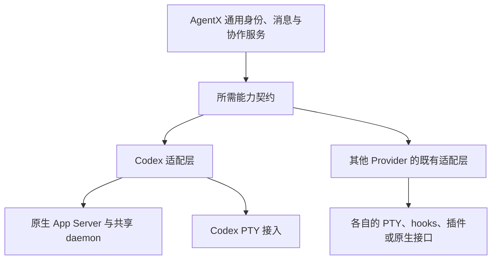

# Codex 自主唤醒：契约与流程设计

设计目标：无论 Codex 通过终端还是 app-server 接入，agentx 都保留自己的身份、子 Agent 协作、消息队列与自主唤醒能力。外层客户端保持原生 Codex 协议，无须理解 agentx 的参与者、管理其子 Agent 或主动轮询其消息。

本目录拥有架构、流程与需求模型；精确声明和行为已落入生产 Rust 模块，见 [契约入口](#契约设计)、[文件交接](../../.controller/codex-shared-runtime/contracts-handoff.md) 与 [源码入口](../../src/README.md#native-codex-stdio)。独立集成已完成其验证和本地打包，实际覆盖与限制统一由 [验收报告](./acceptance.md) 维护；[Delivery](../../.controller/codex-shared-runtime/delivery.md) 的最终验收仍由控制方记录。[先前设计任务](../../.controller/codex-activation-design/task.md) 保留为历史输入。

## 结论与证据边界

已实现的共享接入在 Linux x86_64、原生 Codex `0.167.0` 和未修改的 Paseo `0.15.3` provider API 上完成独立验证：真实父线程通过原生工具启动 AgentX/native 子 Agent，父线程空闲后因子回复自动继续，再向子 Agent 发送业务回复；没有第二次父线程外层提示。多线程身份/环境/hooks、resume/fork、忙碌投递、审批/取消、并发后端复用和连接退出隔离均有对应证据。精确场景范围见 [当前支持表](./acceptance.md#current-support-by-acceptance-boundary)，不能从局部场景外推未执行的环境。

验证使用固定 loopback 推理服务；桌面/移动端渲染、用户现有运行主机、付费推理、其他平台/原生版本及真实 Claude 厂商进程仍未验证。未知新增环境变量继续形成兼容冲突。Rust 静态检查和本地 `just package` 已完成，产物是 [`.bin/agentx`](../../.bin/agentx)，精确版本、哈希、源码和安装边界见 [构建回执](../../.agentx/.tmp/deliveries/codex-shared-runtime/package-receipt.json)；没有替换已安装程序或修改用户服务。插件 runtime 回归通过，但缺少本地依赖使插件 typecheck 未完成，细节由验收报告拥有。

原生协议具备完成目标所需的基本能力。本机 Codex `0.167.0` 的独立实验已在真实原生进程中验证：同一线程可继续运行；同一进程可管理多个线程；不同连接可访问同一线程；hook 可参与 app-server 轮次；实际输入可以用 `clientUserMessageId` 与原生 `userMessage.clientId` 关联。模型服务由本地固定 SSE fixture 替代，没有调用付费模型或修改用户守护进程。完整依据见 [可行性报告](./protocol-feasibility.md)。

当前选定的 app-server 目标是共享原生 Codex daemon，由 agentx 适配上游连接并保持线程级自主投递。Paseo 每次启动的入口可以只创建轻量 stdio 协议桥；同一兼容服务作用域内，后端按需首次启动，后续连接复用同一实例。先前的按启动隔离后端方案不再是默认目标。原生 `app-server` 参数本身不自动完成此转换，需实现服务接入和生命周期契约，详见 [服务拓扑](./topology.md#共享-daemon-的接入与生命周期契约)。

共享服务并不排除逐会话身份变量：两个原生线程的真实 shell 工具已观察到独立的 `shell_environment_policy.set` 覆盖，A→B→A 执行没有串用选取的变量；但同一实验的 hooks 仍继承服务级身份，须按载荷 `session_id` 查线程附件。完整分层、证据及会话身份设计见 [会话环境](./session-environment.md)。

接口应表达“推进目标 Agent 的待收消息处理”。只暴露一个无结果语义的 `wake()` 不够：还必须声明目标绑定、输入是否发出、消息是否越过交付边界、失败是否可重试。以下设计把这些事实分开，并明确不承诺模型或业务执行恰好一次。

## 需求与边界

| 需求 | 可观察的成功条件 | 责任边界 |
| --- | --- | --- |
| R1 自主父子协作 | 父 Agent 空闲后，子 Agent 回复使它继续运行，全程无需用户输入 | agentx 网络与运行适配器闭合 |
| R2 外层独立 | 原生协议客户端无需添加 agentx API、身份模型或调度插件 | 外层产品仍只理解 Codex 协议 |
| R3 目标正确 | 同一服务中的不同主线程、原生内部线程不会串收消息 | agentx 身份与线程绑定拥有者 |
| R4 投递诚实 | 请求成功、消息交付、轮次结束与业务回复可区分 | 消息领域拥有游标和交付凭据 |
| R5 用户操作兼容 | 原生用户输入、审批、工具请求、取消及事件继续工作 | 协议适配器维护单一 I/O 所有权 |
| R6 运行边界兼容 | 项目环境、home、hooks、版本输出和进程退出语义有明确归属 | 启动器与所选部署拓扑 |
| R7 失败可解释 | 丢失响应、重绑、暂停或退出不会被当成已交付，也不会无限重复启动 | 调度与恢复契约 |
| R8 接入可替换 | PTY 与 app-server 使用同一消息语义，公开各自可提供的交付证据 | 领域契约不包含 Enter 或 JSON-RPC 字段 |
| R9 Provider 隔离 | 新增 Codex 接入时，其他 Provider 保留原有启动、身份、消息、唤醒及退出行为；无须实现 Codex 协议 | 通用服务契约、启动组合层与各 Provider 适配层 |

本次设计覆盖本地 Codex 的终端与 app-server 接入，以及它和现有 agentx 子 Agent 网络的组合。app-server 使用共享原生 daemon，单个连接退出不终止共享后端；它拥有的自动投递驱动在关闭后停止新投递，保留消息等待有效控制拥有者恢复。普通 PTY 仍保留自身进程生命周期。本次不引入服务池、分布式协调系统或新的对外 agentx RPC，不修改 Paseo，也不把原生 Codex 内部子线程自动注册为 agentx Agent。

“透明接入”要求外层继续使用原生协议，不代表隐藏真实的 Agent 工作。agentx 引发的真实消息项、轮次、输出和审批事件应按原生协议呈现。把这些事件隐藏起来会造成客户端状态错误。

## 实施基线与生产契约

下表记录本次 Delivery 开始时已确认的基线。新增契约和行为的现状沿 [生产模块入口](../../src/integrations/codex/AGENTS.md) 与 [验收报告](./acceptance.md) 查询，不能用旧基线推断正在实施的代码已被接受。

| 责任 | 当前来源 | 已知边界 |
| --- | --- | --- |
| agentx 参与者和原生线程绑定 | [agents/binding.rs](../../src/agents/binding.rs) | 与外层客户端的 Agent 记录独立 |
| 消息持久化与待收游标 | [db/sessions.rs](../../src/db/sessions.rs) | 唤醒请求不等于消息已交付 |
| 终端唤醒与投递检查 | [messaging/delivery](../../src/messaging/delivery/mod.rs) | 调度目前与 PTY 屏幕和按键耦合 |
| Codex hook 消息交付 | [hooks/codex.rs](../../src/integrations/hooks/codex.rs)、[hooks/common.rs](../../src/integrations/hooks/common.rs) | 成功输出 hook 上下文后提交游标；没有承诺业务执行完成 |
| 原生 stdio 托管 | [runtime/codex_stdio.rs](../../src/runtime/codex_stdio.rs) | 直接继承流，没有自主唤醒或协议路由 |

基线的 `process_bindings` 把启动进程映射到一个身份，身份解析优先用进程绑定，Codex 内部线程过滤也使用主线程假设；这些机制需要由带作用域的附件补足，才能支持多个外层主线程。旧 `has_pending` 与 `get_cursor` 的部分错误路径会返回空或零，新增 claim/调度路径必须传播查询失败，不能把错误当成交付证据。

身份与消息域已交付下列生产实现。精确行为与后续修改入口由各域源码维护；端到端接线和已执行验证仍以 [独立验收报告](./acceptance.md) 为准。

| 生产能力 | 当前实现与维护入口 |
| --- | --- |
| 带作用域的规范身份与附件 | [身份入口](../../src/agents/AGENTS.md) 与 [附件存储](../../src/agents/attachments_store.rs) 独立维护 provider/scope/session 谱系、控制者和附件栅栏；停止后可恢复快照、祖先关系与游标，并创建新的实例行代次；名称已被其他参与者使用时拒绝恢复 |
| 持久谱系与删除边界 | [存储入口](../../src/db/AGENTS.md) 与 [schema/删除保留实现](../../src/db/shared_runtime.rs) 让会话、附件和 claim 独立于 live 行存活；成功删除或停止事务保存游标并撤销精确代次的附件，失败的停止 CAS 不影响继任者 |
| 独占收件与推进策略 | [消息入口](../../src/messaging/AGENTS.md) 连接 SQLite claim、hook 与显式 listen/inline 输出；消费者、内容和窗口冻结，输出前持久标记 Issuing，flush 后才能确认；[ActivationPolicy](../../src/messaging/activation.rs) 以顺序调用组合同一个 inbox 与 driver |

## 对象模型与所有权

| 对象 | 含义与基数 | 所有者 |
| --- | --- | --- |
| ParticipantRef | 规范名称加实例行代次；名称可显示、可复用，旧代次不可继承权限 | `agents`，精确复用 `InstanceRow.created_at.to_bits()` |
| ExecutionId | 运行代次，独立于 OS PID；共享托管指后端，旧终端沿用启动执行作用域 | 服务适配层提供；通用附件验证 |
| AttachmentOwnerId | 每个连接代理的独立控制权令牌；共享后端代次不代表共享线程控制权 | 通用附件；连接组合点生成 |
| NativeThreadKey | 已解析 home 作用域加原生 thread id | Codex 集成层 |
| RootBinding | 一个参与者连接到一个原生主线程的当前附件；带新 BindingId | Codex 集成层组合通用身份附件与原生线程映射 |
| PreparedBatch | 一次原子准备的消息批次；有独占 claim、事件窗口和交付关联 id | `messaging` |
| AttemptId | 一个存活运行中的输入尝试关联；不是原生幂等键 | `messaging` 调度 |
| Native turn | 原生执行轮次，可接收多个来源的输入 | Codex；适配器观察状态 |

一个运行进程可以承载多个已绑定主线程；每个主线程拥有独立 agentx 身份、收件箱和状态。一个参与者在同一时刻最多有一个有效的运行附件，附件同时记录独立连接控制者；相同后端上的另一条连接不能因此取得控制权。共享 app-server 的 `ExecutionId` 使用服务的稳定运行代次，代理自身的令牌只标识控制者。启动时的进程默认绑定继续服务旧终端兼容，不能在已知 thread id 时覆盖线程级查找。

## Provider 分层与兼容边界

AgentX 是多 Provider 的协作系统。共享 Codex daemon 是 Codex 接入层的部署策略；各 Provider 共享的是身份、消息与协作语义。增加该策略不要求 Claude、Gemini 或其他工具支持 app-server，也不要求它们改用 daemon。

| 层与归属 | 拥有的契约和行为 | 依赖边界 |
| --- | --- | --- |
| 通用应用服务：`agents`、`messaging` | 参与者、父子关系、消息路由、收件批次、附件校验和交付状态 | 不导入 Codex thread/turn DTO、套接字协议、home 查找规则或 daemon 管理 |
| 消费方所需能力契约 | `ActivationDriver` 等表达目标、输入、结果与失败的端口；通用附件使用不透明会话键 | 由实际需要这些能力的策略拥有；不把某个 SDK 或 Provider 的全部方法复制成统一接口 |
| Provider 适配层 | Codex 拥有原生协议桥、线程映射、会话环境、hook 解析、服务发现与 daemon 复用策略；其他 Provider 拥有各自差异 | 适配器把具体状态和证据转换成通用语义；原生 `clientId`、`itemId` 等关联信息留在 Codex 内部 |
| 启动组合与运行机制：registry、launcher、runtime | 按已选 Provider 和接入方式构造适配器，提供进程、PTY、I/O 及信号机制 | 组合点可以选择具体实现；通用运行机制不决定所有 Provider 都要复用 Codex daemon |



图中箭头表示运行调用路径；源码依赖方向是通用策略使用它所需的契约、具体适配器实现或调用这些契约，再由启动组合点完成接线。这里的“能力契约”包含既有接口，不表示其他 Provider 已经或必须立即实现新增 `ActivationDriver`。实际选型复用 [IntegrationSpec](../../src/integrations/registry.rs) 与 [launcher](../../src/runtime/launcher.rs) 的入口，只为此次 Codex 接入增加必要的分支，不新增一个要求所有 Provider 同步迁移的服务框架。

通用交付回执只接收经适配器校验的 `ProviderInputRecorded` 等结果；Codex 的原生记录证据及关联细节由 Codex 适配层拥有。Codex 子 Agent 与其他工具的子 Agent 继续通过同一 agentx 消息网络协作，各自保持自己的运行机制。Codex daemon 缺失或不可用时，错误限定在相应接入，不能成为其他 Provider 启动的前置检查。

## 契约设计

精确类型、错误、字段和签名由下列生产 Rust 模块维护。[原草案文件](./contracts.rs) 只保留导航，不再包含第二份可编辑声明；原生 DTO 仍由 Codex 的实际 schema 拥有。实现负责人、具体构造入口和共享文件归属见 [生产交接](../../.controller/codex-shared-runtime/contracts-handoff.md)，独立验证见 [验收报告](./acceptance.md)。

| 契约 | 提供的能力 | 关键保证 |
| --- | --- | --- |
| [AttachmentStore](../../src/agents/attachments.rs) | 通用参与者代次、不透明会话附件、规范身份恢复和独立控制者 | 已知会话先于进程默认身份；一个参与者只有一个当前附件；旧回调不能操作新附件 |
| [RootBindings](../../src/integrations/codex/roots.rs) | Codex 层组合通用身份附件，按运行、home 和主线程注册、查找及撤销映射 | 只接受关联成功的根线程结果；主线程之间不覆盖身份 |
| [PendingInbox](../../src/messaging/inbox.rs) | 查询、独占准备批次、媒介选择、标记发出边界、确认交付及前代核对 | 游标只前进；错误不是空队列；消费者与凭据匹配；未知结果不能靠超时释放 |
| [ActivationDriver、DriverEvent](../../src/messaging/activation.rs) | 接受真实待收批次并报告发出、准入、未知、稳定或退役 | 不暴露按键或 RPC；拒绝/延迟未发出；事件携带完整目标栅栏 |
| [CodexService、NativeConnection](../../src/integrations/codex/service.rs) | 确保兼容共享后端并提供独立客户端的完整 JSON 帧通道 | 服务代次稳定；接收有界等待；关闭连接不拥有停止 daemon 的权限 |
| [ClientRequestLedger、ServerRequestLedger](../../src/integrations/codex/protocol.rs) | 独立跟踪客户端及原生服务端两个请求方向 | 所有客户端下行 id 重映射；原生 server request id/内嵌 requestId 保持；内部响应不泄漏 |

`ActivationDriver` 的请求包含已经准备的真实消息批次。因此它既能实现“空闲时启动处理”，也能实现“向活动轮次交付输入”。这比抽象 `send_enter()` 或无条件 `turn/start()` 更符合两种接入真正共有的业务能力。

### 交付证据不能混用

| 事实 | 可以证明 | 不能证明 |
| --- | --- | --- |
| `Admission::Accepted` | 适配器接管本次尝试 | 已写入 native、已开始轮次 |
| `DriverEvent::Issued` | 已跨越可能产生外部效果的边界 | 消息已进入对话 |
| 原生 start/steer 成功响应 | 原生 RPC/轮次层接受请求 | hook 接受输入、消息已记录、工作已完成 |
| HookOutputWritten | 指定消息上下文已成功写出并 flush | 原生已消费输出、模型已推理或已回复 |
| ToolOutputWritten | 已领取的显式 listen/inline 批次成功写出并 flush | 模型已消费工具结果、消息已被执行或回复 |
| ProviderInputRecorded | 适配器验证了目标输入记录；Codex 先取得 thread、clientId 与冻结批次内容均匹配的 NativeUserInputRecorded 证据 | 模型已处理或业务完成 |
| `turn/completed` | 原生轮次结束 | 本批消息已交付或任务成功；被 hook 阻止的空轮次也可能结束 |
| agentx 业务回复 | 收件 Agent 发出了某个回复 | 回复内容正确；仍按应用语义判断 |

PTY 保留 hook 上下文交付路径。app-server 选择实际消息输入作为自主交付媒介：空闲时使用 `turn/start`，正常活动时可使用带 `expectedTurnId` 的 `turn/steer`；等待审批或用户回答时延迟投递。实际输入被原生记录后才确认游标。每个附件只启用一个自主交付媒介；app-server hooks 仍提供身份、状态与已有用户 hooks 的行为，不再重复拉取相同收件箱批次。

选择真实消息输入的依据是 [原生实验](./protocol-feasibility.md)：忙碌状态下阻止空标记会结束原来的轮次；单纯的“检查空闲然后发送标记”没有原生原子保证。真实消息即使在 idle→active 竞态中被原生追加到活动轮次，也仍是这名收件人的有效输入。批次关联、单一 claim 和原生记录证据承担一致性责任，而不是依赖阻止标记来充当锁。

## 目标结构与依赖

```text
src/
  agents/
    binding.rs                         existing canonical/placeholder behavior
    attachments.rs                     production opaque session/owner attachment contracts
    attachments_store.rs               SQLite identity restoration and attachment transactions
  messaging/
    inbox.rs                           production exclusive batch/evidence/recovery contracts
    inbox_store.rs                     SQLite claims, frozen output and confirmation transactions
    activation.rs                      production required activation port and progress events
    delivery/                          existing hook delivery and PTY state machine
  integrations/
    codex/
      AGENTS.md                        ownership and domain entry
      mod.rs                           Codex integration exports; bridge behavior owned here
      roots.rs                         production root qualification and mapping contracts
      configuration.rs                 native thread overlays and environment dependency guard
      bridge.rs, bridge/               client I/O, root lifecycle, activation and arbitration
      protocol.rs                      production request ownership contracts
      protocol/                        raw envelopes, ledgers and handshake
      service.rs                       production shared backend and framed connection contracts
      service/                         managed acquisition, compatibility and Unix WebSocket
    hooks/codex.rs                     existing hooks; thread-scoped lookup and mode
  runtime/
    launcher.rs                        selected shared app-server composition
    codex_stdio.rs                     native pinning and unchanged opaque direct-host paths
    pty/                              existing screen/input mechanics
    notify/                           existing notification plumbing
  db/                                 existing durable mail plus attachment/claim transactions
```

上表的契约文件与模块声明已落位；各域在拥有的叶子中实现行为，不要求每个私有 helper 都分文件，也不拆新 crate。`messaging/activation.rs` 拥有所需端口；具体适配器实现端口；`runtime/launcher.rs` 选择并注入它们。通用 `agents` 附件只处理身份、执行、不透明提供方会话键和独立连接控制者，不依赖 Codex DTO 或消息媒介枚举；Codex 集成层负责把 home/thread 映射到附件。消息领域另外拥有媒介选择与 claim。通用进程与连接托管不解析消息业务或创建参与者；Codex 的 `service.rs` 决定共享 daemon、客户端代理及它们各自的退出权限，并调用通用运行机制执行。

数据库继续使用现有 SQLite。现有事件日志和收件游标保持为消息来源；增加的附件关系与当前批次 claim 分别解决已经发生的多线程绑定和多消费者竞争，不另建消息队列。claim 只保留当前批次及必要的未知结果，不演变为永久工作流日志。

现有 `instances.session_id` 全局唯一、`session_bindings` 以裸 session id 为键，不能承担跨 home/provider 的新作用域。新增 `participant_sessions`、`participant_attachments` 和 `inbox_claims` 独立维护作用域、会话谱系和未决 claim，不随实例行删除级联清除；具体 schema 与事务归属见 [存储入口](../../src/db/AGENTS.md)。共享服务配置的原生限制与实现边界由 [服务拓扑](./topology.md) 和 [生产交接](../../.controller/codex-shared-runtime/contracts-handoff.md#native-deployment-decision-and-evidence-limits) 记录。

所有 Codex 收件消费者，包括 hook 和显式 listen，都必须遵守同一 claim 边界。只给 native 适配器加锁、却让旧 hook 或 listen 绕过它，不满足该契约。其他工具的接入不在这次结构调整范围内。

## 核心不变量

1. 所有投递、确认和迟到事件都校验参与者代次、ExecutionId 和 BindingId；原生操作另外校验 home 与 thread id。
2. 同一个绑定最多有一个未决批次；通知可以重复，消息和上下文不可被两个活跃消费者同时领取。
3. 每条原生连接只有一个下行写入者和一个读取者；每个方向的消息边界完整，真实事件按观察顺序转发。
4. 唤醒、RPC 成功和轮次结束均不直接前移收件游标；交付拥有者依据正确批次的证据提交。
5. 原生审批、工具请求、取消和用户输入继续按原生协议处理；agentx 不替外层伪造成功或自动批准。
6. 超时、缺少回执或 claim 到期不证明外部效果没有发生；未知结果进入核对状态，不盲目重放。
7. 未绑定、已退役、未知状态或缺少必要能力时不得猜测自动输入目标。服务版本/传输不兼容而无法建立共享连接时明确报错；已建立兼容连接且原生流量仍可转发时，保留转发并报告自主投递降级。
8. 活跃正常轮次可以接收真实消息；空闲、忙碌及等待审批不是同一个布尔状态。

## 场景与验收

下表拥有 A1–A11 的用户结果要求。当前执行状态、用例与支持范围统一维护在 [独立验收报告](./acceptance.md)，先前原生实验只证明其声明的局部能力。

| 场景 | 关键步骤及必须保持的结果 |
| --- | --- |
| A1 父子协作闭环 | 未修改客户端启动父 Agent；父 Agent 启动子 Agent 后空闲；子回复；父自动继续并回复 |
| A2 活跃投递 | 活动轮次收到消息；按原生 expectedTurnId 交付；不能因空标记阻止而结束用户工作 |
| A3 用户输入竞态 | 用户输入和消息同时到达；外层请求正常响应；真实消息只确认一次 |
| A4 多主线程与恢复 | 一个服务创建/恢复/fork 多个根线程；身份、bootstrap、队列和 hook 均隔离 |
| A5 原生内部线程 | 原生子 Agent 和记忆线程事件不得替换父 Agent 身份 |
| A6 双向协议 | 字符串/int64 id、碰撞、未知方法、serverRequest/resolved、工具及审批保持关联 |
| A7 拒绝与空轮次 | hook 阻止输入时 start 可成功但无 userMessage；游标不前移，不能无限重复唤醒 |
| A8 未知与重绑 | 写入后丢响应、进程退出、旧确认迟到；不误投新线程，不以超时当未发出 |
| A9 运行兼容 | 版本 stdout、长帧、项目环境、home、EOF、信号；并发入口复用同一 daemon，单代理退出不影响其他会话 |
| A10 外层行为 | 不发新的用户输入时也收到真实轮次与消息；无内部 RPC 响应泄漏 |
| A11 其他 Provider 兼容 | Codex 服务缺失不阻止其他工具；异构父子消息可达；受共享层修改影响的既有 PTY、Claude print、hook/plugin 及退出路径保持原有结果 |

## 实现关系与完成依据

生产源码按上述契约分工组合身份/claim 事务、共享原生连接、完整协议路由、真实消息输入和精确交付凭据，再由 launcher 选择支持的 app-server 入口。原生输入附件的 hooks 提供身份与状态，显式 listen/inline 输出与自动驱动竞争相同 claim；普通 PTY 保留既有屏幕、审批和草稿保护，其他 Provider 保留自身启动及投递路径。

独立集成已经在 [声明的环境范围](./acceptance.md#current-support-by-acceptance-boundary) 验证 A1–A11 的对应边界、受影响 Provider 回归、静态检查与本地产物。A1/A10 的真实未修改 Paseo provider API 闭环是单独执行的结果；桌面/移动 GUI 与真实用户主机没有因此获得支持声明。部署、替换已安装程序和发布版本均不在本 Delivery 范围；最终验收由 [控制方](../../.controller/codex-shared-runtime/controller.md) 汇总证据决定。
