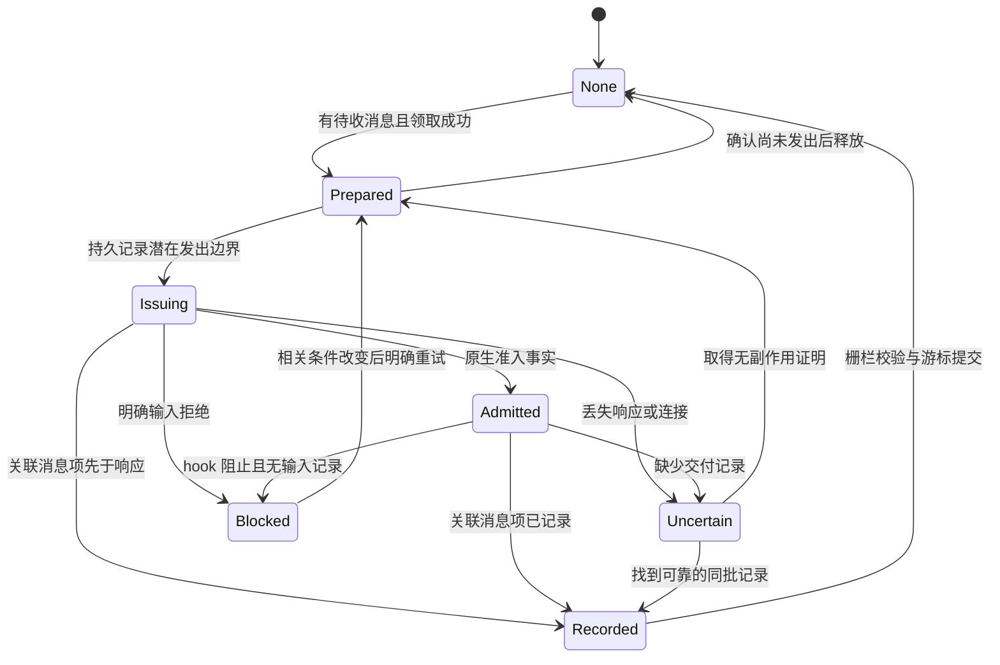
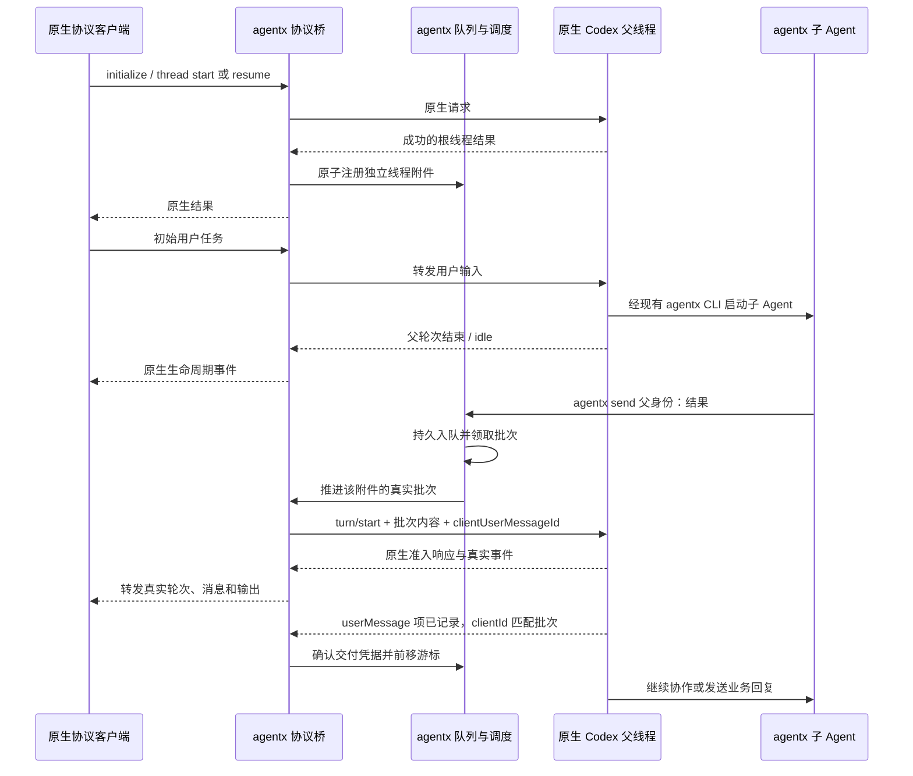

# 线程绑定、投递与原生协议流程

本页拥有流程、状态和协议映射；领域需求与生产声明入口在 [设计入口](./README.md#契约设计)，[原草案](./contracts.rs) 仅作导航。生产模块已拥有精确声明；实现和验收不能由声明存在推定，实际证据见 [验收报告](./acceptance.md)。原生字段与先前行为依据见 [独立报告](./protocol-feasibility.md)，新增 managed daemon 事实由 [原生服务任务](../../.controller/codex-shared-runtime/tasks/native-service.md) 与 [服务拓扑](./topology.md) 维护。

## 1. 连接与根线程绑定

每次 app-server 接入先解析项目环境、绝对 home、原生可执行文件及服务级配置要求，再按 [共享 daemon 契约](./topology.md#共享-daemon-的接入与生命周期契约) 发现、验证或首次启动原生服务。协议桥独占本次客户端对应的原生连接，[NativeConnection](../../src/integrations/codex/service.rs) 向它提供完整 JSON 帧并有界等待接收；不能假设原生 raw proxy 自动把 JSONL 转成 Unix WebSocket。连接退出只清理本客户端，不能套用私有后端的终止语义。后端 `ExecutionId` 随实际服务运行代次确定，不随每个代理启动而更换；每个代理另有 `AttachmentOwnerId` 表示控制权。`--version`、普通交互启动和非 app-server 的原生命令保留其现有路径，不能因为有 `--stdio` 就把任何命令都当成 JSON 协议。

本机 managed daemon 的隔离观察表明，启动时的 `-c` 覆盖不能被假定传入实际后端。选定接入保留官方 managed daemon，通过线程配置覆盖提供已验证的 hooks、信任状态和会话引导，不能静默忽略必要的调用方配置；无法在线程作用域表达的必需配置应明确拒绝。真实 thread/start、resume、fork hook 覆盖与连接退出隔离已有服务域探针证据；生产组合及未修改外层产品的完整支持仍由独立集成确认，见 [交接决策](../../.controller/codex-shared-runtime/contracts-handoff.md#native-deployment-decision-and-evidence-limits)。

工具派生子 Agent 时，服务兼容判断只归一化已有证据的原生调用/显示环境标记、冗余 locale 和所选 managed 包精确的前导 `codex-path`，保留用户 PATH 的其他元素及顺序。未知环境新增项仍形成保守冲突，不能按测试变量名放行；配置引用的环境变量即使与显示标记同名，也必须保留其有无和值的兼容语义。线程 shell 覆盖可用于工具环境，不自动证明任意新增变量后的子进程具有相同后端要求；详见 [环境兼容决策](../../.controller/codex-shared-runtime/contracts-handoff.md#native-tool-environment-compatibility)。

当前 [线程配置组合](../../src/integrations/codex/configuration.rs) 在合并 CLI 默认值与外层根请求配置后、生成 hooks 或发出原生请求前执行环境依赖检查。已知 model-provider、MCP 和 profile 声明通过 `env_key`、`bearer_token_env_var`、`env_vars`、`env_http_headers` 或显式 `env` 名称引用被服务归一化的变量时，明确拒绝该配置；这时没有足够证据确认后端对应值与来源。服务已加载配置的依赖保留由服务域负责，未知无关配置仍原样保留；不从字符串遍历推导所有插件的环境行为。

初始化成功且外层完成原生初始化握手之前，不发出内部原生输入。服务版本或传输不在兼容档案内、尚未建立兼容共享连接时，服务获取明确报错；不能回退私有后端、重启现有 daemon 或改写配置来伪造接入。当前 managed 服务档案仅接受 `0.167.0`，未建立 `0.155` 的兼容共享传输。版本查询和非 app-server 的直接 stdio 路径继续遵守自身契约。

成功建立兼容共享连接后，若原生流量仍可正确转发，但内部观察或自动输入所需能力缺失，则保留可用转发、禁用自主投递，并通过 stderr、已有 launch_context/life 记录及诊断说明降级。A9.4 的“按契约保留流量”以存在可用的兼容连接为前提，不能推导出所有未知版本都必须透传。非 stdio 的服务拓扑需要独立的所选传输实现，不能猜测套接字协议。

支持声明采用经过验证的 native 版本/能力档案，并核对初始化所需公开能力；不在每次启动时跑模型或完整行为探针。升级后的声明必须由兼容用例更新，本次实验证据仅覆盖 `0.167.0`。原生版本探针继续绕过会话建立和会话参数。

### 绑定拥有者

| 输入来源 | 绑定行为 |
| --- | --- |
| 外层 `thread/start` 成功结果 | 把该请求预留的参与者绑定到返回的原生根线程 |
| 外层 `thread/resume` 成功结果 | 在实际 home 中恢复该根线程的规范身份，检查活跃所有权后建立新附件 |
| 外层 `thread/fork` 成功结果 | 为返回的新根线程建立新参与者；父线程不被替换 |
| 同一根线程重复 resume | 复用同一逻辑参与者，不创建第二个收件人 |
| `thread/read`、列表或历史查询 | 不注册新参与者，也不选择默认收件人 |
| 原生内部子线程、记忆整理或未经关联的 started 事件 | 仅按原生协议观察/转发，不据此注册 agentx 身份 |
| 失败或丢失的创建结果 | 保持占位或未知状态，不猜测返回的是哪个线程 |
| 原生 close、archive、delete、unload 结果 | 撤销相应附件；保留消息事实，不自动在别的线程投递 |

这里的根线程资格来自外层生命周期请求及其关联结果，不来自一个全局的“最近 thread/started”。响应可能乱序，关联使用桥自己的下行 request id。明确请求创建的 ephemeral 根线程可以在存活期间拥有独立临时身份；Codex 自己创建的内部 ephemeral 线程不满足这个资格。

附件持久关系由 [AttachmentStore](../../src/agents/attachments.rs) 拥有，包含后端代次、带作用域的提供方会话键、参与者行代次、附件令牌和独立连接控制者；消息领域另外按附件记录所选 `DeliveryMode`。每个当前参与者至多拥有一个有效附件；同一执行可以拥有多个根线程，但相同执行不授予兄弟代理接管同一根线程的权限。通用身份模块把提供方会话键视为不透明值，[RootBindings](../../src/integrations/codex/roots.rs) 在 Codex 集成层组合这些能力，不让身份模块依赖原生 DTO 或投递媒介。实现使用现有 SQLite 事务机制，把规范身份恢复、占位处理、附件建立与资格确认放在同一事务边界；存活所有权冲突不能仅凭心跳超时强行接管。

现有 `session_bindings`、停止记录与占位逻辑可以复用，但现有单一 `process_bindings` 不能作为多根线程的最终查找。若旧记录没有 home 作用域，必须结合实际运行 home 与成功的原生恢复结果确认，不能用裸 thread id 跨 home 推断身份。

`generate_unique_name` 已保留 pending 行；创建/fork 复用这一名称分配和现有 `initialize_instance_in_position_file` 的元数据规则，携带启动祖先、初始游标与 launch context，再通过 `participant` 得到精确行代次。resume 在原生请求前用 `canonical_participant` 查逻辑身份；从未注册的原生线程可以保留新占位，并通过 resume intent 携带到成功结果后的附件事务。事务重新核对作用域与规范身份，已有规范身份和存活控制权仍然优先，不能用预先准备的占位覆盖它们。原生成功后才提交附件。旧 `instances.session_id` 和 `session_bindings` 的裸键唯一约束不承担新的作用域；未决 claim 不能随实例行删除级联清除。

生产 [附件存储](../../src/agents/attachments_store.rs) 已实现规范恢复与控制权判定：恢复不存在的 live 行时读取持久快照/游标、创建新行代次，遇到被其他参与者复用的名称则拒绝。控制权更换需要显式退役、成功删除对应实例，或旧控制者 OS 进程已退出/进程代次已变化的正面证据；心跳过期、代理重启和新的后端代次都不足以证明可接管。该身份判定只允许建立新附件，不能据此释放未知输入的 claim。维护入口见 [身份域](../../src/agents/AGENTS.md)。

### Bootstrap 与 hook 查找

app-server 的进程级 bootstrap 提供通用能力和身份握手规则，不把一个固定名称写给该进程中的所有线程。每个根线程的首个 `UserPromptSubmit` 按线程附件输出当前身份及必要引导，成功 flush 后独立确认公告；普通用户输入和 agentx 输入都适用。输入 hook 不负责把同一收件批次再投递一次。

根线程创建时的 `SessionStart` 可能早于原生结果；此时尚未关联的 hook 不猜测进程默认身份。协议桥在向外层释放成功的根线程响应前完成附件建立；后续首个用户/agentx 轮次才能获得正确线程身份。resume 的已知线程同样使用显式附件核对。PTY 继续使用既有单主线程 bootstrap。

工具中的自动身份解析在已知 `CODEX_THREAD_ID` 和 app-server ExecutionId 时必须查询线程附件；没有线程信息而运行存在多个根线程时，返回明确的身份不确定错误。显式管理命令的 `--iam` 仍按现有授权语义工作。hook 的 session id 与 ExecutionId 必须同时匹配，不能用新线程覆盖进程的第一个身份。

会话工具环境通过明确的原生线程配置覆盖传递，不靠连接客户端的 OS 环境自动继承。`shell_environment_policy.set` 已验证适用于创建线程的原生 shell 工具，但本次观察的 hook 身份环境仍为服务级值。hook 处理器必须从载荷取 `session_id`，结合实际后端 ExecutionId、home 和当前附件形成处理上下文；若兼容旧命令需设置身份环境，只构造本次 hook 子进程的环境，不能临时改写共享服务的全局环境。逐字段归属、创建/恢复规则和实验边界统一见 [会话环境契约](./session-environment.md#agentx-会话环境契约)。

## 2. 两种交付适配

公共请求包含真正的 `PreparedBatch`，其消息来源、格式、事件窗口与 claim 由消息领域拥有。适配器不能凭一个裸收件人名称重新挑选不同消息。

| 运行状态 | PTY / hook 媒介 | app-server / 原生输入媒介 |
| --- | --- | --- |
| 空闲且输入可用 | 检查屏幕、审批和用户草稿；输入触发标记；按回车；hook 领取已准备批次并输出 | 向确定的根线程提交 `turn/start`，input 是真实批次，附带批次关联 id |
| 正常活动轮次 | 现有安全 hook 边界可以交付同一受控 claim；终端不抢写用户输入框 | 用 `turn/steer` 和已观察的 `expectedTurnId` 交付真实批次 |
| 等待审批/用户回答 | 延迟，不把消息敲进审批或回答输入框 | 延迟，不把 agentx 消息当成审批决定或问题答案 |
| 本地状态未知、未绑定或正在变更 | 保留队列并核对 | 保留队列；必要时内部读取原生线程状态 |
| 一个 claim 未决或结果未知 | 不启动第二个消费者 | 不重复提交同批次 |

PTY 的 `<agentx>` 标记只负责触发原生已有 hook 流程，不携带业务消息。app-server 不复用空标记方案，而是发送实际格式化消息。原生输入和 hook 上下文是两种明确的交付媒介；每个附件只有一种自主媒介，显式 listen 也必须通过同一领取/确认边界。

显式阻塞 listen 已拥有收件资格时，自动驱动延迟，消息通过工具输出继续当前轮次。若自动驱动已领取批次，随后到来的 listen 必须返回“交付正在进行”或等待该 claim 的明确结果，不能在驱动已消费消息后无限等待同一条消息。所有路径的输出确认仍需满足本身媒介契约，不能先推进游标再尝试写输出。

[PendingInbox](../../src/messaging/inbox.rs) 在 claim 中冻结消费者；`Hook`、`NativeInput`、`ExplicitListen` 共同竞争一个批次，确认时验证证据类型。`NativeInput` 媒介拒绝 hook 再收件，但允许显式工具接收参与竞争；其成功 flush 对应通用的 `ToolOutputWritten`。仅有当前参与者名称、旧 hook ack 或未领取的窗口不足以确认附件消息。

生产 hook 与显式 listen/inline 路径已通过 [消息域实现](../../src/messaging/AGENTS.md) 接入相同 claim。hook 在把准备结果交给 dispatch 前保守标记 Issuing，因此结果未输出或中途丢失会保留待核对状态，不能作为 NeverIssued 自动释放。旧 ack 不能绕过 managed 收件箱的栅栏；未挂接的旧 Provider 路径保留自身既有行为。

[ActivationPolicy](../../src/messaging/activation.rs) 使用 `Default` 构造，宿主依次调用 `prepare_request`、driver 的 `offer` 与 `finish_admission`，再通过 `observe` 记录带栅栏的驱动进展。这一顺序让桥可以拥有同一个 inbox 和 driver，避免同时借用同一可变资源；通知、兜底扫描和 provider I/O 仍由宿主负责。确认交付始终是独立的证据事务，不能由 admission 代替。

### app-server 交付步骤

1. 启动扫描、消息通知、状态变化或 agentx 自己的低频兜底扫描发现待收消息。通知只是提示；消息事实仍从 SQLite 读取。兜底不依赖外层客户端轮询。运行适配器注册 agentx 自己的投递通知端点，并刷新所有已绑定参与者的心跳；不能把客户端沉默误判为 Agent 已退出。
2. 校验完整附件栅栏，原子领取一个有上限的现有格式化消息批次，写入 BatchId、事件窗口、领取者与当前附件。其他消费者遇到该 claim 就延迟。
3. 调度请求进入协议适配器的单一执行者。执行者在最终发出前再次核对附件、claim、原生状态及外层控制请求。尚未发出时可以让已到达的用户控制请求先行。
4. 在可能写入原生流之前，把 claim 标为 Issuing。空闲时选择 start，正常活动时选择有预期轮次栅栏的 steer；两者均带同一个批次关联 `clientUserMessageId`。不覆盖 native 已维护的模型、cwd、审批和 sandbox 设置。
5. start/steer 响应只建立请求或轮次准入事实。只有收到与 thread、批次 `clientId` 和冻结批次内容均对应的原生 `item/completed`、类型为 `userMessage` 的记录，才产生 Codex 适配层的 `NativeUserInputRecorded` 证据，再转换为通用回执的 `ProviderInputRecorded`；原生关联 id 留在适配层及其诊断/恢复状态。外层可以自行选择或复用 client id，不能只靠某个前缀或 id 相等确认消息。不能用 assistant 项、其他用户项、turn/completed 或成功响应代替。
6. 消息领域在事务内校验参与者代次、执行、附件与 BatchId，然后只把游标推进到该批次的最后一条合格消息，并清理该 claim。后续消息仍待收；业务回复仍由 Agent 自己通过 agentx 发送。

`clientUserMessageId` 是关联凭据，不假设它在服务端具有去重或事务提交能力。`item/completed` 的 userMessage 记录是 native-input 媒介的边界，不是模型已经处理内容的保证。丢失该事件可以在原生提供完整可靠历史时核对同一 clientId；读取失败、分页不完整或尚未落盘的空线程均不能证明输入不存在。

已有 [DeliveryAck](../../src/integrations/hooks/mod.rs) 和 [ack_hook_delivery](../../src/db/instances.rs) 的前移及行代次保护应复用，但需要绑定栅栏与批次 claim。所有 Codex 消费者都经过这一边界后，才能启用 native 自动输入，不能让旧 PostToolUse 收件与新输入驱动并行抢同一批消息。

### 外层输入与内部输入的竞态

| 顺序或结果 | 规定行为 |
| --- | --- |
| 用户控制请求先到，内部批次尚未发出 | 先处理原生用户控制请求，重新判定该批次的目标状态 |
| 内部 start 已发出，用户随后输入 | 按原生协议转发用户请求，保留真实生命周期；不伪造成功、不偷偷改写用户 start 为 steer |
| 内部预计 idle，但原生已经 active | 本版本 start 可以把真实输入追加到现有轮次；把这视为同一批次的输入准入，再等其实际消息记录 |
| 内部 steer 的 expectedTurnId 已过时 | 已知的预期轮次拒绝可重新观察后选择 start 或新的 steer；其他错误不一律视为无副作用 |
| user hook 阻止真实消息 | 观察到未记录输入且 hook 明确阻止时，保留 claim/消息并报告阻止原因，等待相关策略变化或明确重试；不制造无限轮次 |
| 用户取消或归档后才到达子 Agent 回复 | 尊重原生生命周期；未有效绑定则保留消息，不偷偷恢复已关闭的运行 |

这里不承诺“原生只会在绝对空闲时接到内部输入”：native 没有为 start 提供 idle 的原子前置条件。所选真实消息方案允许正常活动轮次接收有效输入，避免把一个空标记的拒绝当作分布式锁。等待审批/回答的状态仍不自动输入。

第三方 hook 仍可能拒绝或结束轮次，这是原生已有行为。agentx 不在自己的自动投递协议中使用“拒绝空标记”作为忙碌锁，也不绕过用户 hooks。

## 3. 原生协议路由

采用已有 JSON 消息边界和字段语义，不新增外层 API。原生类型继续以本机支持版本生成的 schema 为准；桥只解析信封和它需要观察的少量方法，其他字段保持原始 JSON 内容，不经缩减版 DTO 重建。当前项目已启用 `serde_json::RawValue`，无需为此引入新的序列化协议或 async 运行时。

下表针对一条桥拥有的原生连接，请求账本及初始化按连接隔离，不把所有客户端拼成一次原生握手。共享的是后端服务及其线程能力。使用独立控制连接的变体须额外验证订阅和 server-request 拥有者，不能直接跨连接套用下表的 id 假设。

| 流量 | 关联与路由规则 |
| --- | --- |
| 外层 request → native | 给每个未决请求分配桥拥有的下行 id；保留原 id 的类型和值；未知方法同样转发 |
| 内部投递/状态读取 request → native | 使用同一 id 分配器，但关联到内部尝试或核对目标 |
| native response → bridge | 按下行 id 找拥有者；外层响应恢复原 id；内部响应交给调度，不能发送给外层 |
| 外层 notification → native | 保持原生 notification；没有假造 response |
| native notification → outer | 先供内部观察，再按原生顺序和外层订阅过滤转发；不能隐藏真实内部轮次或输出 |
| native server request → outer | 保留原生 id 与载荷，跟踪审批、用户输入、动态工具及 elicitation 等所有类别 |
| outer response → native server request | 保留原生 id，返回 native；内部轮次也遵守同样规则 |
| `serverRequest/resolved` | 原生 requestId 原样保持；bridge 不另造面向外层的 RPC，因此无需重映射这一方向 |

只给内部请求加一个“特殊前缀”不能保证不碰撞，因为外层可以选择相同字符串。下行所有客户端 request 都经过同一分配器；`1` 和 `"1"` 必须可区分。客户端请求与服务器请求是两个独立方向，不能仅凭 id 查一个混合 pending map。

服务器请求不改 id，是本方案的有意简化：agentx 没有向外层另行发起 RPC 的需求。若将来增加这种需求，必须同时设计该方向 id 重映射及 `serverRequest/resolved` 等内嵌引用，不能只改信封。

初始化保留外层 clientInfo 和能力选择，不擅自启用 experimentalApi。若外层用 `optOutNotificationMethods` 排除了内部需要的公开事件，则 native 侧订阅取外层与内部需求的并集，bridge 仍按原始 opt-out 给外层过滤。其他能力不扩张。该虚拟订阅行为必须有专门兼容测试；无法建立可靠观察时，自动投递应声明不可用。

每个线程的内部观察集至少需要状态变化、轮次 started/completed、userMessage 项完成、关闭/归档/删除以及必要的 hook 结果。未知新控制方法保持转发；若其效果可能改变当前附件或线程状态，在重新得到可靠状态之前暂停内部输入，不能把“尚未认识的方法”解释为无副作用。

取消、审批回答、工具回答和连接关闭不得被正在等待的内部尝试堵住。下行由单一写入者保证完整消息序列；上行也只有一个读取者和一个外层输出写入者。长消息允许超过 PTY 的行长，采用现有管道和有界队列背压，不依赖终端行规程。不在 stdout 写日志、标题或自定义状态帧。

## 4. 状态与恢复

状态分为正交的三组，不把所有组合塞进一个大枚举。

| 状态组 | 状态 | 含义 |
| --- | --- | --- |
| 运行连接 | Starting / Ready / Closing / Closed | 能否合法处理原生协议及是否接受新内部工作 |
| 目标线程 | Unbound / Idle / Active / AwaitingApproval / AwaitingInput / Unknown / Retired | 由原生事实和当前附件共同确认 |
| 当前批次 | None / Prepared / Issuing / Admitted / Recorded / Uncertain / Blocked | 消息 claim 与跨进程副作用的进展，不等于模型工作结果 |

图中的“已记录”是输入媒介事实。PTY 分支用成功 hook 输出替代 native userMessage 记录，并使用同一 claim 的对应凭据；两种凭据的强弱和边界见 [交付证据表](./README.md#交付证据不能混用)。

| 事件 | 必需的状态检查及动作 |
| --- | --- |
| 通知重复或丢失 | 从持久队列核对；相同 claim 不产生第二次外部提交；启动及自己的兜底扫描恢复通知损失 |
| 关联消息项先于 RPC response | 可确认交付；保留 request ledger 到响应结束，迟到内部响应仍不能泄漏 |
| 轮次结束但没有交付凭据 | 结束不是交付证明；核对 hook/输入记录，阻止自动忙循环 |
| SQLite 查询失败 | 返回 Unavailable；保留状态，不能当作空队列或已交付 |
| claim 准备后、发出前退出 | 只有证明旧执行已结束且从未跨越发出边界，才可安全释放 |
| Issuing 后崩溃或失去响应 | 结果未知；不能以超时、过期 lease 或未找到一个事件就重发 |
| 重启、恢复或附件变化 | 创建新 BindingId；旧驱动事件和旧确认不能修改新附件；未知批次独立核对 |
| 用户关闭连接、EOF 或代理退出 | 关闭本次连接与它拥有的投递驱动，保留未决批次；不终止共享 daemon、不伪造线程关闭，也不影响其他有效连接 |
| 原生共享服务退出 | 全部相关附件进入不可投递状态；以新服务运行代次恢复，保留旧批次的未知结果，不能等同于某一个客户端断开 |
| stderr、stdout 背压或进程失败 | 不丢真实协议消息；暂停新的内部输入；通过既有诊断及状态呈现失败 |

未知结果的恢复优先使用完整的原生历史和批次 clientId。只有权威证据表明输入未记录，且旧运行已不可能继续产生该效果时，才能重新准备。不能得到这种证据时，保留 Uncertain 并要求明确的恢复决策；本设计没有跨进程“恰好一次推理/执行”的保证。

旧 claim 的未决状态必须按原生 home/thread 及原收件人谱系保留，不能因为建立了新 BindingId 或重建实例行就创建第二个同批输入。旧异步回执不能直接提交到新行；恢复拥有者使用独立的栅栏事务核对旧批次，确认已记录或证明未记录后才解除这一阻挡。普通超时和新运行的出现都不是这样的证明。

持久化最小新增信息是根线程附件和每个附件当前批次的 claim、阶段、事件窗口与 native 关联 id。更细的步骤留在运行内存和既有日志；不引入服务池、事件溯源或工作流引擎。

当前生产存储的三个新增平面与事务边界见 [数据库入口](../../src/db/AGENTS.md)：`participant_sessions` 保存带作用域的逻辑身份、快照和已交付游标，`participant_attachments` 保存历史/当前栅栏及控制者 OS 身份证据，`inbox_claims` 保存冻结批次和处理结果。成功的删除或停止 CAS 在同一事务保存 managed 快照/游标并撤销被删除行代次的附件；失败 CAS 不撤销继任者，未决 claim 继续保留。SQLite 写锁不跨越任何 provider 输入或输出 I/O。

恢复证据由 provider 适配器或明确的恢复拥有者负责取得；存储验证 claim、attempt、谱系与前后附件，拒绝 Issuing 后的 NeverIssued、错误 attempt 和空历史引用，但不自行查询原生历史。通用持久恢复接口已实现，不代表每一种原生未知结果都已能自动取得充分证据；实际支持范围见 [验收报告](./acceptance.md)。

## 5. 父子协作的完整链路

这条链路里，外层不创建 agentx 子 Agent、不查询 agentx 收件箱，也不替 agentx 决定何时继续。它继续拥有自己的用户输入、展示和原生审批职责。独立集成已通过真实原生客户端和未修改 Paseo `0.15.3` provider API 分别执行完整父子闭环，检查真实消息、双方游标与 claim；环境、其他控制场景和未验证边界统一见 [当前支持表](./acceptance.md#current-support-by-acceptance-boundary)。这些结果不扩展为桌面/移动端渲染或用户现有主机的验证。
