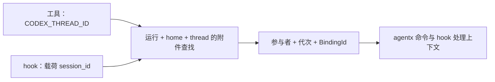

# 共享 App Server 的会话环境与身份

同一个 App Server 可以让不同原生线程的 shell 工具进程使用不同环境变量。本机 Codex `0.167.0` 已实测这一点。但是，连接客户端的环境不会自动传给服务；线程的 shell 环境覆盖也没有传给本次观察的 hooks。agentx 必须分别处理工具与 hook 身份，才能保留共享服务下的独立会话能力。

## 环境分层

| 环境 | 如何确定 | 本次结论 |
| --- | --- | --- |
| 客户端 OS 环境 | 客户端启动及自己的环境修改 | 不会因为建立连接而替换远端服务的 OS 环境 |
| App Server OS 环境 | 后端启动环境 | 同一后端的公共基线；不能作为多个参与者的唯一身份 |
| 原生线程的 shell 工具环境 | `thread/start` 的 `config.shell_environment_policy` 覆盖 | 两个线程的真实原生 `exec_command` 获得各自的变量，并拥有对应 `CODEX_THREAD_ID` |
| hook 子进程环境 | 本次观察中继承后端环境 | 选取的身份变量保持服务级值，`CODEX_THREAD_ID` 为空；hook 输入的 `session_id` 区分线程 |

会话环境是后端创建工具子进程时应用的配置，不要求为每个会话创建一个 Codex 后端 OS 进程。同一个原生线程被两个客户端连接时，仍然是一个线程的执行上下文；不能把连接数当成身份数。

## 原生接口与依据

[官方配置参考](https://developers.openai.com/codex/config-reference/) 将 `shell_environment_policy.set` 定义为显式注入的环境变量，并说明过滤规则仍可能移除它们。[官方 App Server 文档](https://developers.openai.com/codex/app-server/) 说明可用当前 CLI 生成对应版本的协议 schema。本机生成的 `ThreadStartParams`、`ThreadResumeParams`、`ThreadForkParams` 都包含 `config` 对象；本次实际验证的是 `thread/start`。

以下是探针采用的 A 线程配置片段；B 线程替换三个假身份值。`inherit: all` 是本次固定实验的基线，生产接入需要与线程原有环境策略组合。

```json
{
  "method": "thread/start",
  "id": "thread-A",
  "params": {
    "config": {
      "shell_environment_policy": {
        "inherit": "all",
        "set": {
          "SESSION_PROBE_ID": "session-A",
          "AGENTX_PROCESS_ID": "execution-A",
          "AGENTX_INSTANCE_NAME": "participant-A"
        }
      }
    }
  }
}
```

这里故意让两个线程覆盖所有选取的假身份值，以观察传播边界，不表示生产设计应为每个线程伪造一个后端执行身份。`command/exec.env` 另有逐命令覆盖字段，但那是独立命令接口，不能用它证明模型工具或 hooks 会得到会话环境。

## AgentX 会话环境契约

沿用 [线程附件契约](./protocol.md#1-连接与根线程绑定)，身份来源是已确认的参与者与原生线程绑定，环境变量只是向子进程传递上下文的载体。

| 上下文 | 归属及规则 |
| --- | --- |
| `CODEX_HOME` 与 ExecutionId | 属于实际后端运行；共享服务下一个 ExecutionId 可承载多个根线程，不能单独选出参与者 |
| `CODEX_THREAD_ID` | 原生工具进程提供的线程定位信息；结合后端运行、规范 home 查线程附件 |
| `AGENTX_INSTANCE_NAME` 及其他会话变量 | 可在创建线程时显式配置；agentx 自己的名称和附件字段由绑定拥有者维护，并核对对应参与者及代次 |
| hook `session_id` | 从原生载荷取得线程 id，再结合 hook 所属后端运行和 home 查相同附件 |
| 既有进程默认绑定 | 仅保留单主线程终端及初始占位兼容；已知线程时不能覆盖线程查找，缺少唯一目标时不能猜测 |



图中是共享身份解析的责任路径。hook 处理器先解析载荷、查找并校验附件，再调用带明确上下文的处理逻辑。旧处理逻辑若依赖环境，只能为本次处理启动的子进程构造身份环境；不能修改共享 App Server 的全局环境再改回来，否则不同线程并行时会串用身份。当前生产映射入口见 [Codex 根线程适配](../../src/integrations/codex/roots.rs)，通用附件语义见 [身份域入口](../../src/agents/AGENTS.md)；实际组合证据见 [验收报告](./acceptance.md)。

创建线程时应用明确的环境覆盖；恢复或 fork 时也要核对参与者与原生结果，再建立新附件或新身份，不能继承一个过期名称并将其当作绑定事实。根线程响应与首次输入之间的绑定顺序、尚未绑定的早期 hook 行为，继续由协议页拥有。Delivery 开始时的进程优先解析是历史基线；当前共享入口在 [CLI 上下文](../../src/cli/context.rs) 先走带作用域的 Codex 映射，再决定是否适用既有 Provider 路径。

### 工具环境与后端兼容

[SessionConfiguration](../../src/integrations/codex/configuration.rs) 把会话的有效环境与显式 `shell_environment_policy.set` 合并后提供给工具；后端获取仍由 [原生服务](../../src/integrations/codex/service/managed.rs) 核对既有服务回执。两者不能视为同一环境快照：真实原生 shell 会附加调用/显示标记并把 managed 包的 helper 目录放到 PATH 开头。

当前选定修正只归一化有证据的原生附加项、冗余 locale 和所选包精确的前导 helper，保留其他用户 PATH 元素及顺序、认证、代理、不同 locale、配置和服务代次冲突。未知新增变量仍是保守的获取冲突；线程能设置某个工具变量，不代表继承任意新变量的子 Agent 已具备复用后端的兼容证据。配置通过 `env_key`、`env_vars`、`env_http_headers` 等字段明确引用的环境变量，必须保留其有无和值的依赖语义，或明确拒绝无法核对的配置，不能当显示标记忽略。

已实现的线程侧边界更具体：[配置组合](../../src/integrations/codex/configuration.rs) 在合并 CLI 默认值和外层根配置后检查已知 model-provider、MCP 与 profile 声明；依赖服务会归一化的变量时，因无法核对后端值而在 hook/原生副作用之前明确拒绝。检查复用 [服务契约](../../src/integrations/codex/service.rs) 的纯函数 `environment_input_is_normalized`，不复制规则表；未知无关配置保持原样。服务自身已加载配置的依赖核对仍由服务域拥有，独立集成负责执行对应成功/拒绝用例。

这一边界解决已观察到的原生父子环境来源差异；不引入推测所有原生环境依赖的分析器，也不新增服务环境透传协议。确切字段与后续支持统一由 [环境兼容决策](../../.controller/codex-shared-runtime/contracts-handoff.md#native-tool-environment-compatibility)、服务域源码和独立验收维护。

## 实验回执与覆盖边界

执行 [双会话探针](./.tools/probe_session_environment.py)，使用真实原生工具执行绝对路径的临时 Python 读取器。模型响应由固定的本地 SSE 服务提供。后端、项目、hooks 和 home 全在临时目录；没有连接付费模型、改用户配置或操作托管 daemon。

| 轮次 | 原生线程 | 工具 `SESSION_PROBE_ID` | 工具假执行身份 / 假名称 |
| --- | --- | --- | --- |
| A1 | `01a1b481-6c80-7c80-8f82-5f3baabf06ce` | `session-A` | `execution-A` / `participant-A` |
| B1 | `01a1b481-6c99-7d93-8049-6d1ce721d99f` | `session-B` | `execution-B` / `participant-B` |
| A2 | 与 A1 相同 | `session-A` | `execution-A` / `participant-A` |

三个工具命令均成功，`CODEX_THREAD_ID` 均匹配目标线程，`CODEX_HOME` 均为同一个临时 home。共记录六次本地模型请求、十一次 hook 调用，覆盖两线程的 `SessionStart`、`UserPromptSubmit`、`PostToolUse` 和 `Stop`。所有 hook 的选取环境均是 `server` / `server-execution` / `server-participant`，其载荷 `session_id` 各自匹配 A 或 B。

本次原生可执行文件的 SHA-256 为 `cdcb45aaa01d0f14e298985e09465aebccd47f64ecd298aea44814af7b62bbda`，版本为 `0.167.0`。完整临时证据在 `/tmp/zomi-session-environment-8qzgk15l/summary.json`、`trace.jsonl` 和 `hooks.jsonl`；临时目录可能被系统清理，保留的复现入口和本页回执拥有长期结论。

第一次采集尝试在 `/tmp/zomi-session-environment-lv_s1t93`，读取器写文件被只读 sandbox 拒绝，不能作为工具环境成功证据。修正采集为直接解析原生 `commandExecution.aggregatedOutput` 后，在保持只读 sandbox 的条件下完成上述三个用例。

本节的早期实验只覆盖创建线程、顺序交替执行和列出的 hooks；它本身不证明并行轮次、resume/fork、长驻 shell、MCP 或生产解析行为。后续 Delivery 的独立集成已执行生产 A/B/A 工具环境与 hook 身份、resume/fork 和父子闭环；其精确范围见 [当前支持表](./acceptance.md#current-support-by-acceptance-boundary)。没有独立证据的长驻 shell/MCP 子进程和其他平台、原生版本仍不得从这些场景外推。
