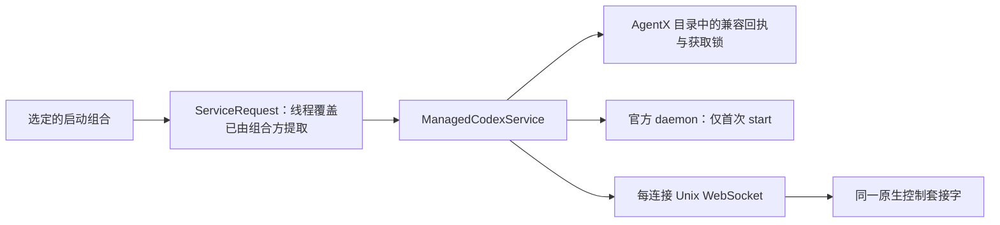
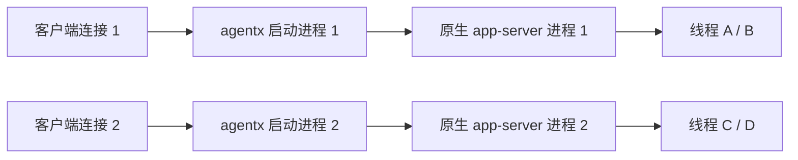
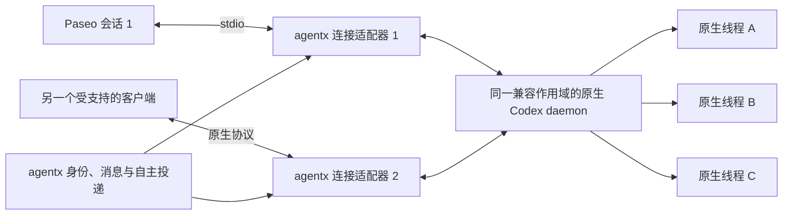

# App Server、客户端、线程和守护进程

## 原生服务实现边界

本次 Delivery 的原生服务生产契约是 [service.rs](../../src/integrations/codex/service.rs)，具体获取逻辑与传输分别位于 [managed.rs](../../src/integrations/codex/service/managed.rs) 和 [transport.rs](../../src/integrations/codex/service/transport.rs)。当前实现只接受 Linux 与已实测的 Codex `0.167.0`，通过官方 `daemon start` 首次启动，随后直接使用同一个控制套接字的 Unix WebSocket 连接；不为每条客户端连接另起后端，也不需要一个原生 proxy 子进程。生产组合与独立集成验收仍由 [Delivery](../../.controller/codex-shared-runtime/delivery.md) 负责，不能把本节服务代码或隔离原生事实等同于完整产品闭环。

未支持的原生版本（包括尚未建立共享传输兼容证据的 `0.155`）在获取服务时返回明确错误，不启动私有后端或透传到未经验证的控制套接字。[A9.4](./acceptance.md) 中保留原生流量、降级自动投递的适用前提是已经取得兼容的共享连接，且缺失能力只影响自动输入的观测或确认。原生版本查询、非 app-server 的直接 stdio 和普通 PTY 仍遵循各自已有入口。

| 状态或输入 | 服务操作与保证 |
| --- | --- |
| 尚无活跃后端，且无未知所有权套接字 | 获取同一 home 的 AgentX 锁；以去除客户端身份的环境执行官方 `daemon start`，验证 `started`、端点、版本与原生 PID 身份后保存兼容回执 |
| 活跃后端且回执匹配 | 只创建独立连接；核对原生 PID 记录的 boot ID/start ticks、实际进程身份、服务执行 token 与 Unix peer PID |
| 已有用户服务、未知来源套接字、损坏记录或启动竞争中返回 `alreadyRunning` | 明确报告冲突，保留运行服务；不自动接管、重启、改配置或创建另一个后端 |
| 版本、环境、全局配置输入、AgentX 存储或运行代次变化 | 拒绝复用并说明冲突；不把旧附件和未知输入转移到新代次 |
| 客户端退出、连接关闭或对象析构 | 只关闭本次 WebSocket，不调用 daemon stop/restart，不向后台进程或进程组发送信号 |
| 启动 CLI 超时 | 只回收本次管理 CLI 子进程；后端启动结果保留为未知，不自动重试或重启 |

兼容回执存于 `$AGENTX_DIR/codex-services/<canonical-home-hash>/service.json`，内容是路径、版本、运行代次和摘要，不包含原始配置或凭证。环境摘要忽略明确的客户端身份与 cwd/direnv 来源变量，保留实际 PATH 和其他后端环境；不同 cwd 本身不会分割服务。配置摘要覆盖 home/system 的 `config.toml`、`requirements.toml` 及原生命令 prefix。逐线程 hooks、开发者指令、工具环境由组合方通过原生线程配置提供，不在 daemon start 中假装生效。外部插件/额外间接配置文件的热更新兼容性未建立。

真实子 Agent 会继承原生工具的附加环境。服务层仅归一化已观察到的工具调用/版本标记、shell 与终端/pager 来源信息、与有效 locale 相同的冗余 `LC_CTYPE`，以及 PATH 开头精确匹配当前托管包的 `codex-path`；其余 PATH 分量及顺序保持兼容检查。已加载服务配置中的 `env_key`、`bearer_token_env_var`、`env_vars`、`env_http_headers` 和 `env` 名称会退出这些归一化规则，缺失值变为存在值也会产生冲突。服务配置若依赖某个客户端专属 AgentX 变量则明确拒绝；逐线程配置复用同一个 [名称判定契约](../../src/integrations/codex/service.rs) 实施拒绝或保留边界。未知的新增变量仍会冲突，没有按测试变量名豁免，也没有从变量未出现在回执中推导它与后端无关。任意新线程环境变量下的子 Agent 服务复用尚未建立。

回执保留逐变量值摘要以定位兼容故障；冲突仅报告变化的字段和变量名，不输出环境值。此规则来自 [独立原生 shell 环境证据](./managed-service-evidence.md#真实原生-shell-继承与兼容故障)，生产父子闭环的复验由集成负责人负责。

服务执行 token 在首次启动前生成，以 `AGENTX_PROCESS_ID` 传入后端，与 `AGENTX_CODEX_SHARED=1`、规范 home 和 AgentX 存储一起保持服务级上下文；不设置 `AGENTX_INSTANCE_NAME` 或默认参与者。回执还独立绑定真实 OS 进程代次，避免同一 token 随原生 updater 重启后被视作旧执行。线程身份不能只依赖这个服务 token。

每个 WebSocket 文本消息保持完整原生 JSON 对象及未知字段的原始表示，使用维护中的 `tungstenite` 实现帧协议；收发上限为单消息 16 MiB。接收等待有明确 timeout，部分帧留在协议缓冲区等待续传，不以 JSONL 行或代理进程 EOF 猜测线程完成。详见 [真实托管 daemon 证据](./managed-service-evidence.md)。

## Delivery 前的运行基线

本次 Delivery 开始前，`agentx codex --stdio --go -- app-server` 每执行一次，就由 [stdio 托管代码](../../src/runtime/codex_stdio.rs) 启动一个独立的原生 `codex app-server` 子进程。它不是连接共享服务的客户端。版本查询走独立的原生查询路径；普通 `agentx codex` 启动交互式 Codex，agentx 不会给它自动追加 `app-server`。本节保留原始基线；服务实现见上节，完整接线状态见 Delivery 与源码。

这里的“每次启动”指实际启动运行会话；客户端什么时候创建、复用或销毁连接，由客户端自己的实现决定。不能从 agentx 的启动函数推导出一次 UI 操作一定对应一次新进程。

## 本机原生契约表达的服务模型

本机 Codex `0.167.0` 的公开 CLI 和原生实验表明，app-server 是面向客户端的协议服务入口，服务进程、传输连接和原生线程是不同对象。它没有规定整台机器只能运行一个服务。初次取官方网页返回 HTTP 403，本页具体传输行为仍依据 [本机声明与实验](./protocol-feasibility.md)；后续已取得的官方协议与配置资料见 [会话环境依据](./session-environment.md#原生接口与依据)。不把部署选择推测为官方设计意图。

这里的“原生 app-server”指官方 `codex` 可执行文件的服务运行模式。当前每次启动的独立服务同样是原生服务；这个名称不表示系统中已经存在一个全局服务。服务承载对话线程、轮次执行、模型请求、工具调用和协议事件。它可以按需运行工具子进程，但不能据此推导每个线程都是一个独立 Codex OS 进程。`daemon` 则是在服务能力之外提供长驻生命周期管理的部署方式。

| 命令或对象 | 真实作用 | 已确认边界 |
| --- | --- | --- |
| `codex app-server` | 启动服务，默认使用 stdio | 当前 agentx 使用这种子进程拓扑 |
| `codex app-server --listen ...` | 选择服务监听传输 | 本版本不能同时指定多个监听地址；Unix 监听实际是 WebSocket over AF_UNIX |
| `codex app-server daemon start` | 启动或复用受管理的本地服务 | 属于单独的服务管理路径，不是普通 `app-server` 的隐式行为 |
| `codex app-server proxy --sock ...` | 把 stdio 字节代理至已运行服务的控制套接字 | 是客户端代理；不能把任意监听套接字都视为该控制套接字 |
| 原生 thread | 对话、历史和运行状态的边界 | 一个服务可以承载多个 thread；同一 thread 可以由多个连接访问 |
| agentx participant | agentx 网络中的身份和收件人 | 不能直接等同于进程、连接或任意原生内部线程 |

独立实验中，两个初始化过的 Unix WebSocket 连接访问同一个临时服务；第二个连接成功在第一个连接创建的线程上发起工作，原订阅者收到了轮次生命周期事件。仅执行 `thread/read` 并不自动获得该线程的完整轮次订阅。`proxy --sock` 直接连接这个普通 Unix 监听器没有成功，不能把“共享服务可行”简化成“换一个 proxy 参数就完成”。实验没有接触用户已有的受管理服务。

## 两种身份体系与共享资源

| 概念 | 所有者 | 作用域 |
| --- | --- | --- |
| 外层客户端的 Agent、UI、用户触发 | 外层客户端，例如 Paseo | 由外层产品自己定义 |
| agentx 身份、子 Agent 关系、消息与投递策略 | agentx | 独立于外层客户端 |
| 原生线程、轮次、历史、工具审批 | Codex | 由原生协议控制 |
| `CODEX_HOME`、初始 OS 环境和启动 hooks | 服务启动进程 | 新连接不会自动替换已运行后端的这些值 |
| 原生线程 cwd、模型和协议支持的配置覆盖 | Codex 线程协议 | 只按原生协议公开的覆盖规则生效 |

初始化响应把 `codexHome` 定义为服务的 `$CODEX_HOME`。本项目的不同 `.envrc` 会选择不同的 home、认证、PATH 和 agentx 数据目录。线程级 cwd 或配置字段不能被当成“整个后端进程已重新加载该项目环境”的证据。

因此，一个全局共享服务会带来实质性语义变化：某个客户端设置自己的 `AGENTX_PROCESS_ID`、hooks 或 `CODEX_HOME`，不会让已经启动的服务重新获得这些值。若采用共享服务，agentx 的身份解析必须依赖线程绑定，不能继续把客户端代理进程的环境当成后端 hook 的环境。

这不代表所有会话都只能使用同一组身份变量。本机双线程实验已验证，`thread/start.config.shell_environment_policy.set` 能向各自原生 shell 工具进程注入独立变量；选取的 hook 环境仍来自后端，需要通过原生载荷 `session_id` 解析线程身份。工具环境覆盖与 hook 身份适配是两个不同契约，详见 [会话环境](./session-environment.md)。

`CODEX_HOME` 是配置、认证和历史的目录作用域，不是运行中服务的地址，也不自动提供服务发现或唯一实例约束。多个独立服务可以使用同一个 home，但共享磁盘历史不等于共享正在运行的线程。反过来，一组客户端如果需要相同 home、兼容的后端环境/版本/启动配置，也可以复用一个服务；不同 cwd 已有线程级协议支持，不能单凭项目目录不同就要求不同后端。

## Paseo 当前选择与共享目标

Paseo 的 [providers 文档](https://paseo.sh/docs/providers.md) 描述了 CLI 子进程接入模型，[Codex 文档](https://paseo.sh/docs/codex.md) 明确使用官方 CLI 的 app-server 接口。本机 `@getpaseo/server` `0.15.3` 的 `codex-app-server-agent.js` 中，`createSession` 和 `resumeSession` 为每个 provider session 提供 `spawnAppServer`；`establishConnection` 实际启动 child，`spawnAppServer` 追加 `app-server` 并创建独立 stdio 管道。`app-server-transport.js::dispose` 关闭输入并终止该 child。这些源码位于本机安装包的 `dist/server/server/agent/providers/` 下，是当前实现事实，不是对作者原始动机的推断。

这种实现把会话生命周期与后端 child 绑定，便于逐会话提供环境、结束进程及隔离故障；它没有实现跨会话后端发现、复用和连接生命周期分离。当前 agentx 前缀接管的是这个启动点，因此继承了同样的拓扑。Paseo 原先就直接与官方 Codex 服务通信，agentx 并没有把一个共享官方服务替换成多个自有服务。

用户选择的 app-server 目标是共享原生 daemon。Paseo 每次启动的命令入口由 agentx 解释为“接入已选择的后端”；本次连接适配器可以有自己的进程，但不能因此再启动一个独立 Codex 后端：

图中是选定目标，尚未实现。原生实验已支持多连接访问同一线程，但仍须实现服务发现/所有权、每连接订阅、明确的线程参与者挂接、审批路由、断连后运行策略及服务级 hooks。当前 Paseo 的命令加 stdio 方式是首个接入目标；每个会话有一个代理进程，不意味着每个会话有一个后端。原生支持的其他监听接入仍需各自的传输适配和兼容证据。

原生共享服务也允许 agentx 使用独立控制连接，或让支持直连的外层客户端直接访问原生监听器。该变体仍须明确线程注册、订阅及审批拥有者；不能把“存在第二条连接”当成这些工作已经完成。首个协议桥实现可以在每条客户端对应的原生连接中同时路由外层和内部请求，沿用已有请求关联契约。

## 共享 daemon 的接入与生命周期契约

“同一套后端”定义为：同一个已选定服务作用域内的受支持入口，连接到同一个活跃原生服务实例。以规范 `CODEX_HOME` 定位服务后，还要核对原生版本、后端环境、hooks 和启动配置的兼容性。相同 home 本身不是兼容证明；配置冲突应明确报错，不能悄悄再起一个后端或自动重启已有工作。

| 步骤或事件 | 拟议规则 |
| --- | --- |
| 解析上游启动 | 把参数分为连接传输、线程配置、服务配置与非会话查询；只对受支持的 app-server 入口进行共享服务适配 |
| 确保服务可用 | 发现并验证已有服务；不存在时使用原生 daemon 管理路径启动并核对连接结果。并发入口必须归并到同一个实例，不能各自创建私有后端 |
| 建立连接 | 为每个外层连接维护自己的初始化、请求关联、订阅和 server-request 状态；使用目标端点实际支持的协议，不能混用普通 Unix WebSocket 与 daemon 控制套接字 |
| 创建或恢复线程 | 取得原生结果后按线程建立 agentx 附件；会话环境与 hook 解析遵守会话环境契约 |
| 空闲时收到子 Agent 消息 | 有效附件的 agentx 驱动自主发起原生输入，外层不承担 agentx 调度职责 |
| 单个客户端 EOF、代理退出或被终止 | 仅结束本次连接适配及它拥有的驱动；不向共享 daemon 转发进程组终止信号，不因此停止或重启服务，也不伪造线程取消或归档 |
| 本次驱动关闭后仍有待收消息 | 保留队列及未知批次；相应附件停止新投递，后续控制拥有者恢复时先核对。daemon 长驻本身不等于 agentx 驱动也在长驻 |
| 明确关闭原生线程 | 按原生结果撤销相应线程附件，不影响其他根线程或共享服务 |
| 服务退出或重启 | 旧运行代次失效；所有相关附件停止新投递，未决输入按未知结果核对，不能只重连并重发 |

原生 `0.167.0` 的 `daemon start --help` 明确声明“服务尚未运行时启动”，`proxy --help` 明确声明把 stdio 字节代理到运行中的控制套接字。[真实托管实验](./managed-service-evidence.md) 现已确认并发复用、实际端点、进程代次及其他会话不受连接退出影响；也证明 proxy 不会把 JSONL 转成该套接字要求的 WebSocket。生产组合与未修改 Paseo 的完整闭环仍需独立集成验收。

统一接入保证要求调用经过 agentx 的入口或已经登记的服务连接。绕过 agentx 直接启动原生可执行文件的进程，以及没有实现客户端适配的交互式 TUI、`exec` 等其他 CLI 模式，不属于“任意调用都自动并入 daemon”的承诺。`--version` 等查询保留直接查询语义；它们不需要建立会话或启动 daemon。

## 技术方案选择

| 方案 | 自主消息能力 | 环境与生命周期 | 当前判断 |
| --- | --- | --- | --- |
| 直接继承 stdio | 没有独立发起消息输入的通道 | 保留现有子进程语义 | 已实现的基础能力，不能满足完整目标 |
| 每次启动独立服务，agentx 在 stdio 中维护协议桥 | agentx 统一协调外层请求与内部消息输入 | 保留项目环境、home、hooks、EOF 和信号边界 | 先前兼容方案；已被共享 daemon 目标替代，不再作为默认落地目标 |
| 每次启动私有监听服务，外层与 agentx 使用独立连接 | 原生多客户端能力可承担部分路由 | 需要新增监听地址、订阅管理和进程收尾 | 技术可行的替代；不能直接附加到现有 stdio 服务 |
| 多个客户端共享原生 daemon，agentx 适配接入 | 原生线程级控制可以实现自主输入，接入方式不决定 agentx 消息语义 | 按本页服务兼容与生命周期契约管理 | 当前选定目标；关键原生能力已有证据，受管理 daemon 和生产桥闭环待实现验收 |
| 外层客户端或插件替 agentx 发起轮次 | 依赖外层产品调度 | 改变能力归属 | 不满足本次独立性要求 |

共享目标复用官方 Codex 的后端与 daemon 管理能力，agentx 提供服务接入、身份和投递适配，不另建一个实现 Codex 业务的后端。协议桥仍须处理完整原生双向请求及事件，不能只向管道额外写入一条 JSON。消息领域契约保持不变；本次不引入服务池、远程调度系统或新的对外 agentx RPC。

## 对 Agent 和子 Agent 的影响

agentx 启动的子 Agent 是独立的 agentx 参与者，可以运行 Codex 或其他已支持工具，并通过现有 agentx 消息网络回复父 Agent。进入 agentx 受支持 app-server 入口且属于同一兼容服务作用域的 Codex 子 Agent，也应复用该 daemon；其他工具和普通 PTY 按各自运行契约工作。这些子 Agent 不要求由 Paseo 创建。

Codex 在一个服务内创建的原生子线程、记忆整理线程，则属于另一种对象。它们不会仅因出现 `thread/started` 事件就成为 agentx 收件人，更不能覆盖父 Agent 的绑定。参与者注册必须由明确的根线程创建、恢复或 fork 操作与结果关联而来，详见 [协议与绑定流程](./protocol.md)。
