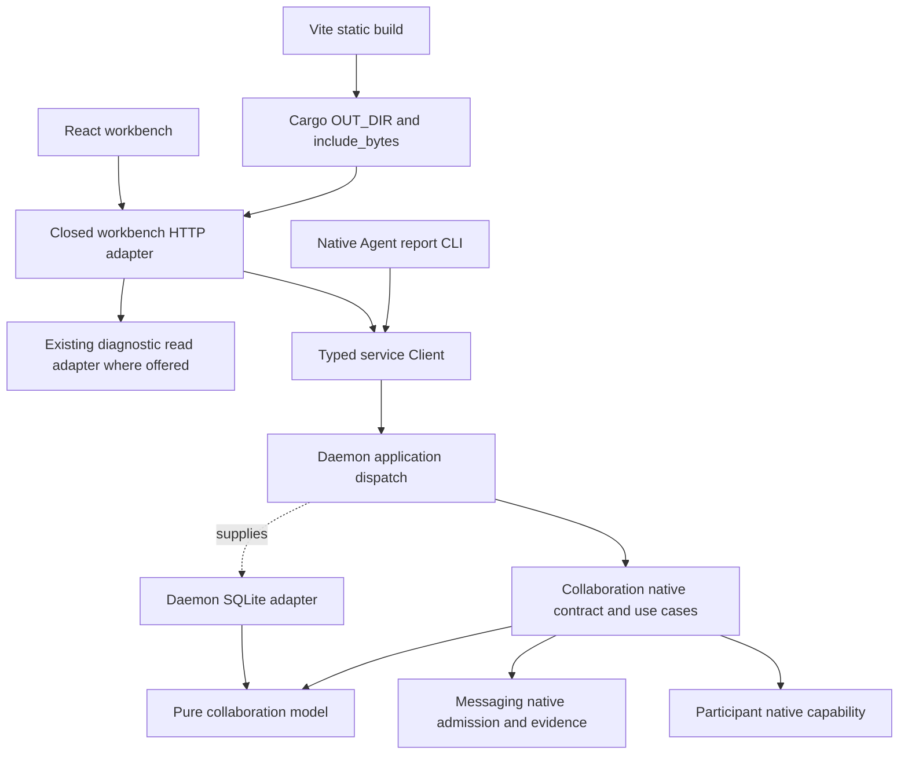

# Work delivery capability and engineering design

## Authority and outcome

This document owns the selected domain meaning for the [Delivery](../../.controller/collaboration-workbench/delivery.md). Its structural operation sketches are now realized by [actual native declarations](../../src/collaboration/service.rs), [native usage/limits](native.md) and the [closed browser mapping](browser-api.md). Those declarations are the callable source of truth; the [original native Task](../../.controller/collaboration-workbench/tasks/collaboration-service.md) and independent acceptance distinguish authored source from executable support. The [experience design](experience.md) and its owner own layout and visual interaction.

The bounded outcome is one real project change: a person defines its goal and acceptance criteria, assigns an existing AgentX implementer and an independent checker, answers a concrete question, receives a versioned result, explicitly requests checking, inspects the check and accepts that exact result or requests changes. Return after a disconnected browser must preserve the work and distinguish an unknown request outcome from failed work. The running LAN demonstration is a separate preserved resource.

Stakeholders are the operator, assigned participants and future maintainers. Provider execution permissions remain Provider-owned. AgentX owns coordination facts. Paseo is the development team's platform and supplies no product identities or scheduler to this design. The current [domain model](../model/README.md) and [storage boundary](../model/storage-boundary.md) continue to apply.

## Existing capability and selected gap

| User need | Existing source authority and actual meaning | Selected addition or limit |
| --- | --- | --- |
| Select real collaborators | [Participant service](../../src/agents/service.rs) has List, Lookup, Record and Resolve; [ParticipantRef](../../src/agents/attachments.rs) is canonical name plus exact incarnation bits. | Project-filtered safe candidate projection and exact role bindings. Do not send complete InstanceRow, session metadata or process capabilities to the browser. Revalidate the exact reference inside every dispatch transaction. |
| Start or resume an Agent | [Launch contract](../../src/agents/launch_service.rs) reserves participants and records terminal/supervisor/batch outcomes; [runtime boundary](../../src/runtime/AGENTS.md) owns actual host effects. Batch requested/launched/failed counts describe launch, not completed work. | Reuse ordinary local launch for the first path. Browser selects existing participants; it does not receive argv, executable, environment, terminal, resume, kill or spawn authority. A new generic launch platform is unnecessary. |
| Send an assignment or answer | [Messaging service](../../src/messaging/service.rs), [stored admission](../../src/messaging/service_store.rs) and [submission](../../src/messaging/submission.rs) already commit messages and retain request-ID acceptance. [MessageEnvelope](../../src/messaging/routing.rs) supplies thread, reply_to, intent and bundle_id. | Compose work-linked finite dispatches over these capabilities. A committed message is queued work, not a participant's acknowledgement or completion. Explicit targets seed a work thread; no browser broadcast or arbitrary thread selector. |
| Know whether a message arrived | [Inbox contracts](../../src/messaging/inbox.rs) and [activation policy](../../src/messaging/activation.rs) distinguish preparation, Issuing, exact receipt and uncertainty. | Project safe message delivery state only when actual native evidence is available. Missing evidence remains unknown; never let a browser acknowledge inbox claims. Delivery is separate from work acknowledgement and progress. |
| Keep a conversation in context | Existing message thread/reply relationships and [event queries](../../src/events/service.rs) retain conversation facts; [bundle operations](../../src/messaging/bundle_service.rs) provide frozen event windows. | Work detail offers finite pages for its own retained thread and explicit message refs. No browser SQL/filter tunnel or machine-wide timeline. Free text does not become structured status by inference. |
| Ask for human input | Native messages can carry a request, but no existing work-question lifecycle was found. Runtime blocked status is not a structured product question. | A small question value inside the work record retains author, assignment, prompt, answer and message refs. It is necessary to restore the unanswered decision after reload and prevent acceptance while it is unresolved. |
| Find an output | [Bundles](../../src/messaging/bundle_service.rs) retain file/event/transcript references; [transcript selection](../../src/transcript/service.rs) retains source paths, not file content. | A versioned reported result retains summary, source basis and bounded artifact refs. The first path uses an immutable repository revision or content fingerprint verified by the checker. No new artifact repository, uploads or arbitrary filesystem preview. |
| See independent checks | Existing events and messages can report checks but do not bind a verdict to a work result or enforce independence. | Retain a checker report bound to the exact result and brief revision, with observed source fingerprint and check evidence. A passing report is attributed evidence, not a daemon-run test or browser-verified claim. |
| Accept the result | Messaging's type named Acceptance means durable message admission; it is not human acceptance of work. No existing work acceptance contract was found. | Retain an explicit operator decision naming current result, passing check and brief revision. Never reuse messaging Acceptance as this concept. |
| Reuse a workflow | [Bundled workflow registry](../../src/workflows/mod.rs) embeds shell workflows; scripts compose launch, messaging and events. They are not a durable task/run/acceptance service. | Reuse useful human/Agent procedures and original references; do not expose arbitrary workflow scripts to browser execution or turn this slice into a workflow editor. |
| Diagnose an interruption | [Native service](../../src/service/mod.rs), [caller context](../../src/service/context.rs) and [typed client](../../src/service/client.rs) preserve generation, request identity and transport uncertainty. [Observability](../observability/README.md) supplies diagnostic evidence, not business authority. | Work command lookup supplies durable reconciliation. Diagnostic links are contextual and optional; observation loss cannot change work facts. |
| Open the workbench | [Current browser contract](../observability/browser-api.md) and [closed browser reads](../../src/observability/web/api.rs) implement credential-free one-scope diagnostic reads only. | A distinct workbench entry adds finite collaboration operations with startup-selected scope/project/mode. Existing observe-web remains read-only. |

## Minimal model and why it persists

Use one small collaboration aggregate per work item, not a second editable planning system. An optional original Task file, issue URL or other source reference remains authoritative for planning. AgentX retains an explicit brief snapshot for this execution and its source reference/revision; it neither edits that source nor silently synchronizes status back to it. A source file changes only through its existing owner. An execution snapshot is needed even when the original source later changes or disappears.

In this slice a source reference is retained metadata, not an automatically read file or fetched URL. Show the saved source/revision as reported and its current readability/freshness as unchecked. A missing source does not erase the retained brief, and a changed source does not silently update it. The operator explicitly records an UpdateBrief from the intended new basis. This supplies the experience's source-disclosure fallback without promising an unselected file reader.

| Concept | Meaning and minimal retained facts | Reason for retention |
| --- | --- | --- |
| Work reference | Data scope + database generation + work ID; fixed canonical project root; title, goal, criteria and optional original source reference. | Reopen the same work and reject references after dataset replacement. Project is independent from AgentX data scope. |
| Brief revision | Immutable goal/criteria/source snapshot plus accepted decision answers; each required criterion has a stable ID within that revision. A separate monotonically increasing work revision guards concurrent mutations. | A result checked against old requirements must not qualify against new ones; general UI refreshes must not invalidate a result. |
| Role assignment | Stable assignment ID, role, exact ParticipantRef and current dispatched brief basis. Initially one implementer and one distinct checker. | Names can be reused. An idle Agent is neither an assignment nor a result. Rebinding creates a new assignment and preserves the old facts; dispatches preserve their original basis. |
| Dispatch | Assignment, command ID and retained message acceptance/event ref; role and brief/result basis are frozen. | Restore a lost acknowledgement without sending a second assignment. Use the existing message event as the correlation; no separate generic Run entity. |
| Work report | Attributed acknowledgement, started/progress, question, result or check from the assigned actor. | Runtime activity cannot supply these domain statements. Retain bounded progress summaries and referenced message evidence; do not retain every tool event again. |
| Question | Stable question ID, author/assignment, prompt, optional suggested answers, open/answered state, answer and answer-message ref. | The operator can find and answer a particular pending decision after returning. Answered is not proof the Agent consumed the message; no additional close-question operation is needed in this slice. |
| Result revision | Immutable result ID, publishing assignment, brief revision, summary and artifact/source refs with reported fingerprint. | A later result must not inherit a previous check. Artifact location alone is mutable and insufficient as checked identity. |
| Check report | Immutable check ID and check-request ref, checker assignment, exact result ID/brief revision, observed fingerprint, per-criterion verdict/evidence and overall verdict. | Establish what was actually inspected and by whom. Verdict is passed, failed or unable-to-check; unavailable is not pass. Missing a required criterion cannot produce an overall pass. |
| Operator decision | Accept or request-changes, exact result/check/basis, reason and native command identity. | Preserve an explicit human-facing decision and its subject. No verified named human identity is claimed on a credential-free LAN. |

These values belong in one work record. Use one daemon-owned aggregate row with indexed project/work identity and revision, and the existing retained-command pattern for finite mutation receipts. A separate table/service for each value is not justified. The native owner selects the exact additive storage declaration and reset handling; do not scatter editable work facts across source files, browser storage and telemetry. Do not remove historical results/checks/questions to implement a current-state transition.

Bound records and projections explicitly in native declarations: finite text and artifact lists, finite dispatch/report history and paged work/thread lists. On a declared record limit, reject the mutation without partial changes and keep existing work readable. Do not silently evict acceptance or command-recovery facts while promising their availability. The first slice does not require indefinite retention, archival or a generalized event-sourced ledger.

An artifact reference is either a project-relative path plus a content fingerprint, an immutable Git revision/path, an owned message/bundle ref, or an external reference displayed without fetching. Relative paths cannot escape the launch-selected project. A supplied fingerprint is reported evidence until the independent checker reports observing the same content. Acceptance names that immutable result; it does not certify the current working tree, a deployment, or future bytes at a mutable path. Prefer an immutable commit/tree in the real acceptance fixture. Browser file previews and live filesystem freshness checks remain deferred.

## Operations, effects and recovery

The following names retain the design's semantic operation grouping; consume [service.rs](../../src/collaboration/service.rs) for actual types/signatures and [native.md](native.md) for report/entry usage. They are not another editable schema. `OperatorCommand` and `AgentReport` separate caller meaning; browser closure contains operator operations only. One native domain variant is warranted because work-specific invariants are new and belong neither to Participants nor Messaging.

```text
Read(ProjectSelection, WorkQuery) -> WorkList | WorkDetail | Candidates | CommandOutcome
Apply(CommandId, ExpectedWorkRevision, WorkCommand) -> CommittedChange | Rejected

WorkCommand = CreateWork | UpdateBrief | BindParticipant | DispatchAssignment
            | SendNote | ReportProgress | AskQuestion | AnswerQuestion | PublishResult
            | RequestCheck | PublishCheck | AcceptResult | RequestChanges
```

CreateWork supplies a stable client command ID and the selected initial role bindings; work reference is absent until creation. Other commands carry the complete work ref, expected revision and operands. Native public errors distinguish invalid input, forbidden actor, stale reference/generation, revision conflict, unavailable service and capacity/size limits. Transport cancellation or a lost reply has no new business verdict. Read only returns the selected project's finite projections; it never returns raw aggregate service requests or credential-bearing participant records.

| Operation | Required meaning and actual effect |
| --- | --- |
| CreateWork | Atomically retain title/goal/criteria/source basis and exact implementer/checker bindings after validating the chosen project and participants. No message is implied. A UI may compose create then dispatch, but must retain the created work if dispatch fails and show that specific partial result. |
| UpdateBrief / BindParticipant | Explicit operator change against expected revision. Requirement changes create a new brief revision; role replacement creates a new assignment. Existing evidence remains historical and cannot silently qualify for the changed basis. |
| DispatchAssignment | Validate exact current participant, assigned project, brief and role; atomically retain the native message acceptance and work dispatch reference. Message body includes work/assignment/basis refs and how to report through the finite native contract. Return accepted event and recipients. No started/completed claim. |
| SendNote | Operator sends an ordinary task supplement to selected currently bound role(s), with the work thread and exact recipients supplied by native mapping. Retain native acceptance and its work reference atomically. It does not answer a question, change criteria or set progress by parsing its text. |
| ReportProgress | Assigned actor explicitly acknowledges or reports started/progress for its current assignment/basis. Browser operator cannot impersonate that participant. Runtime status and message delivery remain separate evidence. |
| AskQuestion | Current assigned actor creates a stable question under its assignment with prompt and supporting message ref. Do not infer a question from arbitrary text or Provider blocked status. |
| AnswerQuestion | Operator retains one answer and a targeted message in the same native transaction. Address the current exact assignment for the question author's role, preserving the historical author; after rebind, an old pending question can therefore be answered to the replacement. If the answer changes the mandate, also create a new explicit brief revision and an amendment dispatch advancing the addressed assignment's current basis. An ordinary clarification can retain the existing basis. Concurrent or duplicate answers cannot silently overwrite each other. Native message-admission failure rolls back the answer; subsequent Provider delivery failure/uncertainty preserves the saved answer and accepted message. |
| PublishResult | Current implementer publishes immutable result and artifact/source identities for its assigned brief. A native message referencing the publication may notify collaborators; no automatic checker execution follows. |
| RequestCheck | Operator explicitly chooses the current result and the independently bound checker. Retain a targeted native message and its acceptance with this check request, advancing the checker assignment's dispatched basis to that current result/brief. This is the visible “请求独立检查” action, not automatic scheduling. An explicit same-result recheck supplies a reason and a fresh request ref; the new active request supersedes earlier check eligibility without deleting its reports. |
| PublishCheck | Only the requested checker assignment may publish a verdict for its exact active check request/result/basis. A passed verdict requires matching observed source fingerprint, all required criterion IDs passed and concrete check evidence; a different source or missing criterion cannot pass this result. Checker and result publisher must be distinct participants. |
| AcceptResult | Operator compare-and-set requires the current result, current brief, current eligible passing check, no open question and no outstanding request-changes. Retain the exact accepted tuple. A late check or optimistic browser state cannot make an obsolete result acceptable. |
| RequestChanges | Operator retains the reason and links it to the exact result/check. When dispatching the request to the implementer, retain its native acceptance atomically. A new publication/check is required; the old result/check/decision remain inspectable. |

### Atomicity and caller meaning

Use the existing daemon `with_write_scope` and post-commit facilities described in the [DB guide](../../src/db/AGENTS.md). A mutation, its normalized intent/actor receipt, and any native message event/acceptance required by that mutation must commit or roll back together. Compose the domain-owned messaging admission under this outer scope; do not duplicate message-routing SQL or run CLI commands in the daemon. Messages owns normalization, routing, durable acceptance and wake policy. Post-commit wakes remain hints; they do not create a new daemon worker or durable job queue. No Provider I/O or filesystem traversal occurs under this transaction.

For a command retry, look up the retained intent before reapplying the current expected-revision guard. Same command ID + normalized intent + actor + generation returns the original result, even if the aggregate revision later advanced. Reuse with different intent/actor conflicts. Work command receipts for operator actions are scoped to the local operator meaning and data generation, not to one browser tab, adapter PID or daemon lifetime; otherwise a restart would break reconciliation. Participant reports retain their exact resolved actor identity. Do not reuse another domain's private retained helper if its PID/incarnation binding has different semantics.

Each dispatch is the bounded work attempt; no generic Run record is added. A standalone UpdateBrief creates a new requirement basis but does not silently deliver it. Explicit DispatchAssignment advances the current assignment's dispatched basis and preserves old dispatches. A mandate-changing AnswerQuestion composes that amendment dispatch atomically because its new instruction is already being sent. Reports/results must name the current dispatched basis and current brief. Rebinding either role invalidates eligibility based on its superseded assignment; further result/check publication must use the new assignment. This avoids an Agent accidentally reporting against requirements that were saved but never assigned to it.

The browser adapter supplies a captured local invocation for its fixed scope/project with inherited Agent identity claims cleared; the browser cannot submit environment, actor capability, process binding, PID or Provider session. The daemon continues to observe the real local caller process. Participant reports use `agents::service::resolve_actor` through the native caller path and must match the current assignment. An actor string in JSON is never that proof. Human-facing browser commands have explicit operator meaning; a stale/malformed Agent claim must not fall back to operator authority. A participant report cannot accept work or publish an independent check as another participant.

Do not use a participant being busy/idle as a work eligibility shortcut. Candidate availability comes from exact project/identity and current native capability checks; an accepted message can remain pending while the Provider is active, waiting for approval/input or otherwise unable to consume it. No Provider permission/approval interface is added here. Expose the known blocked/unknown reason locally and leave the existing Provider owner responsible for its permission.

### Interrupted return

1. Browser issues one stable command ID with the current work revision. HTTP closes after the daemon may have committed a dispatch or acceptance.
2. Browser shows “结果待确认” and keeps the current dossier/evidence. It does not mark the work failed or generate a second command ID for the same intended action.
3. A finite CommandOutcome lookup using the same command ID, actor meaning and generation returns committed outcome or not-found. The browser may retain only this bounded pending command reference for reload, without credentials or work content; the implementation must document and clear it after reconciliation.
4. A committed outcome is displayed from native facts. Not-found alone does not prove the first request can no longer commit; resubmission uses the same stable command ID and same intent, relying on native deduplication. If the input is no longer available, refresh work and require a deliberate new action rather than fabricating the original request.
5. A daemon restart may reconnect to the same data generation; a dataset replacement requires explicit refresh and rejects the old reference. Never replay across generations or auto-create the old work in the new dataset.

Browser observation has a separate lifecycle: connected, loading, showing historical evidence, unavailable and closed. Closing the page cancels page reads only; it does not stop participants or erase work. Native participant exit during a dispatch is a stale/unavailable collaborator condition. Keep its old assignments/reports; select a new exact participant through an explicit rebind instead of silently targeting a namesake. Full interrupted-Agent resumption orchestration is deferred.

## States and invariants

Do not flatten independent dimensions into a misleading single “running” enum. The authoritative facts are brief/assignment/result/check/decision records. The UI can derive a concise primary state from them while still showing message delivery and participant runtime state separately.

| Dimension | Allowed meanings |
| --- | --- |
| Dispatch | Not requested; native message accepted; positively delivered; delivery uncertain/unavailable. Only Messaging can establish the latter evidence. |
| Assigned work | No acknowledgement; actor acknowledged; actor reported started/progress; waiting on an open question; result reported. None is inferred from idle. |
| Result/check | No result; current result awaiting check; check requested; checker reported in progress; check failed/unable; check passed for exact current basis. A new result leaves previous checks historical. |
| Operator outcome | Undecided; changes requested; accepted exact result/check/basis. Accepted work is closed in this slice; further work is a new work item referencing it. |
| Observation | Current read; historical retained view; unavailable; stale generation. Observation does not write any dimension above. |

Invariants to enforce in native behavior, not only button visibility:

- Work refs never cross scope/project/generation; short labels and participant names are display values.
- No assignment targets a different participant incarnation or a different project after validation. Selection outside the fixed project is rejected, not a hidden launch.
- Every report is attributable to its current exact assignment; a retired assignment's late report cannot replace current work. Historical reports remain attributable after participant exit.
- Each result and check is immutable. Publish a new ID rather than editing a checked payload in place.
- A passed check belongs to the active check request, requested result, source fingerprint and brief revision, covers every required criterion, and comes from a participant distinct from the result author. This establishes participant-level independence, not independently authenticated humans or different model vendors.
- Open questions block acceptance. Changed requirements, replacement result, failed/unable check or an outstanding request-changes invalidate current eligibility without deleting evidence.
- AcceptResult compares its selected tuple and expected work revision in one transaction. All concurrent browser clients share this rule.
- Message admission, exact receipt, report publication, reported check and operator acceptance remain different facts. Missing observations cannot fill gaps in that chain.

## Credential-free finite LAN boundary

Preserve the user's direct-access requirement. Recommend a dedicated `agentx workbench --scope PATH --project PATH [--collaboration] [--host IP] [--port PORT]` entry, with embedded resources. This is a proposed spelling, not current help. Scope and canonical project root are fixed at local launch; default numeric loopback/ephemeral port follows the existing adapter, and explicit numeric LAN binding remains available. `--collaboration` enables only the selected work mutations and associated targeted messaging. Without it, the workbench can show its finite project reads and clearly says “只读”. No token, bootstrap, session, login or per-action authorization stage is added.

This mode is the proportionate explicit boundary: the local operator chooses one project and whether LAN clients may coordinate its work. All clients reaching an enabled listener have the same finite operator capability, including explicit acceptance. Same-origin/Host validation prevents unintended cross-origin browser requests; it does not authenticate a person or distinguish trusted LAN users. Free-text assignment/answer messages may cause assigned Agents to act under their already granted Provider permissions. The product must describe this capability honestly rather than calling message text a restriction on all possible Agent effects.

Reuse exact numeric Host/Origin checks, strict JSON/precision handling, finite body/response/concurrency limits, no CORS, no-store responses and same-origin CSP from the [current adapter](../../src/observability/web/mod.rs). Closed work reads/mutations get their own native-derived browser types and mappings. Do not deserialize `service::Request` from HTTP or add a generic native proxy. Preserve lossless integer/incarnation handling from the [precision codec](../../src/observability/web/wire.rs).

The enabled set is work creation/brief/bindings, selected dispatch/note/answer/check-request/change-request messages and explicit acceptance. Structured Agent report commands remain native actor-bound operations, not browser impersonation actions. The browser cannot choose data scope/project root, send arbitrary file paths to a reader, execute shell/SQL, start or terminate processes, mutate configuration, reset data, select environment or acknowledge delivery claims. Native use cases retain validation even though all local same-user clients already have their usual OS authority.

Expose a finite launch/connection descriptor with selected project label, scope ref, current data generation, collaboration mode and service availability. Product affordances are “协作可用”, “只读” and service unavailable, with a short reason beside the unavailable action. No fake unlock/login button. Once enabled at launch, each allowed domain action proceeds directly under its own revision/actor guards. Existing `observe-web` keeps its credential-free passive diagnostic contract and its live demonstration is not repurposed.

## Engineering structure and frontend choice

The persistent dossier, shared selection across conversation/result/check panes, human question form, asynchronous mutations, stale replies, concurrent revision conflict and narrow-screen disclosure justify React's local state/component ownership. The implementation is still one client-rendered workbench served by Rust; it needs neither a Node runtime service nor server-side rendering.

| Candidate | Fit and cost | Decision |
| --- | --- | --- |
| Existing DOM + strict TypeScript | Zero added runtime dependencies; proven for finite read-only diagnostics. The [current state owner](../../web/observability/state.ts) and [build script](../../web/observability/build.mjs) can remain unchanged in their domain. Coordinated editable forms and persistent contextual panes would add manual DOM/state synchronization. | Retain for diagnostics; possible fallback if the chosen experience collapses to a single bounded read/form. Do not rewrite the diagnostic app for this Delivery. |
| React + TypeScript + Vite | React provides component identity and owned state for the selected interacting views; Vite supplies established JSX/build/module/asset handling instead of a custom bundler. Adds a finite frontend dependency graph and lock/install prerequisite. | Recommend for the selected workbench. Keep the dependency addition scoped to this app and pin versions through the existing package lock; no unrelated plugin SDK upgrades. |
| Next/full-stack framework, router/state/query platform | Adds server/deployment or framework policy without a selected need. One task context and a few local panels do not require those facilities. | Deferred. Start with React state/reducer, typed API functions and native browser AbortController. |

Official basis checked 2026-11-09: React's [build-from-scratch route](https://react.dev/learn/creating-a-react-app) explicitly allows build tools including Vite for constraints not served by a full framework; [Vite production build](https://vite.dev/guide/build) emits static assets. Current package metadata reports [React 19.3.1](https://registry.npmjs.org/react/latest) MIT, [Vite 8.3.6](https://registry.npmjs.org/vite/latest) MIT with Node `^20.19.0 || >=22.12.0`, and [plugin-react 6.2.1](https://registry.npmjs.org/@vitejs/plugin-react/latest) MIT targeting Vite 8 with the same Node range. The repository [engine](../../package.json) requires Node `>=22.23.3 <23`, which fits that declared range. These are selection evidence, not installed or exercised dependencies; implementation must pin a mutually compatible react/react-dom/type/plugin set and inspect optional compiler peers rather than install unrelated tools. No dependency installation, compiler or compatibility probe was performed by this design Task.

### Module map and dependency direction



Arrows describe capability/dependency direction, except the labeled composition edge. Pure model/contract types do not import Axum, React, CLI parsing, Provider frames or private message/participant stores. The daemon adapter can use the existing DB write scope and domain-offered native handlers; only daemon composition constructs managed storage. Reports and browser actions are consumers of the same collaboration contract.

Recommended implementation homes and write allocation for the existing planned Tasks:

| Owner | Concrete home and responsibility |
| --- | --- |
| Native collaboration Task | New `src/collaboration/{mod.rs,service.rs,model.rs,store.rs}`: offered native declarations, pure aggregate rules and daemon persistence/application adapter. Add `Request::Collaboration`/response and composition in `src/service/{mod.rs,application.rs}`; register module in `src/main.rs`. Keep the public leaf small. |
| Native collaboration Task | Add minimal `src/cli/commands/work.rs` and owning CLI routing/help for show, acknowledgement/progress, question, result and check reports, using typed Client and resolved actor. Human work mutations may use the same leaf without separate business logic. No shell-script protocol for structured reports. |
| Native collaboration Task | New `src/collaboration/web/{mod.rs,api.rs}`: proposed startup entry, fixed project/mode, closed browser mapping, safe projections and actor-cleared local invocation. Add only the necessary early CLI dispatch. Do not add collaboration writes to `observability/web/api.rs`. |
| Native collaboration Task | New `src/db/collaboration.rs` only for cohesive aggregate-row/receipt SQL if needed by existing DB organization; additive schema/reset entries in `src/db/{mod.rs,reset.rs}`. Domain transition/eligibility rules remain in collaboration. Reuse existing event/message persistence rather than duplicate it. |
| Native collaboration Task | Browser transport reuse: extract only existing generic manifest loading, precision codec and numeric-origin admission into shallow `src/browser/{mod.rs,assets.rs,wire.rs,admission.rs}` consumed by both outer adapters. Move behavior with its tests; no new transport abstraction framework or change to diagnostic routes. Current embedding-specific table selection stays at each app composition. This reuse is justified by two concrete consumers; if a helper remains private to one host, leave it there. |
| Native collaboration Task | Own `web/workbench/api/{native.ts,client.ts,derive.py}` for native-derived browser closure and the strict finite handwritten client; reuse the existing derivation mechanism where its supported syntax matches. No second editable DTO/schema. Native owner publishes declarations before Web behavior depends on them. |
| Web workbench Task | New `web/workbench/` with `entry.tsx`, `workbench.tsx`, `state.ts`, feature-local components for task context/assignment/conversation/questions/results/checks, `styles/`, `index.html`, `tsconfig.json`, `vite.config.ts`, `build.mjs` and source/case guides. Exact visual grouping follows the experience design. API closure is imported from its native owner. |
| Web workbench Task | Own the scoped `package.json`/lock additions and `build.rs` frontend orchestration/embedding changes, with matching Cargo source-archive includes, package documentation and just recipes. The native owner does not concurrently edit these files. Controller records any actual shared-source handoff before workers begin. |
| Independent acceptance Task | Own actual build/package/browser/native execution and one evidence record. Consume owner-authored cases; preserve the live demo and use a disposable scope/project/listener. |

The shared browser extraction is infrastructure reuse, not permission to reorganize observability policy or rebuild its UI. Native owner also owns its moved Rust references; Web owner owns build/table/manifest references. Their skeleton release must name those seams before parallel edits. No `.bin` asset, process, build resource or source claim is held by this design assignment.

### Frontend state and packaging contracts

Use a workbench state owner for selected work, latest authoritative revision, pending command and request generations. Keep form drafts local to their feature; preserve a draft on a failed mutation and never replace authoritative native state with an optimistic acceptance. A response must match selected work/scope/generation and its request before applying. React components own cancellation/timers through cleanup; late reads cannot switch the current work or overwrite a newer mutation. `return` expresses structure; named selectors/handlers own behavior. Exported TSX components require the project's concise `@aiPurpose`/`@aiUsage` contracts.

Prefer no global state library, general router or data-fetch framework initially. The native client owns lossless wire decode, explicit command lookup, read cancellation and transport-vs-domain errors. Presentation owns Chinese labels and illustrative examples; native code owns eligibility and reported/verified distinctions. Do not retain work payloads in local storage. The bounded pending command ref used for interrupted return is a specific documented exception to the old diagnostic app's no-storage rule; it carries no authorization.

Vite builds a static distribution into a fresh Cargo-owned `OUT_DIR/workbench-web` directory. Configure same-origin external scripts/styles and controlled output names/paths. Generate the existing finite `manifest.json` format from actual outputs, including hashed assets; consume it as the asset allowlist. No CDN, inline bootstrap/style, development server or Node process is needed by a packaged user. Check that the selected styling mechanism respects the existing CSP; a runtime inline-style library is unnecessary.

Extend [build.rs](../../build.rs) to build and embed both distinct apps from current source. Its present generator accepts only flat html/js/css; a Vite assets subdirectory or SVG/font therefore needs a deliberate manifest-driven generated table, path/MIME validation and matching runtime loader. Reuse the existing byte/count bounds and canonical-path rules from [assets.rs](../../src/observability/web/assets.rs). Do not accidentally feed an unmodified nested Vite dist to the current flat scanner, embed stale `.bin` bytes, or silently continue when frontend compilation fails. Watch all workbench source/config/lock inputs and compiler dependencies so a cached Rust binary cannot retain old UI assets.

The root package already has plugin SDK dependencies; avoid a second package manager or parallel unmanaged lock. Treat the added browser packages as build inputs, document locked install prerequisites for source/archive builds and update Cargo's source include list where required. Prebuilt users need only the binary. A development server, if used by the independent executor, uses an explicitly selected non-default port and is unrelated to the running LAN demo.

## Rejected expansions and remaining conditions

The concrete [experience offering](experience.md#唯一场景源与四张图) was consumed as document/SVG source, without rendering or claiming visual validation. Its S1 saved-before-dispatch state, S2 structured overwrite question, S3 explicit check request, S4 per-criterion reports/versioned acceptance and S5 preserved narrow context fit this model. The offered task supplement required the finite SendNote operation above; its per-criterion rows required criterion IDs/report coverage, and same-result recheck required a new check-request ref. No domain constraint prescribes its dossier layout. Controller-owned SVG rendering and user discussion remain the actual next design-stage activity.

| Alternative | Disposition |
| --- | --- |
| Infer task completion from idle, assistant text, delivered mail or HTTP 200 | Rejected: none establishes a result/check/acceptance fact. |
| Full task/Run/DAG/scheduler/organization model | Deferred: existing native activation and explicit human check dispatch serve this slice. |
| Rewrite original Task files from browser state | Rejected: duplicates planning truth and creates hidden synchronization. Retain a linked execution basis. |
| Token/login/session bootstrap for LAN writes | Rejected for this Delivery's explicit credential-free preference. Fixed startup scope/project/mode and closed native operations are the selected boundary. |
| Browser arbitrary prompts to any scope/agent or generic shell/argv bridge | Rejected: selected commands address bound project participants only; launch permissions remain local/native. |
| In-browser file browser/test runner/artifact service | Deferred: result refs and an actual checker provide the selected outcome without broad filesystem/command authority. |
| Treat a reported fingerprint as a filesystem freshness proof | Rejected: check and acceptance name an immutable published source; live mutable-file freshness is unsupported. |
| Automatic check dispatch on every result | Deferred: use explicit RequestCheck, keeping the operator's current decision visible and avoiding a scheduler. |

Implementation is authorized after the discussed SVG/detail offering, under the [Delivery](../../.controller/collaboration-workbench/delivery.md). Native declarations, finite bounds, v23 storage/reset, actor/receipt rules, closed browser mapping and report CLI grammar are now source-authored at [native usage](native.md). Web consumes this actual boundary and the experience artifacts. Independent execution/outcome acceptance remains separately owned; these source facts do not establish delivered runtime support.

Open details are intentionally implementation-owned: exact additive schema version and record limits; exact compatible React package pins/optional peers; available source/archive tooling; and whether the Provider used in the real fixture exposes positive message delivery evidence. None may be silently represented as executed support. Full Provider approval UI, automated launches, source-file synchronization, browser artifact previews and mutable-filesystem freshness remain unselected. Native implementation must document any actual inability to compose a required message and work record in one transaction before changing that guarantee.

## Bounded real acceptance scenario — authored, unexecuted

Use a disposable real repository and AgentX data scope, an immutable published source revision, a real existing implementer and a different real checker under the selected Provider. Create product-test participants through AgentX in a disposable scope separate from engineering participants. A suitable small task is the experience owner's illustrative CSV export: explicitly define overwrite policy and a check that catches an incorrect overwrite behavior. The example remains illustrative until these participants and artifacts actually exist.

| Case | Required observation and owner |
| --- | --- |
| Define and assign | Create work with goal/criteria/original ref and exact role bindings. Verify the native retained work, accepted assignment event and any real delivery evidence separately; no idle-to-complete inference. Native/Web authors supply cases; independent owner executes. |
| Resolve a decision | Implementer creates a structured overwrite-policy question; browser returns to that same question and answers it. Verify retained answer, targeted message and explicit brief revision when changing criteria. |
| Produce and inspect | Implementer publishes result r1 with actual source/artifact refs. Browser retains task context while reading summary/source/check evidence. Copied links resolve to real fixture output; no promised preview is replaced by a fake page. |
| Check fails then recovers | Operator requests independent checking; checker inspects r1 and reports a real failure. Operator requests changes; implementer publishes r2; checker inspects r2 and reports actual passing evidence for its exact source/basis. r1 and its failed check remain inspectable. |
| Enforce acceptance | A stale r1 acceptance, wrong-basis check, self-check or old participant incarnation is rejected natively. Accept r2/current passing check explicitly and retain its tuple. Any personal identity claim stays within credential-free operator semantics. |
| Interrupted return | Drop one HTTP mutation reply after it may commit, reopen and reconcile the same stable command ID. Verify one retained message/decision and no automatic duplicate dispatch. A daemon restart on the same scope preserves facts; a different data generation rejects old refs. Exercise only this bounded return path. |
| Finite LAN mode | Numeric LAN navigation needs no credentials. Read-only launch refuses mutations; collaboration launch admits only selected operations for its project. Wrong origin, cross-scope/project, actor impersonation and arbitrary command input are rejected. Existing diagnostic listener remains untouched. |
| Standalone and UI | Independent owner builds fresh embedded assets, runs the exact binary from an unrelated directory without --assets, and exercises the selected desktop/narrow path. Record artifact hash/version, real Provider/platform, native/browser results and cleanup. No source release or SVG counts as this evidence. |

Only the [independent acceptance Task](../../.controller/collaboration-workbench/tasks/acceptance.md) executes these cases and records actual support. This design performed source/document/package-metadata inspection only; it installed nothing, ran no tests or builds and changed no product process.
