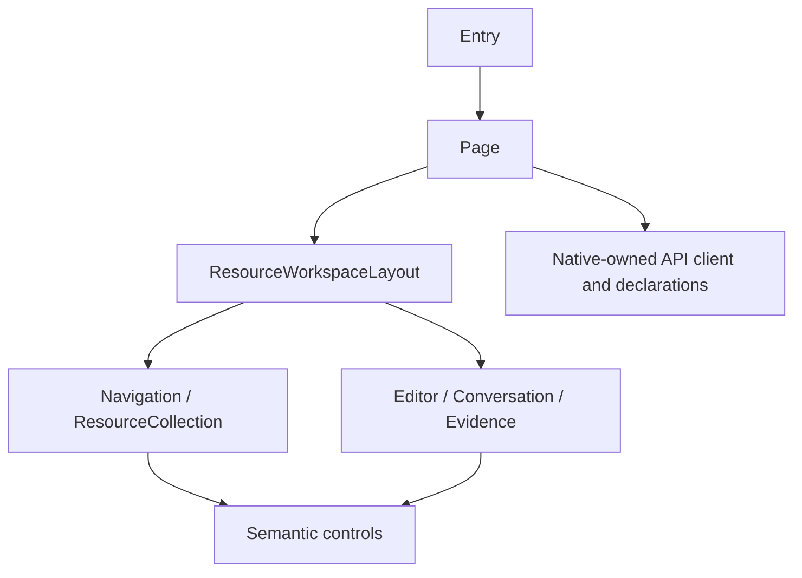

# Workbench frontend

## Structure and authority

The [accepted semantic contract](interface-details.md#layout--blocks--components-合同) is the structural basis. The actual source entry is [`web/workbench/AGENTS.md`](../../web/workbench/AGENTS.md). `entry.tsx` bootstraps; `workbench.tsx` composes Page orchestration, the named resource layout and feature Blocks. `components.tsx` owns interaction primitives. Resource, editing, conversation and evidence Blocks import native-owned `api/native.ts` declarations; `api/client.ts` owns HTTP/wire behavior. No second editable native model or production example data is selected.

Page owns confirmed snapshots, abortable read generations, shared object selection and captured command outcomes. Blocks emit intent; editors keep drafts in memory above view remounts. Derived filters only cover loaded native records. Source groups are saved references, not filesystem browsing or persistent Delivery entities.



## Tooling and embedding seam

Root npm is the only package/lock system. Exact new development pins are React/react-dom `19.3.1`, their type packages `19.3.0`, Vite `8.3.7`, plugin-react `6.3.0`. Registry metadata was read 2026-11-09; React DOM and type peers align, Vite/plugin-react support the existing Node `>=22.23.3 <23` engine, and optional React compiler peers are not selected. Existing TypeScript/Node/plugin pins and overrides stay authoritative in root package.json. Metadata compatibility is not executed verification.

Fresh build outputs are `OUT_DIR/observability-web` and `OUT_DIR/workbench-web`. Each contains a finite `{files: [{url, file, content_type}]}` manifest and flat external HTML/JS/CSS. Root index maps to `/`; Vite emits hashed scripts/styles. `build.rs` publishes `observability_assets.rs` and `workbench_assets.rs` as expressions `&[(url, content_type, include_bytes!(...))]`, preserving the existing diagnostic consumer shape. Native owns consuming tables/optional manifest and HTTP hosting. No CDN, inline bootstrap or runtime Node is required by binary users.

## Method record and execution

Design → typed Layout/component skeleton → leaves → composed Blocks → Page native reads/commands is the implementation order. The original [Web Task](../../.controller/collaboration-workbench/tasks/workbench-web.md) owns live progress and friction. Independent acceptance owns all executable checks and the dependency lock. Source authoring does not establish browser, native-effect or standalone acceptance.

## Implemented presentation state and limits

`contracts.ts` declares UI-only inputs and intents; every domain value comes from native-owned `api/native.ts`. `layout.tsx` owns scroll regions and accessible resource disclosure. `resources.tsx`, `editor.tsx`, `conversation.tsx` and `evidence.tsx` own resource collections, brief/role changes, exact-Q/note/thread interaction and immutable evidence/acceptance respectively. `page-state.ts` owns read cancellation, native command capture and confirmed snapshots; `workbench.tsx` contains semantic composition. Export contracts point consumers to these responsibilities.

| State boundary | Implemented transition / invariant |
| --- | --- |
| Drafts | One new-work slot plus up to eight retained brief editors; no eviction or payload persistence. Existing editors are keyed by work ID; question/note drafts remain separate. Native counts exclude drafts. |
| Reads | Retain confirmed content/time during refresh. Abort replaced queries, reject stale query generations and invalidate reads across mutations. Bounded native work/candidate pages feed loaded-only filters; exact deep-linked work may be fetched directly. Thread reads have separate cancellation and event-identity pagination. |
| Commands | Capture normalized typed call, revision, work/scope/generation and one random command ID; disable competing writes while pending/unknown. Apply confirms only matching native outcomes; domain rejection preserves fields. A lost response retains the original call in memory for explicit same-intent retry. |
| Return after reload | Session storage retains only bounded command/work/scope/project/generation references. Lookup is available; missing receipt remains unknown. No input reconstruction or automatic replay. Old generations cannot replay. |
| Concurrent edit | Keep local fields; show server differences keyed by criterion identity; explicitly choose local/server values before continuing against refreshed revision. Role change remains its own command. |
| Evidence | Exact native result/check/basis/role evidence; accepted state is never optimistic. A confirmation captures native eligibility tuple and revision and becomes invalid after authoritative changes. Historical reports remain attributed/read-only. |

Native Detail is a bounded complete aggregate, not a paged history endpoint. Real ordinary Agent messages use the native Thread read; structured operator history separately exposes persisted receipt/basis fields. Current delivery projection has durable admission/recipients only, so delivery is honestly unknown. Source/file references are disclosed/copied or explicitly opened as external HTTP links, never fetched as file content.

The [authored cases](../../web/workbench/cases.md) identify intended observations; [canonical independent evidence](../../.controller/collaboration-workbench/evidence/acceptance.md) owns executed coverage and remaining gaps. No install, formatter, compiler, test, app build, browser or product execution was performed by the Web source author.

## Startup and everyday use

在项目目录运行 `agentx workbench`。scope 默认遵循 `AGENTX_DIR`（未设置时使用正常 home scope），project 默认为调用目录；本地启动会获取缺失的守护进程。需要有限协作写入时使用 `agentx workbench --collaboration`。无需参与者身份或单独启动 daemon；完整路径与恢复语义见[原生启动契约](native.md#workbench-startup-and-defaults)。

要显式覆盖 scope、项目和监听地址，可使用：

```bash
/absolute/path/to/agentx workbench \
  --scope /absolute/path/to/scope \
  --project /absolute/path/to/project \
  --iam wb-operator \
  --collaboration \
  --host 127.0.0.1 \
  --port 18947
```

Open the URL printed on stdout. For direct LAN use, replace `127.0.0.1` with this machine's numeric LAN interface address and use that exact printed origin. This credential-free listener exposes its selected mode to clients that can reach it. Scope, project and collaboration mode are fixed at startup. `--collaboration` enables finite operator commands; omitting it selects read-only mode. Both modes acquire the selected daemon once at local startup; HTTP cannot acquire a daemon. `--iam` is accepted as a shared invocation option and does not give browser calls a participant identity. No login/token/bootstrap stage or browser Agent impersonation is involved. Ctrl-C closes this adapter; native daemon and Provider lifecycles remain independently owned. The separate `agentx observe-web` entry serves passive diagnostics. See the [native entry and CLI contract](native.md#everyday-entry-and-native-reads) for reads and actor-bound reports. New startup-default/recovery execution evidence belongs to the [startup follow-up](../../.controller/domain-daemon/startup-evidence.md); the historical checks below retain their original fixed-artifact scope.

Start/select actual AgentX participants for this project through the existing native workflow before assigning work. The browser cannot launch Providers. A saved work is distinct from dispatch; exact participant incarnations matter, so a resumed or replaced role must be rebound explicitly. Follow the selected work through its local tabs:

1. Create the brief with its original source reference/revision metadata, goal, criteria and two exact role bindings; save, then explicitly dispatch.
2. Answer the exact structured question under Tasks or follow the real thread under Messages. A note is separate from answering a question; changing requirements is an explicit amendment. Saved message admission alone does not establish delivery or completion.
3. Inspect the real immutable result under Outputs and explicitly request a check for that result, brief and checker. A result needs a full Git object ID or SHA-256 identity; original brief revision metadata is not a substitute.
4. Return a failed result for repair, retaining its report. A repaired result and its new independent check remain distinct from the historical failure.
5. Open the exact eligible result/check/basis confirmation and explicitly accept. Acceptance closes the work as an operator statement; it does not authenticate a personal identity, merge code or publish anything.

Filters cover loaded records only and retain selected work outside the filter. Refresh failures retain confirmed content and local drafts. If an apply response is lost, use the retained original-command lookup; a missing receipt remains unknown. After reload only the bounded reference survives, with no reconstructed input or automatic replay. Concurrent brief edits retain local fields and require explicit per-field reconciliation before a new save.

## Independently exercised support

The [completed startup follow-up](../../.controller/domain-daemon/startup-evidence.md#controller-promotion-and-user-runtime-handoff) owns the current repository image and project daemon/workbench handoff. Its independently verified lifecycle/default changes supersede the historical r8 repository promotion below; the original workbench business and presentation evidence retains its fixed-input scope.

The historical [final artifact, evidence and cleanup handoff](../../.controller/collaboration-workbench/evidence/acceptance.md#final-artifact-evidence-and-cleanup-handoff) records immutable r8 `agentx 0.7.31`, its exact SHA-256 and source identity, and promotion of those same bytes to repository-local `.bin/agentx` at that checkpoint. Final packaging used the task-local required Node22 environment. From an unrelated empty directory without `--assets`, the binary passed workbench and original diagnostic embedded HTTP checks, byte-for-byte bundle identity, actual narrow evidence/touch interaction and diagnostic module/style mounting. The actual two-Agent outcome below is retained on r5 and reused across the documented presentation-only derivatives.

The [canonical evidence](../../.controller/collaboration-workbench/evidence/acceptance.md#exact-repaired-result-and-explicit-operator-acceptance) records packaged r5 `agentx 0.7.31`, its exact artifact digest and the real Linux numeric-LAN two-Agent path: question, failed baseline check, explicit return, immutable repair, new passing check and exact acceptance. It also records committed-reply loss/reload/original lookup, per-field conflict, read-only access, filter-empty/failed-refresh retention, keyboard Tooltip/Escape and narrow question editing. The same binary served embedded workbench and original diagnostic resources from an unrelated asset-free directory. These observations establish the named fixture and environment, not every authored case, operating system or browser.

The outcome used explicitly isolated full-access Codex roles after inherited runtime claims were removed. Workspace-write acquisition and configured v20 hooks against the v23 scope have separate retained limits in the [native support record](native.md#independently-exercised-support-scope). Independent acceptance verified both product roles, browsers, owned hosts and daemon stopped, the fixture ports closed and disposable fixture removed; retained evidence and the prior repository binary remain preserved. Protected LAN demo identities and installed/PATH/default programs remain unchanged. Independent acceptance is complete for this finite Linux scope; formal Delivery acceptance remains controller/user-owned.

Actual touch refresh exposed a missing Tooltip on r5. The bounded `web-workbench-r1.3` correction makes activation show its label/reason, retains one action invocation and restricts hover dismissal to actual mouse pointers. Independent r7 execution passed actual tap refresh, Tooltip/Escape/focus retention and touch reference disclosure; [canonical evidence](../../.controller/collaboration-workbench/evidence/acceptance.md#bounded-touch-correction-and-final-narrow-layout-finding) retains the exact derivative and receipts. Subsequent screenshot inspection exposed long UUIDs squeezing the task/status columns and result selector, with closed sticky actions covering findings. The bounded r1.4 CSS correction assigns proportional overview columns, a shrinking selector, more finite evidence space and visible check findings before long result narrative; fully disabled decisions stay in flow. Complete result/report identities remain in local evidence.

Independent [r8 layout evidence](../../.controller/collaboration-workbench/evidence/acceptance.md#final-narrow-evidence-layout-correction) records fresh build/strict TypeScript and the corrected390×844 Chrome observation, initially using the staged r7 host with explicit fresh r8 external assets. Task title and mila→zeno remain compact; the heading is horizontal and the selector contained; current result/b1, checker zeno and C1–C3 verdicts appear together. Touch expands the actual C1 finding and the complete `export_orders.py` repair-commit reference; refresh/Tooltip/Escape retains focus and no apply occurs. The final r8 binary independently passed the same narrow case with byte-identical embedded assets and no external-assets argument, as linked in the final handoff above. Physical touchscreen, assistive-technology, scale and zoom/platform support remain outside this finite observation.

## Portable bundler correction — web-workbench-r1.2

Independent acceptance established that importing Vite8.3.7 under the required Node22.23.3 crashes in Rolldown1.2.18's Linux x64 ELF initializer. GDB captured `shlx` at binding file offset `0x4f336f`; the CPU lacks BMI2. Static disassembly confirmed that instruction. This is an observed native build-time dependency incompatibility; frontend source and native Rust code were not reached. The earlier metadata-only engine/peer compatibility statement did not establish CPU compatibility.

The selected correction preserves Vite8.3.7, plugin-react6.3.0 and React19.3.1. Root package.json adds the exact official [`@rolldown/binding-wasm32-wasi@1.2.18`](https://registry.npmjs.org/@rolldown/binding-wasm32-wasi/1.2.18) and pins Vite's Rolldown dependency to the same1.2.18 through a package-scoped override within Vite's declared `~1.2.18` range. Its Node range `^20.19.0 || ^22.13.0 || >=23.5.0` includes required22.23.3; package metadata has no OS/CPU restriction. The [actual1.2.18 loader](https://github.com/rolldown/rolldown/blob/v1.2.18/packages/rolldown/src/binding.cjs) supports `NAPI_RS_FORCE_WASI=error` and `NAPI_RS_WASI_FLAVOR=wasm32-wasi`: it skips native loading and fails if the matching WASI binding is unavailable. The published1.2.18 loader in node_modules was inspected directly.

`build.mjs` now sets those build-process-only options and enforces binding-version agreement before a dynamic Vite import. No binary patch, custom bundler, automatic npm/network fetch, system/PATH change or production-runtime dependency is introduced. All source builds use the portable binding deterministically; performance cost is confined to source authoring/building. Upgrade the exact Rolldown and WASI pins together. Native1.2.18 failure is preserved; acceptance must first discriminate corrected import, then the fresh frontend/native build before broader checks. This author did not execute probes/builds.

Upstream release context: [Rolldown1.2.18](https://github.com/rolldown/rolldown/pull/11596) updates mimalloc-safe to0.1.70; [the dependency change](https://github.com/rolldown/rolldown/pull/11593) addresses a separate Android build failure. No reviewed upstream declaration promises an older patch will avoid BMI2 on this host, so a speculative downgrade was rejected. The same-version WASI binding avoids the offending x64 code path directly.

The upstream [WASI execution workflow](https://github.com/rolldown/rolldown/blob/v1.2.18/.github/workflows/reusable-wasi.yml) covers Node/examples/runtime lifecycle but also documents a shared-dlmalloc concurrency/memory-growth flake in its full parallel suite ([#10697](https://github.com/rolldown/rolldown/issues/10697)). This builder requests one bounded app build and adds no retry workaround. Independent acceptance must interpret its actual import/build result within that limit, not infer universal WASI stability from metadata or retry an unexplained failure.

Independent [portable builder evidence](../../.controller/collaboration-workbench/evidence/acceptance.md#same-version-portable-builder-correction) confirms the fixed-candidate import and actual fresh frontend build including strict TypeScript under task-local Node22.23.3/npm10.9.9, with the expected Node WASI experimental warning. That evidence owns exact timings, commands, lock identities and preserved failures. The existing default Node24/npm11 environment was not changed. The current Vite config's future-major loader warning is retained. Browser/native/standalone observations are recorded separately in the support section above; this build result alone establishes none of them. Source/case releases and any concrete repair remain in the [original Web Task](../../.controller/collaboration-workbench/tasks/workbench-web.md).
