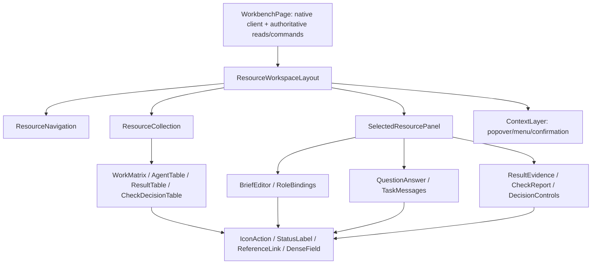

# 资源、操作与组件细化

## 作者源与使用边界

用户已认为[资源工作区整体方向](experience.md)大体合适，本文件细化该方向，不重启信息架构。[S1–S5](experience.md#唯一场景源与四张图)仍是唯一场景作者源；[能力设计](capabilities.md#operations-effects-and-recovery)拥有原生操作、参与者身份、不可变依据与持久状态，未来实际声明取代其结构草图。本文件拥有界面入口、交互、组件边界、状态样式与布局；不维护第二份 DTO、wire schema、任务状态机或 API。

下文“现有”指原生参与者、消息、回执、运行观测等已存在基础；“选定目标”指本 Delivery 新增的工作记录及有限浏览器动作；“延后”没有启用的假按钮。所有 SVG 内容仍为设计示例，预览由控制者生成。图中一个 Tooltip 用途标签不等于可访问 Tooltip 已实现，静态检查不等于交互或业务验收。

## 缺口评估与已决定的范围

| 重要缺口 | 对主线的影响 | 本轮处置 / 权威 |
| --- | --- | --- |
| 资源入口只有名字，没有实际列表/关联返回 | 无法从来源、Agent 或结果找到工作 | 补齐资源透视、选中资源面板、返回规则和关联入口；只投影已载入工作，原生查询以能力 owner 声明为准 |
| 编号 #022 尚无角色，却已算作保存工作 | 与 CreateWork 两个初始角色约束冲突 | 控制者明确选择本页草稿：取消该原生编号，未有效分工不保存、不派发、不计 daemon 任务。主图最小修正为 5 项已载入 + 1 本页草稿；来源 install 为 1 项，草稿独立呈现 |
| 新建、编辑和换人被一个“保存”概括 | 原子性/部分效果不真实 | 首次 CreateWork 一次保存完整内容与两角色；已存在工作分别保存任务依据、应用一次角色更换，不制造跨命令事务 |
| 候选、身份失效与真实可用性未画 | 可能把忙碌当不可用、同名当同一人 | 精确候选、当前绑定、不可用原因和更换确认；不启用启动/停止/恢复 Agent |
| 问题与普通补充共享输入语义不清 | 答错问题/发错角色或误称送达 | 明确 Q、作者角色、当前接收者、普通笔记收件人和原生/外部回执层次 |
| 历史结果/失败/无法检查与修改/重查未展开 | 可能把旧通过拿来接受新结果 | 固定结果/依据/检查请求，明确当前和历史，只在合法上下文启用接受；失败后的动作局部显示 |
| 加载、刷新、冲突、未知结果样式缺失 | 清空旧数据、重复派发、无依据显示成功 | 一个有限词汇表与就近反馈；未知操作按原命令查询，不增设恢复编排平台 |
| 组件只按外观拆分 | 状态和业务权威容易混杂 | 语义 Layout → Blocks → Components 输入/意图/局部状态合同，CSS tokens/焦点/滚动规范 |

不选择的扩展：原生无角色工作、任务删除/归档/重开、批量调度、浏览器 Agent spawn/kill/权限审批、全局聊天、任意命令、文件内容读取/diff/测试运行、上传下载产物平台、认证身份或自动同步源文档。已接受工作在本切片关闭；继续工作用新记录引用旧来源，旧结果/检查/决定仍可查。

### 草稿修正的确切语义

原来示意的 #022 不是一个已存在真实原生任务；本轮将其纠正为“本页草稿 · 安装说明”。草稿没有原生工作 ID、角色 assignment、command receipt、结果或检查；它既不进入服务器计数，也不进入来源/Agent/结果/检查透视。标题/来源文本可以已经输入，但该来源只在草稿表单里，不计成 install 分组第二项。

本轮只保留一个新建草稿槽位。点新建而已有草稿时恢复这个槽位；取消/收起面板保留它，导航左侧显示紧凑“本页草稿”入口。明确“放弃草稿”才清除；离开整个页面时浏览器原生离页提示尽力提醒，刷新/关闭后的恢复不承诺，不将工作内容写 localStorage。提示只在离页、放弃或首次关闭可能丢内容时出现，不常驻教程。首次保存成功才使用服务器分配身份，移除本地草稿入口并更新已载入任务与分组；未知保存结果保持草稿与命令身份，不能再创建第二份工作。

## 资源与控件登记

所有行内操作用精确对象引用，不以名称或当前行号定位；长标签有完整可读入口。下表给实际资源和各类可见控件一个确定去向，样式相同且行为相同的重复图标不另建组件。

| 资源 / 入口 | 必须可见或就地读取的字段 | 动作、结果与返回 | 可用性 / 能力依据 |
| --- | --- | --- | --- |
| 顶栏项目、协作状态、信息按钮 | 固定项目标签、作用域简名/代、只读或协作可用、服务可用性 | i 打开只读连接小面板；复制项目/作用域标识，关闭回 i；无项目切换 | 现有基础 + 选定 launch descriptor；无模式时所有写入禁用，读仍可用 |
| 全部工作 / 来源行 / 折叠箭头 | 组名=已有引用路径、已载入数量，未关联来源单列 | 选组过滤已载入列表，箭头只折叠；全部清除来源过滤；不清除草稿 | 本地投影；组无可读源内容不报空文件 |
| 来源信息 / 行内文件图标 | 保存的原始引用与所报修订、工作依据快照、当前新鲜度未检查 | 打开局部引用面板，复制引用；外部 URL 显式在新标签打开，不后台抓取 | 原生保存引用，文件预览延后；不提供打开任意本地路径的浏览器读取 |
| 资源视图 Agents | 名字+精确引用末段、运行事实/观测时间、关联任务/角色 | 按已载入工作过滤关联项；点 Agent 显示身份及关联工作，点工作回主矩阵固定任务 | 现有参与者查询的安全投影；不展示 PID/env/Provider session；未观测显示未知 |
| 资源视图 产物 / 结果 | 所属任务、结果版本、报告者、来源、产物数量、检查与接受 | 点版本/产物引用在同一下方面板展开；点所属任务回任务视图 | 选定工作结果查询；显示已报告引用而非真实文件目录 |
| 资源视图 检查与接受 | 任务、结果/条件、请求/报告身份、检查者、结论、决定 | 点报告或决定看固定依据与历史；状态筛选只针对这组资源 | 选定工作查询；缺报告、失败、无法检查不当通过 |
| 搜索 | 当前资源视图的检索词、已载入/筛后数量 | 输入过滤已载入标题、角色姓名、原引用、结果/产物标签；Esc 清输入，清除按钮恢复 | 不索引未读文件、不声称全库搜索；离开视图保留各视图词项 |
| 全部 / 待我处理 / 待检查 / 进行中 | 由明确工作事实计算的筛选、当前选中 | 待我处理含未答 Q/可接受/需人触发动作；进行中含已派发或已报进度且未有最终决定，不按 Agent busy 推断 | 只过滤已载入；相交来源/检索词时保留条件 chips 与“清除条件” |
| 按来源分组、列设置、刷新 | 当前分组/可见列、读取状态与观测时间 | 组菜单仅来源/不分组；列菜单可切非核心补充列，任务/状态保留；刷新发只读请求保留内容 | 本地偏好留在本页；刷新不写业务；刷新失败显示旧时间与局部再试 |
| 新建 / 本页草稿 | 无身份的新草稿标题、dirty/validation | 恢复/创建唯一草稿编辑器；保存后取得原生身份；返回保留本页草稿 | CreateWork 目标；只读可看现有草稿但不可保存；不预填示例数据 |
| 任务行标题 / 状态 / 问题 / 局部 tabs | 身份、目标、条件、角色、当前 Q / 结果 / 检查 / 决定 | 点行选任务；点精确子资源切面板；任务/产物/检查/消息保持主体与原筛选 | 选定工作查询；历史有稳定版本，不能“最新一次”猜身份 |
| 行内角色 / 编辑角色选择器 | 当前确切分工、候选名/身份/项目/原生可用原因 | 就地查看→选择候选→确认/应用单一角色；保留旧 assignment/报告 | BindParticipant；同一精确实现者不能做 checker，名字相同也不替代身份 |
| 行内来源 / 对话 / 更多 | 对应任务身份、接收者、低频选项 | 来源如前；对话选角色补充；更多含编辑、复制链接、历史；已接受则只读项与新建关联工作 | 没有接收者/已接受/服务只读时发送禁用；不提供删除/归档假项 |
| 详情编辑 / 链接 / 收起 | 当前任务和依据版本、dirty/执行中 | 编辑进入已有任务编辑器；链接复制稳定任务/固定子资源地址；收起只改布局 | Clipboard 失败给可选全文；不把整份草稿/机密放 URL，不改变业务 |
| Q 切换 / 建议答案 / 自定义 / 回复 | Q 身份、作者、角色、问题、当前收件人、已答内容/回执 | 选择已有建议或自定义文本→回复该 Q；多问题逐一切换，未答数可见 | AnswerQuestion；无建议不自动推断；已答不可覆盖；改要求需明确新条件依据 |
| 普通补充 / 收件人 / 发送 | 明确选中的当前角色、名字、已输入文本 | 按角色单选/多选，预览将发给 Lin/Moss，提交 SendNote；留存文本及消息引用 | 只允许绑定角色，不任意地址/广播；与回答 Q/改条件不同 |
| 派发 / 回执 / 查询原操作 | 工作/角色/依据、command ref、消息身份、持久接收与外部送达事实 | 显式派发→pending→已接收；细节读回执；结果待确认只能查询或在合同允许下同身份重提交 | 不显示取消执行；关闭面板不撤回命令，不生成第二命令复制效果 |
| 结果选择 / 产物引用 / 来源 | 任务内固定 r、作者、条件、指纹或 Git 来源、摘要和有界产物列表 | 选当前/历史结果；点产物打开保存引用、复制/外部链接；不展示假文件内容 | PublishResult 是 native actor 操作，浏览器只有读取和请求检查 |
| 检查请求 / 报告 / 条件行 | 固定结果/依据、请求、检查者、每个条件结论/依据、总体结论 | 请求当前结果检查；条件可展开事实/报告引用；历史报告留在原结果 | PublishCheck 是 actor 操作；UI 不代填通过；原生判断独立/源/覆盖完整性 |
| 要求修改 / 重新检查 | 选中当前结果、报告、明确收件人或 checker、必填理由 | 修改保存+有界派发；重查同版本保留理由、生成新检查请求；取消只丢该输入或留草稿 | RequestChanges / RequestCheck；二者不互相伪装，重新检查不能清除未解决的修改要求 |
| 接受 / 取消 / 确认 | 当前 r/check/b、源、所有必要条件与未答问题情况 | 局部确认→原子接受→关闭写操作；取消回当前结果 | AcceptResult；旧结果/换人/旧依据/未答/失败/无法检查/修改未解决均不允许确认 |
| 连接与诊断 | 当前项目的有限诊断摘要、可读消息/身份引用 | 局部诊断面板；若独立诊断地址实际提供则新标签，返回不丢工作 | 现有只读观测；不猜运行 LAN 地址、不进入进程控制 |

### 资源透视的确切列与关联

工作视图列沿用主图；本页草稿显示独立草稿带，不占来源分组的已载入任务行。Agents 透视：姓名/身份、运行事实、可选状态、已载入关联工作和角色；“可选”来自原生身份/项目能力检查，不从空闲推断。没有工作引用的候选显示关联数 0，不是空或失败。产物/结果透视：一行一个结果，列为任务、r、摘要、报告者、来源短指纹、产物数、当前/历史、检查/接受；展开结果显示产物行，不能把三个产物冒称三个任务。检查与接受透视：一行一个检查请求/报告或接受决定，行种类有文字标签，固定结果/条件/角色/结论/时间可查；同结果多次重查不合并抹历史。

结果/报告查询超出第一页时详情底部出现“继续载入”，指明已载入数；客户端过滤只针对这些记录。当前/历史靠真实 current basis 派生，历史通过保留绿色勾和“历史 · r1/b1”并列，不能让它看起来能接受当前 r2。未知时间直接“时间未知”，不按收到时间捏造发生顺序。

## 主线交互细化

### S1：新建、编辑、分工、保存与派发

首次新建的字段是标题、目标、至少一项非空条件、可选来源、实现者与独立检查者。实际长度/项数/精度由原生声明给定，界面读取/复用其限制而不另立宽松上限。条件是有稳定身份的条目；新条目的临时身份仅用于草稿，保存后使用 native ID。调整顺序不会更换既有条件身份，删除/改义在下一条件依据中体现。Source 只输入引用，没有“浏览本机文件”按钮。

字段在首次失焦或提交后显示错误；新空表单不先涂满红色。点击保存时定位第一个无效字段，错误关联 input 并保留其余值；角色未选、两角色同一人、候选过期各给具体信息。保存按钮在已提交错误后仍可作为跳到错误的提交入口，真正不可操作的只读/发送中状态有明确原因；不能只靠一个灰按钮让用户猜哪里缺内容。

候选选择为有标签的 combobox/listbox：搜索当前项目候选，行显示姓名、精确引用末段、原生可用/不可用原因和运行摘要。busy 但可接收工作仍可选，只以“工作中”提示；失效/不同项目/身份不完整不可选；checker 等于实现者时显示“与实现者相同”并禁用。没有候选显示“没有符合条件的已运行 Agent”，可刷新候选，不增加浏览器启动动作；本地启动仍归既有产品能力。

先选候选只改草稿。保存前原生重新校验候选与工作修订，选择框已显示过可选不能授权后续派发。新建只调用 CreateWork，成功后显示“已保存 · 尚未派发”和真实 ID；再点派发，明确实现者及 b。派发消息体由 native 绑定上下文，不允许 UI 改成任意收件人。创建已成功而派发失败时工作仍存在，错误只归派发；未知派发禁止再次生成 command。

已有工作编辑分为“任务依据”与“角色分工”两项就近保存。前者调用 UpdateBrief，成功产生新 b，提示“b2 已保存 · 未派发”，结果/检查保留为历史并阻止旧通过的接受；用户显式派发更新依据。后者每次更换一个角色调用 BindParticipant，显示旧/新身份，说明旧分工证据成为历史；没有一个模糊的“保存全部”承诺跨操作原子性。要求同时换两角色时逐项应用，已成功第一项不能被第二项失败抹掉。新角色用于下一次明确派发/检查，UI 不自动重新执行工作。

dirty 草稿保存在本页对应 editor owner；任务切换/收起/资源透视仅暂停编辑，导航可见小草稿标记。新建只有一个槽位，既有任务编辑按当前 work ID 缓存已打开的少量草稿；实现可限制同时保留数并在替换前明确提醒，不能静默丢失。放弃确认有“继续编辑/放弃更改”，取消不重置表单。保存中冻结这次提交输入，允许读其他资源；完成回到相同编辑对象，不能把延迟回包覆写当前另一个任务。

并发冲突显示“任务已更新”，保留本地字段和服务器新版本，用局部“查看差异”展开只读字段差异（表单值对比，不是文件 diff）。“载入更新”先确认是否放弃当前字段；“基于更新继续编辑”重新以最新值为底稿，用户逐字段选择保留本地或使用服务器值，再次显式保存；不自动重放旧意图。草稿字段有相同 native ID 时配对，否则列为新增/删除，不凭位置合并条件。

### S2：问题、收件人、补充与投递

Q 默认读作者、提问时分工、正文、可选建议答案、当前状态。已答时显示保存答案、实际收件人/消息与回执，回复控件移除。换人后原作者仍写 Lin，“将回复给 Iris（当前实现者）”在回复按钮旁可见；不会把历史作者偷偷改成 Iris。当前角色失效则回复阻止并给“更换实现者”入口；答案草稿留存，换人后需再次确认实际收件人。

“改变任务要求”是明确、默认关闭的辅助选项。开启后局部展开目标/条件修订，提交标为“保存要求并回复”，展示将产生 b2 与实际角色；没有新条件输入不允许按普通回答改要求。原生 AnswerQuestion 承接其原子 amendment dispatch。普通澄清不改 b。Native 接收失败整笔答复不保存；持久接收成功但之后投递失败保留已答与回执，不能用“重新回答”覆盖它。

普通 SendNote 的接收者选择是当前“实现者 Lin”“检查者 Moss”两个角色行，可选一个或两个；输入条预设对应任务上下文的实现者，但点击发送前直接看得见，不默认广播。角色更换导致文本旁接收者更新时先提示需要确认，旧输入不直接送新对象。发送后清除的仅已提交那份输入；后续新输入不受旧回包影响。便条不能创建问题、覆盖条件或表示检查报告。消息 tab 只读该工作线程的分页记录，按角色/消息种类局部筛选；不能任意选择全局 thread 或扮演 Agent。

回执分三层：`已保存/已接收`有 native 持久消息身份；`已送达`仅在实际投递证据存在时显示；`Lin 已确认/已开始`只来自明确工作报告。缺投递证据显示“送达未知”，不是已失败。回执弹层显示消息/命令引用、目标角色/实际参与者、保留时间与已有投递证据，缺项写未知；复制身份用于查询，绝不提供“标为送达”。

未知命令结果在对应提交区显示“结果待确认 · cmd…”，保留任务/输入与禁用重复发送，给“查询原操作”。查询已提交即读真实结果；not-found 只表示当前无回执，不证明原请求不会提交。当前页保有原 normalized intent 时可由显式“按原操作重试”复用同 ID/同输入，只有 native 承诺去重时可用；刷新后只剩有限 pending ref 而无原输入时只查询/刷新状态，再要求用户新的明确动作，不重建旧请求。换数据代时旧 pending ref 不重放，提示“数据已更换，刷新工作”。UI 没有取消业务执行或撤回消息按钮。

### S3–S4：版本、证据、失败、修改、重查与接受

点结果默认打开行上指定的 r；从任务产物 tab 进入时默认当前 r 并保留显式结果下拉。版本列表显示 r、当前/历史、作者、b、来源与检查概况。选历史不改变 current、不触发重查或赋值为最新；历史动作区只读，保留“查看当前结果”入口。产物详情只展开保存引用、指纹、来源归属、报告摘要和复制链接；外部链接须可识别且用户点击才打开，不后台抓取，不渲染任意 HTML/脚本。

没有结果时用本任务“尚未报告结果”紧凑空态和已有实现进展；用户可发补充，不能在浏览器“提交产物/标为完成”。有结果未查时选定 checker/r/b 后“请求独立检查”，持久接收成功显示请求身份，等待报告；check requested 不是“检查已通过”。条件列表按 native criterion ID 对应，没覆盖的行显示“未报告”，缺任一必要项不显示总通过。

失败的逐项行就地显示实际发现，例如“已有文件被覆盖；预期拒绝”。总体失败用红色叉和“检查失败 · Moss 上报”；无法检查用琥珀问号/“无法检查”，说明缺证据/环境原因，不能与失败合并成一个绿色百分比。两者均不可接受。用户可选“要求修改”或“重新检查”，后者不是用新检查清空问题；若结果确有缺陷应走修改→新结果→新检查。

要求修改面板明确目标 r/C/b、实际实现者与必填理由，提交关联决定并按已选 native 意义派发，成功保留旧证据与“已要求修改”；它本身不自动回滚文件、编辑结果或清除问题。新 r2 报告后，旧 r1/C1 仍为历史。重查面板明确同一 r、当前 checker 和必填理由，新请求让旧报告不再有当前接受资格；不能因为旧报告通过就让待进行的新请求自动通过。有未解决 RequestChanges 时，相同 r 的再通过仍不恢复接受资格，必须新结果并再次检查。

接受动作只在当前 r/b、当前 assignment/active check 且通过、必要条件完整、源指纹匹配、没有 open Q 或待修改时启用；未满足时按钮邻近给简短具体原因。浏览器只表现 native eligibility，原生事务最终守卫。点击接受局部显示 r/C/b/来源及“记录接受，不执行合并或发布”，确认后提交；新 r/b/角色或报告使旧确认失效，留存用户所看旧证据并显示新版本入口，不自动替换 tuple 然后接受。接受成功关闭所有变更（编辑、换人、补充、派发、检查、修改），保留阅读/复制/来源/历史与“新建关联工作”；后者是带旧来源引用的新建表单，不重开原记录。

## 状态词汇与视觉表达

这些是局部组件的状态到视图映射，不是第二套原生总状态机。多个独立维度可以并存，例如“选中任务/读取旧报告/发送结果待确认”；不要将它们压成一个泛化 running。

| 状态 | 词/形/颜色与位置 | 可用动作 / 保留内容 |
| --- | --- | --- |
| 初始读取 | 只在未知表区绘制灰骨架，表头/项目仍在，`读取中` | 只读导航可用，无假的 0 条与写入口 |
| 刷新已有数据 | 刷新图标旋转或静态进度，旧行保留，时间旁 `更新中` | 选中/草稿不动；同区刷新合并，写入仍按当前 authoritative revision |
| 初次空集 | `尚无工作` + 新建任务；无演示记录 | 新建可用按服务模式；资源透视空态链接回全部工作 |
| 筛后空集 | `当前条件无结果` + 条件 chips + 清除条件 | 已载入数量不被改成数据库总数，不清掉草稿/选中详情 |
| hover / selected / focus | hover 浅灰、selected 浅绿左标、focus 独立蓝色 2px 环 | 焦点与选中可不同，聚焦按钮不自动切行；文字状态不消失 |
| disabled | 原内容降低强调 + `aria-disabled` 或原生 disabled；关联原因可经就近 i 读取 | 无角色、已接受、只读、旧依据等各有原因；关键因果不用只 hover |
| dirty / invalid | 字段旁小点 `未保存`；invalid 红边+文字 | 输入不丢，首错可聚焦；dirty 不是业务状态 |
| 保存中 / 发送中 | 当前按钮 spinner + 动词进行式，宽度稳定 | 冻结该提交，其他资源可读；不先显示“已保存/已送达” |
| 已拒绝 / 验证失败 | 红叉+具体字段/原生错误，`未保存` 或 `未派发` | 保留输入，可纠正后新命令；确定失败才显示针对该效果的重试 |
| 结果待确认 | 琥珀时钟/问号、原命令短 ref、查询原操作 | 禁止创建重复 command；保持输入与已知任务，不说业务失败或取消 |
| 协作者不可用 | 灰身份+具体原生原因，候选行不可选，当前绑定保留 | 更换已有角色/刷新候选；不自动选同名人、不显示启动/kill |
| 仅上报 / 检查通过 / 已接受 | 作者归属+来源 i；通过绿勾；接受单独文字/图标与固定 r | 三个事实不同，原生观察到的 fingerprint/报告是署名证据，不伪装平台实测 |
| 失败 / 无法检查 / 未报告 | 红叉/琥珀问号/灰横杠，条件行就近发现 | 修改/重查按当前资格，均阻止接受；未知不渲染 0% 或通过 |
| 历史 / 旧依据 | 灰 `历史` + 固定 r/b，旧通过保留归属 | 只读，明确查看当前；不自动套用历史到新版本 |
| 冲突 / 代已换 | 琥珀 `任务已更新` 或 `数据已更换`，局部差异/刷新入口 | 保留 draft，不盲目覆盖/跨代重放；确认面板失效需重读 |
| 只读 / 服务不可用 | 顶栏简短模式，受影响动作旁短原因；读取失败保留最近时间 | 历史可读、可复制，读重试可用；不引入登录/解锁流程 |

Tooltip 是解释名称与简短区分；Popover 承载两三项事实/原因/复制操作；菜单承载同一对象低频动作；非模态详情用于阅读；确认/放弃/换人等有界决定可模态。出现新错误只在对应表单或命令区域，除非整个连接失效才提升为顶栏状态。状态 sheet 是示例集合，不将所有错误同时塞进生产主屏。

## Layout → Blocks → Components 合同

以下名称/输入是实施职责设计，不是另一份可调用 TypeScript/wire 声明。实现须导入 native-derived 类型，回调只表达用户意图，真实结果由有 authority 的读/写回执回来；组件不能因点击自行填充 accepted。无需每行一个文件，相关私有叶组件可与 Block 同文件。

| Unit | Purpose / inputs | Emitted intent | Owned ephemeral state / exclusions |
| --- | --- | --- | --- |
| WorkbenchPage | Coordinate fixed connection descriptor, canonical work/candidate/thread data, current revisions and command outcomes | Typed native reads/mutations through the owned client | Own request generation/cancellation, selection shared by blocks, bounded pending command ref; no duplicate editable domain store or schema |
| ResourceWorkspaceLayout | Named slots for connection bar, nav, collection, selected detail and local layer | Layout expand/collapse only | Own no domain state; sizes/scroll regions via semantic CSS; no fetch/eligibility |
| ResourceNavigation | Loaded source groups, active view, safe participants, draft presence | SelectSource, SelectView, InspectParticipant, ResumeDraft | Disclosure/focus only; no planning tree edits, no shell/process actions |
| ResourceCollection | Loaded bounded records, current filters, selected object, read status | SelectWork/Subresource, Search, Filter, ReadMore, Refresh | Local filter text/visible columns and per-view scroll; no server-total inference or duplicate receipts |
| WorkMatrix / WorkRow | Work identity, exact roles, result/check summary, allowed actions | InspectSource/Role/Result/Check, Answer, Dispatch, RequestCheck, RequestChanges, OpenMenu | Row hover only; button focus must not trigger row selection; no inferred progress from runtime |
| AgentTable / ParticipantDetail | Safe candidate identity, runtime/availability, loaded related work | SelectRelatedWork, CopyReference, SelectForRole when invoked by editor | Expanded details only; provider/model optional only if supplied safely; no PID/env/Provider-secret fallback |
| ResultTable / CheckDecisionTable | Native-derived result/check/decision references and report summaries | InspectResult, InspectCheck/Decision, SelectRelatedWork | Local history filter; no mutable result edits or Agent report authoring |
| SelectedResourcePanel | Selected work/subresource, fixed evidence basis and view | ChangeView, Edit, CopyLink, Collapse | Active local tab and focus-return ref; drafts live above tab remounts; no identity chosen by most-recent name |
| BriefEditor | Authoritative brief revision, create/edit mode, native limits, candidate bindings for create | CreateWork or UpdateBrief with captured basis; DiscardDraft | Own field draft, touched/errors, dirty/submit snapshot; no role mutation hidden in existing-brief save |
| RoleBindings / ParticipantPicker | Current exact roles/assignments, safe candidates, native reason/independence constraints | SelectCandidate; ApplyOneRole; ConfirmReplacement | Search/open/highlight, candidate draft; assignment changes only after native result; busy alone never disables |
| QuestionAnswer | Stable Q, historical author, current role/recipient, answer receipt, optional suggestions | AnswerQuestion (ordinary/amendment), SelectQuestion | Per-Q answer draft and touched/amendment fields; no SendNote reuse, no automatic question parsing |
| TaskMessages / RecipientComposer | Bounded work-thread records, current bindings, per-message receipts | SendNote(selected roles), ReadMore, InspectReceipt | Draft, explicit recipient set, local filter; no arbitrary recipients/thread/broadcast or participant impersonation |
| ResultEvidence / ArtifactReference | Fixed result/brief/source, attributed summary and bounded artifact refs | SelectResult, InspectReference, CopyReference, OpenExternalReference | Expansion/history selector only; no file reader, diff, upload, terminal or platform test execution |
| CheckReport | Exact active/historical request/check, criterion IDs/verdict/evidence, author/source | ExpandCriterion, InspectEvidence, OpenRecheck | Expanded criterion rows; cannot mark pass or fill absent evidence |
| DecisionControls | Native eligibility/reasons, selected current result/check/brief and prior decisions | RequestChanges, RequestCheck(reason), ConfirmAcceptance(tuple) | Bound reason/confirmation snapshot; stale tuple invalidated, native transaction authoritative |
| CommandFeedback | Object/request-associated pending/rejected/unknown/committed status and actual recovery affordance | LookupOriginal, ExplicitSameIntentRetry if supported | No new command ID or mutation on refresh/close; no cancellation claim |
| ContextLayer / Tooltip / IconAction / StatusLabel / DenseField | Named content, accessible label, intent callback, supported semantic variants and disabled reason | Only the local control's user intent | Focus/disclosure/touched local state, no service client/domain eligibility; tooltip opens on focus/click/touch |

Data handling: the Page keeps confirmed records from native, short-lived query snapshots and one mutation snapshot per outstanding effect. Editors keep their own draft basis and fields; selectors derive current/historical/disabled reason from authoritative facts. No general state-machine library, normalized data platform, global form engine or registry service is selected. Native outcomes must match work/scope/generation/command before applying; late list/detail reads cannot replace newer work or switch current selection. Child callbacks are requests, not success events.

Addressing: copyable links identify native work and optionally fixed result/check within current project/generation, never payloads or arbitrary return URLs. Direct entry resolves the named object from native, loads missing pages as needed, shows missing/stale-generation feedback if not found, and falls back to the fixed workspace. Browser Back restores view/selection/filter return context, never replays a mutation. Copy Clipboard failure reveals selectable link text. Reading diagnostic content or an external evidence reference does not rewrite the current task address.

## 语义 tokens、variants 与输入规范

这一组仅属于本工作台；现有 SVG 样式是视觉依据，实施时一个 CSS tokens 文件为真相。示意值不散进 JSX，不为每个业务状态生成整个主题。

| Token role | Chosen starting value / use |
| --- | --- |
| `--surface-main`, `--surface-nav`, `--surface-subtle` | `#ffffff`, `#f3f5f7`, `#f8fafb`; reading, navigation, group/header surfaces |
| `--text-main`, `--text-muted`, `--border-default` | `#253542`, `#697a88`, `#ced8df`; body/secondary/reference boundaries |
| `--action-primary`, `--selection-bg`, `--selection-edge` | `#176b5b`, `#eaf3f0`, primary; action versus selected row share family with distinct shape |
| `--warning-text/bg`, `--danger-text/bg`, `--info-text/bg` | `#8e610d/#fff5df`, `#b04c45/#fbeeed`, `#45649a/#edf1f9`; concise local status with text/icon |
| `--focus-ring`, `--focus-width/offset` | `#316fd0`, `2px/2px`; distinct from selected and invalid border, never removed |
| `--font-body/table/meta/section/title` | `14/13/12/16/21px`, line-height `1.45–1.6`; metadata is not an interactive target size |
| `--space-control`, `--space-section`, `--space-panel` | `8/16/24px`; leaf internal 4/8, aligned groups 12/16, panel edges 24 |
| `--size-control`, `--size-touch`, `--row-work`, `--radius-control` | `32/44/48/5px`; coarse pointer or narrow increases target, no invisible overlap |
| layout-local tokens | nav `216px`, header `48px`, desktop selected-panel `328px` default; min collection/detail sizes and adaptive rules owned by layout, not global UI primitives |

Button variants: primary (one action per current form/decision), secondary (border), quiet icon (no permanent box until hover/focus), destructive intent (red label and consequence when warranted), pending (same width/spinner), disabled (reason reachable). Status variants have plain text + supporting shape/icon; no badge for every harmless field. Fields have label, optional required marker, default/focus/invalid/readonly/disabled; textarea/condition-list grow within panel scroll, not push action bar outside viewport. Selection chips/filters have selected and removable variants; background color never the only selected cue.

Icons use the same 16px line family, with a minimum 32px desktop or 44px touch target, labels from resource+action. Information/tooltip icons can remain visually compact inside a nonoverlapping target. Hover treatment appears on hovered row/control; focus ring on actual focused element; selected row has its own left edge/bground. Disabled controls should normally be native disabled for action prevention with adjacent focusable explanation; where the composite pattern needs focusable `aria-disabled`, handlers suppress invocation. Do not rely on disabled browser hover to reveal essential reason.

Tooltip opens on keyboard focus and pointer hover with short delay, on tap/click without needing long press; Esc/outside dismiss. Interactive explanations use a labeled popover, not focusable children inside role=tooltip. Modal bounded decisions trap focus and set an appropriate initial control; nonmodal read panels do not trap focus. At closing, return to invoker or selected row if invoker disappeared. Tabs with network load use manual activation if needed, preserving focus separate from active tab. Native radio/checkbox inputs keep expected arrow/space semantics; plain data table keeps native semantics rather than inventing a complete ARIA grid.

Only meaningful state changes animate: context panel open/close 120–160ms opacity/translation, spinner while actual read/write pending. Reduced-motion removes translation/spinner animation but preserves a static progress glyph+text. No optimistic acceptance animation, toast-only error or indefinite shimmer over real retained content. Action success stays near affected record/command; temporary nonblocking “链接已复制” may use a polite live message, not a new persistent banner.

## 适配、滚动与长内容

| Available width | Composition / scroll contract |
| --- | --- |
| ≥1280px | 216px nav; collection uses remaining width; default 48px rows, selected panel about 328px with fixed header/action footer. Table and selected detail may each scroll vertically only when needed; nav scrolls only if resources overflow. No document-wide horizontal scroll. |
| 1024–1279px | Compact 184px nav; nonessential runtime detail collapses; role names share stacked cell if needed, outcome/action columns stay explicit. A genuinely wide table may have a bounded horizontal scroller with selected identity pinned, not global page overflow. |
| 768–1023px | Nav becomes disclosure; collection uses full width, linked roles stack beneath task name; selected detail remains below, may expand to read evidence. Cross-resource lists retain result/check identities and action menu. |
| <768px / 390×844 | Existing compact resource list retains source and current work relations; local detail has task header/tabs, main fields/content scroll, sticky action bar ≥44px targets. Long create/edit/picker may expand the local sheet to nearly full height while preserving a task/draft identity header and explicit return. |

At 200% zoom follow effective width, not a desktop-only clipping rule. Limit long task titles to two readable lines in lists with a focus/tap expand/full-name popover; detail title can wrap. Paths/IDs wrap at separators in reference panels or offer selectable full value; a tooltip alone cannot be the only copy/read path. Required error text wraps and increases local field height; footer remains reachable, no shrink-to-fit fonts. Very long question/report scrolls within its detail region, question identity/recipient and submit bar remain. Popovers fit viewport and can scroll their bounded candidate list; when too narrow become a labeled sheet sharing the same draft owner instead of remounting away input.

Refresh does not snap rows to top or select first record. A selected work filtered out remains in detail with a compact “不在当前筛选中” indicator; a different explicit selection replaces it. If source grouping changes after save, maintain object selection and reveal its new group; do not navigate to an unrelated work. Source count/record limits remain native facts, and virtualization is optional only if real list size warrants it; avoid speculative infinite-list machinery.

## 组合图、覆盖与交接

新增图保持有限，不画每个边缘状态组合；以具体任务揭示实际交互，组件 sheet 仅作为共享词汇，不是第二个产品界面。

| Drawing | Design question / canonical scenario reference |
| --- | --- |
| [05-agent-resources.svg](visuals/05-agent-resources.svg) | Agents 透视、精确身份/已载入关联工作与局部角色选择入口（S1/S2） |
| [06-create-validation.svg](visuals/06-create-validation.svg) | 无原生编号的新草稿、必填错误、角色候选不可用/同人限制与保存（S1） |
| [07-messages-recovery.svg](visuals/07-messages-recovery.svg) | 正确角色收件人、已保存/送达未知、原命令结果待确认与查询（S2） |
| [08-check-history.svg](visuals/08-check-history.svg) | r1 当前失败检查 C1、此前无法检查的 C0、具体发现与修改理由（S3/S4 的失败分支；随后新 r2/C2 才到图 03 的通过/接受） |
| [09-result-resources.svg](visuals/09-result-resources.svg) | 结果/产物跨工作透视、固定来源引用与检查/接受关联（S3/S4） |
| [10-component-states.svg](visuals/10-component-states.svg) | 同一套实际控件/状态的选中、焦点、invalid/pending/unknown/read-only/conflict/empty 词汇与 narrow 行示意（S1–S5） |
| [11-check-resources.svg](visuals/11-check-resources.svg) | 检查/请求/接受记录的跨工作视图、固定结果资格与同版本重查理由（S3/S4） |
| [12-edit-conflict.svg](visuals/12-edit-conflict.svg) | 已有任务编辑的 b1/b2 字段对比、保留本地和放弃更改的明确边界（S1 的编辑/冲突分支） |
| [13-narrow-picker.svg](visuals/13-narrow-picker.svg) | 同一候选选择器的窄屏 sheet、44px 目标与返回本页草稿（S1/S5） |

现有 01–04 只做上文真实语义修正：把假编号 #022 纠正为本页草稿，并将各来源/已载入数改为 5 个持久工作、install 1 个；本页草稿独立，不参与资源投影。原生角色/结果/检查既有示例身份保持。没有因为细化再发明另一套整体布局。

作者源为[draw.py](visuals/draw.py)（共享 SVG primitives 与 01–04）和[detail.py](visuals/detail.py)（复用前者绘制 05–13）。两者只使用 Python 标准库生成可编辑 SVG，不是产品代码或真实数据适配器。新增场景中未选择候选使用选择箭头，可选/不可选靠真实原因文字；仅已选择候选才可有选中勾。问题已答后的工作行显示“已答 Q1 · 等待更新”，另一条结果未知便条不重开 Q1。已接受工作的补充图标实际禁用，解释经就近控件读取。

Receiving ownership:

| Existing Task | Consumes / authors | Critical authored case obligations (not executed here) |
| --- | --- | --- |
| [Web workbench](../../.controller/collaboration-workbench/tasks/workbench-web.md) | This interaction/component/token/layout source, 01–13 SVGs, native-derived client/declarations; owns actual React components and field/interaction cases | Draft absent from native counts; create invalid/candidate replacement; distinct save/dispatch; exact Q/recipients; return/draft/focus; retained refresh/empty/read-only/unknown/conflict; current/historical evidence; keyboard/touch/narrow |
| [Native collaboration](../../.controller/collaboration-workbench/tasks/collaboration-service.md) | capabilities.md native meaning; supplies exact limits, safe candidate fields, closed reads, eligibility/errors/receipts | Atomic create/answer/dispatch, actor-bound reports, exact role/basis and current acceptance guards, command dedupe/recovery, closed accepted work; UI labels cannot substitute these checks |
| [Independent acceptance](../../.controller/collaboration-workbench/tasks/acceptance.md) | S1–S5 canonical path + native/Web owner-authored cases + this six-criterion/evidence mapping | Real two-Agent result/check/failure/recovery/acceptance, actual standalone/browser/key/touch use, fixed fixture/hash and genuine observations; do not claim these from SVG source |

Local-criterion evaluation: resource relationships remain in overview and cross-resource tables; new details close real unreachable/ambiguous controls rather than add decorative actions. Compact 32px desktop /44px touch controls and 13–14px body text retain useful density. Every new scene has concrete object/recipient/basis and local return; explanation is i/Popover unless a consequence/error is needed at action. Current/historical and report/receipt/acceptance are separate. The #022 inconsistency is explicitly corrected rather than hidden. Rendered bounds/readability are controller observations; source author has not run browser/product checks or claimed user acceptance.

控制者已渲染早期 05–10（`/tmp/agentx-workbench-details/render.json`），报告资源上下文与局部动作可见，状态 sheet 是参考资料而非主屏杂乱内容；同时指出问题答复摘要、候选误用勾选符号、常驻说明和现有编辑原子性文案的一致性问题。本源已按该具体反馈修正，并仅对改变的组合状态重查源内容；这不是额外审查周期。11–13 及最终改变后的图仍由控制者捕获，早期渲染不能冒称最终结果。

源检查结果：13 张 SVG 的 XML、唯一分组 ID、viewBox、原生文本、中文图标用途标签、无图片/脚本/外部 href、每图一处示例标识和相对资源链接通过；没有验证 Markdown anchors、最终字界/布局、点击、键盘或业务操作。发生后续实际图修改时只重新检查受影响内容，不能把源合法性当作本地六项设计标准的通过证据。

Remaining obligations are implementation facts, not a new approval stage: exact native numeric limits/safe candidate fields/API references; real delivery-evidence availability; actual DOM/keyboard/touch/zoom/scroll and long-content behavior; a real immutable result and checker report for integration. No unresolved product semantic requirement remains after the controller's local-draft disposition; any future inability to uphold these bounded promises returns to the existing native/Web owner with the affected scenario.
