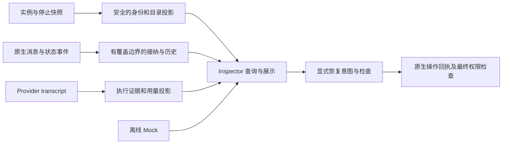

# Inspector：AgentX 数据基础评估

本阶段迁移完整的监控工作台和可移植核心，数据由明确标注的离线 Mock 提供。本文是源码评估，不是在线集成、部署或运行验收。AgentX 已有实例、消息、状态事件、停止快照、模型会话内容，以及部分 Provider 的用量事实；现有管理 HTTP 投影只暴露其中一部分。保留范围内的轮次观测、注意力已读、历史指标账本、恢复执行与分析报告仍需要专属数据和行为。

范围来自源项目的[入口](/home/long/works/longwork/paseo-retry/AGENTS.md)、[完整领域模型](/home/long/works/longwork/paseo-retry/.docs/domain-model.md)和[数据算法模型](/home/long/works/longwork/paseo-retry/.docs/data-architecture.md)。目标侧以当前 Rust 类型、写入者和查询路径为依据；[管理 API 设计](../agent-management/design.md)负责已声明的 HTTP 语义。未来适配器应消费原生类型或其受控派生绑定，不建立另一套权威 Agent 模型。本文没有提议或实现新的公共 URL。

## 当前选定范围

以[范围裁剪任务](../../.controller/inspector-migration/scope-trim.md)为当前产品选择：移除账户额度/reset/预测、金额估算和成本展示、计划定义/cadence/心跳唤醒、定时与延迟执行及其运行历史。不再把这些条目列为缺失承诺。普通 Agent 停止/恢复、事件/transcript/tool 证据、恢复尝试审计和分析作业历史继续保留。Token 计数与缓存/推理语义继续保留；Provider 未提供的字段是正常可选能力，保持未知或缺席即可。

监控历史从采集建设并启用的时刻开始，记录明确的 collectedFrom、覆盖与缺口。无需旧数据回填；启用采集不会追溯找回此前缺失的历史。原迁移完整保留清单与验收记录属于历史证据，当前实现见[清理记录](../../.controller/inspector-migration/scope-trim-implementation.md)。

## 身份、范围与观察模型

实线表示责任依赖，不表示这些 Inspector 接纳/适配模块已在 AgentX 实现。Mock 只能证明所模拟场景。

| 概念 | AgentX 权威来源 | 必须保留的含义 |
| --- | --- | --- |
| 数据集与代次 | 管理 `Descriptor.generation`、`AgentPage.generation`；[管理契约](../../src/management/contract.rs) | 作用域选择数据集；reset 后 generation 改变。跨数据集/代次禁止拼接引用、消息游标和操作回执。它不是恢复服务的轮次 generation。 |
| 当前实例 | [ParticipantRef](../../src/agents/attachments.rs)：canonical_name + `created_at.to_bits()`；管理 `AgentRef.incarnation` 是字符串 | name 是查找和展示；PID、provider session_id、Conversation ID 都不是实例身份。禁止从显示名拼不可变 ID，禁止把 incarnation bits 当时间戳。 |
| 停止对象 | `AgentRef.stopped_event` + name；[stopped_snapshot / agent / list](../../src/management/store.rs) | 引用具体停止事件，保留其原始 snapshot。列表可同时出现同名当前实例与多个停止记录。别以 name 去重丢历史；同一执行的软退役行和停止证据也不能盲目计为两次会话。 |
| Provider 会话与执行控制 | [ProviderSessionKey / ActivationTarget / Attachment](../../src/agents/attachments.rs) | Provider + scope + session_id 与实例、ExecutionId、BindingId 分开。恢复可能继续同一模型会话；同一 backend 不赋予兄弟实例控制权。 |
| 工作区与团队 | [LaunchCollaboration / collaboration / workspace](../../src/agents/workspaces.rs)、[ResolvedRole / select_workspace](../../src/config/roles.rs) | 成员归属是采用的 workspace 快照，cwd 是另一个维度；角色是定义快照，可有多个实例。无旧元数据按原生规则为 global/unassigned，不能回读当前目录角色来伪造历史归属。 |
| 父子关系 | [InstanceRow](../../src/db/instances.rs) 的 parent_name、parent_session_id、agent_id | 父子、工作区、角色三条关系独立。parent_name 不是父实例 incarnation；不能仅以父名连接到后来的同名实例。缺乏可证父实例时保留未解析关系。 |
| 观察质量 | 源 [DirectoryHealth](/home/long/works/longwork/paseo-retry/plugin/shared/domain/source-health.ts)、[StatsBasis](/home/long/works/longwork/paseo-retry/plugin/shared/stats.ts)、[TokenSnapshot](/home/long/works/longwork/paseo-retry/plugin/shared/tokens.ts)；目标 [ObservationPage](../../src/observability/events.rs) | 目录时效、生命周期覆盖、内容样本和日志覆盖相互独立。保留 observedAt、来源、完整性、保留起点、截断/丢失、时区和 revision；未知不填 0、false 或健康。不能沿用 `paseo-directory` 来源标识宣称 AgentX 采集。 |

## 完整能力矩阵

标记：**F** = 原生已有事实；**D** = 需要定义算法/历史的派生投影；**H** = 已声明且有源码实现的 HTTP 投影；**E** = 已有事实仍缺所需安全 API 暴露；**N** = 尚缺本功能的持久事实或行为。组合标记说明不同层的缺口。H 不是本次运行验收结果；N 指下表选定能力在所查源码中的缺失，不宣称全仓不存在任何近似机制。

| Inspector 能力及源所有者 | AgentX 数据/写读证据 | 判定和最小未来工作 |
| --- | --- | --- |
| 会话列表、身份、详情；[observation](/home/long/works/longwork/paseo-retry/plugin/shared/domain/observation.ts)、[model](/home/long/works/longwork/paseo-retry/plugin/shared/model.ts) | [InstanceRow](../../src/db/instances.rs)、[管理 AgentView / AgentPage](../../src/management/contract.rs)、[list / agent](../../src/management/store.rs) | **F/H/D**：可供当前状态、目录、tool、session、能力标志和具体停止对象。缺源产品的标题/Project/原生 Workspace 归档体系；定义 AgentX 展示投影，不伪造同构实体。目录分页不是固定完整历史快照。 |
| 父子树、后台任务、工作区/团队/角色；[background](/home/long/works/longwork/paseo-retry/plugin/shared/background.ts)、[subtask-tree](/home/long/works/longwork/paseo-retry/plugin/shared/subtask-tree.ts) | [实例字段](../../src/db/instances.rs)、[workspace 元数据](../../src/agents/workspaces.rs)、[角色定义](../../src/config/roles.rs)、[采用行为](../../src/runtime/launcher.rs) | **F/E/D**：管理 AgentView 没有 parent、background、workspace、role。补最小安全投影及可证关联。Provider 内部子任务不保证都有 AgentX 成员行；不能以普通列表冒充完整子任务树。 |
| 运行/等待/阻塞/错误状态；[attention](/home/long/works/longwork/paseo-retry/plugin/shared/attention.ts) | [原生状态常量](../../src/shared/constants.rs)、[lifecycle](../../src/agents/lifecycle.rs)、[live_view](../../src/management/store.rs)、[ModelRequestState](../../src/agents/model_request.rs) | **F/H/D/E**：AgentView 的 status/detail 是 native 展示派生。保留 active/listening/blocked/error/launching/inactive 的原生含义。listening 不表示业务完成，blocked 不证明存在可批准权限；模型错误状态不等于进程死亡。 |
| 注意力分类、停机原因、待回复、循环/卡住；[attention-phases](/home/long/works/longwork/paseo-retry/plugin/shared/attention-phases.ts)、[live-issue](/home/long/works/longwork/paseo-retry/plugin/shared/live-issue.ts)、[stop-reason](/home/long/works/longwork/paseo-retry/plugin/shared/stop-reason.ts) | status_context/detail、model_request、[Exchange.tools/errors/final_text](../../src/transcript/shared.rs) 和 [请求监视](../../src/db/reqwatch_policy.rs) 提供局部证据 | **D/E/N**：规则可保留，但需采样时刻、窗口、重复工具证据、轮次/回复基线及来源质量。reqwatch 是请求未获回复通知，不是完整 attention 分类或恢复链。不能把无 transcript 的 idle 分类成 silent/unfinished。 |
| 已读、完成提醒、错误确认；[ReadReceipt / markCompletionRead](/home/long/works/longwork/paseo-retry/plugin/shared/read-state.ts)、[server read-state](/home/long/works/longwork/paseo-retry/plugin/server/read-state.ts) | [实例 last_event_id](../../src/db/instances.rs)、[inbox claims](../../src/messaging/inbox.rs) 属于消息交付/消费；管理无此 completion 操作 | **N**：缺完成/轮次级 read receipt、注意力 token、stale 校验和持久化。交付游标不是用户已读；补独立 Inspector 状态，以确切实例和结果/轮次身份绑定，不能清除原生错误来实现“知道了”。 |
| 模型对话与结果摘要；[timeline](/home/long/works/longwork/paseo-retry/plugin/shared/timeline.ts)、[results](/home/long/works/longwork/paseo-retry/plugin/shared/results.ts)、[digest](/home/long/works/longwork/paseo-retry/plugin/shared/digest.ts) | [Source / Selection](../../src/transcript/service.rs)、[read_source](../../src/transcript/client.rs)、[Transcript / Exchange](../../src/transcript/shared.rs)、[management transcript](../../src/management/worker.rs) | **F/H/E/D**：已有受限最近对话 job；详细 digest/结果可由内容派生，但 exchange.position 不是 Paseo epoch/源序号。需独立稳定内容引用、范围/截断描述；摘要并非业务成功事实。 |
| 工具执行、编辑、错误钻取、Provider 子任务；[provider-subagents](/home/long/works/longwork/paseo-retry/plugin/shared/provider-subagents.ts)、[evidence](/home/long/works/longwork/paseo-retry/plugin/shared/evidence.ts) | [Exchange / ToolUse](../../src/transcript/shared.rs) 包含工具、错误、edits、files、ended_on_error；各 Provider parser 在 [transcript 模块](../../src/transcript/mod.rs)；管理 ExchangeView 仅文本/文件 | **F/E/D/N**：安全暴露已有结构即可支持部分细节。缺通用 tool-call ID/起止时间/权限决策历史/完整子任务运行生命周期时，不能补数组下标当源序号、推造耗时或声称完整。工具错误不证明轮次错误停止。 |
| 模型请求失败与错误持续；[recovery Incident](/home/long/works/longwork/paseo-retry/plugin/shared/domain/recovery.ts) | [ObserveModelRequest / RequestError](../../src/agents/model_request.rs)、[observe](../../src/agents/model_request_store.rs)、[Hook-only 模型](../model/model-request-errors.md) | **F/E/D**：有 session/turn/model/phase、error_since、last_error_at、连续失败和进展；当前状态字段可作证据，非完整历史。该路径为 Hook-only，不将 app-server 支持、所有 Provider 采样或自动恢复加入承诺。 |
| 人工继续、停止、恢复会话；[RecoveryService](/home/long/works/longwork/paseo-retry/plugin/server/recovery.ts)、[history](/home/long/works/longwork/paseo-retry/plugin/shared/history.ts) | [Command::Send/Stop/Resume、Operation](../../src/management/contract.rs)、[校验及回执](../../src/management/store.rs)、[执行 worker](../../src/management/worker.rs) | **F/H/N**：现成操作可作为未来动作基础，但 Send 是消息提交，Resume 是原生模型会话恢复，均不等于源产品错误恢复成功。缺 Incident/Attempt 资格校验和轮次观察关联；未建立时只可提供普通显式消息动作。 |
| 自动恢复、暂停/范围/审计；[当前方向](#可配置持续错误恢复方向尚未实现) | [请求观察](../../src/agents/model_request_store.rs)已有错误 episode 计时；原生管理操作只是部分基础 | **N/D**：缺可配置持续错误阈值、动作执行器、策略/恢复审计持久化、单未决 reservation 与最终 episode/phase 校验。旧 5/20/60 分钟 backoff 仅保留在离线源模型中，不是新增用户要求。未知结果不补发，accepted 不表示成功。 |
| 普通即时消息与投递证据；[管理契约](../../src/management/contract.rs) | [消息接纳](../../src/db/message_acceptance.rs)、[delivery](../../src/messaging/delivery_service.rs)、管理 MessagePage/Operation | **F/H/E/D**：投影原生接纳/交付事实，保持 accepted/sent/confirmed/answered/task-completed 含义独立。延迟队列、计划发送与运行账本已退出范围；当前 Mock 只保留即时发送的去重与未知结果保护。 |
| 生命周期事件流、历史搜索；[telemetry](/home/long/works/longwork/paseo-retry/plugin/shared/telemetry.ts) | SQLite [events 表](../../src/db/mod.rs)、[EventQuery / EventPage](../../src/events/service.rs)、[query](../../src/events/store.rs)、[固定 archive/live window](../../src/events/history_store.rs) | **F/E/D**：原生事件有 message/status/life 等事实，现管理 HTTP 只提供消息。安全业务事件暴露缺失；适配器须分类/冻结身份/去重并披露覆盖。不能一条 status 当一次 turn completed，不能按 name 混多 incarnation。 |
| 诊断、来源健康、运行请求；[diagnostics](/home/long/works/longwork/paseo-retry/plugin/shared/domain/diagnostics.ts) | [RuntimeRegistry](../../src/observability/registry.rs)、[ObservationJournal](../../src/observability/journal.rs)、[BrowserRead](../../src/observability/web/api.rs)、[浏览器边界](../observability/browser-api.md) | **F/H/D**：现有独立只读 HTTP 能给 runtime/config/短期诊断事件。它不是 Agent 业务事件/模型轮次历史端点；保留 epoch、clock、losses、Busy/Unavailable。源 IPC/chunk/存储诊断需重映射到本模块真实所有者。 |
| Dashboard、时间序列、热力图、会话/模型横评；[StatsBasis / StatsSnapshot](/home/long/works/longwork/paseo-retry/plugin/shared/stats.ts)、[analytics](/home/long/works/longwork/paseo-retry/plugin/shared/analytics.ts) | 原生实例创建时间、事件、内容、请求状态提供部分输入；没有源 observations.json 的统计检查点等价物 | **D/E/N**：需接纳边界、活动/等待区间、内容样本、历史身份、观察缺口和查询时区。可先展示“当前已加载目录”计数；不能从当前 Agent 行重建过去 7/30/90 天成功率、并发或忙碌时长。 |
| Token/缓存/推理/上下文/模型；[tokens](/home/long/works/longwork/paseo-retry/plugin/shared/tokens.ts) | [TokenUsage / SessionUsage / UsageCollector](../../src/transcript/shared.rs)、[parser registry](../../src/transcript/mod.rs)、例如 [Codex](../../src/transcript/codex.rs)、[Claude](../../src/transcript/claude.rs)、[Hermes](../../src/transcript/hermes.rs) | **F/E/D**：原生 parser 已有局部用量事实，管理投影不返回。先暴露解析结果及来源/可用性；不同 parser 不承诺同样字段完整度。`Transcript.usage=None` 是未知；默认单个计数为 0 不证明 Provider 明确报告了 0。 |
| Token 趋势/速率/贡献去重；[admission](/home/long/works/longwork/paseo-retry/plugin/server/tokens/admission.ts)、[snapshot](/home/long/works/longwork/paseo-retry/plugin/server/tokens/snapshot.ts) | 原生已有部分 Provider 用量；没有统一 Inspector 调用贡献账本 | **F/E/D/N**：从采集启用时刻建立稳定 call 身份、修正/冲突、checkpoint、retainedFrom。session 总量不可在每次 poll 相加；resumed/fork/shared 来源需去重。速率要求有效请求起止/输出样本，不能用会话年龄代替。金额和预算不属于当前范围。 |
| Insights、FindingFeedback、保存报告、证据与跨会话建议；[insights](/home/long/works/longwork/paseo-retry/plugin/shared/insights.ts)、[insight-overview](/home/long/works/longwork/paseo-retry/plugin/shared/insight-overview.ts)、[存储](/home/long/works/longwork/paseo-retry/plugin/server/insight-storage.ts) | [协作 WorkResult / Artifact / CheckReport](../../src/collaboration/service.rs) 有任务交付产物，但不具有这些分析报告语义 | **N/D**：内容能作输入，分析 runner、版本化证据、运行限制、feedback 和报告保留需独立实现。WorkResult 不是 InsightReport，普通模型回复不是可追溯 AI 报告。 |
| 分析 jobs、重启/取消、recap/建议回复；[insight-jobs](/home/long/works/longwork/paseo-retry/plugin/shared/domain/insight-jobs.ts)、[recap](/home/long/works/longwork/paseo-retry/plugin/shared/recap.ts)、[job manager](/home/long/works/longwork/paseo-retry/plugin/server/insight-runner.ts) | 管理 Operation 是原生命令回执；协作 CheckRequest 是显式验证请求；二者均非分析 job | **N**：缺所选 runner/job 状态机、取消确认、失败/unknown、report refs、recap 对应轮次/新鲜度。可保留队列与 UI 规则，不能用一个 succeeded Operation 填所有结果。 |
| 归档、停止历史、还原；[history](/home/long/works/longwork/paseo-retry/plugin/shared/history.ts) | 管理 stopped_event 可读/可 Resume；[archive/live 事件查询](../../src/events/history_store.rs)、[dataset reset](../../src/db/reset.rs) | **F/H/E/N**：已有停止记录和 archive 事件，不等价于 Paseo 的 Workspace/Agent archivedAt、已读批量归档或同对象还原。不得为 UI 归档执行 dataset reset/删除。可先独立本地隐藏视图，真实归档另行设计。 |
| Bots 的 Bot/Team/Conversation/Runtime；[bots-observation](/home/long/works/longwork/paseo-retry/plugin/shared/domain/bots-observation.ts)、[SDK adapter](/home/long/works/longwork/paseo-retry/plugin/server/bots/sdk-provider.ts) | AgentX workspace 团队/角色/实例和 [协作 Work](../../src/collaboration/service.rs) 可供本地另一组概念；没有同构 Bots authority/catalog/routine 持久模型 | **F/D/E/N**：原纯 read-only 观察算法可留。保留 foreign/ordinary/runtime-qualified 身份和各来源 partial/forbidden/unconfigured。Conversation ID 永不变成原生 Agent handle；按产品决策提供独立外部观察，或明确重设计为 AgentX 团队/Work，不能字段改名冒充等价。 |
| 偏好、保存视图、snooze、提醒、语言；[preferences](/home/long/works/longwork/paseo-retry/plugin/shared/preferences.ts)、[alerts](/home/long/works/longwork/paseo-retry/plugin/shared/alerts.ts)、[服务](/home/long/works/longwork/paseo-retry/plugin/server/preferences.ts) | 原生 config/profile/role 是运行配置，管理 Descriptor 仅 tools/profiles；无 Inspector ViewPreferences 存储 | **N/D**：本地应用可保留纯偏好和提醒规则，定义用户/设备/数据集作用域及版本。偏好不修改执行权限/状态；snooze 不解决错误。Mock localStorage 不声称跨浏览器持久化。 |
| 主题、原版/pixel、图标、声音、图表/布局资源；[原资源所有者](/home/long/works/longwork/paseo-retry/uiux/systems/inspector/inspector.native.ts)、[surface 入口](/home/long/works/longwork/paseo-retry/plugin/client/surfaces.tsx) | 无需原生事实；由迁移后 Web 模块拥有运行/资源绑定 | **可移植 UI**：保留资源 provenance/license，替换宿主导航、音频、RPC 和订阅桥。独立主题/skin 是展示能力，不证明 live data。 |

## 已有 HTTP 的精确边界

[src/management/contract.rs](../../src/management/contract.rs) 是原生数据契约；[store.rs](../../src/management/store.rs)、[worker.rs](../../src/management/worker.rs) 和 [web.rs](../../src/management/web.rs) 说明其实际投影与执行。已声明路径见[管理 HTTP 表](../agent-management/design.md#http-contract)：descriptor，Agent list/detail，消息读/写，launch/stop/resume/transcript 命令，以及 operation 查询。本评估不增加路由，不调用这些路径。

| 边界 | 实际限制及 UI 后果 |
| --- | --- |
| 目录分页 | `MAX_PAGE=100`；先 local-origin live rows 按 name，再停止事件按事件 ID 降序，`next` 是 opaque continuation。NULL/空 origin 均为 local，非空远端排除在分页之前。这不是“全球所有 Agent”。完整读完也不提供跨页固定快照承诺；查询过程中可能变化。 |
| 消息分页 | `MessagePage.next_after`、has_more、generation；在实例 created_at 下界和具体 stopped_event 上界间查询。消息 ID 和 incarnation 保持十进制字符串，不转 JS Number。管理消息不自动包含 archive/live 联合窗口。 |
| 对话读取 | `POST .../transcript` 返回 Operation，之后读取结果；worker 的 `read_source(...,100,false,false)` 只取最近范围，字段逐项有界，结果约 1 MiB 内。`TranscriptPage` 没有可继续 timeline cursor/epoch；size-limit reason 不能代替完整覆盖声明，返回 100 行也不证明仅有 100 行。 |
| 对话投影损失 | `ExchangeView` 返回 position/at/user/assistant/action/files；丢 tools、edits、errors、ended_on_error、exchange usage 和 SessionUsage。API-only 补充应保留缺失/截断/来源事实，而非绕过宿主直接让浏览器读路径或数据库。 |
| 动作回执 | UUID request_id + generation + 精确 command；相同意图重放取同回执，冲突拒绝，工作进程 claim 后执行一次。Accepted/Running/Succeeded/Failed/Unknown 独立于 Agent 状态和业务完成。超时/断线保留原 request_id 并观察；新的 ID 不可成为不确定发送的自动重试。 |
| 可调用能力 | `can_send/can_stop/can_resume/has_transcript` 是当时投影，不是恢复最终许可或文件始终可读保证。外部动作必须重新经原生资格/身份校验。 |

另两组 HTTP 已存在但有不同责任：[observability 的 scope/read](../observability/browser-api.md) 只接受封闭 `BrowserRead`；[collaboration connection/read/apply](../../src/collaboration/web/mod.rs) 使用 [Work 契约](../../src/collaboration/service.rs)。不能将任意事件查询/SQL、分析 job 或模型 transcript 塞进诊断 Read。管理 JSON 数字字符串策略与 observability 的 `{"$integer":"..."}`/bigint 编码不同，复用客户端时需遵循各边界。

## 监控核心的保留与替换

迁移目标包括规则、聚合和恢复证据链，而不止页面。以下是源码可移植性判断；不表示前端 owner 已复制或运行这些模块。含 `defineRpc`、Node 或宿主依赖的文件需要剥离注册/IO，纯函数本身可保留原语义。

| 核心责任 | 可以保留 | AgentX 侧必须重新供应/接合 |
| --- | --- | --- |
| 身份/质量与聚合纪律 | [includesScope](/home/long/works/longwork/paseo-retry/plugin/shared/domain/observation.ts)、[DirectoryHealth](/home/long/works/longwork/paseo-retry/plugin/shared/domain/source-health.ts) 的语义、[Bots loadedCount / exact / teamLoad](/home/long/works/longwork/paseo-retry/plugin/shared/domain/bots-observation.ts) | 原生身份 namespace、workspace 维度、独立来源/时效；移除硬编码 Paseo 来源与 Project 层级假设。无法证明的映射拒绝执行而非填默认值。 |
| Attention、结果/摘要、过滤排序和时间图 | [attentionPhase/reasonText/threadAttention](/home/long/works/longwork/paseo-retry/plugin/shared/attention.ts)、[analytics coveredDuration / buildHourlyHeatmap / buildDailySeries](/home/long/works/longwork/paseo-retry/plugin/shared/analytics.ts)、[digest 纯折叠](/home/long/works/longwork/paseo-retry/plugin/server/digest/fold.ts) | 输入应先通过归一化 Adapter，显式 turn/permission/reply/stop 和覆盖。不能将当前 active 状态改称 observed active intervals；不能给缺失 pendingPermissionCount 填 0 来满足恢复 guard。 |
| 生命周期接纳与统计 | [StatisticsFacts / intervalMetrics](/home/long/works/longwork/paseo-retry/plugin/server/stats-facts.ts)、[buildStatsSnapshot](/home/long/works/longwork/paseo-retry/plugin/server/stats-snapshot.ts)、[StatsBasis](/home/long/works/longwork/paseo-retry/plugin/shared/stats.ts) | 替换 [lifecycle-hub](/home/long/works/longwork/paseo-retry/plugin/server/lifecycle-hub.ts) 的宿主输入与 [ObservationDirectory](/home/long/works/longwork/paseo-retry/plugin/server/observation-directory.ts) 的 SDK 扫描，保留一次接纳、重复/冲突、历史归属冻结、观察缺口及 checkpoint 边界。原生事件可重放范围与源 turn 事件不相同。 |
| 用量贡献与查询 | [admitContribution / validLedgerCall](/home/long/works/longwork/paseo-retry/plugin/server/tokens/admission.ts)、[buildTokenSnapshot](/home/long/works/longwork/paseo-retry/plugin/server/tokens/snapshot.ts)、[cacheHitRate / outputSpeed](/home/long/works/longwork/paseo-retry/plugin/shared/tokens.ts) | 替换 discovery/roots/provider parser 接合和目录归属。使用 AgentX 已有 parser 能力，但会话合计不能伪装稳定 per-call 贡献；只有可证的时间/身份/修正才入新账本。保留 safe integer/容量与暂停接纳规则；u64 原生计数不能无校验塞进源 number 类型。 |
| 恢复领域与状态机 | 当前离线实现保留源 RecoveryService、backoff 和 mock audit；[原生错误模型](../model/model-request-errors.md)定义未来计时依据 | 旧 prompt/permission baseline 状态机是迁移 Mock 规则，不能作为新选定需求。真实接合应按下文持续错误时长方向建立执行器与审计，不搬旧适配器或暗示已有普通注入权限。 |
| 调查/报告/分析作业管理 | [InsightJobsSource](/home/long/works/longwork/paseo-retry/plugin/shared/domain/insight-jobs.ts) 的 retained-window 规则 | 保留分析 job lifecycle、runner、版本化证据、feedback 和 report storage；需要独立持久化。计划管理与调度账本已移除。 |

### 必须保持的数值与历史算法

Token 单位是 token 次数：`input` 不含 cache；`cache_read/cache_write` 分离，reasoning 是 output 子集，不能再加进总量。源 `tokenTotal` 包含 input + cacheWrite + cacheRead + output；AgentX 的终端 `format_usage` 将 newly processed 与 cached 分开，二者不能直接拿标签“tok”做横评。cache hit 的分母应选明确定义的输入合计，零分母返回未知；当前 Inspector 不再消费或比较金额；原生可含 cost 字段不意味着本产品需要展示。

源统计规则在[数据算法模型](/home/long/works/longwork/paseo-retry/.docs/data-architecture.md#生命周期与统计)及 `intervalMetrics`：completed / (completed + failed)，取消/未终结不进完成率分母；平均时长按有效起止样本；busy 为 Agent 活动区间并集，observed-active 为各 Agent 时长之和，峰值用半开区间端点扫描且同刻先结束。权限等待按同 Agent 重叠区间并集。截窗口后再计算，按查询 IANA 时区切日/小时，不能把 UTC 桶改标签冒充本地日。

这些算法依赖观察支持域，而非当前目录全量：保留窗口、since 累计、生命周期/内容样本完整性、元数据归属、前期覆盖分别表达。源 400 天是保留政策，不能继承为 AgentX 已拥有 400 天数据。当前 `model_request` 是最后状态与有限 retired_turns，不是历史统计表。

原生有两类事件：SQLite 业务事件支持 generation、after/through 和固定 archive/live history cursor（最多 1000 事件/2 MiB page），而 [ObservationJournal](../../src/observability/events.rs) 是易失诊断窗口（最多 8192 条、16 MiB、900000 ms，page 至多 256 条/512 KiB）。后者的 stream/epoch/nonce、drop/eviction/gap 必须保留；不能用其“没有 turn 事件”证明没有执行。旧档案 generation 可能为空且读取可有 warning，不能合并为当前数据集完整历史。

时间单位也需显式转换：实例 created_at 为 epoch 秒 f64，status/last_seen/model error 时间为 epoch 秒整数，原生事件为时间字符串；源统计 duration 为 ms，source clock/history 各有边界。诊断 monotonic 时间只在同 ClockId 下相减。缺失时间不填当前时刻；provider timestamp 字符串保留解析失败/来源差异。

## 最小后续切片与待决策事项

| 优先级 | 最小可用增量 | 完成判据与所有者 |
| --- | --- | --- |
| P0：本阶段 | 完整离线 UI + 移植可用的规则/聚合核心 + 有限状态 Mock；显式 simulated action 与 unknown/unsupported/partial 案例 | 前端 owner 负责 runnable provider、规则实际消费与文档；独立执行 owner 验证页面/代表路径。本评估仅提供供应和差距模型。无需因 HTTP 缺失阻塞迁移。 |
| P1：现有事实只读接合 | 复用管理身份/目录/消息/受限对话；安全补父子、采用的 workspace/role、模型错误和 structured transcript usage/tools 供给 | 未来原生/API owner 决定最小投影，派生绑定，声明分页、来源、缺失与截断；consumer 验证同名 successor、generation reset、missing/partial transcript。不要把完整 InstanceRow/launch_context/文件路径原样暴露。 |
| P2：监控历史 | 从确切身份的原生事件及 Provider 证据接纳一次，增加观测覆盖/内容样本/区间/调用贡献及查询 checkpoint | 数据 owner 定义稳定事实 key、duplicate/correction/conflict、写入一致性和保留/容量；指标 owner 复用可证算法。若缺必要 turn/权限事实，由采集 owner 补采，历史空洞保持未知。 |
| P3：持续错误恢复 | 可配置连续未解决 native error 时长（示例/默认建议 10 分钟），执行器与审计 | 按下文实例/错误 episode/动作时 phase 核验、单未决尝试、未知结果屏障实施；目前仅离线 Mock，无原生动作支持声明。 |
| P4：独立供应 | Inspector 偏好/已读、分析 runner/report/jobs/recap 持久化 | 各域分别拥有模型与生命周期；账户额度、金额和调度不再是实施义务。 |

需要产品决定：Inspector 的 session 主对象是确切 AgentX 实例还是 Provider 会话；两者都展示时须保持独立导航与关联。Project/Workspace 导航应采用 AgentX directory-team 语义，还是额外提供纯展示分组；目录不能同时假装是 cwd、持久成员归属与 Paseo Workspace ID。Bots tab 保留外部独立 authority 的观测，还是重设计为本地团队/协作 Work；本阶段均使用独立 Mock，不假定可恢复 Conversation。偏好/已读由浏览器、用户还是 scope 共用；报告/自动恢复是否进入原生持久服务，也需明确所有者后实施。

## 矛盾、限制与处置

| 发现 | 处置 |
| --- | --- |
| “缺 API”容易被误读为“底层事实都没有”；相反存在相似类型容易被当作完整支持 | 用 F/D/H/E/N 分层；token/tools/模型错误属部分已有事实，从启用开始的监控历史与恢复执行仍缺独立事实或行为。 |
| 源文档同时包含目标模型、正在交付与历史运行记录 | 原声明/代码是静态支持证据；不继承源运行验收、不把源保留政策或接受状态当目标已实现。 |
| 源 Recovery AgentObservation 的旧基线与当前所选持续错误规则不同 | 保留源 Mock；未来以原生 ModelRequestState 与受支持动作接合。不能用假 permission/turn 默认值赋予资格，也不把整个旧基线系统变为新需求。 |
| 源 TimelinePage epoch/序号与 AgentX Exchange.position 不同；源 generation 与数据库 generation 不同 | 不伪造 epoch 或用数组索引替换源序号；分别命名生命周期基线、数据集代次、运行/绑定 fence。 |
| `has_transcript` 仅表示已登记路径，SessionUsage 可能为 None，部分 parser 默认计数为 0 | 展示 available/empty/missing/read_failed/truncated 的真实区别；统计保留 observed/unknown 及来源能力，不把 0 数值升级为完整采样。 |
| Bots/Workspace/Resume/Operation 等同名或近义对象没有同一生命周期 | 保留外部 namespace 和原语义；映射由明确产品决策授权，不因同名自动绑定。 |
| native/API 源码存在不代表该 scope 正运行相同版本或已配置 endpoint | 本次无 daemon/runtime/provider 调用，无私有日志/数据库读取，无 live 验证；部署与集成证据由未来 owner 另行取得。 |

静态检查范围和交接见[评估记录](../../.controller/inspector-migration/data-implementation.md)。此文件对监控核心的保留建议不代替 `web/inspector/` 的实际移植清单和执行证据。

## 可配置持续错误恢复方向（尚未实现）

权威来源是 [RequestError / ModelRequestState](../../src/agents/model_request.rs)、[事务写入者](../../src/agents/model_request_store.rs)和[原生语义](../model/model-request-errors.md)。`error_since` 为 epoch 秒，首次 Failed 设置，后续失败保留并更新 last_error_at/consecutive_failures；Started 只推进 last_progress_at、保留未解决 error；Cancelled 不清除；符合 turn/身份约束的 Completed 清除 error。普通工具/Stop/心跳不清除。inactive 和 approval blocked 可优先于 error，故 error_since 表示连续未解决错误 episode，不能直接当作 UI status 连续停留时长。

选定方向：恢复策略包含可配置 errorDuration（示例/默认建议 600 秒，用户可调整）。计时使用 native error_since 与当前可信观测时间；不以最近失败、日志文案或浏览器页龄替代。达到阈值只产生候选，不授予操作权。执行前必须重新核验相同作用域/generation、实际 incarnation、native session 与同一 error episode（至少 failing turn/source/error_since），并且状态仍为 error，未退出、未被审批阻塞、未成功清除或换到新 episode。

仍为 error 也可能处于 Provider 的主动重试 Started 阶段：必须再次读取 ModelRequestState.phase/last_progress_at，避免和在途重试竞争。须先选择 runtime 明确支持的恢复动作，并由动作所有者执行最终 episode/phase 校验；当前 native error 不是 idle，也不授权普通 PTY 注入“继续”。结构化错误目前仅来自 Hook-only Codex，不能推及 app-server 或其他 Provider。

同一 episode 仅允许一个未决恢复尝试；先持久化 reservation/operation identity，再调用所选动作并审计。未知结果继续阻挡重复发送，只有已核实未送达才可受控重试；accepted 回执不是恢复成功，须观察成功或 episode 清除。重启需重建未决屏障，不能重置为可发送。此方向未实现 native/API、真实执行器或后台计时，不对真实 Agent 执行动作。旧离线 backoff/permission/prompt 规则仍为源模型模拟，不能声称已实现本方向。

当前实质后续工作是安全 native 投影、从启用时刻起的观察/Token 历史持久化、Inspector 已读/偏好状态、分析 runner/报告/作业持久化，以及上述恢复执行器/审计。缺失 Provider 字段正常可选，账户额度/reset、金额、调度及旧数据回填不在清单内。
