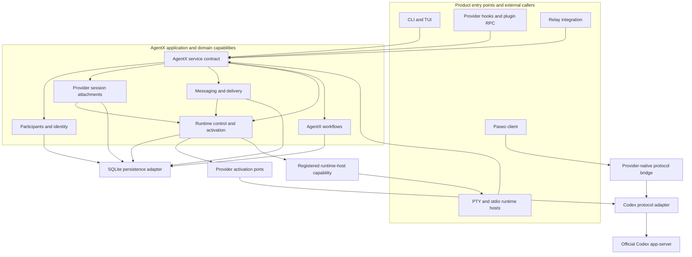

# AgentX domain model

This is the navigation entry for AgentX's domain design. It distinguishes current source behavior from the selected direction and planned architecture. Native Rust declarations remain authoritative for implemented Rust contracts; the [Rust-native contract method](../../.inbox/rust-contract-design/domain/README.md) defines how future boundaries are derived. The [single-binary daemon proposal](../proposals/domain-driven-agentx-daemon.md) owns target decisions and unresolved design questions.

| Model question | Owning material |
| --- | --- |
| How are Agents classified and addressed? | Native names and exact participant references own addressing. [Labels design](../agent-classification.md) defines the accepted scalar classification, selectors, indexes and plugin consumption; the [implementation Delivery](../../.controller/agent-labels/implementation.delivery.md) owns actual source/consumer support under Controller nezi. The [completed design Task](../../.controller/agent-labels/design.task.md) retains its bounded synthetic evidence. [Metadata maintenance](../../.controller/agent-metadata/AGENTS.md) owns current cleanup consumer/storage evidence. |
| How should configurable context be generated at startup and after compaction? | [Context composition proposal](../proposals/agent-context.md): ordered internal source hooks, replaceable guide content and future domain projections. [Usage](../agent-context.md) and [Delivery](../../.controller/agent-context/delivery.md) own implemented scope and evidence. |
| How should named reusable launch configurations work? | [Profile usage](../launch-profiles.md), [accepted proposal](../proposals/launch-profiles.md) and [implementation/evidence](../../.controller/launch-profiles/delivery.md): scoped config definitions, single-base resolution, native adopted provenance and target-side Relay preparation. |
| How do reusable roles, directory teams and default recipients relate? | [Role/workspace usage](../roles-workspaces.md), [accepted proposal](../proposals/roles-workspaces.md) and [Delivery](../../.controller/roles-workspaces/delivery.md): filesystem role origins are separate from stable participant workspace membership; native endpoint reservations precede process launch. Read Delivery for actual executable acceptance and limitations. |
| How can callers use AgentX objects through TypeScript? | The [domain object design](typescript-domain-sdk.md) translates scoped native identity, workspace membership, Role, snapshots and original operation recovery without introducing a second authority. Its [Delivery](../../.controller/typescript-domain-sdk/implementation.delivery.md) owns actual implementation and evidence. |
| What are the identities, state owners, transactions and effect boundaries? | [State and transaction ownership](state-ownership.md) |
| What does compatible native build mean, independently of exact artifact audit? | [Native build compatibility](state-ownership.md#native-build-compatibility), including supported Cargo inputs and rebuild/path-replacement behavior |
| How do ordinary startup and old-build recovery work? | [Lifecycle usage](../architecture/daemon.md#operator-status-and-recovery) defines automatic missing-daemon acquisition and explicit scoped diagnosis/restart; the [completed startup outcome](../../.controller/domain-daemon/startup-usability.md#accepted-local-outcome-and-project-handoff) links independent Linux evidence and the current project runtime handoff. |
| Which baseline source opens or depends on storage, and who migrates it? | [Production database inventory](db-access.md), [full evidence](db-access.json) and [generator](generate-db-access.py) |
| Which final storage permissions and mixed-module helper paths are accepted? | [Production storage boundary](storage-boundary.md), including remaining owned effect/caller gaps |
| Which native operations and dependency direction apply? | [Architecture contracts](../architecture/contracts.md) and [source ownership release](../../.controller/domain-daemon/contracts-handoff.md) |
| What is implemented and independently verified? | [Delivery](../../.controller/domain-daemon/delivery.md) and [acceptance](../architecture/acceptance.md) |
| How is an originating environment selected without changing shared daemon state? | [Environment model and usage](../architecture/environment.md) links frozen control/final scope, native snapshot/retention contracts and child source order. Its [independently exercised support](../architecture/environment.md#independently-exercised-support) records the packaged Linux local finite/HTTP boundary; [evidence](../../.controller/environment-loading/evidence.md) owns exact execution and [Delivery](../../.controller/environment-loading/delivery.md) owns artifact/live adoption. |
| What observation and management consumers are supported after the daemon baseline? | [Observability foundation](../observability/README.md): implemented native inspection, CLI and read-only browser investigation, with bounded runtime/configuration/events evidence; [direct LAN and standalone follow-up](../../.controller/observability/lan-usability.md) owns its later running outcome. |
| Which collaboration capability is implemented, and what is independently supported? | [Native declarations](../../src/collaboration/service.rs), [source guide](../../src/collaboration/AGENTS.md), [entry/report usage](../collaboration-workbench/native.md) and [closed browser contract](../collaboration-workbench/browser-api.md) realize the [selected change](../proposals/collaboration-workbench.md). [Independent evidence](../../.controller/collaboration-workbench/evidence/acceptance.md) establishes the packaged Linux staged CLI/native + numeric-LAN browser path through failed baseline, repair, exact-result recheck and explicit acceptance. [Support limits](../collaboration-workbench/native.md#independently-exercised-support-scope) retain full-access real Codex roles, local-user explicit caller selection and the old configured-hook boundary. [Source release](../../.controller/collaboration-workbench/tasks/collaboration-service.md), [acceptance Task](../../.controller/collaboration-workbench/tasks/acceptance.md) and [Delivery](../../.controller/collaboration-workbench/delivery.md) own their distinct source, execution and closure states; [design entry](../collaboration-workbench/README.md) retains SVG authority. |

For durable exact AgentX creation provenance, resume continuity and direct Space conversation navigation, follow [the owned model](../../.controller/agent-launch-relations/design.md), [native implementation](../../src/agents/launch_relations.rs) and [usage](../agent-management/README.md#agent-启动关系). Creation ancestry is separate from Provider parent fields, task assignment, mutable runtime status and permissions. [Delivery](../../.controller/agent-launch-relations/delivery.delivery.md) owns actual acceptance scope; no live adoption is implied by source declarations.

## Product boundary

AgentX is a multi-provider agent coordination product. It owns AgentX participants, their relationships and attachments, durable inter-agent messages and delivery state, AgentX workflows, and the coordination needed to activate a participant. A Provider owns its native session protocol and execution behavior. Paseo owns its own agent identity, orchestration and scheduling model. Neither Provider sessions nor Paseo agents become AgentX participants merely because an adapter connects them.

An AgentX participant, an AgentX execution/attachment, a native Provider session and a Paseo agent are distinct identities with explicit mappings. One AgentX participant can attach to a provider session; a native provider can host many sessions; a participant may start child AgentX participants through AgentX use cases without involving Paseo.

## Domain and adapter ownership

This diagram shows runtime collaboration, not Rust import edges. Domain responsibilities are logical boundaries first; this map does not require one crate per box. Domain policy and use cases depend on typed capabilities; concrete SQLite and Provider adapters implement those capabilities and are injected by composition. IPC, CLI, hooks and process hosts are adapters composed at application entry points. A client command composes user intent and presentation; it does not become a second database implementation.

## Current evidence and target

The single-binary client/daemon architecture is implemented and [accepted within its documented local Linux scope](../../.controller/domain-daemon/delivery.md#accepted-local-outcome). Production clients use typed native operations through local IPC; the daemon owns live managed database construction and application dispatch. Provider-neutral attachments, pending inboxes, fenced runtime identities, delivery claims and receipts retain their domain-owned semantics. The [source entry](../../src/README.md), native declarations and module guides own implemented contracts.

The [production database inventory](db-access.md) is regenerated from current source; historical migration scans remain in [architecture acceptance](../architecture/acceptance.md). The [current storage boundary](storage-boundary.md) owns exact daemon adapters, approved read-only archive constructors and scoped helper permissions. Clients have no direct managed-database fallback after IPC failure; notification sockets remain wake hints alongside the typed service transport.

For each canonical AgentX data scope (normally the resolved `AGENTX_DIR`), a daemon owns database open/migration and the AgentX use cases. CLI, TUI, hooks, plugins, PTY hosts and applicable Relay processes use that scope's service boundary. Each scope may have its own daemon and database; “one daemon” is not a machine-global process spanning different AgentX data directories. The [observability foundation](../observability/README.md) supplies native instrumentation, CLI and a browser investigation consumer over this implemented baseline. The [accepted local implementation](../../.controller/observability/implementation.md#accepted-local-implementation-outcome) and [later direct LAN follow-up](../../.controller/observability/lan-usability.md#accepted-running-outcome) own their distinct evidence and limits. That diagnostic browser surface does not expose participant lifecycle or messaging mutations. The separately enabled [Agent management HTTP/Web surface](../agent-management/README.md) maps exact Agent references and durable operation receipts to native lifecycle, messaging and transcript capabilities; its [Delivery](../../.controller/agent-management/delivery.md) owns implementation and acceptance status. The accepted daemon Delivery retains its platform, external-integration and installed/live-cutover limits; unselected future capabilities remain [Roadmap candidates](../roadmap.md).

The separate [collaboration browser](../collaboration-workbench/browser-api.md) adds finite operator work commands through the same native service boundary. Work methods own assignment, immutable result/check identity and acceptance eligibility; the daemon adapter composes participant resolution, persistence and required message admission. Agent reports remain native caller operations, and acceptance is an explicit operator statement without authenticated personal identity. Its [independently exercised scope](../collaboration-workbench/native.md#independently-exercised-support-scope) distinguishes the real r5 work outcome from final r8 presentation/artifact checks. The [final evidence](../../.controller/collaboration-workbench/evidence/acceptance.md#final-artifact-evidence-and-cleanup-handoff) records completed repository-local artifact promotion and disposable-resource cleanup, with installed/default/PATH programs and the protected demo unchanged; formal Delivery acceptance remains controller/user-owned. Passive diagnostic policy remains separate.

## Provider and Paseo relationships

The AgentX daemon protocol is independent of the Codex app-server protocol. AgentX's Codex adapter may connect to the official Codex daemon and translate between AgentX activation/session capabilities and Codex methods/events. The official process remains Codex-owned and follows its own configuration scope. Per-session environment and identity must be supplied or validated at session creation/attachment; they cannot be inherited from the AgentX daemon's startup environment.

Paseo remains an external AgentX/Provider client with its own identities and scheduling. An AgentX-launched Codex can create AgentX child participants directly through AgentX contracts. Paseo need not be present for those AgentX relationships or activation decisions. A protocol bridge maps a concrete caller's contract; it does not collapse these domain models.

## Model maintenance

Keep actual behavior in source-owned declarations and module guides. Update this entry when a domain owner, cross-domain relationship or supported entry-point boundary changes. The proposal records target decisions and open details; the Delivery records execution state. Do not copy implementation status into the model or infer support from a selected roadmap item.

For Hook-observed model request failure, durable error state, recovery evidence and governance fields, see [model request errors](model-request-errors.md) and its [implementation task](../../.controller/domain-daemon/model-request-errors.md).
