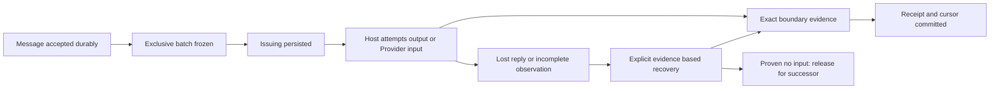

# State and transaction ownership

This is the semantic ownership model for the accepted client/daemon direction. Native source owns exact types and callable signatures. The [production inventory](db-access.md) describes current source dependencies; [acceptance](../architecture/acceptance.md) retains historical migration evidence and owns executable support. A declared operation or transaction obligation below is not evidence that all clients have migrated.

## Identity and lifetime

| Concept | Authority and lifetime | Required distinction |
| --- | --- | --- |
| Data scope | [Daemon scope](../../src/daemon/scope.rs); canonical AgentX data directory | Different aliases of one scope share ownership; different scopes retain independent state and event IDs. Provider homes are separately scoped. |
| Database generation | [Persistence generation/reset](../../src/db/reset.rs); durable KV key `service:database_generation` | Survives daemon restart; reset/replacement invalidates old-generation work. The transport mirror is not a second durable authority. |
| Daemon instance | [Scope lease](../../src/daemon/scope.rs); fresh process lifetime | Restart invalidates connections/instance tokens, without creating new participant or Provider identities. |
| Participant incarnation | [`ParticipantRef`](../../src/agents/attachments.rs); exact named row incarnation | Deleting/recreating a name cannot authorize old status, stop, attachment or receipt operations against the successor. `created_at` bits preserve existing identity. |
| Provider session lineage | [`ProviderSessionKey`](../../src/agents/attachments.rs); Provider namespace, scope and native session | Durable canonical participant/cursor can survive live-row deletion; a raw session string alone is insufficient. |
| Execution | [`ExecutionId`](../../src/agents/attachments.rs); runtime/backend generation | One shared backend can host several sessions and controllers. Execution generation is not a database generation. |
| Attachment binding | [`BindingId` / `ActivationTarget`](../../src/agents/attachments.rs); one attachment | A callback must match participant, execution and binding. Retirement does not erase predecessor claims. |
| Attachment controller | [`AttachmentOwnerId` / `AttachmentOwnerProcess`](../../src/agents/attachments.rs); one real host | Tokens returned by lookup are not sufficient process authority. Transport-observed PID/incarnation or validated registered host evidence supplies actual ownership; never persist the daemon as the Provider owner. |
| Caller configuration | [`InvocationContext`](../../src/service/context.rs); one originating invocation | Cwd, environment, explicit name and binding/session claims configure a call. None authenticates another participant or host by itself. |
| Observed local caller | [`CallerProcess`](../../src/service/context.rs); transport-observed PID and available OS incarnation | Unix authentication can succeed without an incarnation; Windows rejects unavailable identity. Unknown identities do not prove ownership of external effects, including `None == None`. Positive exit/reuse evidence can retire an owner; missing evidence cannot grant its effects to another host. |
| Request identity | [`RequestId`](../../src/service/context.rs); caller-chosen intent identity | Only a domain-declared durable lookup/deduplication promise permits replay. Stable IDs do not imply universal exactly-once effects. |
| Batch and receipt | [`BatchId` / `DeliveryReceipt`](../../src/messaging/inbox.rs); frozen eligible message window and exact consumer evidence | Neither an unrelated event watermark nor RPC success can acknowledge a batch. |
| Paseo agent | External orchestrator authority | A Paseo ID is not an AgentX participant, Provider session, execution or controller token. AgentX child launch and messaging work independently of Paseo. |

Participant incarnation currently uses the exact IEEE-754 bits of `InstanceRow.created_at`. Native JSON decoding enables serde_json `float_roundtrip` so a transported row retains those bits when a client derives `ParticipantRef`; rounding the timestamp or weakening the comparison would invalidate this identity contract.

## Domain responsibility map

| Capability | Native authority | State and implementation owner | Consumer boundary |
| --- | --- | --- | --- |
| Participants and lifecycle | [Participant operations](../../src/agents/service.rs), [attachment port](../../src/agents/attachments.rs) | `agents` policy plus daemon-only storage adapters; `db` supplies schema/write scopes | CLI start/reclaim/stop, hooks, plugins, launch hosts and read models use semantic operations. Lifecycle is nested in Participants; it is not a new top-level domain. |
| Messages and delivery | [Message operations](../../src/messaging/service.rs), [inbox](../../src/messaging/inbox.rs), [activation](../../src/messaging/activation.rs) | `messaging` owns routing/acceptance, claims, recovery and cursors | Send/listen/hook/plugin/native hosts supply explicit actor and exact output/input evidence. |
| Runtime control | [Host operations](../../src/runtime/hosts.rs), [host adapter](../../src/runtime/hosts_store.rs) | `runtime` owns process/PTY/stdio/network effects and registered capability lifetime; participant invariants delegate to `agents` | Daemon policy returns typed decisions; real hosts execute Provider I/O and report fenced observations. |
| Events and subscriptions | [Event operations](../../src/events/service.rs) | `events` owns filter/cursor/subscription policy; daemon handlers own managed reads and persistence | CLI/TUI/listeners poll bounded pages from a durable cursor; notifications reduce latency and never establish delivery. |
| Product read models | [Query records and operations](../../src/service/queries.rs) | Daemon read-model adapter assembles state; TUI owns presentation extensions | A snapshot/search projection contains no connection and grants no mutation authority. Existing participant records are reused, not copied into an editable shadow schema. |
| Maintenance | [Maintenance operations](../../src/service/maintenance.rs), [adapter](../../src/service/maintenance_store.rs) | Daemon application serializes archive/reset; persistence owns managed clear and generation | Archive selectors identify managed archives, not arbitrary paths. File-only preferences/hook installation remain caller-side. |
| Relay | [Relay native service](../../src/relay/service.rs) and [owning Task](../../.controller/domain-daemon/tasks/relay.md) | Daemon owns replication/import/cursor/control decisions; relay host owns network and actual external control effects | Remote source/event/request identity survives translation; a remote event ID is not a local receipt frontier. Native control plans cannot tunnel argv, SQL or arbitrary record patches. |
| Workflows | [Workflow entry](../../src/workflows/mod.rs) | Existing bundled scripts compose AgentX client commands; no new daemon scheduler is implied | Source/help and local discovery need no database. Script effects use the same semantic client operations. |
| External Provider storage | [Provider inventory exceptions](db-access.md#boundary-decisions) | Read-only transcript/session adapters own Provider stores | OpenCode/Kilo/Hermes stores are not AgentX managed SQLite; native Provider authority remains separate. |

`service::Application` composes these capabilities and performs shared dispatch fencing. It does not acquire a second copy of participant, mailbox or Provider policy. A consumer may temporarily implement an exclusively delegated leaf in the owning domain; review and durable domain authority remain with that domain, independently of the worker that wrote the file.

## Transaction boundaries

| Decision / mutation | Consistency owner and atomic facts | Outside the write scope / rejection |
| --- | --- | --- |
| Register/reclaim/change participant | `agents`: validate actor and exact row/incarnation, then change owned bindings/lifecycle/status facts and events in the same relevant write scope | Parsed CLI flags are intent. Process spawn/kill and output remain real-host effects; late completion must CAS the original incarnation. |
| Stop hook session/descendants | Participant hook-session adapter: validate incoming session/tool and exact root incarnation; enumerate both owned child relationships, apply cycle/depth bounds, capture snapshots/retired-host facts and atomically clean the exact descendant set with root lifecycle facts | A failed enumeration/CAS/required mutation rolls back all managed changes and yields no host effect. Preserve recorded kill initiator and durable attachment/inbox history; a late old SessionEnd cannot stop a rebound session or successor. |
| Stop participation as operator | Lifecycle retains full normalized operator intent/result around canonical `stop_operator` under authenticated peer, exact local participant and its existing write scope | Replay precedes deleted-row lookup and validates successors. No-PID killed retirement grants no root signal/pane authority; tracked-root kill retains ticket/Issuing/completion. Hermes registry disconnect precedes ordinary stop. [Core and consumer ownership](storage-boundary.md#provider-hooks-bundles-and-operator-admission) remain distinct. |
| System stale/dead-process cleanup | Separate internal Participants admission for listing, dead-process, launch-placeholder and exact resume policy; reuse the retirement tree with current row/PID/stored incarnation checks | A dead parent does not establish descendant death. Defer unsafe independent-child cleanup; return retained frozen effects through actual Listing/Diagnostics, Maintenance Cleanup, ResumeResolution and LaunchStatus carriers. [Source closure](storage-boundary.md#released-system-cleanup-boundary) is released; independent execution remains separate. |
| Apply retired-host effects | Real hook/runtime host consumes frozen exact participant, PID/OS incarnation, scope, terminal/pane and wake facts after commit | Never resolve a retired name against a new row or use daemon-global context. Recheck process identity before signaling/escalation; bounded wait/signal/file/wake happen outside SQLite/dispatcher. Signal failure cannot roll back a committed retirement or authorize successor cleanup. Existing dead-leader group semantics require explicit OS/runtime evidence. |
| Attach/control transfer | Attachment adapter: canonical lineage, current participant, execution/binding and actual host ownership | Timeout, missing callback and daemon restart do not prove old-host death. Replacement needs explicit retirement or positive OS exit/incarnation evidence. |
| Accept message | `messaging`: normalized input and resolved actor bind generation + request ID to the event and frozen accepted recipient outcome in one commit; [ledger](../../src/db/message_acceptance.rs) | Notification/wake/relay effects follow commit. Same identity/input returns retained outcome; changed actor/input conflicts instead of creating another event. |
| Prepare output/input | Inbox adapter: eligible messages, bounded window, immutable formatted content, consumer and correlation are frozen with exclusive durable claim | Hooks, explicit listen and native input share contention. Preparing for one medium cannot silently consume mail owned by another. |
| Mark Issuing | Inbox adapter: persist phase before any output flush or Provider-input attempt can occur | Host I/O follows. For prepared tool/hook output, the server may persist Issuing before returning the claim so a lost response remains conservative. |
| Confirm delivery | Inbox adapter: validate current row/execution/binding, exact batch/window/evidence and advance cursor atomically, forward only | A Provider request acknowledgment, assistant output, completed turn or cancelled wait is insufficient. |
| Recover predecessor | Inbox adapter: independently validate durable lineage, predecessor claim and current successor; explicit recovery entry | Exact recorded input can recover delivery. Privileged complete no-input evidence can release for successor. Partial/empty history or elapsed time cannot. |
| Register/renew/release host | Runtime adapter: validate participant/attachment/controller plus authenticated PID/incarnation, then update registration token/endpoint/heartbeat/status as one relevant scope | Connect-and-close wake is distinct from terminal injection. A stale release cannot remove successor endpoint/status. |
| Archive/reset | Maintenance + persistence: create consistent standalone archive before reset; clear explicit managed state + replace durable generation + reset event in one transaction | Archive work runs outside the clear transaction under the serialized application dispatcher. On clear failure preserve old generation/state; a completed archive may remain without a committed reset. |
| Publish reset | Application dispatcher: after commit publish the committed durable generation before admitting the next request | On publication failure invalidate the mirror and fail closed. Never keep serving under the old generation after durable reset. |
| Read/follow/relay | Owning read/replication capability preserves domain cursor and generation, source identity and any required snapshot consistency | A wake hint is lossy. Reconnect/read from durable cursor; do not infer empty state from a database error or advance delivery cursor from unrelated reads. |
| Accept remote control | Relay adapter: preserve peer authentication/replay rules and bind generation + group + source + stable request identity to retained action/target/normalized input before handing off real effects | Same identity with changed intent conflicts. Existing one-way actions retain their envelope identity/freshness. Pure local domain decisions stay in process; no dispatcher-to-IPC reentry. |
| Execute/complete remote control | Relay worker: use bounded action-specific effect plans, persist fenced issuing state before a possibly mutating external effect, and commit exact completion through the native leaf | Network/process/file/terminal effects run after dispatcher return. Stale generation/worker/claim completion is rejected; timeout/death/missing result remains unknown and cannot trigger blind replay. |

The daemon is the sole production process constructing managed storage. A non-`Sync` SQLite connection can belong to one bounded application dispatch worker. This choice serializes the relevant database decisions without moving Provider/terminal/network waits inside transactions or forcing all external work through that worker. Test fixtures inject isolated persistence explicitly.

Listener readiness and queued application work are independent readiness sources. The [admission correction](../../.controller/domain-daemon/tasks/daemon.md#cohort-result-and-independent-readiness-correction) keeps the sole application/SQLite dispatcher and bounded Job queue, while one scoped admission thread owns its platform listener and bounded connection workers. `server::run` composes `accept_connections` with `dispatch_jobs`; `Admission` and `StopOnDrop` handle normal/error/unwind teardown, and `wait_ready` uses OS listener/pending-pipe readiness with the existing control tick. Admission failures stop serving and reach the dispatcher; dispatcher exit stops admission, rejects/drains pending work and joins workers before application and scope-lease destruction. Peer observation and every dispatch deadline/lease/instance/generation check remain intact. Exact platform waits and bounds belong to the [daemon design](../architecture/daemon.md); [independent affected Linux execution](../../.controller/domain-daemon/tasks/daemon.md#verified-admission-result-and-remaining-performance-disposition) supports the scoped lifecycle correction. This adds neither SQLite concurrency nor a new protocol/session; native Windows/macOS and final combined-source acceptance remain separate.

Hook stop reports durable participant retirement separately from completed host cleanup. If the committed stop reply carrying cleanup effects is lost, retain sufficient stopped snapshot/correlation or outcome lookup to recover the same frozen plan, or surface explicit pending/unknown cleanup. A missing row on retry cannot silently discard required process cleanup. Recovery never reinterprets a successor's current name as the retired host; actual effect ownership and process identity still apply.

## Effect and knowledge model

This is a semantic path, not a duplicate enum or a promise that every input reaches completion. [`ClaimPhase`](../../src/messaging/inbox.rs) and [activation progress](../../src/messaging/activation.rs) retain their exact source-owned variants. Unknown observation describes the caller's knowledge; it cannot be treated as absence of the external effect. Delivery confirmation reports the selected input/output boundary, while model action and completed user work remain separate facts.

Daemon loss invalidates a transport connection. It does not stop a shared native Provider backend, erase a durable claim, authorize a new controller, cancel committed work or establish no-input evidence. A host may reconnect using the explicit generation/fences and reconciliation contract; it may never open managed SQLite as fallback.

Relay control has the same external-effect knowledge boundary with its own domain-local request records; mailbox claim types do not become a generic effects engine. Peer enqueue/publication, target acceptance, issued control and the existing remote `rpc_result` remain distinct observations. Retention and supported retry windows must prevent a forgotten uncertain action from becoming a fresh execution. The [Relay owner](../../.controller/domain-daemon/tasks/relay.md) publishes exact native plans and per-action recovery before binding behavior; its Task retains unresolved action-specific consumer migration and independent acceptance.

Relay bounds active Accepted/Issuing work, envelope operation counts and payload/result bytes, while completed compact request receipts persist for the database generation. Historical receipt count is not active queue length. Reusing an old request ID with a fresh timestamp still resolves its retained intent; consuming an `rpc_result` or pruning large answer bytes cannot remove that binding or authorize a new effect. If full answer data is unavailable, report completed/result-unavailable through the declared native/peer error mapping. Issuing does not expire into replay authority. Active-capacity exhaustion rejects new external-effect admission explicitly while completion/reconciliation and pure reads remain usable. An arbitrary generation-lifetime control-count cap was rejected because it would stop healthy sequential use without reducing live work; exact active/byte quotas remain Relay-owned native policy.

Relay Receive/Backfill return frozen allowed wake targets and the worker sends bounded local hints after dispatch returns. Durable cursors remain authoritative if a hint is dropped. Shared domain post-commit notification policy remains separately owned; this split does not assert that all dispatcher I/O has moved to hosts. The [storage boundary](storage-boundary.md#relay-wake-and-shared-post-commit-policy) records actual helper/consumer ownership and pending legacy cleanup paths.

## Native build compatibility

Current policy: ordinary and inspection IPC accept matching `wire::PROTOCOL_VERSION` epochs regardless of package/build differences, while preserving canonical scope, kernel peer, daemon instance and database-generation fences. Epoch 4 adds native one-shot reminders and exact reminder mailbox delivery; it rejects epoch 3 in both directions. Epoch 3 introduced the native-name participant contracts. Epoch 2 established the compatibility contract; epoch 1 used exact build admission. Increment the epoch for incompatible serialized types or operation semantics; compatible additions must remain readable and usable by prior callers. Build UUID and package version are diagnostic only, and an artifact SHA identifies the tested bytes. Unknown/new operations are not silently retried or downgraded. Adding a required field, changing enum encoding, emitting a new enum variant to an old reader, or changing an operation's meaning is not automatically additive-compatible; use a new epoch unless both directions retain the old contract. Capability negotiation and configurable strict matching are deferred. The [compatibility Task](../../.controller/domain-daemon/protocol-compatibility.md) owns this change and its evidence.

### Historical epoch-1 policy (superseded)

The remainder of this section records the earlier exact-build policy and its performance evidence. Its build-rejection requirements do not apply to current epochs.

Runtime compatibility and exact artifact audit answer different questions. The native handshake must reject an unsupported protocol, package/native build cohort or canonical scope before application dispatch. It does not attest that the peer executes particular file bytes: [`ClientFrame::Hello`](../../src/daemon/wire.rs) already contains a self-declared `build_id`, and [`server::connection`](../../src/daemon/server.rs) compares it rather than hashing the authenticated peer's executable. Peer PID/incarnation and domain capabilities separately establish caller authority. Integration's full-file SHA-256 names the exact tested artifact and remains audit evidence.

The selected correction replaces mandatory per-process executable hashing with an opaque build-cohort stamp embedded by the Cargo build. Keep `build_id` as the native field, with a disjoint `native-build-v1:<uuid>` value generated once by a successful build-script execution. Both peers compare the embedded value, protocol/package versions and canonical scope before dispatch. A changed same-version native build must receive a different cohort; package version or a manual protocol bump alone is insufficient. This is a conservative compatibility boundary, not a computed schema fingerprint or an exact artifact digest. The [build generator](../../build.rs) and [compile-time validated native identity](../../src/daemon/wire.rs) are source-released; the prior SHA-based artifact/phase evidence remains retained, while actual Cargo invalidation, process and DD-12 verification remains integration-owned.

| Boundary case | Selected meaning and implementation obligation |
| --- | --- |
| Dirty source and embedded assets | Cargo must invalidate the generator on recursive `src` changes, including all currently embedded production assets, plus test embeds under `tests/support`, `Cargo.toml`, `Cargo.lock`, the generator and existing toolchain/configuration files. No Git HEAD, clean/dirty boolean or manual revision bump substitutes for these dependencies. The current root has no path dependencies, declared features or `.cargo` directory; adding a compile input or local/replaced dependency outside the recorded roots must extend the build dependency closure. |
| Features, target, compiler and flags | Preserve Cargo build-unit separation for features, target/host, profile and compiler/toolchain; track user Rust flags/cfg and toolchain-selection inputs that can alter the native build. The generator must be rerun for the relevant changes. This relies on the supported Cargo build graph, not a runtime inode/mtime cache. Exact invalidation cases belong to integration. |
| Stamp construction and failure | The generator owns a fresh v4 UUID and embeds its domain-tagged value through the compiler environment. It ignores externally supplied stamp overrides. Missing/invalid generator output fails the build or identity check; no empty, version-only, timestamp-derived or runtime-random fallback is allowed. The UUID is a nonsecret compatibility identifier, not authorization. |
| Unchanged cached build or relink | A successful Cargo cache hit/relink can retain the same stamp when the native build inputs are unchanged; differing output bytes alone do not imply protocol incompatibility. A clean generator rerun may conservatively mint another cohort even from equal source. A fresh build is not promised byte-reproducible through this stamp mechanism. |
| Supported build invocation | The normal Cargo build/check/test/package graph with tracked configuration, Rust flags and toolchain inputs owns cohort generation. Current package recipes use ordinary `cargo build`. Extra final-crate arguments passed directly through `cargo rustc -- ...` can bypass build-script invalidation; arbitrary compiler/wrapper replacement in place is likewise not automatically observable. Such native overrides need a fresh generator run or isolated target output for each changed build and separate artifact evidence, or remain uncertified. Do not claim the ordinary cached stamp detects them or add a compiler-hook framework to do so. |
| Same package, changed native source/configuration | Invalidate and generate another cohort; both directions reject before service dispatch. Reusing an old stamp for changed serialization or use-case inputs violates the build contract. Invalid build-dependency tracking must be corrected before this mechanism is accepted. |
| Copy, signing or other post-link packaging | Copies retain the compiled stamp. Packaging can change bytes without changing the native cohort; retain a separate full-file SHA for each tested/distributed artifact. An arbitrary post-link native-code change that preserves a stamp is not certified by this compatibility mechanism. |
| Running image and pathname replacement | A running process reads its stamp from loaded code on Linux, macOS and Windows. Replacing the pathname cannot recapture the replacement's identity. A new process with another cohort rejects the old daemon; an old process that spawns the replacement from its current path must observe the mismatch, not silently claim compatibility. |
| Old SHA-based candidate | The domain-tagged stamp and prior 64-hex identity are unequal even when protocol/package values match. Keep fail-closed incompatibility and the supported explicit scope maintenance procedure; do not silently restart a live owner, downgrade or reopen its DB. |
| Identity and durable effects | OS peer/user authentication, PID/incarnation, participant/attachment capabilities, canonical scope, daemon instance, database generation and exact receipt/recovery fences are unchanged. Equal compatibility stamps never grant another host's effects, and a rebuild/restart never proves that prior input did not occur. |

The choice is proportional to the runtime promise:

| Alternative | Fit against the actual requirement | Disposition |
| --- | --- | --- |
| Full-image SHA for every new CLI process | Distinguishes exact artifact bytes, but reads/hashes the full image before a short-lived call. The maintained-backend correction retained a material matched DD-12 regression. A self-declared digest still is not peer executable attestation. | Retain full SHA for artifact audit, remove it from mandatory runtime compatibility. |
| Package version, Git revision or a manually bumped protocol alone | Misses dirty same-version native changes and forgotten bumps. | Rejected. |
| Runtime path/size/mtime hash cache | Requires a new trust/invalidation model; replacement, metadata preservation, copies and platform behavior cannot be assumed safe. | Rejected. |
| Kernel proof of the same held image, then SHA fallback | A Linux proof would need authenticated peer PID/incarnation, pinned image handles and loader-enforced file-object semantics; distinct copies and unavailable proof still hash. Equivalent Windows/macOS guarantees and deferred Ready identity need additional work. | Not selected: it solves a stronger image-equality question with more platform/handshake machinery. |
| Deterministic build-input fingerprint | Can support reproducible identity with a complete canonical content/configuration/dependency closure. It requires maintaining that hashing/generation scheme in addition to normal Cargo invalidation. | Not required for conservative cohort compatibility; do not introduce it merely to imitate artifact SHA. |
| Generated embedded build-cohort stamp | Distinguishes supported changed native builds through the normal build graph, survives path replacement and has no per-client image I/O or runtime cache. Fresh clean builds can conservatively reject each other. | Selected with explicit dependency/failure semantics above. |

Daemon owns the build generator and native lifecycle implementation; integration owns manifests, actual Cargo/artifact/process cases and matched DD-12 execution. Keep fixed-source/profile/workload comparisons, the original regression and full-artifact SHA ledger. The [fixed optimized phase trace](../../.controller/domain-daemon/tasks/integration.md#fixed-optimized-release-phase-observation) records the executable open/read/close span separately from Ready waits and application calls; the traced interval also contains CPU, scheduling and tracer overhead, rather than an isolated release hash-CPU measurement. The separate debug digest sample cannot explain the exact release delta. No timeout, fence or polling change follows from guessing the remainder, and this decision makes no measured improvement claim.

The [initial fixed cohort execution](../../.controller/domain-daemon/tasks/integration.md#native-cohort-fixed-input-and-execution) reduced the earlier candidate's cost but still regressed against the matched baseline. The subsequent event-driven admission correction addresses its independent listener wait cause; [the qualified disposition below](#measured-transport-cost-and-accepted-residuals) records the actual scoped result. Exact generator/copy/path-replacement and process evidence stays in integration's ledger.

The same ledger now records a successful real-Cargo generator probe covering the frozen generator's meaningful cache/dirty/input/unit/failure cases in a disposable minimal crate. Its harness-only feature, installed host target and same actual compiler/toolchain are explicit limits; another compiler/platform and OS entropy failure were not exercised. This supports the recorded build-input contract at that scope rather than universal custom-build invalidation. The later s7 execution retains the corrected copy/path case separately. No repeated generator or prior passing fixture run is selected by this model update.

## Measured transport cost and accepted residuals

Controller and architecture accept the bounded transport/lifecycle implementation and correction of the material image-hash/listener regression, with the remaining cold/start cost disclosed. Integration's [fixed admission artifact run](../../.controller/domain-daemon/tasks/integration.md#event-driven-admission-product-and-measurement) uses SHA-256 `f9068bf0eabc802a5b6e0e4ab62cdcb83ba3f2330786d8003a5523a762a05b81`, the retained matched runner, 30 operations per warm workload and six workers, without a concurrent compiler. Warm list/events return to the measured baseline neighborhood with zero candidate errors. Cold list is 29.405 versus 16.669 ms; start p50/p95 is 31.389/40.115 versus 25.354/34.438 ms. Raw `candidate-s5-admission-measurements.json` and `candidate-s5-admission-process-receipt.json` remain under integration's recorded evidence root. The affected 8 server/scope and 3 process cases passed; readable-PID observation gaps, the baseline's one secure-DB failure and the single local Linux run without Provider/network workload remain explicit.

The [daemon's residual source disposition](../../.controller/domain-daemon/tasks/daemon.md#verified-admission-result-and-remaining-performance-disposition) distinguishes required boundaries from unattributed cost. Fresh-scope readiness includes the second process, lock-before-DB and initialized/published generation. Start retains the real BootstrapSnapshot read and BootstrapFlushed confirmation after actual stdout flush; the confirmation cannot move before I/O. The acquisition retry park and repeated readiness Hello are possible future transport composition work, but this run does not isolate their contribution to the residual delta. No new timer/protocol/connection change, diagnostic run or zero-regression target is selected. Final combined-source performance, ownership guard, package/cutover and native-platform acceptance remain integration/Delivery outcomes on the final artifact; this scoped decision does not certify them.

## Legacy process cutover

The supported upgrade boundary is explicit maintenance of one data scope. New client/daemon process ownership is a guarantee of the supported candidate deployment after old owners have retired. It is not a filesystem security boundary against an old executable that deliberately ignores the new lease and directly opens the same SQLite path. Changing the managed path or adding a second migration protocol is not selected.

| Step | Responsible actor and required observation |
| --- | --- |
| Quiesce | The operator/deployment owner stops new invocations for the selected scope, including workflow/service restarts. Select the canonical scope explicitly; do not stop unrelated scopes or Provider backends. |
| Retire old owners | The actual hook/plugin/PTY/stdio/relay/process owner checkpoints or stops its old AgentX processes and closes their managed-DB handles. Shared Provider backend lifetime remains separate; do not terminate unrelated native sessions. An old host that can later reopen storage must also be retired, not merely observed between reads. |
| Confirm boundary | Confirm the old scope's known supervisors/jobs are no longer launching old binaries, and inspect old managed database/WAL/SHM handles where the platform permits. An OS handle snapshot alone does not prove an idle old process cannot reopen later. Unknown/unmanaged old owners leave the cutover unverified. |
| Start candidate | Start the candidate daemon under its OS-held scope lease and readiness/compatibility handshake. Only candidate clients/hosts resume; their managed accesses use IPC and fail closed on daemon loss. |
| Resume / recover | Re-register exact surviving identities and recover unresolved claims using durable evidence. A restart or operator maintenance does not establish no-input or authorize blind delivery replay. |

Same-scope old/new overlap is outside the supported deployment. If discovered, quiesce and repeat the retirement boundary; do not assert that the daemon lock repaired it. Rollback is another explicit maintenance transition and also requires schema compatibility; reopening an old binary is not a supported automatic recovery path.

Independent fixtures should first show that a preserved baseline binary can open the candidate path while ignoring the new lease, record this limitation, retire only their owned legacy processes and verify handle closure, then exercise candidate ownership and no-fallback paths. Reporting that legacy opens are blocked when they are not is a failed claim. Product installation and execution of this procedure against live user services are separate authorization and evidence, outside the source/build Delivery.

## Decisions awaiting implementation evidence

- Generation persistence and publication are distinct boundaries. The durable key is selected; affected Linux admission/process cases now exercise invalidation and stale-generation rejection. Final combined-source and platform evidence remain integration-owned.
- The selected Unix binding is private length-prefixed serde of native operations, one request per connection with bounded resources. Authenticated Windows transport is required; an unsupported branch is a development gap rather than accepted loss of platform behavior.
- Existing `--sql` syntax is limited to the named event/archive/participant read-model predicate use case. It must not become an arbitrary SQL/query, database-path or write API. The owning read-model domain enforces projection restrictions through its daemon-side SQLite authorizer; pure filter expression generation grants no storage authority. Mutation operations remain typed.
- Current package version alone is not native compatibility. The [embedded build-cohort correction](#native-build-compatibility) separates runtime compatibility from full-file artifact audit; its source/invalidation/process/performance evidence remains independently owned.
- The [retired-process cutover](#legacy-process-cutover) is selected. Integration must document observed legacy behavior and the fixture's retirement boundary; the candidate does not automatically detect or exclude every old executable. Deployment/live-service completion remains separate.
- Multi-provider support, effective per-session environment, actual client migration and final combined-source latency/contention require the owning implementation and independent evidence. The scoped performance disposition above does not establish final product/platform or live-service support.

## Hook-observed request errors

The [model request error contract](model-request-errors.md) defines first-class `error` status, its durable request/error metadata and source-specific presentation. Participant policy owns observation admission and atomic state/events; hooks supply facts, not direct SQL updates. Heartbeats, ordinary Stop and tool callbacks do not clear an unresolved model error. A same-session accepted success is recovery evidence; process exit and unrelated errors retain their own authority. No recovery state or app-server subscription is introduced by this Hook-only slice. See the [implementation task](../../.controller/domain-daemon/model-request-errors.md) for executed evidence and limits.
