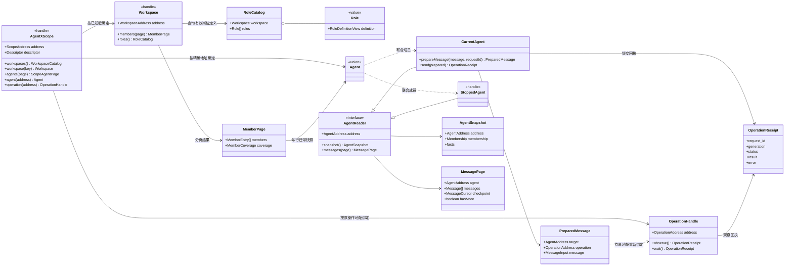

# Domain SDK：现有模型、缺口与演进

这份审计记录扩展前的源码基线。查阅目前已实现的对象、操作和兼容规则，请看[当前 Domain SDK 契约](typescript-domain-sdk.md)；查阅 Space 接入和验证状态，请看[完整性改造交付](../../.controller/typescript-domain-sdk/completeness.delivery.md)。

当前 SDK 有一条完整的「选作用域 → 找 Agent → 读事件 → 发消息 → 查原回执」链路。它表达了精确身份、快照和异步操作，已经是一个可用的对象模型。它还只是第一版切片：Space 的 Transcript、启动关系、生命周期、附件、信箱和联系目录等操作仍走同一个生成式 HTTP SDK，由应用层负责不少领域规则。这些功能有原生支持，缺的是领域层的统一表达。

源码入口：[公开类型](../../packages/agentx-client/src/domain/contracts.ts)、[作用域与回执](../../packages/agentx-client/src/domain/index.ts)、[Workspace](../../packages/agentx-client/src/domain/workspace.ts)、[Agent](../../packages/agentx-client/src/domain/agent.ts)、[生成式 HTTP SDK 的封装](../../packages/agentx-client/src/management.ts)。想逐个点击字段、参数与返回类型，打开 [Contract Canvas](../object-atlas-v2/index.html)，选 **Domain SDK → SDK 总览**。Canvas 的「应用模型」层是 Office/Actor 设计提案；实际 Space 的消费路径见 [DomainOfficeReads](../../web/agent-space/src/live/domain-office.ts) 和 [LiveSpace Controller](../../web/agent-space/src/live/controller.ts)。

## 现有对象类图

图中方法是已实现的 TypeScript 对象方法，省略 `CallOptions`、`Promise` 和部分字段。`MemberEntry` 和 `MemberCoverage` 是为阅读方便给两段内联类型起的名字。`AgentReader<R>` 是内部接口。当前和停止的 Agent 是两种冻结的对象句柄；`Agent` 是这两种类型的联合。箭头表示接口继承、组合或返回类型，不代表所有权级联或运行时类继承。

| 概念 | 身份与状态 |
| --- | --- |
| 作用域 `AgentXScope` | 监听器 URL + 预期原生 scope + 数据库 generation。绑定后不可切换。切换服务或数据代次要明确重新选择，旧游标和待办操作保留原身份。 |
| 工作区 `Workspace` | 作用域内的原生工作区路径或显式 `global`。句柄可在本地构造，构造成功不证明存在。工作区归属独立于 Agent 的 cwd、岗位文件路径和目录消息路由。 |
| Agent | 作用域 + 名字 + 当前 `incarnation` 或停止 `stopped_event`。同名恢复仍是新身份；`current` 只说明当前实例记录存在，不表示进程健康或一定可以发送。 |
| 观察值 | Agent 快照、岗位定义、消息页、回执是某次读取的不可变值。角色、能力和进程状态变动后要重新读取。上层 Office、Actor、草稿和场景状态可组合这些句柄，仍由上层管理。 |
| 操作 | 作用域 + 原 `requestId`。准备是本地行为，提交可能产生效果，观察原回执不会重播。`Sent` 确认原生消息进入系统；送达、被模型读到、模型回复是后续的不同事实。 |

## 缺口：什么已有，什么还要补

| 能力 | 当前归属与缺失 | 建议 |
| --- | --- | --- |
| AgentX 消息、快照、原回执 | 领域层已有 `Agent.messages()`、`snapshot()`、`CurrentAgent.send()`、`OperationHandle`。类型仍直接带部分生成 DTO。 | 保留原身份和恢复模型。为新能力表达有实际用途的领域结果与能力，而非复制全部 DTO。 |
| Provider Transcript | [原生 `TranscriptPage`](../../src/management/contract.rs) 已可通过 journal 读取；[Space 自己发命令、解析回执并验证确切 Agent](../../web/agent-space/src/live/controller.ts)。页表示一次有限摘录，当前没有公开续页游标。 | 在 Agent 的共享读取接口增加专用能力；显式表达「读取任务」与「摘录可用／不可用」。用原操作地址恢复，别把 Transcript 与 AgentX 消息合并或许诺连续翻页。 |
| 启动来源／启动的 Agent | [原生 `LaunchRelations`](../../src/management/contract.rs) 已支持。Space 调用生成客户端，并保留自己的关系游标和目标校验。 | 归入 Agent 的读取能力。游标绑定确切 Agent；关系目标有可用与不可用两种观测，不可用时没有可替代的名字跳转。来源区分 Agent、外部、未知。 |
| 启动、终止、停止参与、恢复、分叉 | [Space 的 HTTP 适配](../../web/agent-space/src/live/host.ts) 已可提交，页面用 `can_*` 观测做可用性提示。原生 `LaunchOutcome.agents` 只返回名字。 | 启动归属作用域或工作区的启动上下文；实例生命周期是精确 Agent 的命令。把「终止进程」与「停止参与」分开。恢复和分叉创建新的执行身份，原句柄不变；在原生回执返回精确地址前，只能承诺返回启动结果及名字，不能从名称自动构造新句柄。 |
| Workspace 成员与 Role | `workspace.members()`、`roles()` 已有。成员先按全局 Agent 翻页，再按已采纳归属过滤，可能空页但有后续。`Role` 只是当前定义值；`Membership` 携带历史采用的 `RoleView`。 | 原生应先按归属过滤再限页，届时用新的分页模式及游标区分。岗位宜明确区分 `RoleDefinition` 与 `AdoptedRole`，后者记录启动采用；从岗位启动应由原生重新解析有效定义及配置。 |
| 附件、信箱、联系目录 | [Space 直接使用生成客户端](../../web/agent-space/src/live/controller.ts)。附件按 generation 注册，上传不是发送；人类信箱有显式处理状态；目录尝试经路由找到接收方。 | 附件归 scope，可用 `AttachmentRef`、上传/下载来组合发送；模型不承诺自动重试上传。人类信箱不造一个假 `Agent`。目录路由独立于 Workspace 成员及统一发消息，保留预览与实际接受结果。 |
| 标签、活动、Inspector、Workbench、Observation | Management 已暴露标签和办公室活动，Space 直接消费活动。Workbench 和 Observation 目前是包内独立端点；Inspector 有独立设置、采样与分析语义。 | 标签可作为当前精确 Agent 的能力，保留 revision/CAS；场景活动是可选的 scope 观察源。其他端点不为追求「全」而塞进 Workspace 或 Agent。 |

## 语义上优先修的四件事

1. **把状态、身份和能力拆开。** `current` 是身份分支，`can_send` 是某次快照的提示，原生受理才是实际结果。`StoppedAgent` 当前只有读方法，停止历史不能发送；这不代表停止记录不能作为恢复或分叉的来源。可以给适用的精确引用增加命令，仍在当次受理检查能力。类型上让 `CurrentAgent.snapshot()` 返回保留 `CurrentReference` 的 `AgentSnapshot<R>`，避免上层读回结果后丢失已知的类型信息。
2. **一个命令有一份原凭据，回执要能分清结果。** 目前只有 `PreparedMessage`，Space 为 Transcript 和生命周期自己构造 `{generation, request_id, agent}`，也自己检查结果类型和引用。先新增可序列化的 `PreparedOperation<Kind>`，保留原命令种类、作用域、目标和参数；继续支持现有 `prepareMessage`/`send`。知道命令种类时，观察层可以校验终态结果的种类与精确目标；只有地址时，仍走原来的通用回执。`Failed`、原生 `Unknown`、客户端没收到响应和本地停止等待必须保留不同含义。SDK 不替应用持久化，也不自动补发。
3. **分页覆盖范围必须可读。** `currentComplete` 现在只说明底层全局序列的当前实例段读完，名字容易被误读为工作区成员完整。保留现有兼容字段，新的成员模式使用更明确的覆盖含义。`scope.workspace(key)` 本地只检查非空及 NUL；路径经 `.roles()` canonicalize 后可能返回另一个 `Workspace`，原句柄不变。对需要 canonical 地址的调用，单独引入显式解析或只接受目录发现中已观察的键，不能悄悄改写原地址和游标。
4. **有名字不等于有对象身份。** `Role.definition` 是当前目录观察值，不能与历史 AdoptedRole 按同名或同路径判相等。`Message.from`、`recipients` 是历史记录，不能当作可跳转的精确 Agent 引用。给消息表达清楚其事件 ID 由 scope/generation 限定、页面游标由读取的 exact Agent 限定；后续如需精确消息导航，以原生提供的确切身份为准。

建议第一批实现 **Transcript + 启动关系 + 原操作恢复**，并让 Space 这两条路径直接消费领域对象。原因是原生已提供两类数据，现有页面也有真实用户路径，能在不改 HTTP 契约的情况下把精确身份、只读观察和操作恢复串起来。第二批是启动和生命周期；第三批按能力补附件、信箱、目录和标签。完整的 Workspace 成员分页、启动结果里的精确新实例引用，则各自先解决原生依赖。访问日志、SVG、角色动画和草稿都继续由 Web 应用层表达，不进入底层对象模型。

后续验证用少量固定样例：同名但不同实例的引用与游标不能串用；Transcript 回执丢失时按原 ID 查询且不补发；不可用的关系不跳转；准备、接受、结果各自保留正确语义。此审计未修改 SDK、HTTP 或 Space 运行代码，也未运行负载测试。
