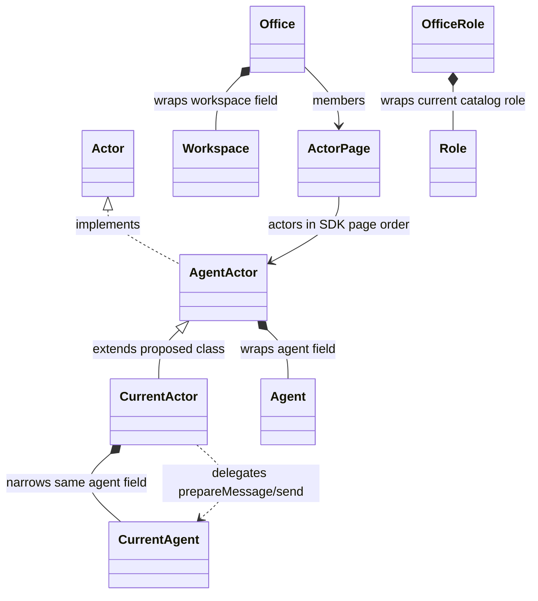

# Declaration layers and an office proposal

A layer owns declarations at one abstraction boundary. It is independent of domain grouping, support status, source authority, current view and runtime instances. The Canvas consumes one canonical graph; a selected layer hides other declarations until a reference or mapping is deliberately inspected. The renderer owns disclosure, layout and return state.

| Layer ID | Meaning | Evidence |
| --- | --- | --- |
| `application` | Proposed Office/Actor reading and messaging model | Design only; no SDK or production Space classes are asserted |
| `sdk` | Public domain SDK handles, addresses, observations, paging and domain errors | Existing domain declarations/implementations; projection-only anonymous types remain labeled |
| `transport` | Management client/DTOs, native receipt branches and HTTP call/error contracts | Existing generated/native-facing declarations; not a separate daemon object layer |
| `platform` | JavaScript/Web values and platform exceptions | Existing platform references |

Every node has exactly one `layerId` and `provenance: source-backed | proposed`. A field inherits both from its owning node; a method shares both with its owner. Layers never imply deployment, authorization or direction of every dependency. A source-backed transport DTO may refer to platform values; a proposed application method may directly accept a public HTTP message value because the SDK itself exposes that value. Preserve that navigation rather than inventing an application copy.

## Proposed objects and operation boundary

The following are authored design contracts for the fixture, not emitted SDK declarations, runtime classes, an executable mock or a replacement source authority. Native guards and durable recovery remain with the current SDK/native owners.

| Proposed identity | Responsibility and constraints |
| --- | --- |
| `Office` | Wrap one exact Workspace; `members` maps one SDK page into actor wrappers, retains coverage verbatim and never claims complete membership. `roles` wraps the current Role catalog and does not infer adopted Role assignments. |
| `Actor` | Read-only interface exposing exact AgentAddress and `snapshot`; deliberately has no sending operation. |
| `AgentActor` | Class implementing Actor, wrapping an SDK `Agent` union. Its address is the wrapped address; snapshot dispatches by the current/stopped union branch. No name lookup, launch or endpoint rebinding. |
| `CurrentActor` | Proposed class extending AgentActor, narrowing the same wrapped `agent` field to CurrentAgent. Only constructed from an already current SDK handle; identity/address remain unchanged. Adds prepareMessage and send. This is valid proposed class inheritance, never inheritance from the SDK Agent union or CurrentAgent interface. |
| `ActorPage` | One ActorEntry per SDK MemberPage member, same order/count, and the unchanged MemberCoverage. Empty entries may still have a next cursor. |
| `ActorEntry` | Pairs an AgentActor wrapper (CurrentActor when the SDK handle kind is current) with the snapshot from that exact SDK row. No fresh snapshot is silently read. |
| `OfficeRole` | Wraps the catalog Role; its `definition` projects `role.definition`. This is a current definition, not proof of adoption by any actor. |

### Proposed operation mappings

| Port | Receiver and SDK method | Mapping and effect |
| --- | --- | --- |
| `Office.members` | `Office.workspace` → `Workspace.members` | Same page/options; project rows to ActorEntry and reuse coverage, original cursor/address and snapshot. Propagate errors unchanged; one read only. |
| `Office.roles` | `Office.workspace` → `Workspace.roles` | Same options; return one OfficeRole per returned catalog Role. SDK RoleCatalog workspace correspondence remains enforced by SDK. |
| `AgentActor.snapshot` | `AgentActor.agent` → `AgentReader<R>.snapshot` | Structural reader contract; current/stopped dispatch without adding capability or changing exact identity. |
| `CurrentActor.prepareMessage` | `CurrentActor.agent` → `CurrentAgent.prepareMessage` | Same message and caller-supplied request UUID; retain original PreparedMessage; local validation only. |
| `CurrentActor.send` | `CurrentActor.agent` → `CurrentAgent.send` | Same prepared command/options, exactly one explicit dispatch; preserve errors and receipt branches. Acceptance is not delivery or reply. |

The Actor interface also exposes its own snapshot port. AgentActor's interface implementation maps to that contract while delegation maps to the SDK reader port. The inherited snapshot remains declared on AgentActor; consumers can inspect the extends edge instead of inventing a second CurrentActor.snapshot declaration.

The caller supplies an already selected exact SDK Workspace; no construction/bootstrap operation is promised here. Caller supplies page cursor from prior ActorPage.coverage.next and creates a fresh UUID for a new prepared message. Narrow the ActorEntry actor by class after the SDK current-kind check performed during projection. A stopped row remains AgentActor and has no send capability. Retain PreparedMessage and its original operation address; on response loss use existing AgentXScope.operation → OperationHandle.observe/wait. Do not resubmit automatically. Native Failed/Unknown receipts, OutcomeUnknown and local observation cancellation retain their existing distinct meanings.

## Relationship contract and truth rules

`extends` is declaration extension: class→class or interface→interface, never union→class. `implements` is class→interface. `wraps` is field→its declared type, identifying the actual held SDK value; it asserts no daemon lifecycle containment. `delegates` is method→method with `via` naming a receiver field and `mapping` documenting argument/result/failure correspondence. `composes` retains the existing broad handle/value composition meaning; `calls` retains source-backed implementation calls. Typed `accepts`, `returns`, `references` and all existing edges remain authoritative navigation facts. An `extends` edge may cross layers only when declaration evidence actually establishes that extension; this fixture has source-backed interface extension and proposed application class extension, but no invented cross-layer inheritance.

Proposed edges always remain proposed, including their links into implemented SDK declarations. Both endpoints being implemented does not establish an implemented mapping. Proposal source refs use authority `proposal`; existing declaration/implementation/native evidence stays unchanged. Existing broad CurrentAgent/StoppedAgent `composes` edges are retained by identity for compatibility; precise `extends` edges additionally state their actual interface extension, with the generic argument recorded. No illustrative object instance, runtime class support or source inference is implied.

## Consumer and evidence

[Model README](model/README.md) owns the offline API and check instructions. [Layer Task](../../.controller/object-atlas-v2/tasks/layer-model.task.md) owns current implementation/integration evidence and limitations. Exact graph signatures and identities live in [the canonical JSON](model/contract-model.json); this design explains meaning rather than maintaining a second schema.

## Proposed Space session: exact actor, conversation, draft

This slice models one loaded office page and the AgentX message reader during one Space page lifetime. The source responsibilities are evidenced by [exact AgentResource keys](../../web/agent-space/src/offline/model.ts#L50), [SpaceController](../../web/agent-space/src/offline/controller.ts), [HallActor](../../web/agent-space/src/scene/model.ts#L9), [LiveSpace exact reads and operation blocks](../../web/agent-space/src/live/controller.ts#L274), [read-model projection](../../web/agent-space/src/live/projection.ts#L5) and the [controlled conversation/composer](../../web/agent-space/src/conversation/Conversation.tsx#L21). Those files establish today's behavior and ownership; the classes and signatures below are proposed Canvas contracts.

| Object | Owns or observes |
| --- | --- |
| `ActorKey` | Exact normalized identity: scope, generation, name and current incarnation or stopped event. Denormalized labels, current status or office layout cannot identify a conversation. A session binds one listener; its keys are not portable across another listener. Space’s existing serialized key additionally preserves both optional native discriminators; the proposed typed key is not a replacement for that string. |
| `ActorCard` | Public roster entry with exact key, display name, optional launch title and observed adopted role. It comes from the exact SDK row; adopted-without-role, unknown and adopted role facts stay distinct. |
| `ActorAdoption` | Adopted snapshot facts when supplied: name, source and optional profile. Unknown is not “no role”. No current definition lookup or fictional revision fills a missing fact. |
| `OfficeRole` | A current catalog/post resource, with independently readable name and source. Neither joining by display name nor subclassing an Actor per post establishes adoption. |
| `ActorAppearance` | A scene-only view of an exact actor. This is a projection based on HallActor, not membership or conversation identity. It is shown in implementation disclosure because the conversation domain has no geometry. |
| `OfficeSession` | Immutable bounded roster, selected exact key and current conversation view; page-local draft slots and view revision remain private. Reopening a view does not reinitialize its slot. |
| `ActorConversation` | One currently open exact actor view with addressed draft, bounded message read and independent text-send availability query. It owns no native send operation. |
| `MessageDraft` | Local text and monotonically increasing edit revision (even if the text is unchanged). Exact actor is part of the value. Absent slot reads as empty revision 0. An empty text edit is a real edit. |
| `ConversationRead` | Read result for its exact actor: available with a bounded window (possibly empty), unavailable, error, or superseded by navigation. These branches cannot collapse to an empty history. |
| `ConversationMessage` | Minimal communication-history projection (message id, author, timestamp, text); it does not claim Provider response generation or full attachment/transcript support. |
| `SendFacts` | Adapter-observed current capability, connection/recovery block and native UTF-8 size limit, for the addressed actor. A stale or missing exact fact set is unavailable. |
| `SendAvailability` | Advisory `ready` or blocked with a stable reason, for exactly the current text draft; no send, permission grant, receipt or delivery. |
| `ConversationSource` | App-owned adapter seam for exact message reads and capability observations for the same Office and generation. It owns neither selection nor drafts. |

### Construction and flow

1. `Office.members` provides a bounded `ActorPage` tagged with its exact `office` address, even when empty. `Office.openSession` requires that page and a same-office, same-listener/generation `ConversationSource`; mismatches, duplicate exact identities and inconsistent row handle/snapshot addresses refuse construction (`null`). It projects page entries to ordered `ActorCard`s, starts with no selection, no open conversation and an empty draft map. Source implementation may already have Management data or compose SDK reads; this fixture has no live adapter.
2. `OfficeSession.selectActor(key)` accepts only an exact roster key. A missing/different-generation key returns `false` without changing selection, open view or drafts. A different successful selection closes the old view and increments the view revision. Space's current single click sets selection and reading together; the proposed ports separate the transitions and the caller can compose them only after selection succeeds.
3. `OfficeSession.openConversation()` returns `null` without a selected exact row, returns the existing view if already open, otherwise opens one with a new view revision. `ActorConversation.readMessages()` supplies only the first bounded exact AgentX message window. Apply a response only if listener/scope/generation, actor and open-view revision still agree; a response arriving after close or switching actors becomes `superseded`. The page can report `hasMore`; pagination, Provider reads, local note channels and upload are outside this slice.
4. `ActorConversation.editDraft(text)` updates only the open conversation's exact slot and increments its revision. An old handle returns `null` without writing. `OfficeSession.closeConversation()` invalidates that view but retains selection and every draft. Reopening the same key reads its previous text/revision; switching to an unrelated, stopped or restarted same-name key cannot acquire that draft. A newly constructed page session starts empty; no browser persistence or receipt-driven clearing is promised here.
5. `ActorConversation.sendAvailability()` is a separate observation for the text-only AgentX channel. Evaluate in order: closed/superseded view, stopped history, missing/stale facts or connection failure, `can_send` refusal, unresolved operation block, empty/whitespace-only text, UTF-8 size exceeding the supplied limit; otherwise `ready`. Editing and reopening never schedule sends. Stopped history can be read and can retain a local text draft in this proposal, but cannot be ready. Actual Space also accounts for attachments, channel and pending upload. Native authorization and submission revalidation remain outside this model.

```mermaid
stateDiagram-v2
    [*] --> Unselected : construct matched page + source
    Unselected --> Selected : select exact roster key
    Selected --> Open : openConversation
    Open --> Open : read or edit exact draft
    Open --> Selected : close; keep draft
    Open --> Selected : select a different exact key; keep both slots
    Selected --> Open : reopen; recover selected draft
    Open --> Open : assess availability; no submission
```

### Public surface and SDK limits

`OfficeSession`, `ActorConversation`, keys, cards, draft, history and eligibility are application declarations. Their working ports return application values rather than SDK snapshots, HTTP DTOs, cursors or receipts. The outer composition entry deliberately accepts the prior `ActorPage` and injected `ConversationSource`. The earlier adapter ports and genuinely exposed SDK values retain their existing identities and references. Optional `visibility: implementation` marks a field or declaration for default presentation disclosure; this is separate from layer/provenance and does not change navigability. The wrapped Workspace/Agent/Role and private source, draft store and view revision belong to the application layer while remaining implementation facts.

This proposal composes the SDK's original `Workspace.members` projection, exact current/stopped `AgentReader<R>.messages` reads, native `can_send` from `AgentSnapshot.facts`, and limits from `AgentXScope.descriptor`. Selection, page-local drafts, unresolved operations and UI navigation remain application responsibilities. The normalized SDK stopped address retains the stopped event; a compatibility adapter needing both fields from Space's older key must retain the original native `AgentRef`. The [implemented SDK projection](model/README.md#decisive-domain-paths) now also includes Provider Transcript, native member paging, scoped attachment operations and typed recovery. The application walkthrough still models its selected AgentX message and draft path, and its links into implemented SDK ports retain proposal provenance.
