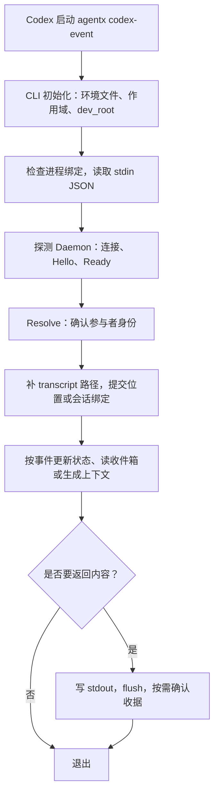

# Codex Hook 性能排查：源码路径

范围：当前 AgentX 工作树的 Codex 命令型 Hook，普通 PTY 为主，单独标出共享 app-server 差异。从 Codex 启动回调到 AgentX 回包并退出。仅静态走查，未运行 Hook、实验或压测。下文的请求次数是成功分支的结构计数；没有证据把用户看到的几百毫秒归给某个阶段，也没有核对安装版本与工作树是否一致。

## 从进程启动到退出

1. **启动和前置。** [Codex 适配器](../../src/integrations/hooks/codex.rs#L847) 注册 `type: command`，执行 `agentx codex-…`。Rust 的 [模块声明](../../src/main.rs#L7) 是编译时链接；普通回调不会启动 Web/TUI 或加载所有 Provider，也不会每次重新安装 Codex Hook 或打开 SQLite。仍有外部命令启动、二进制装载和 OS 调度开销，源码不能量化。进入 `main` 后，Hook 未列入 [环境轻量入口](../../src/runtime/environment.rs#L194)，会解析环境选择、按条件读并解析作用域 `config.toml`、逐份读取显式 dotenv、归一化路径；接着做嵌套进程身份清理和环境快照。普通 CLI 路由还会 [查 `dev_root`](../../src/cli/router.rs#L420)：非空 `AGENTX_DEV_ROOT` 优先；否则只要数据库文件存在，就用 `Client::connect` 加 `Maintenance::DevRoot` 查 KV，即使该键不存在。它发生在 Hook 自己的绑定检查之前；若目标二进制不同，还会 `exec`，重走入口。常规 Hook 不走 [自动更新检查](../../src/cli/router.rs#L578)。
2. **解析和位置。** [Hook 入口](../../src/integrations/hooks/codex/client.rs#L223) 检查 `AGENTX_PROCESS_ID`，读取 stdin JSON，构造 `HookPayload`。主要字段为 `session_id`、`transcript_path`（兼容 `session_path`）、`cwd`，再按事件读取 `tool_name`、`tool_input`、`prompt`、`source`、`turn_id`、`status` 等。 [通用转换](../../src/integrations/hooks/mod.rs#L368) 还复制 `tool_input`、复制或重新序列化 `tool_response`，而当前 Codex 路由不用 `tool_result`。准备好 `InvocationContext` 后连接本地 Daemon，发送的是结构化业务请求和调用方上下文（含[捕获的环境](../../src/runtime/host_client.rs#L9)），并不原样转发 stdin。符合条件的 Hook 先 `Resolve`，再做路径补全，再提交 `ObserveHookPosition`（普通非 compact `SessionStart` 为 `HookSession`）；随后才做事件专属工作。[共享 app-server](../../src/integrations/hooks/codex/client.rs#L19) 先多一次 native thread attachment 查询，再按对应身份处理，且不走工具结束时的 Hook 收件箱交付。
3. **每次请求等业务完成。** [Client](../../src/service/client.rs#L25) 保留 scope 和数据库代际等元信息，却没有保留可复用的 socket。一次热获取做一次单独的 `Hello/Ready`；[每条业务请求](../../src/daemon/transport.rs#L111) 再开本地连接，做一次 `Hello/Ready`，发 `Call` 后等 `Result`。Unix 下每次连接还经过[端点目录准备](../../src/daemon/scope.rs#L72)，服务端校验同 UID、PID 和进程代际（Linux 读 `/proc/<pid>/stat`），并为接收的连接启动 worker。连接并行接入，业务由[每作用域一个 dispatcher](../../src/daemon/server.rs#L219) 串行执行，队列容量 16，业务 listener 并发连接上限 32。接收成功不代表应用完成，任一前序重请求可能拖住后面多个 Hook 子请求。队满可返回 `Busy`；探测失败且允许恢复时才会进入启动锁、拉起 Daemon、等待就绪。源码中的 5 ms/20 ms 等待循环不是每次请求固定睡满的延时。

## 高频事件的请求账本

下表排除 `dev_root`、共享 attachment 发现、失败及重启。计数针对已绑定、通过身份和线程检查的热 Daemon。`Acquire` 的探活不计入业务请求；因此 `N` 次业务请求至少 `N+1` 次连接及握手。如果满足前述 `dev_root` KV 回退条件，再加 **1 次业务请求和 2 次连接及握手**。

| 事件 | `Resolve` 后的串行操作 | 普通 PTY 的业务请求 |
| --- | --- | ---: |
| `PreToolUse`（配置匹配 Bash / apply_patch / spawn_agent） | `ObserveHookPosition` → `ToolActivity`，包含可选 patch 文件列表 | 3 |
| `PostToolUse`（匹配所有工具） | `ObserveHookPosition` → `PrepareOutput`；如需解除审批阻塞加 `Status`；有消息时输出并 `ConfirmOutputAndStatus` | 空箱 3；有消息 4；解阻再加 1 |
| `PreModelRequest` / `PostModelRequest` | `ObserveHookPosition` → `ObserveModelRequest`，记录模型请求阶段和失败信息 | 3 |
| `UserPromptSubmit` | `ObserveHookPosition` → `Status`；AgentX 唤醒占位符走收件箱，空箱再设状态；存在待恢复模型错误时可能加 `ObserveTurn` | 普通 prompt 3 |
| `Stop` / `Interrupt` | `ObserveHookPosition` → `Status` → `WakeHook`；模型错误下可能再加 `ObserveTurn` | 通常 4 |
| `SessionStart` / compact | 会话绑定或位置更新 → 准备上下文；按收据状态读取或冻结指令、读运行快照、输出前再验身份、flush 后确认；普通启动另有状态、唤醒，按配置检查 Relay | 随上下文和模式变化 |

事件分支见 [Codex 路由](../../src/integrations/hooks/codex/client.rs#L101)，输出边界见 [HookClient](../../src/integrations/hooks/client.rs#L112)。`SessionStart` 和 compact 的[上下文组装](../../src/runtime/bootstrap.rs#L588)可能读配置、指令文件和 AgentX 快照，不应外推到高频工具事件。普通 `PreToolUse` 没有收件箱读，基础请求数仍是 3；默认 `dev_root` 回退下就是 **4 次应用请求、6 次连接握手**。热路径每条正常应用请求还有[入站和返回时各一次 SQLite 代际 KV 读取](../../src/service/application.rs#L39)，所以这一示例仅代际读取就有 8 次，另有各操作自身的 SQL；这不是总 SQL 次数。

## 能随数据规模放大的地方

| 位置 | 触发和工作量 | 对延迟的影响 |
| --- | --- | --- |
| [收件箱 `PrepareOutput`](../../src/messaging/service_store.rs#L405) | 所有普通 PTY `PostToolUse`，以及唤醒占位符。先[重读并解析 scope 配置](../../src/messaging/service_store.rs#L251)取 hints，然后在写事务里[查询游标之后全 scope 的 `message` 事件](../../src/db/events.rs#L110)，逐条解析 JSON、在 Rust 里匹配收件人，最后才截到 50。普通无 attachment 空箱仍插入 `output_receipt`，客户端随后因无消息不使用它；有 attachment 的 claim 路径还能重读同一批候选。 | 50 只约束输出。即使自己没有消息，游标没推进时也可能在下次 Hook 重扫其他 Agent 的消息；工作量随游标后的候选数和字节量变长，而且占用写事务和 dispatcher。 |
| [位置更新](../../src/agents/hook_store.rs#L165)与[请求留存](../../src/agents/service_store.rs#L151) | 每个有效高频回调，以写事务重复读实例、解析 process binding、查 attachment／session binding；对包含 invocation 的请求做序列化和摘要，读写去重 KV，字段只要传入就执行 `UPDATE`，未先比较是否有变化，最后再读回完整实例。 | 即使 session、cwd、transcript 都没变，也会付出查询、事务和留存写入；写锁争用、磁盘或调度等待还会由单 dispatcher 传给其他请求。 |
| [状态事件的后处理](../../src/db/events.rs#L383) | 状态事件落库后，在回包前[扫描并唤醒观察者](../../src/events/observer_store.rs#L98)，[逐个检查订阅](../../src/db/subscriptions.rs#L623)并清理过期请求监视；合格订阅可能各有 SQL，命中可写通知、触发 `on-hit` 并唤醒接收方。定向唤醒有 100 ms TCP 连接超时；观察者按最多 32 个端口一批并行，每端口 50 ms，调用方等批次结束。 | 条件是产生状态事件且有相应订阅或唤醒端点；不是每次都花掉超时。`apply_patch` 的 [后续每个文件](../../src/agents/hook_store.rs#L144) 都附加一次实例读取和状态事件，因而可能把观察者与订阅工作再乘上文件数。 |
| [Transcript 回退](../../src/integrations/hooks/codex.rs#L486) | 缺少可用 `transcript_path` 且同 session 的已存路径不存在时，递归 glob `CODEX_HOME/sessions/**/rollout-*-<session>.jsonl`，再按匹配文件 mtime 选最新。找不到可能在后续重复。 | 随 sessions 目录规模和文件系统延迟变化；提供有效路径时没有全目录扫描，不会在这里读取整个 transcript。 |

常规 IPC 有多处固定工作，但固定调用次数本身不能推出几百毫秒。若只有 `PostToolUse` 慢，优先查 `PrepareOutput`；若 patch 文件越多越慢，优先查 `ToolActivity` 事件扩散；若所有高频事件都慢，先分清 `Environment`、`DevRoot`、`DaemonAcquire/Hello`、`ReplyRead`；`ReplyRead` 长再对照 Daemon 的 queue wait 和 application time。现有 [trace 命令与边界](./cli.md) 可用于后续已有记录；采样不能反推全量分布，进程装载、exec 之前已丢失的父段、最终 trace 写入不在当前单条总耗时内，低于 500 ms 的成功记录也可能没被保留。

## 优先优化的边界

这些方向已细化为[优化方案](../proposals/codex-hook-critical-path.md)和[实施任务](../../.controller/observability/codex-hook-performance.task.md)，以方案为准确定接口、顺序和验收边界。

1. 先缩短共用入口。受管回调由 Launcher 固定二进制、scope 及已解析环境，评估移除热路径的 `dev_root` KV 查询和重复配置加载；保留独立 CLI 的显式配置语义。过滤掉无需处理的回调后再连 Daemon；按事件只解析必要字段。
2. 将高频事件合为一次有类型的原生入口。Daemon 一次验证准确的参与者、会话、attachment 与数据库代际，只持久化确实变化的位置，并在同一次分派完成该事件需要的状态或查收动作。先减少无用业务交互，再决定是否有必要改连接协议。
3. 做收件箱空箱快路：先判定当前收件人是否有可交付数据，再进入需要冻结批次的写路径；空箱不建 token、不读格式化 hints。用收件人约束和有界窗口控制数据库工作，保留广播、直接消息、正确游标、并发 claim 及 stdout flush 后确认。状态事件留存与后续通知分离前，先定好通知顺序、失败与恢复语义，避免把异步收包误当作消息已交付。

只记录状态的事件原则上有机会缩短到“一次提交，按要求确认”；要向 Codex 返回上下文或消息的事件，必须同步拿到输出，持久确认仍以真实 flush 为边界。这两类事件不应共用同一种完成标准。
