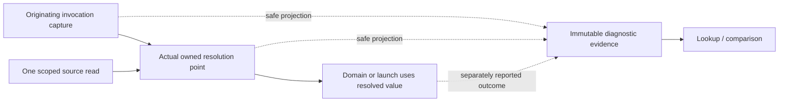

# Configuration and invocation evidence

## Authority and boundaries

Native configuration contracts and behavior are materialized in [`configuration.rs`](../../src/observability/configuration.rs) and [`configuration_store.rs`](../../src/observability/configuration_store.rs). This document owns meaning, policy and load-site obligations; native declarations own exact interfaces. The original [implementation Task](../../.controller/observability/implementation-tasks/configuration.md) records the scoped source release. Owner-authored cases are unexecuted until [native integration](../../.controller/observability/implementation-tasks/native-integration.md) records a fixed candidate and results; source promotion does not establish installed or end-to-end support. Existing [`InvocationContext`, `CallerContext`, `RequestContext`](../../src/service/context.rs), [`Client`](../../src/service/client.rs), [`AgentxConfig` and `FIELDS`](../../src/config.rs), [scoped file operations](../../src/config/file.rs) and [domain contracts](../architecture/contracts.md) retain business authority. Shared references/evidence/time come from actual [`context.rs`](../../src/observability/context.rs); runtime owns client invocation, attempt, connection and server-request identities.

The operator's question is “which inputs and resolved values applied at this particular use?” A daemon's startup environment, a current file declaration, an originating invocation, one actual configuration resolution and a launched host's reported facts are different subjects. None establishes authority over a participant, process, attachment or Provider. Capture never changes business resolution, retries an operation or continuously inspects a process.

Solid arrows describe configuration supply/use; dotted arrows copy policy-approved evidence. Retained evidence is an observation of its producer, never a replacement configuration store. A missing snapshot does not imply that resolution or use failed.

## Current source basis

| Source and actual fact | Capture consequence and source boundary |
| --- | --- |
| [`Config::{get,from_env}`](../../src/config.rs) caches `AGENTX_DIR`, instance-name and process-binding claims process-wide on first use. | Record first-use/startup capture separately; it cannot explain another client's environment. Do not instrument daemon reads by substituting this global cache. |
| [`resolve_agentx_dir_from_env`](../../src/paths.rs) selects nonempty `AGENTX_DIR`, expands leading `~` using `HOME` then `USERPROFILE`, joins an explicit relative path to supplied cwd, otherwise returns home `.agentx` or relative `.agentx`. [`DaemonScope::prepare`](../../src/daemon/scope.rs) then creates/canonicalizes the root. | Retain requested selector and eventual canonical scope separately. Lexical/relative/tilde resolution is not canonical scope identity. Observation inspection must use the passive runtime resolver, not `prepare`, which creates directories. |
| [`InvocationContext::capture`](../../src/service/context.rs) captures cwd, Unicode environment and TTY flags before acquisition; launch capture also carries one-shot launch JSON. [`Client`](../../src/service/client.rs) retains that context and generation; `with_invocation` changes the context without reacquiring. | Capture references describe immutable client inputs. No arbitrary environment or launch JSON enters diagnostics. Unicode capture has the existing source's limits; telemetry cannot claim observation of every OS environment entry. |
| [`AgentxConfig::load_for_scope_with_errors`, `load_from_sources_at`, `env_value`](../../src/config.rs) use explicit scope/environment, field coercion, normalization and fallback. Scoped loading does not create files. | Instrument this actual resolver result. Do not implement a competing diagnostic resolver or reread the file later to explain history. |
| [`file::get_for_scope`](../../src/config/file.rs) returns selected raw environment/TOML/default text and source; it does not run effective-value validation. Unknown keys can read arbitrary supplied environment. | Model raw declarations separately from effective values. Native diagnostic field selectors are closed; this arbitrary-key fallback is not an observation API. |
| [`read_toml_values`, `toml_values_from_str`](../../src/config.rs) return whole-file/field errors; missing file is quiet, unreadable/malformed file falls back. Field parse errors overridden by an environment entry are suppressed from effective errors. | Preserve safe parser/selection outcomes at the same read; distinguish missing, unreadable, syntax-invalid and overwritten-invalid candidates. Do not export parser snippets or raw error strings containing values. |
| [`config/file::edit_config_at_path`](../../src/config/file.rs) locks a stable sibling and atomically replaces the file; direct editors need not cooperate. Preset validation can read the scoped file separately. | A read receipt identifies a read, not a global file version or atomic transaction across all source files. Different reads in one use can be explicitly non-atomic. No filesystem watcher is implied. |
| [`BindingContext::explicit`](../../src/agents/binding.rs), [`reserve_native_root`](../../src/agents/service_store.rs) and [invocation binding](../../src/agents/invocation_binding.rs) load scoped configuration at actual registration/reservation sites. Registration consumes timeout/hints/subscription values. | Record the server's actual per-use snapshot. The snapshot may differ from an earlier client-side load of the same file. Participant state remains a separately owned durable fact. |
| [`launcher::{build_launch_env_captured,overlay_launch_env,launch_with_client}`](../../src/runtime/launcher.rs) chooses a base environment regime, strips identity/terminal markers, exports nonempty resolved AgentX settings, overlays nonempty non-`AGENTX_` entries from scope `env`, then explicit `LaunchParams.env`; it applies later tool/home/identity rules. | Capture distinct scoped-effective, launch-planned and host-reported facts. Scope `env` is a launch passthrough source, not an `AgentxConfig` layer. A configured value alone does not prove the child received it. |
| [`config_instance_client`](../../src/cli/commands/config.rs) mutates exact participant fields through lifecycle contracts; resetting timeout uses the current caller's resolved setting, while resetting subagent timeout clears an optional override. [`effective_dev_root`](../../src/cli/commands/config.rs) uses nonempty invocation `AGENTX_DEV_ROOT` then daemon-owned KV. | Participant overrides and persistent dev root do not belong to a fabricated environment/file/default chain. Link their native owner and capture the actually consumed projection; do not read SQLite from diagnostics. |
| [`transport::acquire`](../../src/daemon/transport.rs) starts a daemon inheriting the starter's process environment, explicitly setting scope/cwd. [Native Codex configuration/service](../../src/integrations/codex/configuration.rs) owns thread overlays and actual backend compatibility. | Daemon startup facts describe that startup only. Provider home/backend/thread facts keep their own owner and reference; do not expose native compatibility fingerprints as diagnostic secret comparators. |

### Resolution rules to preserve

| Field/source case | Actual result that capture must explain |
| --- | --- |
| Ordinary registered field with a present environment entry | The environment candidate is selected before TOML. Invalid selected input falls back to the built-in default, **not** to the lower TOML candidate. |
| `relay`, `relay_id`, `relay_token`, `relay_enabled`, `relay_psk` | File/default only. Their `AGENTX_*` environment entries are not consulted by `env_value` and relay settings are not exported by `to_env_dict`. PSK has additional disclosure prohibition below. |
| Empty selected non-boolean field other than `auto_subscribe` | Skip the selected empty candidate and retain the default; do not resume lower-file selection. Empty `auto_subscribe` deliberately disables subscriptions. Empty boolean string becomes false. |
| Type/coercion | String fields stringify supported TOML scalar types. Integer strings are trimmed/parsed as `i64`; boolean strings accept the existing true/false vocabulary and integers use nonzero=true. Unsupported TOML structures produce field errors. |
| Validation | Terminal case normalization precedes validation. Invalid timeout/subagent timeout (outside 1–86400 seconds), title mode, delivery mode, args quoting, bootstrap exclusion or subscription syntax falls back only that field. Other fields remain effective. Terminal-file unsafe characters and presets add source-specific checks. |
| Bad TOML candidate overwritten by environment | Effective error suppression does not prove the file candidate valid. Preserve `Shadowed` plus parser-known invalidity if already available; otherwise `NotEvaluated`. Never validate the overwritten raw value again just to fill telemetry. |
| Whole-file invalid/unreadable/missing | Preserve the source-read outcome separately from field defaults and surviving environment values. Missing is observed absence, unreadable is failed observation, malformed is observed parse failure. |
| Parsed launch flags | Explicit terminal/cwd/system prompt/options have their existing consuming-site rules. Tool args merge uses [`merge_tool_args`](../../src/runtime/launcher.rs) and tool-owned argument adapters; opaque argv cannot be summarized as a universal last-wins setting. |
| Launch environment and later host state | Base regime may use a clean shell or captured caller fallback. Scope `env`, explicit per-launch environment and later tool/identity injection differ from the resolver's values. `AGENTX_TERMINAL` is removed after backend selection. A planned launch map and an actual registered/reported host are separate facts. |

`AgentxConfig::default` owns exact defaults (including timeout 86400 seconds, subagent timeout 30 seconds and native delivery). This design links that authority instead of maintaining a second defaults table. [`ConfigSnapshot` / `load_config_snapshot`](../../src/config.rs) currently mean a file-only configuration view; the observation types deliberately use different names.

## Capture and snapshot references

Runtime and events consume the actual native declarations linked below. Shared references and domain-owned IDs remain singular imports, not alternative definitions.

Native reference, stage, capture-result and `ConfigObservationEvent` declarations are canonical in [`configuration.rs`](../../src/observability/configuration.rs). They import actual runtime-owned UUID/peer values from [`runtime.rs`](../../src/observability/runtime.rs) and shared era/time/evidence values from [`context.rs`](../../src/observability/context.rs). Runtime and event payloads import these declarations directly.

| Reference | Identity, units and construction | Lifetime and permitted use |
| --- | --- | --- |
| `InvocationCaptureRef` | One runtime-owned invocation UUID and revision. Revision 0 freezes the originating context after capture/parsed overrides and before first service acquisition; each subsequent context change allocates the next revision through a counter shared by all Client clones. `with_invocation` preserves invocation ID and allocates a fresh revision. | Immutable configuration claim, never authority. Carry exactly the frozen ref on every attempt using those inputs. It does not prove PID, participant or continuous environment. Counter overflow requires a fresh invocation ID, not wraparound. |
| `LocalConfigSnapshotRef` | Positive `u32` sequence allocated within one exact capture revision; source process owns its allocator. | Works before any daemon is reached. Native local output can retain the corresponding safe snapshot. A daemon cannot look it up without a later safe report. It never acquires an epoch retroactively. |
| `ConfigSnapshotRef` | Exact current `ObservationEpoch` plus positive strictly increasing `u64` sequence assigned **only after** an immutable safe projection is admitted to the configuration store. | Daemon-owned lookup identity, including for client/host reports. Snapshot source origin remains separate from retention authority. Event/runtime references do not pin its payload. No failed capture allocates a successful-looking ref. Restart/reset cannot reuse the old epoch. |
| `ConfigEvidenceRef` | Discriminated local versus retained identity; not interchangeable string keys. | A retained copy links the original local ref but does not rewrite it. Duplicate client labels from another authenticated peer cannot overwrite a retained snapshot; each admission gets its own daemon ref. |

The snapshot's capture revision freezes all configuration-relevant inputs, including later cwd/environment/parsed changes; auth/session fields can also change the revision but their values are excluded. Diagnostic correlation uses runtime's accepted attempt/server references; it never joins two peers solely on a claimed invocation ID. The native producer must use a shared revision allocator, not `revision + 1` on each clone. Source declarations for adding this metadata belong in `service/context.rs`/`client.rs` under the implementation's sole assigned writer.

`SnapshotPublished` means a safe payload was retained, not that the captured configuration is valid, current, used or authenticated. `captured_at` is the producer's original time/clock; the event envelope has the journal's recording time and exact epoch. Late report publication keeps `ClientReported`/`HostReported` origin and original source time. No environment, field values, parser text, capabilities, tokens or fingerprints enter this event family. `SnapshotsRetired` summarizes a contiguous oldest-prefix removal within the envelope epoch; reset may clear the whole old store and need not produce a readable terminal event. Missing/lost events do not affect snapshot lookup truth. Event retention never extends snapshot retention.

## Safe values, source reads and resolution

The typed field selector is closed. `ConfigSettingId` is a private-field newtype whose parser accepts only current `FIELDS.name` values (including registry-generated tool args); its catalog is derived from `FIELDS`, not an independently maintained list. TOML/env aliases normalize through the owning resolver. Unknown field selectors fail rather than reading arbitrary environment. The fixed context/participant selectors below extend that catalog only for these explicitly modeled facts.

The closed field catalog, safe value/provenance types, `SourceRead`, `ResolutionStep`, `FieldResolution` and projection/validation functions are canonical in [`configuration.rs`](../../src/observability/configuration.rs). `ConfigSettingId::parse` and serde both reject unrecognized selectors. The existing loader's same-pass adapter is [`config/observation.rs`](../../src/config/observation.rs); it supplies typed decisions without copying raw candidates or selecting values.

`Seconds` is an unsigned count of whole seconds. Setting timeout/subagent timeout retain the source range 1–86400; participant timeout follows its own positive native domain constraint, without silently importing the setting's upper bound. Boolean false, empty string and zero remain distinct values where native rules allow them. Text is restricted to policy-approved enums/categorical output; a free text setting cannot become safe merely because its type is `Text`.

`RulesRevision.native_build_id` is the producer's actual loaded native build cohort, never a claimed client field promoted to compatibility proof. Client-reported revision is labeled as such; the daemon must not stamp its own rule revision onto an older report. Catalog/resolution/disclosure revisions start at 1 and change when the corresponding field meanings, resolver rules or disclosure policies change. They are not configuration file versions. `SourceRead.read_revision` is a random per-read receipt, never a content hash, equality proof or “current file revision”; two different receipts cannot prove the file changed. Its native wire representation is a validated UUID-v4 string because the existing uuid dependency has no serde feature; no dependency change is needed. It has exactly the snapshot lifetime. No raw file bytes, whole-file digest, mtime-based freshness promise or environment fingerprint is retained.

Each source step names one source class; field metadata determines any known env/TOML spelling. An absent `read` means a non-file source. Scope-file and launch-file sources require a matching receipt/resource in this snapshot. A participant `DomainRecord` uses its exact typed subject and may have no file receipt; `EffectiveDevRoot` from a persistent KV read requires a `PersistentDevRoot` receipt. Repeated preset reads have separate receipts and times. `steps` is causal resolver order, not one global priority list. An unconsulted candidate has `NotEvaluated`; a shadowed candidate may carry parser-known invalidity without becoming the effective error. `Defaulted` means the default was actually used after a rejected selected candidate, not that the lower source won. Source-read errors may coexist with valid fields supplied by environment.

## Snapshot subjects and provenance

`ConfigSubject`, `ConfigPurpose`, `ConfigSnapshotBody`, local/retained snapshots and `ConfigProvenance` are canonical in [`configuration.rs`](../../src/observability/configuration.rs). The private [`configuration_store.rs`](../../src/observability/configuration_store.rs) admits immutable bodies and retains the original peer/source relationship. These declarations describe available source contracts; actual hook coverage and executable evidence belong to the assigned composition and integration Tasks.

`ConfigPeerBinding` is an alias of runtime's exact [`AcceptedPeer`](runtime.md#runtime-identity-contract), not another process model. It retains `ConnectionRef { daemon, id }`, `ObservedProcess { pid, incarnation }` and `observed_at`; transport constructs it from native `CallerProcess`, and report bodies cannot deserialize it. It contains no actor capability, host-registration token, attachment-owner control token or request environment. A peer process with unknown OS incarnation retains that unknown; the accepted connection identity still distinguishes this observation from another connection with a reused PID. A Host report's execution/participant association is validated by the existing host domain before publication; it is not established by supplying those IDs in a report body. `ExecutionId` refers to the existing owner-defined runtime generation, not an OS PID.

| Subject/stage | Construction and permitted provenance | Meaning and absence |
| --- | --- | --- |
| Daemon startup / `StartupInputs` | Daemon composition freezes policy-approved startup cwd/scope/TTY inputs and selected registered environment fields after actual process entry; retains only once a valid epoch exists. `DaemonCaptured`. | The daemon's own invocation facts at first capture. No user/client configuration inheritance is implied. If startup capture failed or generation never published, return unavailable evidence; do not fabricate an epoch. |
| Invocation / `InvocationInputs` | Originating adapter freezes the effective `InvocationContext` before acquisition, after applicable project-environment re-exec/parsed overrides. Retained reports stay `ClientReported`. | Input facts and configuration claims, not effective file resolution or authority. Ordinary capture must not consume launch-only handoff data. |
| Scope declarations / `ScopedDeclarations` | Explicit source owner's read records selected scope, one read's outcomes and safe fields without pretending that an environment was applied. Direct owned read or reported source read has its actual origin. | Describes the file read, including invalid candidates. It is not “all clients' current effective config”. A missing file is observed absence. |
| Invocation / `ScopedEffective` | Actual resolver at originating client or daemon load site freezes its result and safe trace. Direct daemon producer is `ApplicationResolved`; remote client evidence stays `ClientReported`, even if the client used the same resolver. | Values effective for that exact resolution and captured inputs. Whole snapshot may have invalid-source warnings while unaffected fields remain effective. |
| Host plan / `LaunchPlanned` | Originating launcher freezes selected safe fields after source overlay/tool/home resolution; report is `ClientReported`. | The plan before executing the host effect. It cannot prove spawn success or a running process environment. |
| Host / `HostReported` | The host-domain owner validates its native registration and supplies only approved facts. `HostReported`; peer relationship is retained. | A report at source time. Subsequent process mutation and environment changes remain unobserved. No full child environment is fetched by the daemon. |
| Participant / `ParticipantState` | Exact native projection with `ParticipantRef` from existing domain owner. `StoredDomainProjection`. | Frozen durable settings as read by that owner. It is not a second override store, a freshness guarantee, or proof the original startup settings were the same. |

`fields` contains unique canonical field IDs; a missing field is **unknown/unobserved**, never equal to an empty/default value. `FieldResolution::InputOnly` has no effective-source claim. `EvidenceValue::Absent` is reserved for a positively observed missing optional fact or declaration; `Unknown` identifies failed/unavailable capture; `Withheld` deliberately conceals a value or a forbidden resolution detail. A field catalog query does not depend on whether a hidden value exists. Where a policy conceals provenance, `resolution=Withheld` and `steps=[]` as well.

`resolution_scope` identifies the data root whose sources this producer actually evaluated or used, distinct from the epoch of the store retaining a report. Daemon-owned resolution/projection supplies `Present` from its actual lease. A client uses only a scope already canonically resolved by its bound Client or the passive existing-scope resolver; pre-acquisition input or a missing/unreadable root yields `Unknown(NotCaptured/ObservationFailed)`, never a fabricated `ScopeRef`. Generic reported canonical scope remains a client claim and must match the selected retention scope when present; otherwise report admission returns `InvalidSubject`. A scope-dependent comparison requires established matching resolution scopes, so retaining two reports in one epoch cannot itself prove that they used one scope. `Absent` is not valid canonical-scope evidence: missing filesystem scope is represented by runtime's lookup outcome and unknown configuration-scope evidence.

`consumed_fields` is a unique subset of `fields`: values actually read into this use's domain input or launch plan. Resolver-wide loaded values not consumed stay outside this list. Consumption does not establish a later transaction commit, launch success or external effect; those require the native domain result. A query-time reevaluation has `purpose=DiagnosticReevaluation` and `consumed_fields=[]`. Calling it after editing a file creates a new snapshot/read receipt, not a revision of an old effective snapshot.

## Disclosure policy

The owner projects and discards forbidden values **before** retaining, emitting, reporting or serializing. All callers receive at most this same projection. A native CLI or authenticated browser adapter cannot request `include_secrets`, arbitrary environment names, full argv or raw resolver errors. The policy is a closed match over the real `FIELDS` catalog plus the fixed context selectors; a new field defaults to concealed until its owner explicitly defines a safe policy and increments the disclosure revision.

| Field class | Safe projection and comparison policy |
| --- | --- |
| `timeout`, `subagent_timeout`, `auto_approve`, `auto_trust_workspace`, `relay_enabled`, known `title_mode`, `claude_delivery`, `copilot_delivery`, validated `bootstrap_exclude` | Disclose typed seconds/booleans or canonical bounded enum text; retain safe selected source, normalization/fallback and validation codes. No raw invalid candidate or parser message leaves the resolver. |
| `terminal` | Disclose only a canonical built-in preset or reserved `default`/`print`/`here` value. User-defined preset names and custom command text are `Withheld`; safe source/fallback codes can remain. A built-in name overridden by a custom preset is treated as custom. |
| `hints`, `notes`, `auto_subscribe`, generated `*_args`, Provider system prompts and `name_export`; participant hints | Always `value=Withheld`, independent of empty/set state. Safe source class, disposition and issue codes may explain why the field was selected/defaulted; never retain raw content, lengths, raw candidate values or content fingerprints. Hidden comparisons remain unknown even when both sides are empty or reference the same snapshot. |
| `relay`, `relay_id`, `relay_token`, `relay_psk` | Conceal value **and** selected presence/source/validation details. Catalog may name the already-public schema field, but every record has fixed `value=Withheld`, `resolution=Withheld`, `steps=[]`. PSK never crosses into a diagnostic buffer. The field-only relay rule is explained from schema policy rather than an observed credential. No secret-derived equality or change bit is exposed. |
| Explicit name/session/actor/process-binding claims and launch JSON | Explicit-name selection is concealed; all raw identity, capability, session and launch-context values are excluded from this projection. Existing approved native participant/host references remain separate typed links. Observation does not become an alternate authority source. |
| Cwd, requested/canonical scope, effective working directory, Provider home, effective dev root | Explicitly approved local diagnostic paths for the selected subject only, with `PathBuf` meaning retained. Pre-acquisition requested scope may be relative; only a real resolver can produce canonical scope. No arbitrary path reads or unrelated process/home enumeration. Refuse oversize/unrepresentable output as unknown instead of truncating or losing path equality. Browser adapter receives these paths only inside its explicitly selected local scope/session. |
| Tool/regime/backend and TTY facts | Disclose registry-owned canonical tool/categorical values and booleans. Unknown tool/backend mapping stays unknown, not a user-supplied text label accepted as canonical. |
| Arbitrary ambient/launch-file/explicit environment and native service fingerprints | No names, values, key counts, hashes, lengths or generic diff. Capture only the fixed allowed context fields above and registered setting trace. Provider compatibility errors remain native owned errors; credentials or native fingerprint values are not re-exported. |

For concealed non-credential fields, `CandidateValidation::Invalid(code)` is allowed only as an owner-approved diagnostic reason, without raw candidate material. For credential/identity fields, even invalid/present/changed classification is withheld. Never derive a snapshot ID, read revision, comparison key, report-dedup key or event payload from a secret. Opaque random IDs and monotonic counters encode observation identity only. Telemetry logs are subject to the same policy, including rejected report/unknown-field/error paths.

`ConfigValue::Text` is at most 1024 UTF-8 bytes; disclosed paths serialize at most 4096 bytes. Exceeding either bound yields `Unknown(Pressure)` for that value, preserves only safe source codes and does not truncate into a falsely equal value. Unknown/unrepresentable paths remain distinct from absent paths. Values are stored only as the approved native typed projection, not alongside a raw shadow copy.

Field/value validation is fixed: setting and participant timeouts use `Seconds`; registered boolean settings/TTY fields use `Boolean`; approved paths use `Path`; approved registry/enumeration fields use canonical `Text`. Hidden fields accept only the policy's `Withheld` projection. A raw negative/invalid timeout or unsupported enum is not retained as a safe value; capture uses unknown value plus its permitted validation code until an effective default is known. Reports with a wrong value variant, noncanonical enum, duplicate field, inconsistent source receipt, prohibited provenance detail or invalid source/capture reference return `InvalidFields` before admission. This schema validation does not authenticate the client's claim that the supplied value was actually used.

## Capture and publication operations

The source owner supplies safe facts at the actual use, before a later file change can replace the evidence. A trace is emitted by the same parsing/selection/coercion/validation pass that returns `AgentxConfig`; observation must not rerun resolution on the hot path. Preserve parser-known overwritten errors before effective error suppression, but do not force extra validation of shadowed candidates. File/preset reads from the existing algorithm receive separate `SourceRead` receipts; capture therefore exposes `MultipleNonAtomicReads` where appropriate rather than changing source semantics to claim atomicity.

Producer and originating-side source contracts:

The exact producer ports, `OwnedConfigCapture`, reports/errors, `CaptureInputs`, `CaptureCurrent`, `ConfigResolutionSource` and clone-safe `InvocationCaptureHandle` are canonical in [`configuration.rs`](../../src/observability/configuration.rs). `ConfigurationStore` is re-exported from that public leaf; its concrete implementation is [`configuration_store.rs`](../../src/observability/configuration_store.rs). Composition imports the public leaf, never the private store. The actual originating adapter `config::observation::NativeConfigResolutionSource` calls `AgentxConfig::load_for_scope_observed` once and returns the configuration with that pass's trace.

`OwnedConfigCapture` and publication peer construction are crate-private producer capabilities, not deserializable IPC operations. Composition gives the owned port only to daemon startup, actual resolver and native domain-projection producers. The selected owned origin is checked against the subject/stage table. `record_resolved` does not accept a remote caller's claimed origin and cannot let a caller report `ApplicationResolved`. An instrumentation error returns `Skipped` and must not change the business result. At admission, compare `expected_epoch` with the current store under the same lock used for insertion; mismatched owned publication returns `Skipped(StaleEpoch)`, while a report returns `WrongEpoch`. A prepared old-generation result cannot be labeled with the new epoch after reset. Only a valid current store epoch can allocate a retained ref; an unpublished generation yields `Skipped(GenerationUnavailable)` or the report's `GenerationUnavailable` branch.

`InvocationCaptureHandle::begin` freezes revision 0 for the supplied fresh runtime invocation ID, initializes the family revision counter at 1 and local snapshot counter at 1, and creates empty bounded retention. Client clones share the same handle/counters. `revise` uses checked atomic allocation from the family's counter, returns a new immutable reference plus a fresh snapshot counter shared by that revision's clones, and retains the same family's total retention budget. The client adapter calls it when replacing the captured context; no environment value is needed for allocation. Overflow returns `Unsupported` and requires a new runtime invocation ID; it never wraps or reuses a reference. Snapshot sequence is allocated only on successful local capture admission; contention returns `Pressure`. `capture_resolved` takes an already policy-projected result from the actual local loader/launch use, verifies that its correlation/subject matches this handle and records a new local snapshot without rerunning resolution.

`capture_invocation_inputs` applies the fixed policy to the borrowed originating context without reading a file, acquiring a daemon or consuming launch-only handoff JSON. `capture_current_resolution` is an **explicit originating-side new resolution**, using the existing scoped loader with exactly the borrowed invocation environment; it reads the caller-selected scope file/presets but creates no file/daemon/database. Its purpose is always `DiagnosticReevaluation`, never a reconstruction of a prior use. The handle supplies capture reference, sequence allocator and bounded safe retention to both operations; no process-global mutable allocator or implementation-time contract choice is required. Capture skips leave the handle's immutable reference usable as correlation without pretending its payload was retained.

The passive daemon observation adapter exposes `ReportSafeCapture { expected_epoch, report }` as the single client-report operation, then binds observed peer/accepted connection from transport. It validates shape, sizes, supported catalog/resolution/disclosure revisions, subject/capture consistency and every field policy again before store admission. It fixes retained origin to `ClientReported`, retains source ref/time and returns only the issued ref. A caller cannot choose the retained daemon ref, retained sequence, trusted source time, owned origin or authenticated peer; the report's **local** reference and source time remain caller claims. Duplicate reports may create multiple retained refs; no durable deduplication or exactly-once report promise exists. A lost report acknowledgement means retained-report outcome unknown and has no business consequence.

Host reports are not available through that generic report operation. The existing host service authenticates/validates the native registration, checks current participant/execution fences and calls `record_host_report` in-process. It constructs `ConfigPeerBinding` from that accepted host relationship, never from report body IDs. No host token is copied into configuration evidence. A safe client report may contain its own `HostPlan` but cannot manufacture a `Host` or `Participant` subject; the generic operation rejects those subjects and `DaemonStartup`/daemon-owned scope authority.

The producer and reader handles share a single daemon-composed bounded store. Construct `ConfigurationStore::new` once per actual daemon lifetime with the supplied `DaemonRef`, shared `ObservationClock` clone and optional `Arc<dyn ObservationSink>`; use store clones for all readers/recorders. Composition publishes committed eras through `rotate_epoch`, closes generation-bound admission with `invalidate_generation`, and replaces an epoch-fixed sink through `set_sink`. The finite `handle` takes the accepted transport peer and routes only the native facade. A same-era rotate preserves the allocator/frontier; replacing the store with a fresh constructor in the same daemon/era is prohibited. `record_resolved`/host publication use a nonblocking try-admission; event recording follows successful publication/removal outside any business transaction. Telemetry publication does not call Application, SQLite, Provider or process inspection. A fresh configuration evaluation never runs on the passive inspection lane. If domain use occurs inside a transaction, prepare bounded safe evidence there and attempt publication after leaving that transaction; failure is visible as missing/pressure evidence and does not roll back the domain fact.

The configuration event adapter stamps `SnapshotPublished` with the recorded ref's exact epoch and original producer origin/time; direct startup maps to `DaemonBoundary`, owned resolution to `ApplicationResolved`, domain projection to `StoredDomainFact`, reports to `ClientReported`/`HostReported`. Skip/removal events use their emitting boundary's clock. A skip caused by an old prepared epoch cannot be published as new-generation activity: submit only against its original epoch or suppress when that stream retired. Inspection query/report infrastructure does not recursively create invocation/configuration captures; accepted safe report publication is the deliberate reported-origin event.

## Retained lookup and comparison

Retained-read and finite native inspection contracts:

`ConfigurationReader`, finite `ConfigurationRequest`/`ConfigurationResponse`/`ConfigurationError`, retained lookup/head types and typed comparison basis/results are canonical in [`configuration.rs`](../../src/observability/configuration.rs). [`ConfigurationStore`](../../src/observability/configuration_store.rs) implements the reader, recorder, lifecycle and finite facade. `compare_snapshots` and `compare_local_snapshots` share the native safe field comparison rules; neither performs a resolver read.

`ConfigurationRequest`/`ConfigurationResponse`/`ConfigurationError` are the exact finite imports of runtime's [`InspectionRequest`/`InspectionResponse`](runtime.md#passive-inspection-and-structured-local-failures), not a parallel schema. `Head`, `Lookup`, `Compare` call the matching reader and wrap its result as `Head`, `Snapshot`, `Comparison` respectively; `ReportSafeCapture` calls the recorder with transport's `AcceptedPeer` and returns `Reported`. Query/report failures preserve the corresponding wrapper branch. A selected-daemon mismatch is `DaemonChanged` before routing; transport failure remains outside this enum. Host/owned producers are not IPC variants.

These are immutable memory reads on the passive runtime adapter. They do not evaluate a file, read another process, look up an arbitrary path, call Application or start a daemon. Native IPC embeds these exact declarations; no generic config-key/SQL/environment tunnel is added. Transport errors remain separate from these query/report results. Observation eligibility uses the selected private local endpoint and authenticated same-user peer. Future browser access maps only these safe reads through its explicit local session; it cannot impersonate the captured client's environment or manufacture origin-side reports.

| Operation/condition | Required result |
| --- | --- |
| `head(None)` on a valid store | Actual current epoch, bounds/counters/frontier at `observed_at`. No client/global effective configuration is inferred from the head. `oldest_retained=None` means no payload retained, including immediately after reset; `last_issued=0` before first successful admission. |
| Positive valid ref from current epoch | `Found` returns the exact immutable snapshot; a different observation query never updates its capture time or field values. Expiry is checked before pinning the read batch. |
| Sequence above last issued | `Missing(NeverIssued)` within this exact epoch. Sequence zero/malformed ref is `InvalidReference`. This does not establish whether a particular invocation attempted capture. |
| Successful sequence at/below retirement frontier | `Missing(NoLongerRetained)`; do not reconstruct from current files or domain state. The frontier proves retirement, not the reason. No unbounded tombstone ledger is retained. A surviving retirement event can supply its own removal reason; without it age-versus-pressure is unknown. |
| No runtime snapshot ref for a use | Runtime reports `NotEvaluated`, capture `Skipped` or explicit unknown according to its own observed hook result; no lookup by a guessed UUID or participant name can prove an effective context. |
| Lookup/head with old expected epoch | `EpochChanged` with both eras; never relabel old rows under the new era. Missing generation is `GenerationUnavailable`, not an empty-generation epoch. |
| Compare refs from different scopes/epochs | `Incomparable(DifferentScope/DifferentEpoch)` before any join. Individual current-side lookup remains available separately. Offline retained evidence may be displayed with each original era but is not silently joined by this endpoint. |
| Same retention epoch, scoped stages with unknown/different evaluated roots | `Incomparable(ScopeUnestablished/DifferentScope)`. `ScopedDeclarations`, `ScopedEffective`, `LaunchPlanned`, `HostReported` and `ParticipantState` require matching `Present` resolution scopes. Input/startup captures may compare their disclosed input fields with unknown source scope clearly retained in the basis. |
| Either same-era operand retired/unissued | `Unavailable` carries both lookup outcomes; an available side can still explain that side. Missing history is not equality and does not fall back to a current read. |
| Same era, different stage | `Incomparable(DifferentStage)`; startup/input/declaration/actual resolution/host plan/report/participant states are distinct questions. A consumer may present them side by side with those labels, not claim a value diff under a single stage. |
| Different catalog or resolution revision | `Incomparable(DifferentMeaningRevision)`. Native build IDs remain in the basis; different build IDs with the same explicitly supported meaning revisions do not alone prove differing configuration values. |
| Current disclosure policy stricter than retained/report policy | Reproject before read/comparison; never disclose an old relaxed projection. Unknown report policy revisions are rejected. Use the most restrictive supported policy for both operands, without equality side channels. |
| Same disclosed typed values at same stage | `Equal`; this establishes only that field's captured values. Provenance may be `DifferentClass`, e.g. environment 30 seconds versus file 30 seconds. It does not prove all configuration, environments or observed behaviors equal. |
| Hidden value on either side, including same snapshot twice | `Unknown(Withheld)` unconditionally. Source-class/validation differences are reported only if independently allowed by policy. Credential fields retain no source/equality/change signal. |
| Missing field on either side | `Unknown(Unobserved)`. A complete positive `Absent` on both sides may compare equal as absence; one absent and one present differ only when neither is withheld/unknown. Invalid selected input with a captured fallback compares the effective default while preserving its safe fallback reason. |
| Reset concurrent with read | The store's single read linearization point pins one same-epoch batch. Return that consistently stamped historical batch or explicit `EpochChanged` if reset won before pinning; never a mixed batch or a current header with old rows. Cached results become historical after a later epoch change. |

`Only` has 1–64 unique recognized fields; empty/duplicate/unknown selectors fail. `All` is the union of the two snapshots' observed catalog entries and returns `Oversize` if that union exceeds 64; concealed fields have fixed projections independent of presence. Provenance comparison compares effective **source class**, not equality of opaque source-read receipts, whole file content or secrets. The returned field sides preserve allowed selection/validation steps so a consumer can explain fallback, normalization and overwritten-invalid candidates; no explanatory free text supplied by a client is trusted or interpolated as native output. Source receipts can differ while the disclosed effective values remain equal. The basis explicitly retains each purpose, so an actual-use snapshot and a later `DiagnosticReevaluation` never lose that distinction even when their stage matches.

The originating CLI may apply the same pure comparison rules to two locally held safe snapshots before publication. Its basis uses `ConfigEvidenceRef::Local`, original source process clock, explicit requested scope and input subjects; the adapter must not fabricate canonical scope/epoch or label it a retained-read result. This is an in-process comparator over already safe snapshots, not an extra IPC method accepting arbitrary snapshot JSON. An explicit current reevaluation is a separately captured operand labeled `DiagnosticReevaluation`; after file edits it cannot replace the earlier actual-use operand. Browser adapters cannot resolve a historic client environment they do not possess.

## State maintenance and boundedness

The lifetime is `prepare safe projection → admit immutable payload → retained read → retire prefix`. There is no mutation from input to effective to host state within a snapshot; each stage/use gets a new immutable ref. Local capture revision and source-read receipts record source changes without pretending to form a global filesystem revision.

| Resource | Selected initial hard bound and owner | Pressure/end behavior |
| --- | --- | --- |
| Originating safe snapshot handle | Configuration adapter; at most 8 local snapshots and 256 KiB per invocation, at most one 32 KiB preparation buffer | Older local snapshots may be evicted explicitly; immutable refs do not pin. Existing invocation's full configuration environment remains solely under its normal request lifetime, not copied into telemetry. Process exit drops local evidence unless explicitly output/reported safely. |
| Daemon payload store | Configuration store; at most 1024 payloads, 8 MiB serialized safe payload bytes and 15 minutes (900000 ms) since daemon admission, whichever removes first | FIFO oldest-prefix retirement, using the daemon monotonic clock. Age is since **admission**, not a caller's reported time. Reads do not extend retention. Header returns actual selected limits. |
| One snapshot/report | At most 32 KiB encoded, 64 unique fields, 12 causal steps per field and 16 source-read receipts | Bounded projection/validation; oversize returns `Skipped(Oversize)` or report `Oversize`. No truncated value is treated as complete evidence. Secret data never enters the bounded buffer. |
| Peer-reported share | At most 64 retained client reports or 512 KiB for one authenticated process incarnation; accepted connection identity supplies isolation when incarnation is unknown | Reject excess with `PeerQuota`; do not evict unrelated peers merely to satisfy one peer. Per-peer accounting exists only while its payloads are retained and fits the global count. No credential-derived quota identity. |
| In-memory publication | Nonblocking try-lock/admission and bounded source-local preparation | On contention/unavailable epoch/pressure record bounded skip counters or runtime unknown; never wait for telemetry or suppress the business result. No telemetry retry loop. |
| Read batch | At most two pinned snapshots; query output at most 128 KiB, serialized from bounded safe types | All query workers share runtime's finite inspection admission. `Busy`/`Oversize` leaves product work alone; release pins at return/cancel/timeout. Pinned payload budget is charged separately to the adapter's fixed read-worker bound, not unbounded retention. |
| Events and runtime refs | Their owners retain references only | They can outlive this payload; a retained event/ref is not proof the snapshot is still available. Missing retirement events do not prevent lookup from returning the real frontier. |

The store accounts serialized payload bytes plus a fixed bounded index/frontier/counter overhead. Head skip counters count only current-era skips admitted to the nonblocking counter update; contention can leave these counters incomplete. Callers retain the explicit `Skipped` result independently, so zero counters are not proof of complete capture. No saturating counter or cross-era contention accumulator masks overflow. It also caps preparation/read buffers; implementation must use checked allocation/size arithmetic before allocating from untrusted counts. Snapshot sequences increment only on success; FIFO retirement makes all no-longer-retained successful sequences an oldest prefix, so a single `retired_through` suffices. A rejected report does not leave an identity-shaped hole. If the sequence/counter cannot increment without wrap, configuration capture remains unavailable until a genuinely new `ObservationEpoch` from reset/restart; replacing a collector in the same epoch must preserve allocator/frontier and cannot restart numbering. No collector nonce is introduced, and IDs never alias old refs.

| Trigger | Transition and owner obligation |
| --- | --- |
| First originating capture | Runtime allocates invocation ID; configuration freezes revision 0, records approved input fields and source clock. Capture failure still leaves runtime's own failed-attempt evidence. |
| Client clone / invocation update | Clone shares immutable capture ref and allocator. Changed context allocates a unique revision and captures anew; old revisions remain historical. Do not store new fields into an old revision. |
| Actual resolver call / use | Resolver owner prepares trace and effective field result from that exact pass; consuming owner identifies consumed fields; store admits a new snapshot after the use/transaction boundary permits publication. Concurrent file edits affect later reads only. |
| Safe report arrives later | Boundary checks accepted peer/current expected epoch and field policy, preserves original capture ref/time/revision, stores new daemon ref with `ClientReported`/`HostReported` provenance. No server-resolution fact is inferred from receipt. |
| File edit outside a captured use | No historical snapshot changes; there is no continuous current-file view. Next explicit/current actual resolution gets new receipts. A timestamp or filename alone cannot invalidate/rewrite an immutable captured result. |
| Age/count/bytes pressure | Retire oldest prefix; update counters/frontier; emit one bounded `SnapshotsRetired` summary outside locks/transactions when possible. Event loss changes event coverage only. Native domains/host resources are untouched. |
| Database reset commits in same daemon | Composition rotates store epoch with the committed published generation, clears payloads/frontier/peer accounting and starts sequence at 1 in the new epoch. Reject queued old-epoch reports; clear exact refs from current runtime projections or mark them historical under their original era. Startup capture is not reread from current env to pretend it happened again. |
| Daemon restart, same DB generation | New daemon instance and producer clock; empty volatile store/new epoch. Old refs return wrong-era evidence if sent to the successor. Locally retained old snapshots can still explain their historical origin, never successor state. |
| Generation publication unavailable | Close dataset-bound store admission/read availability; runtime may still report `DaemonRef` process evidence. Never replace unknown generation with an empty string or a current-file re-evaluation. |
| Shutdown | Stop new reports/reads using runtime adapter lifetime; release read pins, sink/store handles and in-memory payloads before the daemon lease is dropped. No file/database/Provider resource was created by the configuration store. |

This foundation selects volatile explainability with visible loss. It does not add a durable telemetry database, watcher, arbitrary process-environment collector or host-wide config inventory. Exact evidence of past behavior exists only where the actual source/use was instrumented and its safe snapshot remains retained. Durable participant/domain records retain their native retention rules; their existence does not retroactively establish the environment/provenance of an old request.

## Focused scenarios and implementation obligations

These remain the source-grounded scenario contract. Concrete owner-authored cases live in [`configuration_tests.rs`](../../src/observability/configuration_tests.rs) and [`configuration_store_tests.rs`](../../src/observability/configuration_store_tests.rs), selected by `observability::configuration::tests::` and `observability::configuration_store::tests::`. The loader cases consume actual `load_for_scope_observed` traces and the actual originating reevaluation adapter. They have not been executed by this owner. Integration owns the complete [investigations](scenarios.md), execution and independent acceptance.

| Case | Exact supply and expected result | Implementation insertion/consumer |
| --- | --- | --- |
| Two clients, same scope/daemon | Captures A/B have distinct runtime invocation IDs; actual `ScopedEffective` snapshots S1/S2 have the same epoch. A's environment timeout 7 and B's file timeout 31 produce `Compared`, `Different`, different safe source classes. Daemon startup timeout is irrelevant to either. | Origin capture/client binding; scoped resolver; `ConfigurationReader::compare`; OBS-04. |
| Same value, different reason | Environment timeout 31 versus file timeout 31 yields `Equal` with `DifferentClass` provenance. This does not promise equal launch regime, cwd or backend. | Resolver trace/typed comparator; OBS-04. |
| Relative scope and aliases | Cwd `/a` with `AGENTX_DIR=state` requests `/a/state`; cwd `/b` requests `/b/state`. A symlink alias of `/a/state` joins only after runtime confirms the same canonical scope. Different roots yield `DifferentScope`; no query creates a missing root. | Existing path resolver plus planned passive canonical-scope adapter; OBS-04/06. |
| File edited after use | S1 retains timeout 31/source read R1. File edit to 44 does not change S1. Explicit `capture_current_resolution` records S2/R2 with `DiagnosticReevaluation`; comparison explains 31 versus 44 while retaining both purposes/source times. If S1 retired, return `Unavailable`, not a reconstruction from 44. | Resolver trace/client explicit new resolution; lookup/compare; OBS-04/10. |
| Invalid selected environment | File timeout 31, `AGENTX_TIMEOUT=bad` yields effective default 86400 seconds, `Defaulted(InvocationEnvironment, InvalidInteger)`. It never reports 31 as the used value; raw `get_for_scope` may display `bad` but is not this contract. | Same resolver pass before errors discarded; OBS-04. |
| Overwritten-invalid file candidate | TOML wrong scalar type for timeout, environment 7: selected environment valid/effective 7; file step is `Shadowed` with parser-known `WrongScalarType`. If raw file string semantic invalidity was never evaluated, it stays `NotEvaluated`; no extra read/validation is invented. | Parser/loader trace before effective-error suppression; OBS-04. |
| Empty versus file/default | Empty timeout environment retains default 86400 despite file 31; empty boolean is false; empty `auto_subscribe` disables subscriptions. The first two can be safely explained; concealed subscription value comparison stays unknown. | Native empty/coercion rules, safe trace; OBS-04. |
| Relay environment and credentials | `AGENTX_RELAY_ENABLED=false` does not override file true. Disclose true with file-only policy; token/PSK fields always have the same withheld projection, including when both refs are identical or both values absent. | Loader policy/projector/comparator; OBS-04 disclosure. |
| Launch overlays and real host | Scoped effective config, launch-planned effective cwd/home/regime and later validated host report are separate snapshots/stages. Host process may mutate after capture. `DifferentStage` prevents a plan from being compared as proof of a live host's current env. | Launcher overlay point; native host owner; OBS-04/07. |
| Participant override and same name reuse | Domain projection reads exact `ParticipantRef`; later lifecycle timeout override creates another captured projection. A new row with the same name has different incarnation and is not the earlier participant. Neither projection rewrites original launch evidence. | Participant lifecycle/projection owner supplies typed settings; OBS-07/09. |
| Report after reset/restart | Old expected epoch returns `WrongEpoch`/`EpochChanged`; rejected report cannot attach history to successor request. A new explicit report may retain old client-only source evidence in the new store only as reported historical input with its old source time and no old server/host authority. | Daemon report adapter and store rotation; OBS-08/09. |
| Capture/read pressure | Product use still runs; hook returns `Skipped(Pressure)` and runtime retains explicit loss. Old ref lookup is `NoLongerRetained`; comparison cannot claim same/different hidden or missing values. | Nonblocking store, FIFO frontier, finite adapter workers; OBS-10. |

The native configuration release implements safe projection/validation, immutable local capture, shared clone revision allocation, bounded store admission/retention, accepted-peer report provenance, epoch fencing and lookup/comparison. The same-pass resolver adapter is now composition-owned source. Composition must finish actual startup/invocation/launch/validated-host/participant hooks, identify only actually consumed fields, preserve capture before fallible acquisition, and supply lifecycle/report/event wiring. A declared stage or callable producer port does not prove that a hook is wired. Independent integration must execute the authored leaves and real producer/consumer paths before executable support is claimed. Root/context changes and source shared-write assignments remain with architecture/controller/integration.

## Native load-site handoff

| Actual boundary and source authority | Required capture and publication |
| --- | --- |
| Originating client initialization and `with_invocation` in [`service/client.rs`](../../src/service/client.rs) | Begin the capture family with runtime's fresh invocation ID before fallible context/acquisition work. Capture the supplied effective context after parsed overrides and before acquisition; retain explicit local failure if capture cannot run. Clones share the family; replacing context calls `revise`, including sibling clone branches. Keep a skipped capture's ref as correlation without claiming a payload exists. |
| [`load_for_scope_observed` and `config/observation.rs`](../../src/config/observation.rs) | Begin before `read_toml_values`; retain parser-known issue codes before `errors.retain` suppresses overwritten errors. Record selected source before empty/coerce checks, normalization during the original normalization, and fallback during the original validation. Return the trace with that pass's actual `AgentxConfig`. Do not read a source again for telemetry. |
| [`service/context.rs::configuration_loaded`](../../src/service/context.rs) | Project `ScopedEffective`/`ActualResolution` with the exact source scope, original attempt/capture and shared daemon clock. Queue at most eight safe bodies in the current dispatch. Publish through `record_resolved` after handler/transaction guards leave SQLite. `consumed_fields=[]` means no particular loaded field is certified as consumed; actual domain consumers alone can identify the unique subset they read. |
| Daemon startup under [`daemon/observation.rs`](../../src/daemon/observation.rs) | Freeze only approved original startup inputs, then publish the bounded body with `DaemonStartup`/`StartupInputs`/`StartupCapture` and owned `DaemonCaptured` origin once the actual epoch is available. Transform only that body's subject metadata; do not send it through the generic client-report port or reread environment on reset. |
| Actual launch overlays in [`runtime/launcher.rs`](../../src/runtime/launcher.rs) | After actual cwd/tool/home/regime/backend selection, capture `HostPlan`/`LaunchPlanned`/`LaunchPreparation` through the originating handle. Supply only approved context paths/categories and permitted setting fields, with actual consumed subset. Keep opaque overlay maps, explicit env, launch JSON and argv outside the snapshot. Preserve any file read receipts captured at their actual read. |
| Native validated host registration and participant projection | After existing host authority/fences succeed, call `record_host_report` with the transport's accepted relationship and `Host`/`HostReported`/`ValidatedHostReport`. The participant owner supplies exact `ParticipantRef`, `ParticipantState`/`DomainProjection` and `StoredDomainProjection` through `record_resolved`. `DomainRecord` participant settings require no invented file receipt; a persistent dev-root KV read needs its own receipt. No passive reader opens SQLite. |

All referenced existing-source callbacks are composition-owned. This configuration release changes only its native modules, tests and documentation. Callable ports do not certify complete producer coverage; native integration must consume the actual composition release.
