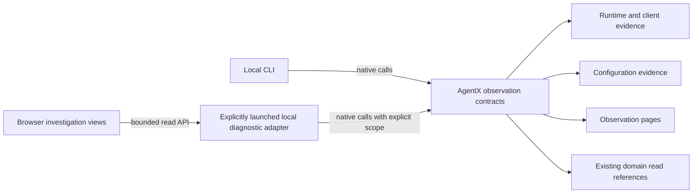

# Observation consumer boundary

This is the selected read-only capability boundary for the [investigations](scenarios.md). The [implementation Delivery](../../.controller/observability/implementation.md) is now authorized and active; its [team contract](../../.controller/observability/implementation-team.md), original Tasks and [native evidence](../../.controller/observability/implementation-evidence/native.md) distinguish source preparation from executable support. The native observation lane and CLI are implemented; their selected local executable results and exact artifact limits belong to the linked native evidence. The implemented [browser adapter contract](browser-api.md), [Web entry](../../web/observability/AGENTS.md) and [independent consumer evidence](../../.controller/observability/implementation-evidence/consumer.md) now supply the selected local HTTP and rendered/interacted investigation results; the completed original consumer Task owns the package/check/cleanup receipt and the Delivery controller owns formal acceptance. Native domain contracts stay with [runtime](runtime.md), [configuration](configuration.md), [events](events.md) and [shared contracts](contracts.md). The Web owns layout/state; additional mutation authority remains outside this consumer.

## Minimum complete consumer

The first consumer is a local CLI path that can report an originating attempt even when no daemon is reachable. It captures only the evidence the actual client owns, resolves the explicitly selected scope, probes an existing compatible daemon and then calls observation reads. It does not use the ordinary command Session path if that path performs identity resolution, participant cleanup, mailbox output confirmation or implicit daemon acquisition. The [engineering map](engineering.md) selects `src/observability/{context,runtime,configuration,events}.rs` as native contract homes and `src/daemon/observation.rs` as the same-lease passive inspection adapter. Their assigned owners now promote those declarations into source; the original Tasks and executable receipts establish actual readiness.

| Step | Capability needed | Owner and boundary |
| --- | --- | --- |
| Capture failure before connect | Originating invocation/attempt and safe local scope/configuration evidence | Runtime/client and configuration; no server timestamp or trusted peer is fabricated |
| Select one scope | Explicit path from the invocation, alias canonicalization and unresolvable-path outcome | Runtime/lifecycle; an absent/unreadable scope must remain a readable failure result |
| Read existing daemon | Native compatibility/identity handshake and bounded snapshot/read operations | Daemon observation adapter; no application SQLite fallback or startup side effect |
| Follow the affected request | Exact reference, stage evidence, retained configuration reference and domain links | Native observation contracts; scope/era/freshness checks precede composition |
| Read/reconnect stream | Bounded page/continuation with exact gap and reset meaning | Events; no browser/CLI-only cursor format |
| Compare evidence | Select retained invocation evidence or explicitly request a new resolution | Configuration; no raw environment dump or hidden-value equality inference |
| Exit or interruption | Release only consumer waits/subscriptions/local handles | CLI/adapter; a read cancellation cannot become a product stop or mutation cancellation |

Current source basis: [`daemon::observation`](../../src/daemon/observation.rs) owns `resolve_existing_scope`, `inspect_existing`, native aggregate envelopes and the retained originating clock. [`InvocationContext::capture_observed`](../../src/service/context.rs) preserves originating input failures as native `LocalFailure` before service flattening, including an unavailable timestamp. [`observe.rs`](../../src/cli/commands/observe.rs) consumes these APIs through cohesive [parser](../../src/cli/commands/observe/args.rs), [client](../../src/cli/commands/observe/client.rs) and [output](../../src/cli/commands/observe/output.rs) leaves. Main/router dispatch precedes ordinary configuration, project reexec, identity, dev-root, updates and Session setup. Source implementation and authored cases are distinct from the independent executable/backend acceptance recorded in the original [diagnostics Task](../../.controller/observability/implementation-tasks/diagnostics.md) and [native evidence](../../.controller/observability/implementation-evidence/native.md).

## Planned CLI surface and output

The selected `agentx observe` surface is now materialized in the [native clap declarations](../../src/cli/commands/observe/args.rs), [entry/help](../../src/cli/commands/observe.rs) and [usage](cli.md). The historical section fragment is preserved for inbound links. An invocation without a subcommand means `inspect`; `relay daemon` retains its independent relay-worker meaning. This source release is not executable or installed support; the [original Task](../../.controller/observability/implementation-tasks/diagnostics.md) and independent evidence govern that distinction.

| Path | Inputs and defaults | Capability and result |
| --- | --- | --- |
| `observe` / `observe inspect` | Family-global `--scope PATH` uses the originating environment/cwd resolver when omitted; `--json` defaults false | Native Runtime Snapshot or local attempted facts/failure; no business readiness inference. |
| `observe request --ref-file FILE` | Required native `RequestObservationRef`; exact selected scope must match | Native RequestDetail or unchanged unavailable/stale/evicted/unsupported outcome. |
| `observe config --ref-file FILE` | Required native retained `ConfigSnapshotRef` | Native immutable Lookup; no reread of current settings. |
| `observe config-current` | Existing selected scope; no daemon contact | Native `capture_current_resolution` with `NativeConfigResolutionSource`; emits safe local DiagnosticReevaluation. |
| `observe compare --left-file FILE --right-file FILE` | Native retained refs plus repeatable `--field NAME`; omission means native All | Native Compare and selection/disclosure policy; expected daemon is not pinned to one operand so native different-era comparison stays visible. |
| `observe events` | Optional native `--window-file FILE`; `--limit` defaults 128, allowed 1..256; `--follow` defaults false | Without window, Describe then Read oldest-1..newest; supplied window is read unchanged. |

`--scope` and `--json` are accepted before/after each leaf. No new ENV or config-file keys are introduced. Explicit scope overrides the existing originating `AGENTX_DIR`/home resolver; relative paths use the originating cwd. Ref/window files must be regular UTF-8 JSON files of at most 32 KiB. Native deserialization and recursive ignored-key detection reject malformed/unknown inputs; positive request/config ref sequences, closed field selectors, duplicate selectors, filter shape and CLI page limits are validated before scope/transport reads. Native event nonce/era/numeric-window policy remains owner-enforced, preserving era-before-frontier semantics. Scope mismatches are rejected before transport, and an operand never selects a second scope. Field selectors use native setting names or the closed `context.FIELD`/`participant.FIELD` forms in the parser; native `validate_selection` stays authoritative.

[`ObserveOutput`](../../src/cli/commands/observe/output.rs) is the consumer-owned framing authority: `{command, requested_scope, scope, local: {inputs, attempt}, result}`. `result` is externally tagged `Inspection(InspectionResult)`, `LocalFailure(LocalFailure)` or `ConfigurationCurrent(Result<LocalConfigSnapshot,CaptureSkipReason>)`. Native enum tags and payloads are embedded unchanged. `scope` is optional native `ScopeLookup`; `local.inputs` is an optional native safe input-capture Result, while `local.attempt` is an optional native Probe/DiscoveryOnly report. Original attempted selection remains separate from canonical scope; the input snapshot describes the original environment/cwd before diagnostic scope selection. No raw InvocationContext/environment is serialized. Known failures keep cause/stage/code even when `at` is null; no report chronology is fabricated when required clock evidence is unavailable.

One-shot JSON is one complete UTF-8 value plus newline. Follow emits the same wrapper as JSON Lines. Whole native refs/windows and u64 values remain exact; no second cursor/opaque-ID namespace exists. Human text retains safe facts, scope/incarnation/generation, producer/receive clocks, capture/retention meaning, unknown/withheld branches and explicit loss. Stderr carries usage/output/follow-stop diagnostics. Exit 0 means a completed read/diagnosis, including native missing/incomparable or a one-shot event gap; it establishes no business success. Local/native rejection uses 1; parser/file/selection rejection uses 2 with empty stdout. Follow emits a gap/changed-era response then exits 1 rather than claiming continuity. SIGINT ends the consumer with 130; detected BrokenPipe stops reads and returns 0.

Follow uses a caller-owned one-second timer and finite native calls; no persistent subscription/pin exists. It repeats a returned immutable `next` while that window remains incomplete, then explicitly tails the same stream under the caller's `--follow` choice. Gap/reset/restart/replacement never triggers automatic rebase. `config-current` alone explicitly rereads the chosen scoped settings through native capture/resolution; retained configuration reads remain historical. No failure triggers daemon start, live SQLite fallback, reconciliation mutation, process stop, report publication or product retry. Original domain recovery reads retain their identity/actor/generation prerequisites and may be unavailable under congestion; [usage/recovery](cli.md#丢失回复后的恢复边界) explains this limit.

## Future local browser composition

Edges describe permitted calls. The local adapter owns browser transport, same-origin admission, disclosure and per-consumer resource bounds. The AgentX daemon remains the only live managed-storage owner. Browser-facing request DTOs must be finite typed mappings of native reads; a generic `Request` tunnel would expose business operations and arbitrary invocation environment beyond this consumer's authority.

Use the existing single executable for an explicitly launched local adapter. Its lifetime is independent of the scope daemon and it does not become a Provider/runtime host. One adapter process serves one explicitly selected scope in the first implementation. No background global discovery, database proxy or telemetry collector is necessary for the selected scenarios. The selected LAN follow-up permits an explicitly bound numeric network interface. Selecting another scope requires a new explicit binding and fresh evidence.

## Browser admission and disclosure decisions

The [LAN usability follow-up](../../.controller/observability/lan-usability.md) selects credential-free direct browser visits and reloads, numeric LAN binding and embedded compiled assets. It supersedes the original bootstrap/session and loopback-only restrictions. The maintained [exact browser contract](browser-api.md) owns launch flags, scope discovery, native mapping, wire precision, origin checks and all finite transport budgets; use it instead of duplicating those declarations here.

The local operator selects one scope at launch. Each page connects independently without credentials, while Host/Origin must match the actual numeric interface receiving the connection and its bound port. No arbitrary DNS Host trust or cross-origin allowance is supplied. Shared native types, retention and safe disclosure remain their original owners' authority. Browser PID/environment/actor claims never grant native process authority. The [HTTP source](../../src/observability/web/AGENTS.md) owns these mappings, and the controller records independent execution in the LAN follow-up.

| Browser capability | Native supply and required mapping | Excluded authority |
| --- | --- | --- |
| Inspect daemon | Runtime `Snapshot`, original daemon/ref/time/coverage and structured local failure | No daemon acquire/start, host census or global healthy boolean |
| Find/follow request | Runtime finite Requests/RequestDetail/Connections/Peers/Hosts reads with exact refs and native list limits | No generic `Request`/argv route, PID lookup authority or arbitrary host/process inspection |
| Explain configuration | Configuration Head/Lookup/Compare with exact native safe operands/results/errors | No ReportSafeCapture, current-client re-evaluation, raw environment or arbitrary file/key lookup from a browser |
| Read correlated stream | Events Describe/Read; complete immutable window and native result/error/loss variants | No PublishObservation, business subscription, durable archive cursor conversion or receipt mutation |
| Resolve a domain evidence link | Only separately declared permitted existing native read with its original scope/actor/generation prerequisites | No fabricated privileged actor, automatic confirmation, retry, claim release or universal historical receipt lookup; unavailable prerequisites yield a visible unavailable link |

Paths accepted as approved returned diagnostic values do not become filesystem-read capabilities. The scope is selected at local adapter launch and is not an arbitrary browser request operand. The API may group related native read results for presentation only when each retains its identity, stamp and failure branch; it must not advertise a cross-owner atomic snapshot.

Only the configuration owner's safe disclosure projection and bounded event/runtime payloads cross into the browser. No environment map, Provider credentials, actor capability, host token, command payload, arbitrary file reader or raw SQL endpoint is included. The numeric same-origin boundary controls browser admission; native field-level disclosure determines what this consumer may see.

These are adapter requirements, not invented shared domain guarantees. Exact browser wire DTOs and generated bindings must be derived after the native contracts are implemented and verified. If the selected existing HTTP/origin/binding tooling cannot enforce these obligations, return the concrete gap to the owning adapter Task rather than using a permissive mock.

## Lifetime and failure behavior

| Resource | Owner and end | Consumer-visible result |
| --- | --- | --- |
| CLI local attempt | Originating process; retained/exported only through explicit safe output | Available without server evidence; time/process claims keep their provenance |
| Native read or long poll | Calling adapter and events/runtime provider; bounded deadline/cancellation | Cancel only the wait. Transport loss remains distinct from an empty result or domain failure. |
| Browser connection | Local adapter process or page; adapter exit or page close | Disconnect prevents fresh reads; already shown evidence remains historical with its original identity/freshness |
| Observation cursor and local polling timer | Native events owner for cursor; consumer for timer | No server subscription or pin exists in the selected stream contract. Gaps/stream replacement/restart/reset follow exact native outcomes; reconnect never fabricates continuity. |
| View selection and cached facts | Browser application | Preserve scope/request selection across detail navigation; changing scope or era retires incompatible cached facts |
| Product participant/Provider execution | Existing domain owner | Independent of consumer disconnection, navigation or adapter shutdown |

Offline browser behavior is limited to already loaded, safely disclosed evidence. No service worker, persistent offline telemetry store or background capture is required. Local-adapter unavailable and daemon unavailable are different states. Cached evidence may support a historical claim but not current health. The CLI remains the minimum usable path before Web work.

## Implementation release gate

The browser work becomes ready only after native reads and the CLI investigation slice have executable evidence, and the local adapter supplies callable routes and rejected/failure branches under the same safe scope/era/disclosure rules. [Implementation work](implementation-plan.md) and its [Delivery](../../.controller/observability/implementation.md) own the exact result contracts, write assignments and integration gate. No design-only acceptance here is a deployment or live-scope authorization.
