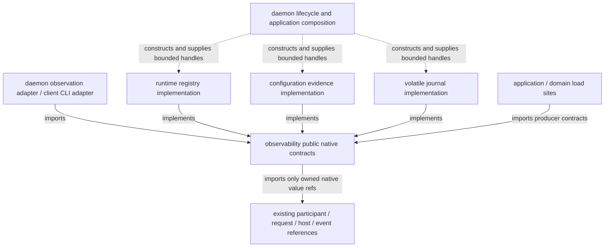

# Observation engineering map

## Support and structure decision

This is the selected source map for the active implementation. Shared [`context.rs`](../../src/observability/context.rs), the [`module facade`](../../src/observability/mod.rs) and [`native guidance`](../../src/observability/AGENTS.md) are materialized; owner Tasks and independent integration evidence govern all other behavior/support claims. Existing source stays in place. `src/runtime/` continues to own actual launch/PTY/host effects; `src/observability/` owns bounded evidence about those effects. Native contracts live with the capability that owns meaning; the daemon supplies transport/lifecycle adapters and the executable/application entry composes them.

```text
src/observability/
  mod.rs                 public facade; narrow capability exports
  context.rs             shared refs, evidence classes and clock units
  runtime.rs             runtime/client query and producer contracts
  registry.rs            private bounded runtime snapshots and counters
  configuration.rs       capture/resolution/provenance/query contracts
  configuration_store.rs private bounded immutable captures and snapshots
  events.rs              stream/sink/query/cursor/gap contracts
  journal.rs             private bounded volatile observation retention
  AGENTS.md              native owners, invariant and maintenance routes
src/daemon/
  observation.rs         passive authenticated inspection adapter/lifecycle
  wire.rs                native observation envelopes, no second schema
  server.rs              lifecycle wiring and bounded observation hooks
src/service/
  context.rs             existing invocation/request authority; additive refs only
  application.rs         domain operation composition and resolution capture
  client.rs              origin capture/attempt association; no DB fallback
src/main.rs              existing one-binary composition only
```

These are ownership homes, not a requirement that every private file exist before behavior warrants it. A coherent implementation may keep small private helpers in their owning file; preserve the public native homes above so parallel work has a stable destination. No crate split, general repository framework, dependency container or global `models` directory is selected.

## Dependency and composition



Solid arrows are planned source dependencies; dotted arrows are runtime construction/wiring. `observability` contracts do not import `daemon` internals, `AgentxDb`, CLI parser, Provider frame or browser/HTTP framework. Domain code is not made dependent on the concrete registry/journal; composition supplies a narrow producer handle where the observation contract requires it. Shared `context.rs` imports standard value types only. Runtime/configuration/events modules may use shared context and existing domain value refs; they do not import each other's private stores.

The daemon lifecycle constructs one inspection adapter and bounded stores for the actual lease, before claiming observation availability. The ordinary Application remains the sole live managed-storage owner. Runtime supplies snapshot readers to inspection; configuration and event queries operate on bounded already-published evidence, never call Application/SQLite on an inspection worker. Application resolution capture occurs at the actual domain resolution point and is published after the relevant result is known. The runtime owner defines exact publication and stop/join ordering; no observer may outlive its owning lease.

The inspection aggregate contains only the owners' finite runtime, retained-configuration and event read operations plus their explicitly restricted safe originating-report intake. Report retention is bounded volatile evidence, never a business mutation or a new source of trusted domain facts. A new configuration resolution is not silently executed on that lane: if it needs domain/file/application work it must follow its explicit offering and availability semantics. Event follow is repeated bounded reads with client-side timer/backoff; no persistent subscription or wait occupies the inspection workers. Native aggregate declarations belong in `daemon/observation.rs` as adapter composition of the domain enums, not new editable copies of leaf declarations.

An inspection handshake reports observation availability separately from ordinary application `Ready`. Unknown generation permits daemon/process evidence; it never produces a fabricated dataset epoch. Separate observation admission and resource budgets must remain useful when ordinary workers/jobs are exhausted. Querying is passive: do not reuse a client acquisition path that spawns a daemon, creates data scope, migrates storage or retries a mutation.

### Epoch publication and concurrent reads

The existing application/durable key plus its fail-closed generation mirror remain the only generation authority. Instrumentation receives the exact published epoch; it cannot create another generation from a telemetry counter or file. On reset, the maintenance owner commits replacement and publishes the new generation by its existing contract. Runtime/configuration/events retire generation-bound projections and old producer handles before claiming any new-epoch evidence. The independent inspection lane may return explicitly unavailable/transitioning evidence while that publication is incomplete; it must not relabel old rows with a new epoch. Old snapshots may remain historical only where their owner explicitly permits a lookup with the old reference.

Every response identifies its capture epoch/clock; no cross-store atomic snapshot is promised. Bounded readers validate the selected epoch and either return an internally consistent owner snapshot or the owner's stale/changed/unavailable result when a reset wins the race. An old-epoch queued/late input may publish an advisory late outcome only under the original fence; it must never re-create current-generation state. Generation invalidation/poisoning stops claims of current dataset evidence. Process-level failure/lifecycle evidence may still use `DaemonRef` within the remaining lease lifetime, subject to the runtime stop contract. Domain implementations must choose actual synchronization that enforces these rules without waiting for telemetry in a business transaction; a diagram/type alone is not that mechanism.

## Representation ownership

| Representation | Owner and mapping obligation |
| --- | --- |
| Native domain contracts | Existing modules own business IDs/rules; planned `observability/{context,runtime,configuration,events}.rs` own new typed observation facts and operations. |
| Local IPC | Daemon frames embed/derive native declarations through existing serde; lifecycle/authentication/size/deadline rules remain daemon-owned. No parallel hand-edited JSON operation schema. |
| Storage | Private bounded observation stores hold only projected/captured evidence. Existing SQLite history/receipt adapters retain domain retention and transaction authority. |
| CLI and eventual Web | Integration's [consumer boundary](consumer-boundary.md) selects only needed operations and typed mappings. Presentation cannot open live SQLite or define alternative health/effect rules. A future browser transport must have explicit hosting, authentication/disclosure and schema authority before implementation. |

Byte limits apply to the **complete encoded routed response**, including the inspection aggregate and Result/enum/window/head overhead. Leaf page builders must reserve that actual outer-envelope cost before adding another item; two nominally equal 512 KiB budgets do not authorize a 512 KiB leaf plus extra wrapping. Size admission and transport serialization use the same capped serde representation. Return the owner's explicit oversize/invalid-input outcome when a valid envelope cannot fit, and never send a silently partial identity or success page.

## Context and change maintenance

From root `AGENTS.md` follow the [feature entry](README.md), [artifact catalog](.xmeta.yaml), owning design, [native module guide](../../src/observability/AGENTS.md), [implementation tasks](../../.controller/observability/implementation.md), and [design acceptance](acceptance.md). Native guides link to current contracts, owner-authored cases and independent execution evidence. Discoverability and native declarations do not themselves establish implemented/verified consumer behavior.

| Change trigger | Owning update | Required consuming updates |
| --- | --- | --- |
| Shared scope/epoch/time/unknown meaning | Architecture; then native `context.rs` after promotion | Runtime/config/events mappings, consumer fence and time comparisons, affected scenarios; revisit all uses before changing semantics. |
| Request/connection/host transition or pressure bound | Runtime owner | Native `runtime.rs`, registry and daemon hooks/adapter; events payload/correlation consumers and scenarios. |
| Configuration loader/precedence/context or disclosure | The actual configuration/domain resolver and configuration evidence owner | Capture/load-site mapping, snapshot provenance, safe adapters and comparison cases; never copy loader policy into telemetry. |
| Event ordering/cursor/gap/retention | Events owner | Native `events.rs`, journal and query adapters; runtime/config producer mappings and consumer gap/reset cases. |
| Existing business operation or durable schema/receipt promise | Existing business domain owner | Observation refs/classification and scenario expectations only where the source promise changes. |
| Browser/CLI output or endpoint hosting | Integration/adapter owner | Native-to-consumer mapping, disclosure/context/compatibility and bounded failure behavior; no new domain authority. |
| Declaration promoted to native source | Implementing owner of that declaration | Remove the design signature block, retain semantic explanation, replace it with source links; update module guide and catalog/feature route once. |

Changes proceed contract → producer/implementation → mapping → consumer → affected scenario/evidence. One owner edits each declaration; bounded transfers cover real shared modifications. Keep implementation state in original Tasks/Delivery, fixed-artifact evidence in its acceptance source, and enduring meaning here/native contracts. Do not maintain a second API catalog, duplicate Task statuses or copy complete native structs into Markdown after promotion.

## Implementation handoff obligations

Integration assigns dependency-correct work using this map and the domain offerings. Shared native values come first; independently implementable runtime/config/events contracts and stores follow; daemon/client composition consumes those releases; bounded consumer adapters and then Web consume callable contracts. Exact shared-file regions (`wire.rs`, `server.rs`, `service/context.rs`, `application.rs`, `client.rs`, `main.rs`) require an assigned sole writer or explicit transfer; multiple domain owners must not concurrently rewrite them.

The implementation must exercise busy dispatcher/worker isolation, same/different epoch joins, client-only failure evidence, reset/restart fencing and pressure/eviction limits. This design batch runs no compilers, product commands or runtime probes. Independent integration owns the smallest document/contract checks and resulting scope-limited evidence.
